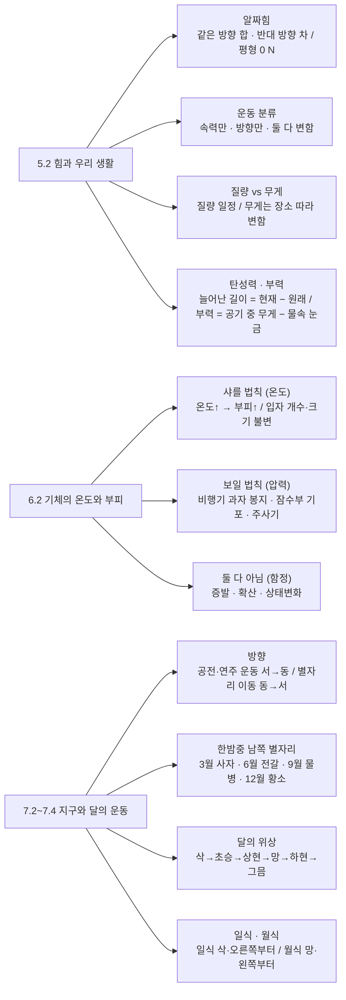
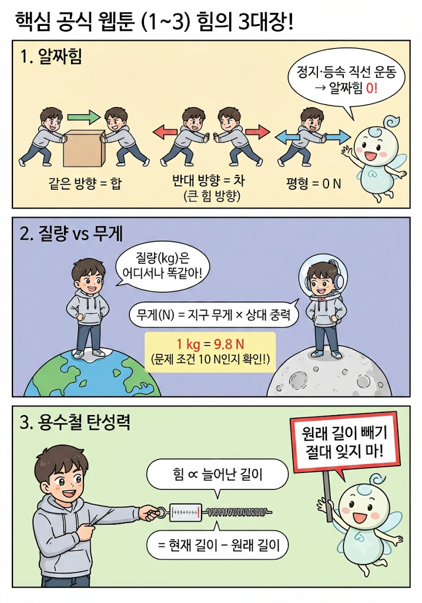
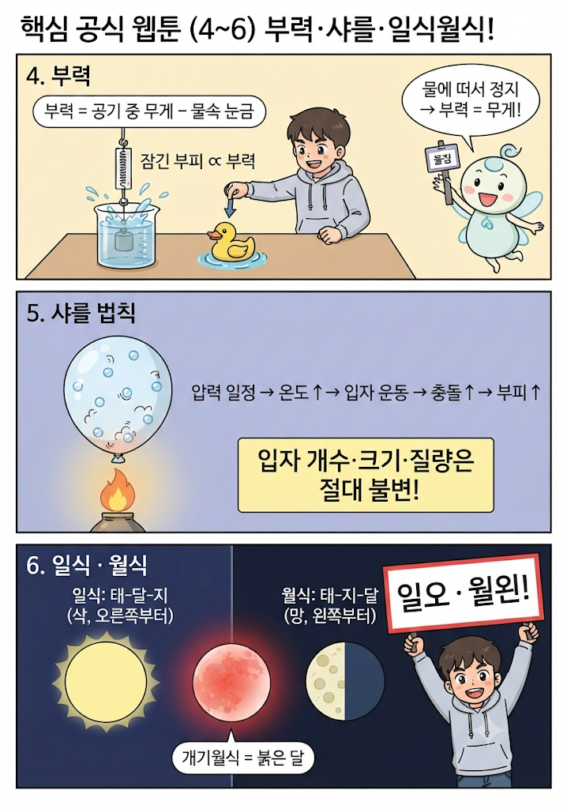
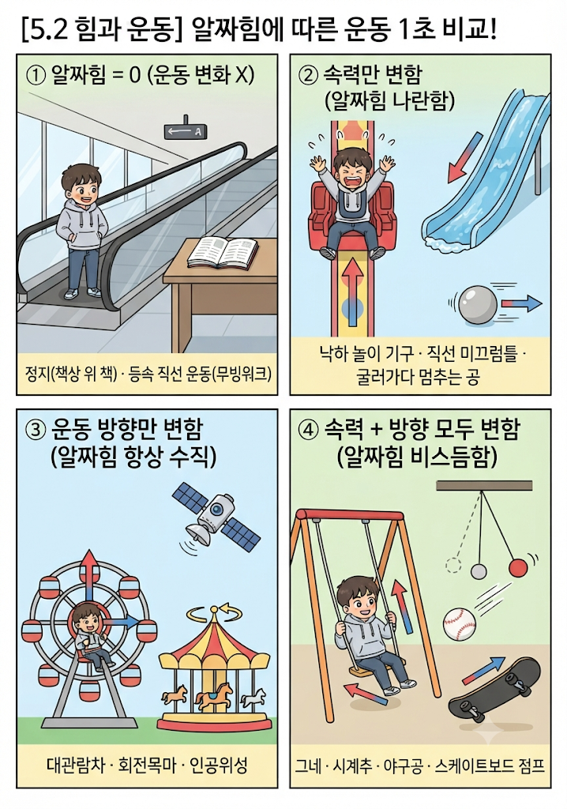
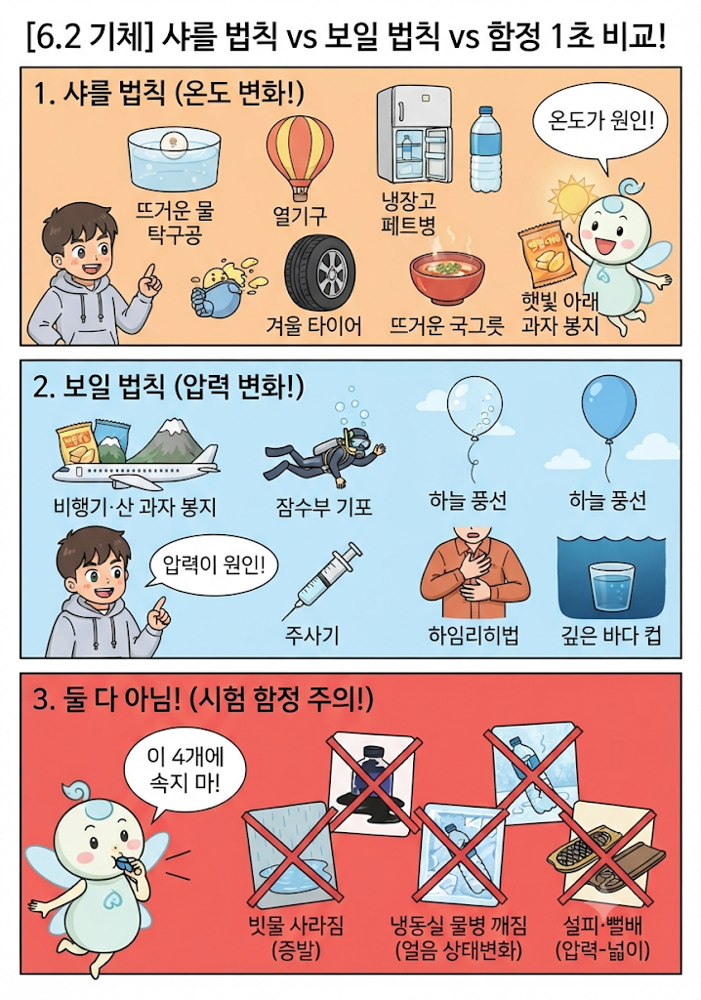
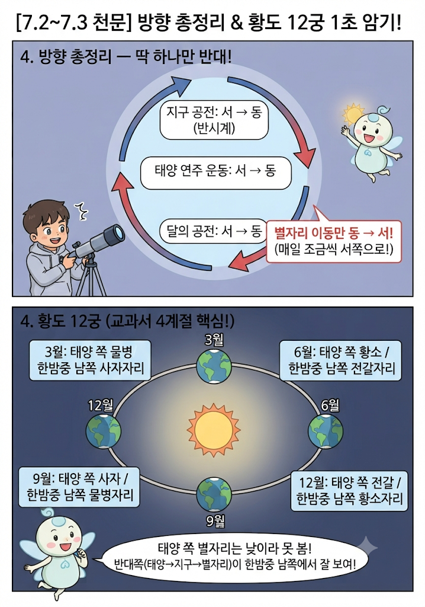
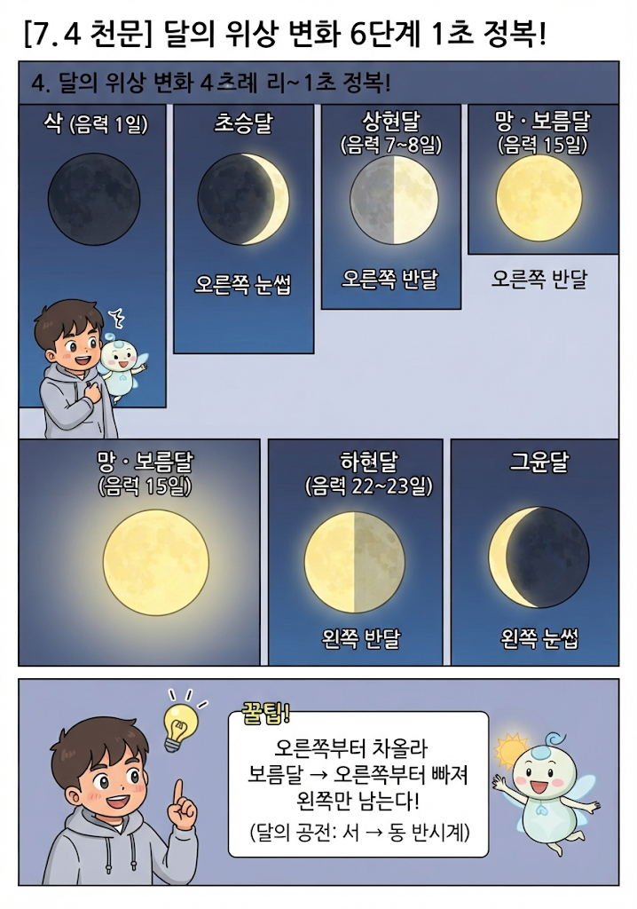
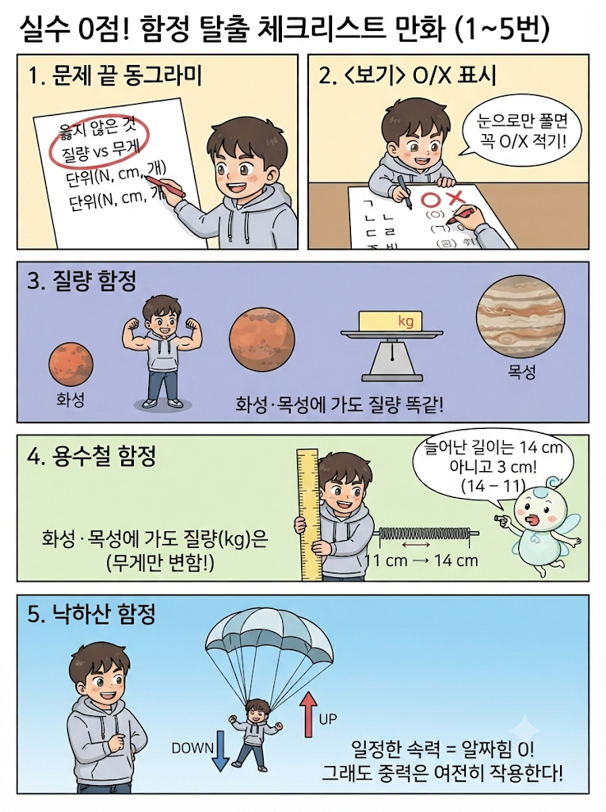
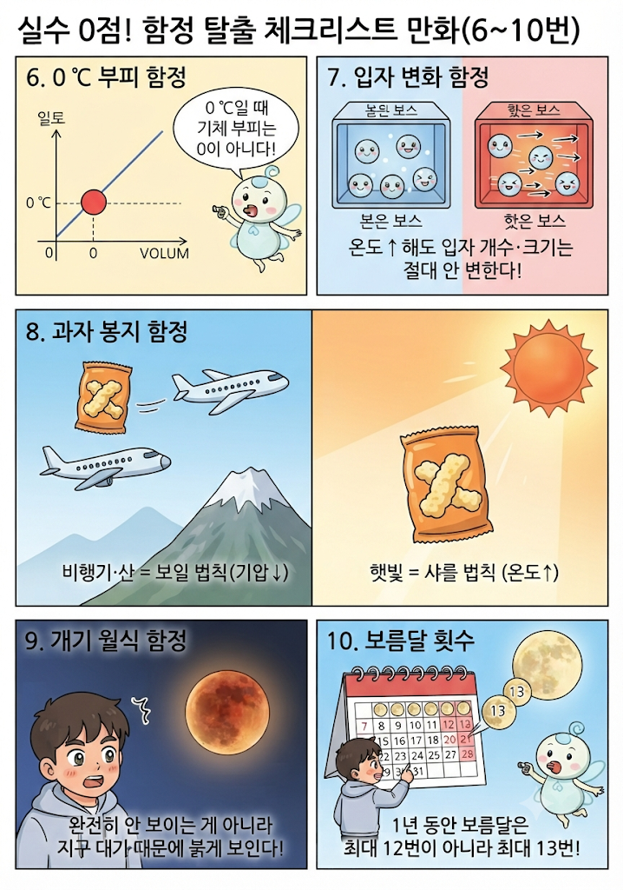

# ⚡ 시험 직전 10분 최종 치트시트 — 2026 7학년 2학기 2회고사 과학

> **시험 전날 밤 & 시험 직전 쉬는 시간용 1장 압축본**  
> **범위**: 5.2 힘과 우리 생활 · 6.2 기체의 온도와 부피 · 7.2~7.4 지구와 달의 운동

---

## 🧠 마인드맵 정리

---

## 1️⃣ 절대 잊지 말아야 할 핵심 공식 6개

| 번호 | 개념 | 공식 / 핵심 규칙 | 단위·주의 |
| :---: | :--- | :--- | :--- |
| **1** | **알짜힘** | 같은 방향 = **합** / 반대 방향 = **차** (큰 힘 방향) / 평형 = **0 N** | 정지·등속 직선 운동 → 알짜힘 **0** |
| **2** | **질량 vs 무게** | **질량(kg)**: 장소 무관 **일정** / **무게(N)** = 지구 무게 × 상대 중력 | $1\text{ kg} = 9.8\text{ N}$ *(문제 조건 $10\text{ N}$인지 확인!)* |
| **3** | **용수철 탄성력** | 힘 $\propto$ **늘어난 길이** (= 현재 길이 − **원래 길이**) | 원래 길이 빼는 것 절대 잊지 말기! |
| **4** | **부력** | $\text{부력} = \text{공기 중 무게} - \text{물속 눈금}$ (잠긴 부피 $\propto$ 부력) | 물에 떠서 정지 → **부력 = 무게** |
| **5** | **샤를 법칙** | 압력 일정 → 온도 ↑ ⇒ 입자 운동 ↑ ⇒ 충돌 횟수·세기 ↑ ⇒ 부피 ↑ | **입자 개수·크기·질량은 절대 불변!** |
| **6** | **일식 · 월식** | **일식**: 태-달-지 (**삭**, **오른쪽**부터) / **월식**: 태-지-달 (**망**, **왼쪽**부터) | **『일오 · 월왼』**, 개기월식 = **붉은 달** |

---

## 2️⃣ 단원별 1초 비교표

### [5.2 힘과 운동] 알짜힘에 따른 운동 분류
- **알짜힘 = 0**: 정지(책상 위 책), 등속 직선 운동(**무빙워크**)
- **속력만 변함** *(알짜힘 나란함)*: **낙하 놀이 기구**, 직선 미끄럼틀, 굴러가다 멈추는 공
- **운동 방향만 변함** *(알짜힘 항상 수직)*: **대관람차, 회전목마, 인공위성**
- **속력 + 운동 방향 모두 변함** *(알짜힘 비스듬함)*: **그네, 시계추, 야구공, 스케이트보드 점프**

### [6.2 기체] 샤를 법칙 vs 보일 법칙
- **샤를 법칙 (온도 변화)**: 찌그러진 탁구공(뜨거운 물), 열기구, 냉장고 페트병, 겨울 타이어, 뜨거운 국그릇(움직임·랩 오목), 햇빛 아래 과자 봉지
- **보일 법칙 (압력 변화)**: 비행기·높은 산 과자 봉지, 잠수부 기포, 하늘 높이 올라간 풍선, 주사기, 하임리히법, 깊은 바다 스타이로폼 컵
- **둘 다 아님 (함정!)**: 빗물 사라짐(**증발**), 잉크 퍼짐(**확산**), 냉동실 물병 깨짐(**얼음 상태변화**), 설피·뻘배(**압력-넓이**)

### [7.2~7.4 천문] 방향 & 별자리 & 달
- **방향 총정리**:
  - 지구 공전 = **서 → 동** (반시계)
  - 태양의 연주 운동 = **서 → 동** (별자리 기준)
  - 별자리의 이동 = **동 → 서** (태양 기준, 매일 조금씩 서쪽으로!)
  - 달의 공전 = **서 → 동** (반시계)
- **황도 12궁 (교과서 기준)**:
  - **3월**: 태양 쪽 물병자리 / 한밤중 남쪽 **사자자리**
  - **6월**: 태양 쪽 황소자리 / 한밤중 남쪽 **전갈자리**
  - **9월**: 태양 쪽 사자자리 / 한밤중 남쪽 **물병자리**
  - **12월**: 태양 쪽 전갈자리 / 한밤중 남쪽 **황소자리**
  - *(※ 지구→태양→별자리 = 낮이라 못 봄 / 태양→지구→별자리 = 한밤중 남쪽에서 잘 보임!)*
- **달의 위상 순서**: **삭**(음력 1일) → **초승**(오른쪽 눈썹) → **상현**(음력 7~8일, **오른쪽** 반달) → **망/보름달**(음력 15일) → **하현**(음력 22~23일, **왼쪽** 반달) → **그믐**(왼쪽 눈썹)

---

## 3️⃣ ⚠️ 아들을 위한 「실수 0점」 함정 탈출 체크리스트 10선

지난 1회고사 분석을 바탕으로, **알면서 틀리기 딱 좋은 함정 10가지**만 모았습니다!

1. **[문제 끝 동그라미]** "옳은 것" vs "옳지 **않은** 것", "질량" vs "무게", "단위(N, cm, 개)" 확인했나?
2. **[`<보기>` O/X 표시]** ㄱ·ㄴ·ㄷ·ㄹ 옆에 반드시 하나씩 **O / X** 표시한 뒤 선지 고르기!
3. **[질량 함정]** 화성·목성에 가도 **질량(kg)은 똑같다!** (무게만 변한다!)
4. **[용수철 함정]** 11 cm → 14 cm이면 늘어난 길이는 14 cm가 아니라 **3 cm**!
5. **[낙하산 함정]** 일정한 속력으로 내려오면 알짜힘은 0이지만, **중력은 여전히 작용한다!**
6. **[0 ℃ 부피 함정]** 샤를 법칙 그래프에서 **0 ℃일 때 기체의 부피는 0이 아니다!**
7. **[입자 변화 함정]** 온도가 올라가도 **입자의 개수·크기는 절대 안 변한다!**
8. **[과자 봉지 함정]** **비행기/산** = 보일 법칙(기압 ↓) vs **햇빛** = 샤를 법칙(온도 ↑)!
9. **[개기 월식 함정]** 개기 월식 때 달은 완전히 안 보이는 게 아니라 **지구 대기 때문에 붉게 보인다!**
10. **[보름달 횟수]** 1년 동안 보름달은 최대 12번이 아니라 **최대 13번**까지 볼 수 있다!

