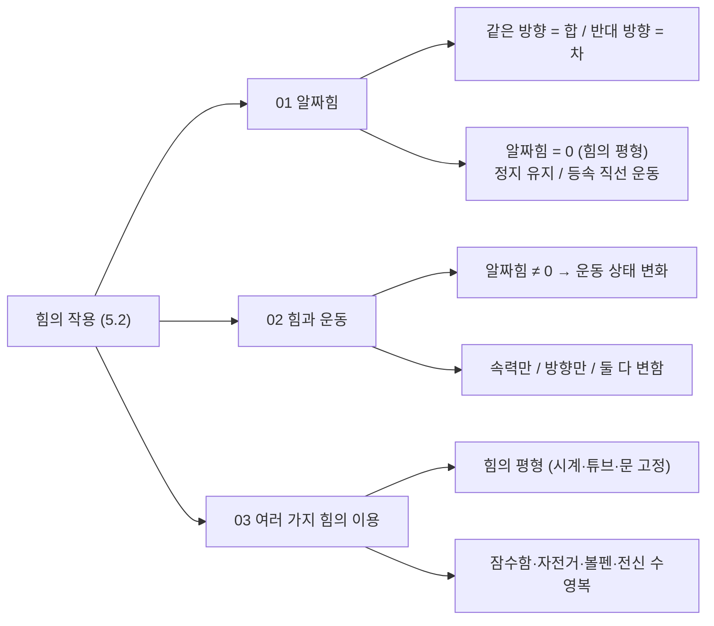
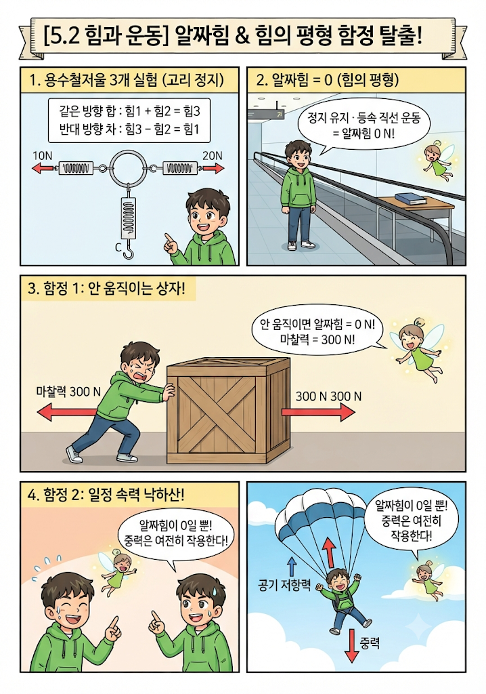
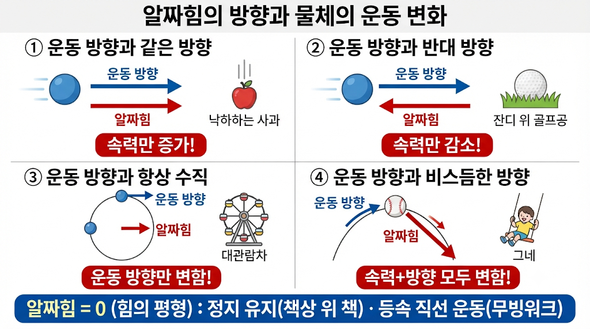
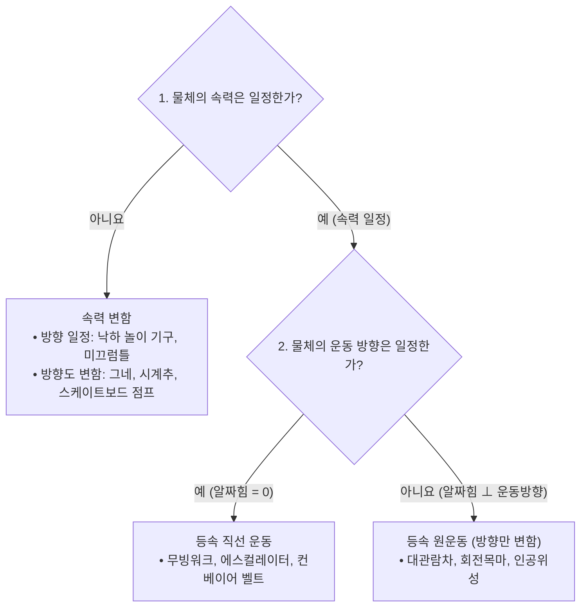
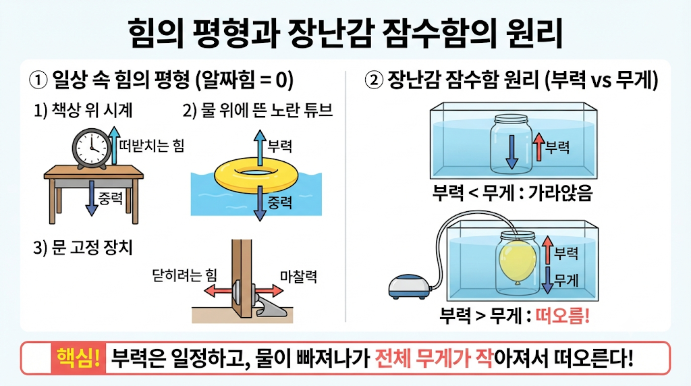
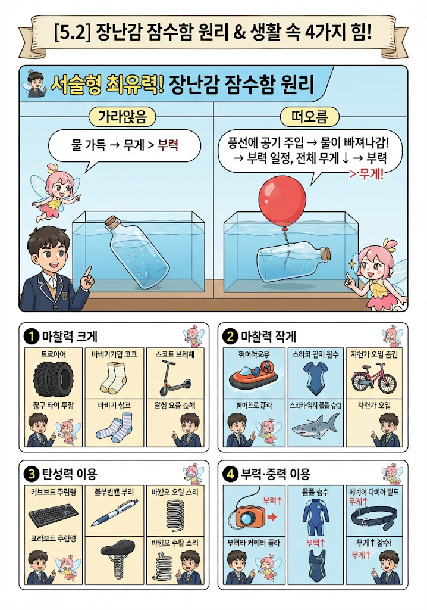
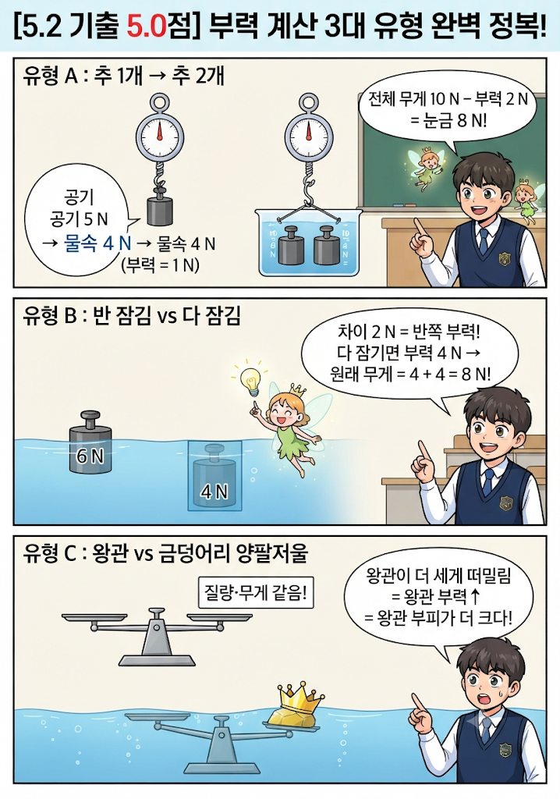
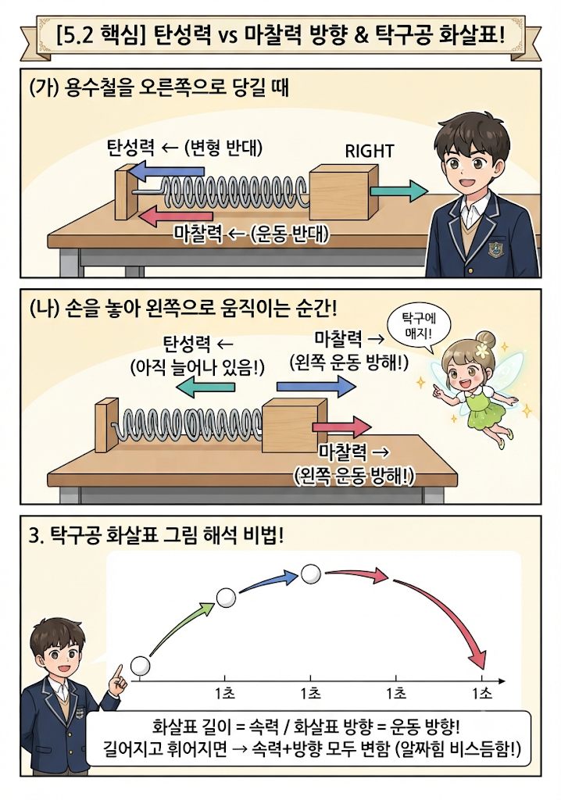

# 📘 5.2 힘과 우리 생활 — 시험 완벽 정리

> **교과서 범위**: p.172 ~ 189 (V. 힘의 작용 — 2. 힘과 우리 생활)  
> **연계 기출**: 2025학년도 KIS 7학년 2학기 2차 지필평가 (1~8번, 고배점 5.0점 문항 다수!)  
> **학습 목표**: 알짜힘 구하기 · 알짜힘에 따른 운동 분류 · 일상생활 속 힘의 평형과 힘의 이용 설명하기

---

## 🎯 한눈에 보는 단원 지도

---

## 01. 알짜힘과 힘의 평형 (교과서 p.174~175)

> 🎬 **개념 몽타주 영상 (1분 51초)** — 알짜힘 구하기 · 힘의 평형 · 함정 2가지을 한 번에 정리해요.

<video controls preload="metadata" playsinline poster="exam/%EA%B3%BC%ED%95%99_%EC%8B%9C%ED%97%98%EA%B3%B5%EB%B6%80/videos/sci_01_netforce_poster.jpg" src="exam/%EA%B3%BC%ED%95%99_%EC%8B%9C%ED%97%98%EA%B3%B5%EB%B6%80/videos/sci_01_netforce.mp4" style="width:100%;max-width:960px;border-radius:12px;display:block;margin:0 auto 1em;background:#000"></video>

### 1) 알짜힘이란?
- 한 물체에 **여러 힘이 동시에 작용할 때, 이 모든 힘을 합한 힘**을 **알짜힘**이라고 한다.

### 2) 나란하게 작용하는 두 힘의 알짜힘 구하기

| 경우 | 두 힘의 방향 | 알짜힘의 크기 | 알짜힘의 방향 | 예시 |
| :--- | :--- | :--- | :--- | :--- |
| **(가) 같은 방향** | 같은 방향 (`→`, `→`) | 두 힘의 **합** ($F_1 + F_2$) | 두 힘의 방향과 같음 | 오른쪽 6 N + 오른쪽 3 N = **오른쪽 9 N** |
| **(나) 반대 방향** | 반대 방향 (`←`, `→`) | 두 힘의 **차** (큰 힘 − 작은 힘) | **더 큰 힘의 방향** | 오른쪽 6 N − 왼쪽 3 N = **오른쪽 3 N** |
| **(다) 크기 같고 반대 방향** | 반대 방향 (`←`, `→`) | **0 N** ($F - F = 0$) | 방향 없음 (**힘의 평형**) | 오른쪽 3 N − 왼쪽 3 N = **0 N** |

> 🔑 **교과서 실험 핵심 (p.175 용수철저울 3개 실험)**  
> 고리가 **움직이지 않을 때(힘의 평형)**:  
> - 같은 방향의 두 힘의 합: $\text{힘}_1 + \text{힘}_2 = \text{힘}_3$  
> - 반대 방향 두 힘의 차: $\text{힘}_3 - \text{힘}_2 = \text{힘}_1$

### 3) 알짜힘이 0일 때의 운동 (힘의 평형)
물체에 작용하는 알짜힘이 **0**이면 물체는 **힘의 평형** 상태에 있어 **속력과 운동 방향이 모두 변하지 않는다.**
- **정지해 있던 물체** → 계속 **정지**해 있다. *(예: 책상 위에 놓인 책, 시계, 상자를 300 N으로 밀어도 움직이지 않을 때)*
- **운동하던 물체** → **일정한 방향과 속력**으로 계속 운동한다(등속 직선 운동). *(예: 무빙워크, 에스컬레이터, 낙하산을 편 뒤 일정한 속력으로 내려오는 스카이다이버)*

> ⚠️ **실수 방지 체크 #1 — "움직이지 않는다" / "일정한 속력이다" = 알짜힘 0!**
> - **함정 1**: *"상자를 오른쪽으로 300 N으로 밀었는데 움직이지 않았다. 마찰력과 알짜힘은?"*  
>   → 움직이지 않았으므로 **알짜힘 = 0 N**, 밀어낸 힘과 평형을 이루는 **마찰력 = 300 N(왼쪽)**! (교과서 p.185 2번)
> - **함정 2**: *"낙하산을 편 스카이다이버가 일정한 속력으로 내려온다. 중력이 작용하지 않는다?"*  
>   → **틀림(X)!** 중력은 **여전히 작용**하고, 공기 저항력(위쪽)과 중력(아래쪽)의 크기가 같아서 **알짜힘이 0**인 것이다! (교과서 p.187 5번)

---

## 02. 힘과 운동 (교과서 p.176~179)

> 🎬 **개념 몽타주 영상 (1분 44초)** — 알짜힘 방향에 따른 4가지 운동 · 운동 분류 순서도을 한 번에 정리해요.

<video controls preload="metadata" playsinline poster="exam/%EA%B3%BC%ED%95%99_%EC%8B%9C%ED%97%98%EA%B3%B5%EB%B6%80/videos/sci_02_motion_poster.jpg" src="exam/%EA%B3%BC%ED%95%99_%EC%8B%9C%ED%97%98%EA%B3%B5%EB%B6%80/videos/sci_02_motion.mp4" style="width:100%;max-width:960px;border-radius:12px;display:block;margin:0 auto 1em;background:#000"></video>

### 1) 알짜힘이 0이 아닐 때 운동 상태의 변화 ⭐ KIS 기출 적중!

물체에 작용하는 **알짜힘이 0이 아니면** 물체의 운동 상태(속력 또는 운동 방향)가 변한다.

| 운동 방향과 알짜힘의 관계 | 속력 변화 | 운동 방향 변화 | 대표 예시 |
| :--- | :---: | :---: | :--- |
| **① 같은 방향** | **점점 증가** (빨라짐) | 변하지 않음 | 낙하하는 공, 낙하 놀이 기구, 직선 물 미끄럼틀, 빨대로 진행 방향에 바람 불기 |
| **② 반대 방향** | **점점 감소** (느려짐) | 변하지 않음 | 잔디 위를 굴러가는 골프공(마찰력), 브레이크 밟은 자동차, 위로 던져 올린 공 |
| **③ 항상 수직** *(힘의 크기 일정)* | 변하지 않음 (일정) | **운동 방향만 변함** | **대관람차, 회전목마, 인공위성(등속 원운동)** |
| **④ 비스듬한 방향** | **변함** | **변함** *(둘 다 변함!)* | **그네, 시계추, 야구방망이로 친 야구공, 스케이트보드 점프, 비스듬히 던진 공** |

### 2) 시험 단골! 운동 분류 순서도 완벽 암기 ⭐ (2025 KIS 기출 8번 · 교과서 p.188 9번)

> ⚠️ **실수 방지 체크 #2 — 탁구공 화살표 그림 해석 (2025 KIS 기출 7번 · 교과서 p.188 8번)**  
> 1초 간격으로 찍은 탁구공 그림에서 **화살표의 길이 = 속력**, **화살표의 방향 = 운동 방향**이다.
> - 화살표가 **점점 길어지고(또는 짧아지고)** + **휘어지면** → **속력과 운동 방향이 모두 변함**!
> - 따라서:
>   1. 알짜힘은 **0이 아니다**.
>   2. 알짜힘은 운동 방향과 **비스듬한 방향**으로 작용했다.

---

## 03. 여러 가지 힘의 이용 (교과서 p.180~183)

> 🎬 **개념 몽타주 영상 (1분 37초)** — 장난감 잠수함 원리 · 마찰력·탄성력·부력·중력의 이용을 한 번에 정리해요.

<video controls preload="metadata" playsinline poster="exam/%EA%B3%BC%ED%95%99_%EC%8B%9C%ED%97%98%EA%B3%B5%EB%B6%80/videos/sci_03_forces_poster.jpg" src="exam/%EA%B3%BC%ED%95%99_%EC%8B%9C%ED%97%98%EA%B3%B5%EB%B6%80/videos/sci_03_forces.mp4" style="width:100%;max-width:960px;border-radius:12px;display:block;margin:0 auto 1em;background:#000"></video>

### 1) 일상생활 속 힘의 평형 (교과서 p.180 그림 21)

| 물체 | 아래/한쪽으로 작용하는 힘 | 반대 방향으로 평형을 이루는 힘 | 상태 |
| :--- | :--- | :--- | :--- |
| **책상 위 시계** | 중력 (아래) | 책상이 시계를 **떠받치는 힘** (위) | 정지 (알짜힘 0) |
| **물에 뜬 튜브** | 중력 (아래) | 물이 밀어 올리는 **부력** (위) | 정지 (알짜힘 0) |
| **문 고정 장치** | 문이 닫히려는 힘 | 바닥과의 **마찰력** | 정지 (알짜힘 0) |

### 2) 탐구 집중! 장난감 잠수함의 원리 (교과서 p.181) ⭐ 서술형 최유력!
잠수함은 내부 물탱크에 물을 채우거나 비워서 **전체 무게**를 조절해 가라앉거나 뜬다.

| 상태 | 집기병 내부 변화 | 부피(잠긴 부피) & 부력 | 집기병 전체 무게 | 힘의 크기 비교 & 결과 |
| :--- | :--- | :--- | :--- | :--- |
| **가라앉아 있을 때** | 집기병에 물이 가득 참 | 부력 일정 | 무게가 큼 | **부력 < 무게** → 가라앉음 |
| **풍선에 공기를 넣을 때** | 풍선이 부풀면서 **집기병 속 물이 빠져나감** | 집기병 전체 부피는 같으므로 **부력 일정** | 물이 빠져나가 **무게가 작아짐** | **부력 > 무게** → **떠오름!** |

> 💡 **서술형 모범 답안 (교과서 p.181 정리 3번)**  
> *"풍선에 공기를 넣으면 풍선이 부풀면서 집기병 속 물이 빠져나가 **집기병 전체의 무게(중력)가 작아지고**, 위로 작용하는 **부력이 무게(중력)보다 커지므로** 집기병이 떠오른다."*

### 3) 생활 속 기구·장치에 이용된 힘 총정리 (교과서 p.180~189)

| 힘의 종류 | 생활 속 기구 및 원리 |
| :--- | :--- |
| **마찰력 크게** | • **아기 양말 바닥 고무**, **킥보드 울퉁불퉁한 손잡이·미끄럼 방지 바닥·브레이크** • **자전거 페달**, **병따개 고무**, **볼펜 고무 손잡이** • **트랙터 바퀴**(진흙·흙길에서 미끄러지지 않도록 **홈이 깊고 거칠게** 만듦) |
| **마찰력 작게** | • **자전거 핸들 회전축 윤활유** • **공기 부양선**(프로펠러 바람으로 땅에서 떠서 지면 마찰력을 줄임) • **전신 수영복**(상어 비늘 모양 돌기로 물과의 **마찰력을 줄임**) |
| **탄성력 이용** | • **키보드 자판 속 용수철**(눌렀다 떼면 원래대로 되돌아옴) • **자전거 안장 아래 용수철**(충격 흡수), **킥보드 용수철**, **볼펜 속 용수철** |
| **부력·중력 이용** | • **수중 카메라**(부피가 크고 가벼운 물체로 감싸 **부력을 크게** 함) • **전신 수영복**(물에 잘 뜨는 소재로 **부력을 크게** 함) • **해녀의 납 허리띠**(무거운 납으로 **중력(무게)을 크게** 하여 부력을 이기고 물속 깊이 잠수!) |

---

## 🔥 5단원 연계 필수 공식 & 고배점 기출 계산 공식 (2025 KIS 5.0점 문항 대비!)

교과서 대단원 마무리(p.186~189)와 2025 KIS 기출(1~6번)에 반드시 나오는 **계산 핵심 4종**입니다. 아드님이 지난 1회고사에서 아쉽게 놓친 부력 문제까지 여기서 완벽히 잡습니다!

### ① 질량 vs 무게 (2025 KIS 기출 5~6번, 5.0점)
- **질량(단위: kg, g)**: 물체의 고유한 양 → **지구, 달, 화성 어디에 가도 절대 변하지 않는다!**
  - ⚠️ *함정*: "우주 비행사(질량 70 kg)가 여러 행성에서 **질량**을 측정했을 때 지구보다 큰 값이 나오는 천체는?" → **0개!** (전부 70 kg으로 똑같다!)
- **무게(단위: N)**: 물체에 작용하는 **중력의 크기** → 측정 장소(천체)에 따라 변한다!
  - $\text{지구에서의 무게(N)} = 9.8 \times \text{질량(kg)}$ *(문제에서 $1\text{ kg} = 10\text{ N}$으로 주어지면 $10$을 곱함 — 단서 꼭 확인!)*
  - $\text{다른 천체에서의 무게} = \text{지구에서의 무게} \times \text{상대적 중력 크기}$
  - 예: 질량 70 kg($1\text{ kg}=10\text{ N}$ 조건), 화성 상대 중력 0.38 → $700\text{ N} \times 0.38 = \mathbf{266\text{ N}}$

### ② 용수철 탄성력 계산 (2025 KIS 기출 1번 · 교과서 p.189 10번)
- **핵심 규칙**: 힘의 크기는 용수철의 *전체 길이*가 아니라 **『늘어난 길이』** 에 비례한다!
- **3단계 공식**:
  1. $\text{늘어난 길이} = \text{현재 길이} - \text{원래 길이}$
  2. $\text{1 cm당 힘}$ 또는 비례식 세우기
  3. **반드시 원래 길이를 뺐는지 검산!**
- *예시(2025 기출 1번)*: 원래 11 cm → 2 N 매달면 12 cm (**+1 cm**) → 14 cm가 되었다면 (**+3 cm**) → 무게 = $2\text{ N} \times 3 = \mathbf{6\text{ N}}$!

### ③ 부력 계산 3단계 (1회고사 오답 복습 · 2025 KIS 기출 2~4번 · 교과서 p.188 7번, p.189 10번)
- **공식 1**: $\text{부력} = \text{공기 중 무게} - \text{물속에서 측정한 눈금}$
- **공식 2**: 부력은 **물에 잠긴 부피**에 비례한다! (물속에 **반** 잠길 때보다 **다** 잠길 때 부력이 **2배**!)
- **공식 3**: 물에 **떠서 정지**해 있으면 **힘의 평형** → $\text{부력} = \text{물체의 무게}$ (교과서 p.187 3번: 무게 5 N인 공이 물에 떠서 정지 → 부력은 **5 N**)
- **유형 A (추 1개 → 추 2개, 2025 기출 3~4번)**:
  - 추 1개 공기 중 5 N, 물속 눈금 4 N → 추 1개 부력 = $5 - 4 = \mathbf{1\text{ N}}$
  - 같은 추 2개 물속 완전히 잠김 → 전체 무게 $10\text{ N}$, 전체 부력 $2\text{ N}$ → 용수철 눈금 = $10 - 2 = \mathbf{8\text{ N}}$!
- **유형 B (반 잠김 6 N / 다 잠김 4 N → 원래 무게는?, 교과서 p.188 7번)**:
  - 반 잠김 → 다 잠김으로 가면서 눈금이 $6 - 4 = 2\text{ N}$ 줄어듦 = 반쪽의 부력이 $2\text{ N}$!
  - 따라서 다 잠겼을 때 부력 = $4\text{ N}$, 원래 무게 = $6 + 2 = 4 + 4 = \mathbf{8\text{ N}}$!
- **유형 C (왕관과 금덩어리 물속 양팔저울, 2025 기출 2번)**:
  - 공기 중에서 수평 = 두 물체의 **질량(무게)이 같음**
  - 물속에 넣었더니 **금덩어리 쪽으로 기울어짐** = 왕관이 위로 더 세게 밀어 올려짐 = **왕관의 부력이 더 크다** = **왕관의 부피가 더 크다!** (무게는 같음!)

### ④ 탄성력과 마찰력의 방향 구분 (교과서 p.188 6번)
- **탄성력 방향**: 용수철이 변형된 방향의 **반대 방향** (늘어났으면 줄어드는 쪽, 압축됐으면 펴지는 쪽)
- **마찰력 방향**: 물체가 **운동하는(또는 운동하려는) 방향의 반대 방향**
- *교과서 p.188 6번*: 용수철을 **오른쪽**으로 당길 때(가): 탄성력=왼쪽, 마찰력=왼쪽 / 잡고 있다가 놓아서 **왼쪽**으로 움직이는 순간(나): 탄성력=왼쪽(아직 늘어나 있으므로!), 마찰력=**오른쪽**(왼쪽 운동 방해)!

---

## ✅ 교과서 핵심 서술형 모범 답안 체크 (시험 전 암기!)

1. **잔디 위를 굴러가는 골프공의 속력이 느려지는 까닭 (p.179)**
   > 골프공의 운동 방향과 반대 방향으로 **마찰력(알짜힘)**이 작용하기 때문이다.
2. **해녀가 무거운 납 허리띠를 차고 잠수하는 까닭 (p.185)**
   > 물속에서는 위로 작용하는 **부력** 때문에 몸이 뜨려고 하므로, 무거운 납 허리띠를 차서 아래로 작용하는 **중력(무게)을 크게** 해 쉽게 잠수하기 위해서이다.
3. **승용차와 트랙터의 바퀴 모양이 다른 까닭 (p.183)**
   > 트랙터는 흙길이나 진흙길처럼 미끄러운 땅에서 움직여야 하므로 바퀴 홈을 더 깊고 크게 만들어 **마찰력을 크게** 하기 위해서이다.
4. **전신 수영복이 기록을 단축하는 까닭 — '마찰력', '부력' 포함 (p.189)**
   > 표면의 돌기 구조로 물과의 **마찰력을 줄이고**, 물에 잘 뜨는 특수 소재로 **부력을 크게** 하여 앞으로 더 빠르게 나아갈 수 있기 때문이다.
5. **공기 중 10 N(5 cm 늘어남) 물체를 물속에 완전히 넣었더니 3 cm 늘어났다. 부력의 크기와 방향은? (p.189)**
   > 5 cm 늘어날 때 10 N이므로 1 cm당 2 N이다. 물속에서 3 cm 늘어났으므로 용수철 눈금은 6 N이다. 따라서 부력의 크기는 $10\text{ N} - 6\text{ N} = \mathbf{4\text{ N}}$이고, 방향은 **위쪽(중력의 반대 방향)**이다.
