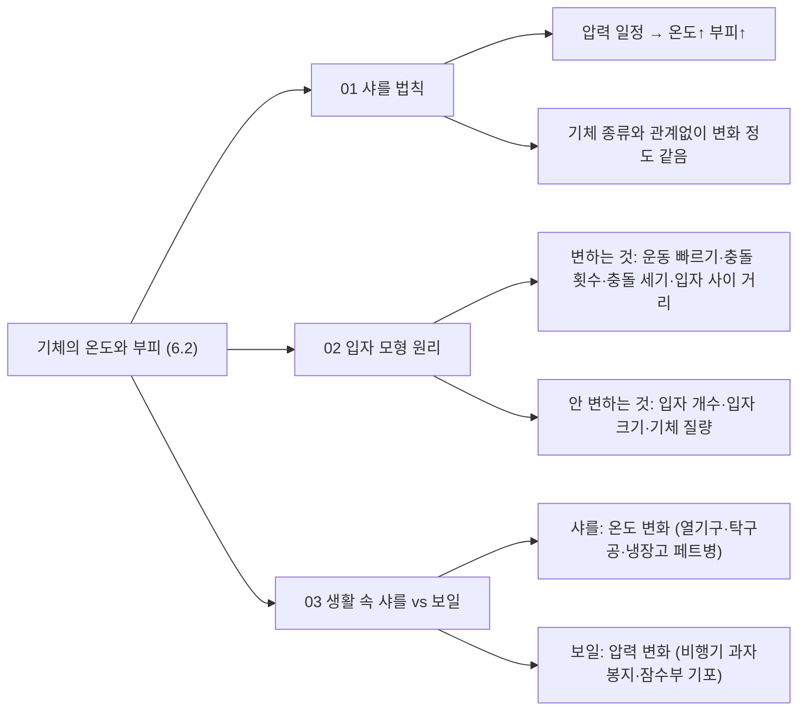
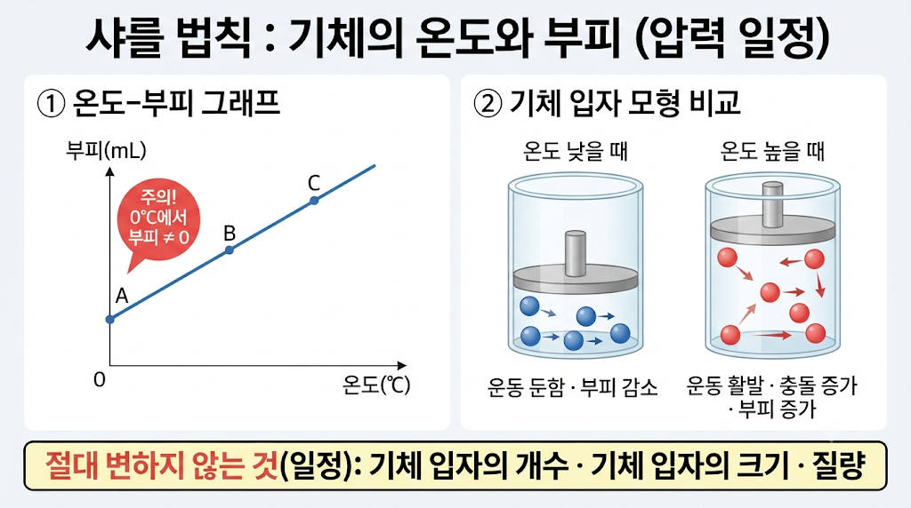
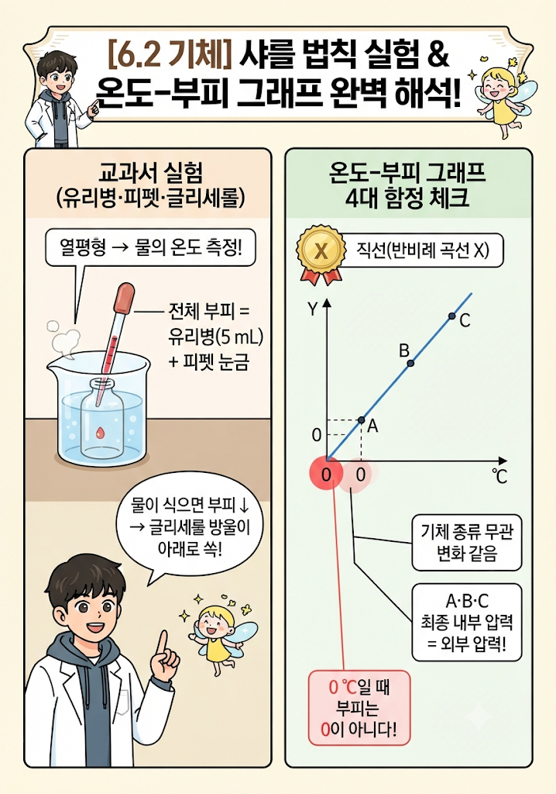
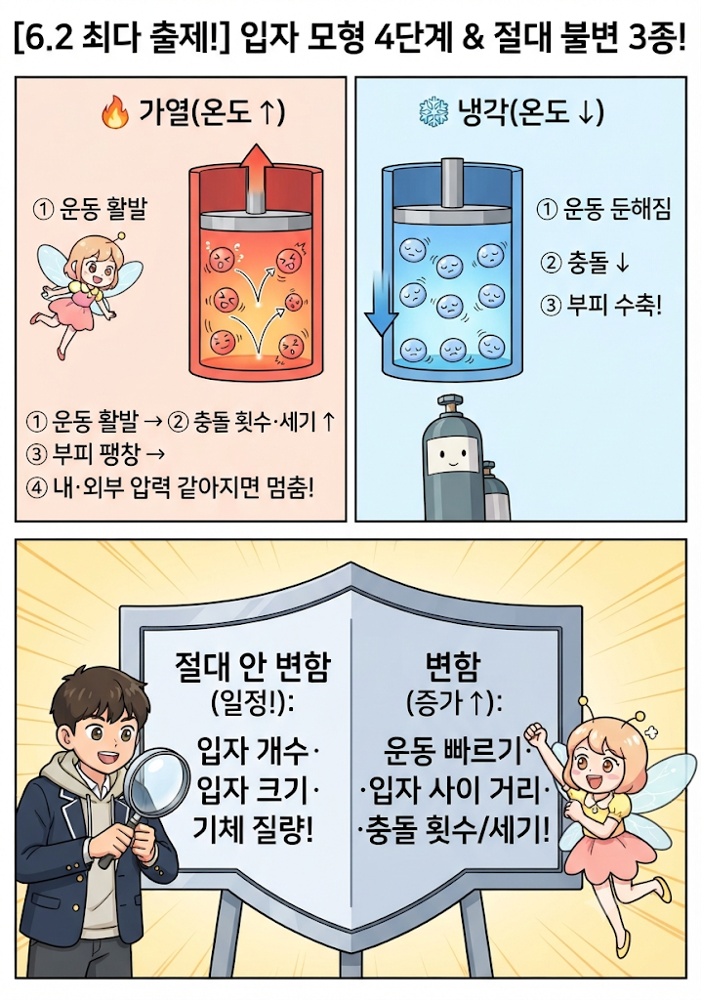
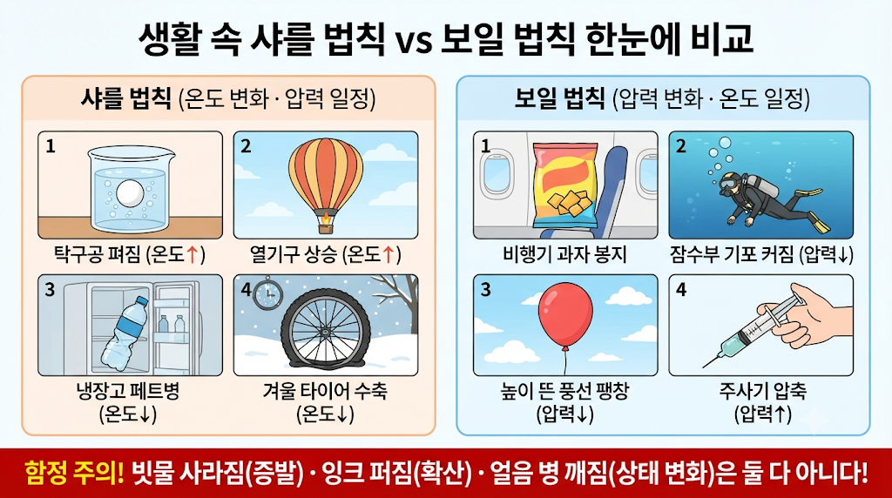
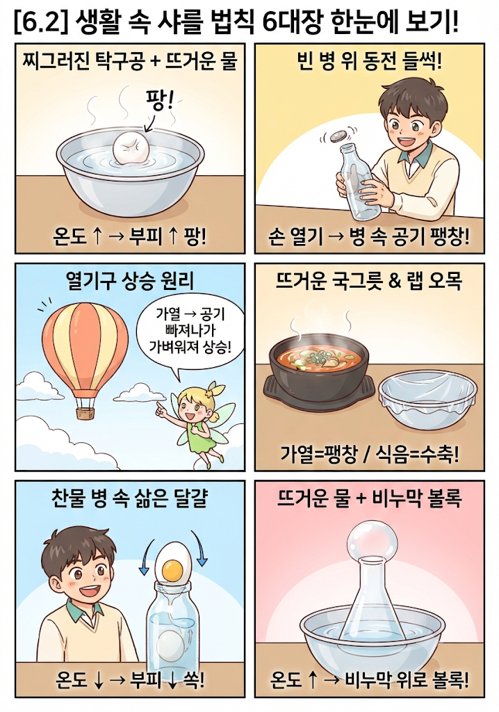
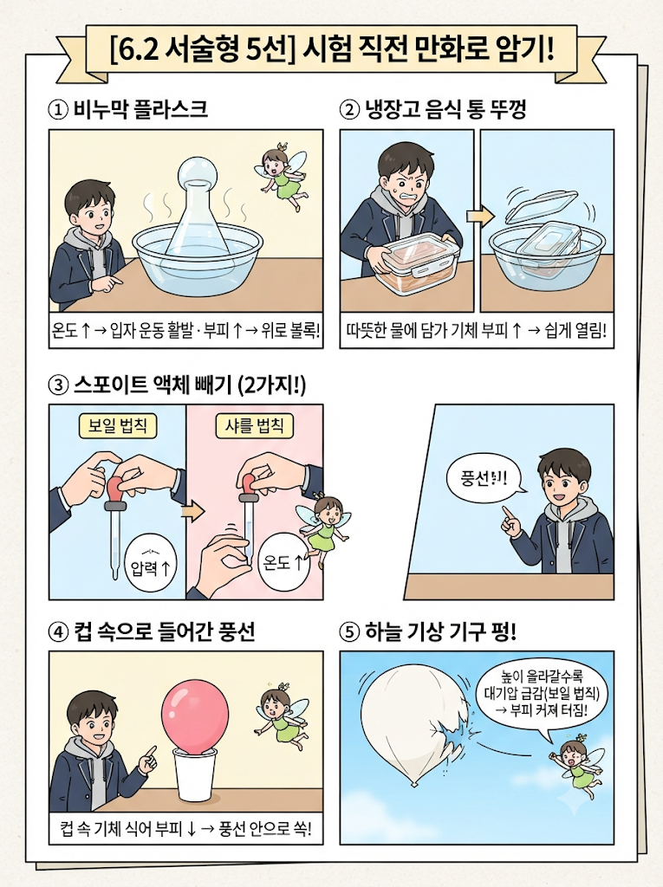

# 📗 6.2 기체의 온도와 부피 — 시험 완벽 정리

> **교과서 범위**: p.206 ~ 222 (VI. 기체의 성질 — 2. 기체의 온도와 부피)  
> **연계 기출**: 2025학년도 KIS 7학년 2학기 2차 지필평가 (13~16번, 문항당 4.0~4.4점)  
> **학습 목표**: 샤를 법칙과 그래프 해석 · 입자 모형으로 부피 변화 설명 · 생활 속 샤를 법칙 vs 보일 법칙 구분

---

## 🎯 한눈에 보는 단원 지도

---

## 01. 샤를 법칙과 온도-부피 그래프 (교과서 p.208~211)

> 🎬 **개념 몽타주 영상 (1분 44초)** — 샤를 법칙 · 교과서 실험 · 온도-부피 그래프 함정을 한 번에 정리해요.

<video controls preload="metadata" playsinline poster="exam/%EA%B3%BC%ED%95%99_%EC%8B%9C%ED%97%98%EA%B3%B5%EB%B6%80/videos/sci_04_charles_poster.jpg" src="exam/%EA%B3%BC%ED%95%99_%EC%8B%9C%ED%97%98%EA%B3%B5%EB%B6%80/videos/sci_04_charles.mp4" style="width:100%;max-width:960px;border-radius:12px;display:block;margin:0 auto 1em;background:#000"></video>

### 1) 샤를 법칙이란?
- **정의**: **압력이 일정할 때**, 일정량의 기체 부피는 **온도가 높아지면 일정하게 커지고**, **온도가 낮아지면 일정하게 작아지는** 법칙이다.
- **중요 성질**: 온도 변화에 따라 기체의 부피가 변하는 정도는 **기체의 종류와 관계없이 모두 같다.**
- **교과서 실험 핵심 (p.208~209 유리병·피펫·글리세롤 실험)**:
  - 유리병 속 기체의 온도는 직접 재기 어려우므로, 유리병 속 기체와 비커 속 물이 **열평형** 상태라고 가정하고 **물의 온도**를 측정한다.
  - 기체의 전체 부피 = **유리병의 부피(5 mL) + 피펫으로 읽은 부피**
  - 비커의 뜨거운 물이 식으면 유리병 속 기체의 온도가 낮아져 부피가 줄어들므로 **글리세롤 방울이 피펫 관 아래로(안쪽으로) 빨려 내려간다.**

### 2) 온도-부피 그래프 완벽 해석 ⭐ KIS 기출 적중! (2025 기출 14번 · 교과서 p.217, p.219)

| 그래프 특징 | 정확한 해석 | 자주 나오는 오답 함정 ⚠️ |
| :--- | :--- | :--- |
| **모양** | 오른쪽 위로 향하는 **직선** (일차함수 형태) | 곡선(반비례)으로 고르면 오답! *(반비례 곡선은 보일 법칙!)* |
| **0 ℃에서의 부피** | 그래프가 **세로축(부피축)의 0보다 위쪽**에서 시작한다! | ❌ **"0 ℃에서 기체의 부피는 0이다"** → **절대 오답!!** (0 ℃에서도 기체는 부피를 가진다!) |
| **온도가 높은 지점 (C)** | 부피 최대, 입자 운동 **가장 활발**, 입자 사이 거리 **가장 멀다** | ❌ "입자 개수가 가장 많다" / "입자 크기가 가장 크다" → **오답!** |
| **최종 내부 압력** | A, B, C 모든 지점에서 **외부 압력과 같다** *(압력 일정 조건!)* | 부피 변화가 끝난 뒤에는 `내부 압력 = 외부 압력`으로 평형! |

---

## 02. 입자 모형으로 설명하는 샤를 법칙 (교과서 p.210~211) ⭐ 최다 출제!

> 🎬 **개념 몽타주 영상 (1분 24초)** — 가열·냉각 4단계 · 변하는 것 vs 변하지 않는 것을 한 번에 정리해요.

<video controls preload="metadata" playsinline poster="exam/%EA%B3%BC%ED%95%99_%EC%8B%9C%ED%97%98%EA%B3%B5%EB%B6%80/videos/sci_05_particles_poster.jpg" src="exam/%EA%B3%BC%ED%95%99_%EC%8B%9C%ED%97%98%EA%B3%B5%EB%B6%80/videos/sci_05_particles.mp4" style="width:100%;max-width:960px;border-radius:12px;display:block;margin:0 auto 1em;background:#000"></video>

### 1) 온도가 변할 때 일어나는 단계별 인과관계 (서술형 핵심!)

#### 🔥 온도가 높아질 때 (가열)
1. 기체 입자의 **운동이 활발해진다(빨라진다)**.
2. 입자가 용기 벽에 **충돌하는 횟수와 충돌 세기가 증가**한다.
3. 순간적으로 내부 기체 압력이 외부 압력보다 커져 **기체의 부피가 커진다**.
4. **외부 압력과 기체의 압력이 같아질 때까지** 부피가 커지다가 멈춘다.

#### ❄️ 온도가 낮아질 때 (냉각)
1. 기체 입자의 **운동이 둔해진다(느려진다)**.
2. 입자가 용기 벽에 **충돌하는 횟수와 충돌 세기가 감소**한다.
3. 순간적으로 내부 기체 압력이 외부 압력보다 작아져 **기체의 부피가 작아진다**.
4. **외부 압력과 기체의 압력이 같아질 때까지** 부피가 작아지다가 멈춘다.

### 2) ⭐ 시험 100% 출제! 변하는 것 vs 변하지 않는 것 (2025 KIS 기출 13번)

밀폐된 용기(피스톤 등)에서 압력이 일정할 때 **온도를 높이면**:

| 구분 | 항목 | 변화 |
| :--- | :--- | :--- |
| **절대 변하지 않음 (일정)** | **기체 입자의 개수** | 변함 없음 *(밀폐 용기이므로!)* |
| **절대 변하지 않음 (일정)** | **기체 입자의 크기** | 변함 없음 *(입자 자체가 커지는 게 아님!)* |
| **절대 변하지 않음 (일정)** | **기체의 질량** | 변함 없음 |
| **변함 (증가 ↑)** | **기체 입자의 운동 빠르기(활발한 정도)** | **증가** |
| **변함 (증가 ↑)** | **기체 입자 사이의 거리** | **멀어짐 (증가)** |
| **변함 (증가 ↑)** | **부피가 변하는 동안 충돌 횟수·충돌 세기** | **증가** → 부피 팽창의 원인! |

> ⚠️ **실수 방지 체크 #1 — 2025 KIS 기출 13번 주의!**  
> 교과서 p.211 본문과 p.217 1번, 그리고 **2025 KIS 기출 13번**에서:
> - 온도가 높아져 기체의 부피가 커질 때 **변하는 것**으로 **`기체 입자의 운동`**과 **`기체 입자의 충돌 횟수(및 세기)`**를 모두 정답(`ㄷ, ㄹ`)으로 인정한다!
> - 반대로 **`기체 입자의 개수`**와 **`기체 입자의 크기`**는 **어떤 경우에도 절대 변하지 않는 대표적인 오답 선지**이다!

---

## 03. 생활 속의 샤를 법칙 vs 보일 법칙 (교과서 p.212~222) ⭐ KIS 기출 적중!

> 🎬 **개념 몽타주 영상 (1분 44초)** — 생활 속 샤를 법칙 · 보일 법칙 구분 · 함정 선지를 한 번에 정리해요.

<video controls preload="metadata" playsinline poster="exam/%EA%B3%BC%ED%95%99_%EC%8B%9C%ED%97%98%EA%B3%B5%EB%B6%80/videos/sci_06_life_poster.jpg" src="exam/%EA%B3%BC%ED%95%99_%EC%8B%9C%ED%97%98%EA%B3%B5%EB%B6%80/videos/sci_06_life.mp4" style="width:100%;max-width:960px;border-radius:12px;display:block;margin:0 auto 1em;background:#000"></video>

### 1) 샤를 법칙으로 설명하는 현상 (키워드: **온도 변화 — 뜨거움, 차가움, 냉장고, 햇빛, 겨울, 가열**)

| 현상 | 원리 설명 |
| :--- | :--- |
| **찌그러진 탁구공을 뜨거운 물에 넣으면 펴짐** | 탁구공 속 기체의 온도가 높아져 부피가 커짐 |
| **뜨거운 국·라면 그릇이 식탁 위에서 스스로 움직임** | 그릇 밑 갇힌 공기가 데워져 부피가 커지며 그릇을 살짝 들어 올림 |
| **차가운 빈 병 입구에 물 묻힌 동전을 올리고 손으로 감싸면 동전이 들썩임** | 손의 열기로 병 속 기체 온도가 높아져 부피가 커지며 동전을 밀어 올림 *(교과서 p.211)* |
| **열기구 속 공기를 가열하면 하늘로 떠오름** | 공기를 가열 → 부피 커져 일부 공기가 밖으로 밀려 나옴 → 열기구가 **가벼워져** 떠오름 *(가열 멈추면 식어서 내려옴)* |
| **햇빛 비치는 곳에 과자 봉지를 두면 빵빵해짐** | 온도가 높아져 봉지 속 기체의 부피가 커짐 *(※ 비행기·산 위는 보일 법칙!)* |
| **냉장고에 넣은 페트병이 찌그러짐 / 찬물 넣은 병에 삶은 달걀 빨려 들어감** | 온도가 낮아져 병 속 기체의 부피가 작아짐 |
| **겨울철(추운 날) 자동차·자전거 타이어가 수축 / 밖으로 가져간 풍선이 작아짐** | 온도가 낮아져 타이어·풍선 속 기체의 부피가 작아짐 |
| **뜨거운 국그릇에 랩을 씌우고 식으면 랩이 오목하게 들어감** | 국이 식으며 그릇 안 기체의 온도가 낮아져 부피가 작아짐 *(교과서 p.220 8번)* |
| **삼각 플라스크 입구에 비누막을 만들고 뜨거운 물에 담그면 비누막이 부풀어 오름** | 플라스크 속 기체의 온도가 높아져 부피가 커짐 *(교과서 p.217 5번)* |

### 2) 보일 법칙 vs 샤를 법칙 구분표 ⭐ (2025 KIS 기출 16번 · 교과서 p.217 4번, p.219 4번)

| 구분 | 보일 법칙 (온도 일정, **압력 변화**) | 샤를 법칙 (압력 일정, **온도 변화**) |
| :--- | :--- | :--- |
| **핵심 관계** | 압력 ↑ → 부피 ↓ (**반비례**) | 온도 ↑ → 부피 ↑ (**일정하게 증가**) |
| **입자 운동 빠르기** | **변하지 않음** *(온도 일정!)* | **변함** *(온도↑ 빨라짐 / 온도↓ 느려짐)* |
| **대표 예시** | • **비행기 이륙 / 높은 산**에서 과자 봉지가 부풀어 오름 • **하늘 높이 올라간 풍선**이 커지다 터짐 • **잠수부가 내뿜은 기포**가 수면으로 올라올수록 커짐 • 주사기 피스톤 눌렀다 놓으면 밀려 나옴 • **하임리히법**(기도에 음식물 걸렸을 때 배 위쪽 압박) • 깊은 바다에 넣은 **스타이로폼 컵라면 용기**가 쪼그라듦 | • **햇빛 아래** 둔 과자 봉지가 부풀어 오름 • **찌그러진 탁구공** + 뜨거운 물 • **냉장고** 속 페트병 찌그러짐 • **열기구** 가열 / 냉각 • **뜨거운 국그릇** 스스로 움직임 / 랩 오목해짐 • **겨울철** 타이어 수축 |

> ⚠️ **실수 방지 체크 #2 — 낚이기 쉬운 '샤를 법칙이 아닌' 함정 선지 (2025 KIS 기출 15번!)**  
> 아래 선지들은 시험에 함정으로 매우 자주 나옵니다. **절대 속지 마세요!**
> 1. ❌ *"운동장 웅덩이의 빗물이 사라진다"* → **증발** (상태 변화)
> 2. ❌ *"물에 잉크를 떨어뜨리면 퍼진다"* → **확산**
> 3. ❌ *"물이 가득 든 병을 냉동실에 얼리면 병이 깨진다"* → **물의 상태 변화(액체→고체 얼음 부피 팽창)** *(기체가 아님!)*
> 4. ❌ *"갯벌에서 뻘배를 타면 진흙에 빠지지 않는다"* → **압력(넓이 크게)**
> 5. ❌ *"비행기/산 위에서 과자 봉지가 부푼다"* → **보일 법칙** *(기압 감소!)* — 반면 *"햇빛 아래 과자 봉지가 부푼다"*는 **샤를 법칙**!

---

## ✅ 교과서 핵심 서술형 모범 답안 체크 (시험 전 암기!)

1. **삼각 플라스크 입구에 비누막을 만들고 뜨거운 물에 담갔을 때 변화 (p.217 5번)**
   > 삼각 플라스크 속 기체의 **온도가 높아져** 기체 입자의 운동이 활발해지고 **부피가 커지므로**, 비누막이 **위쪽으로 볼록하게 부풀어 오른다.**
2. **냉장고에서 꺼낸 플라스틱 음식 통 뚜껑이 안 열릴 때 해결 방법 (p.213)**
   > 음식 통을 **따뜻한 물에 담그거나 따뜻한 곳에 두면**, 통 안의 기체 온도가 높아져 부피가 커지므로 뚜껑이 쉽게 열린다.
3. **액체가 1/4 채워진 스포이트에서 보일 법칙과 샤를 법칙으로 액체를 빼내는 방법 (p.221 9번)**
   > - **보일 법칙**: 스포이트의 고무 꼭지를 **손으로 눌러 압력을 높이면** 내부 기체의 부피가 작아지며 액체가 밀려 나온다.
   > - **샤를 법칙**: 스포이트의 유리 부분을 **손으로 감싸 쥐어(또는 따뜻하게 해) 온도를 높이면** 내부 기체의 부피가 커지며 액체가 밀려 나온다.
4. **따뜻한 물이 든 컵에 풍선을 대고 식혔더니 풍선이 컵 속으로 부풀어 오른 까닭 (p.221 11번)**
   > 컵 속 기체가 식으면서 **온도가 낮아져 기체의 부피가 작아지므로**, 바깥쪽의 풍선이 컵 속으로 밀려 들어가며 부풀어 오른다.
5. **하늘 높이 올라간 기상 관측용 기구가 결국 터져서 떨어지는 까닭 (p.222)**
   > 하늘 높이 올라갈수록 기온도 낮아지지만 **대기압이 훨씬 크게 낮아지므로(보일 법칙)** 기구 속 기체의 부피가 점점 커지다가 결국 터져서 땅으로 떨어지게 된다.

