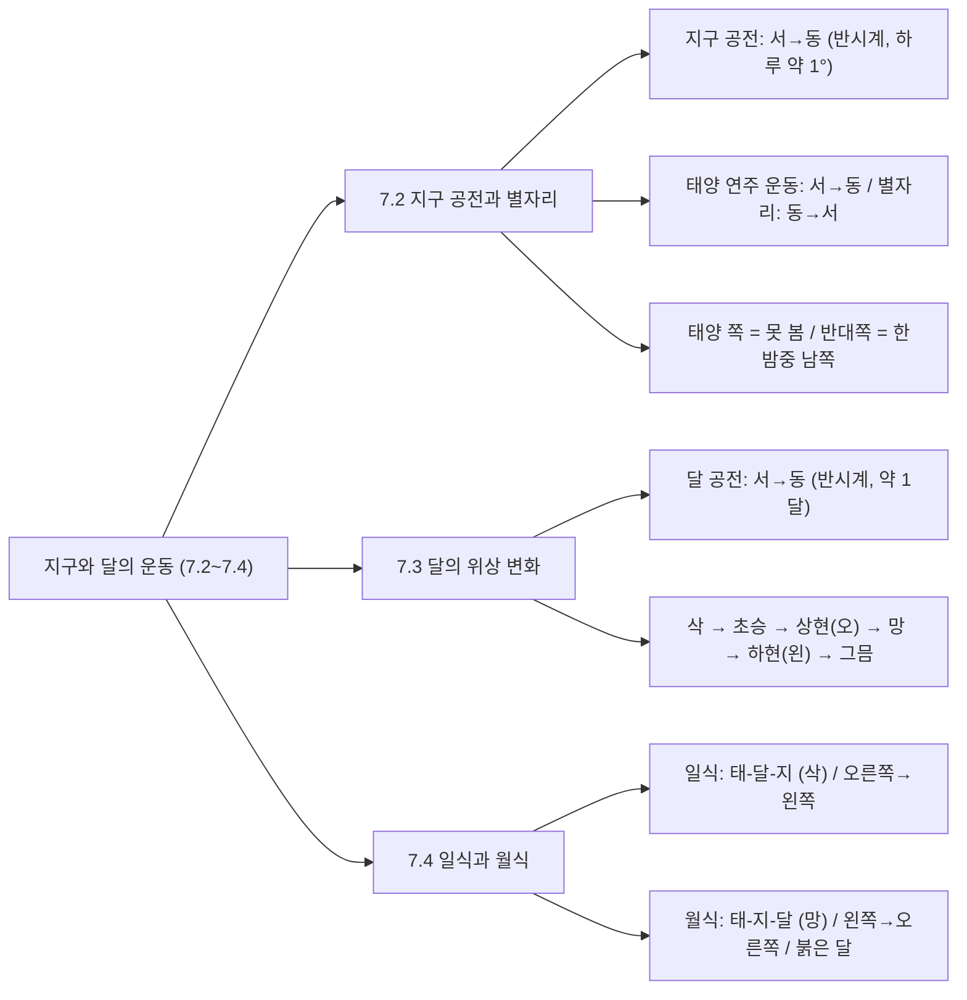
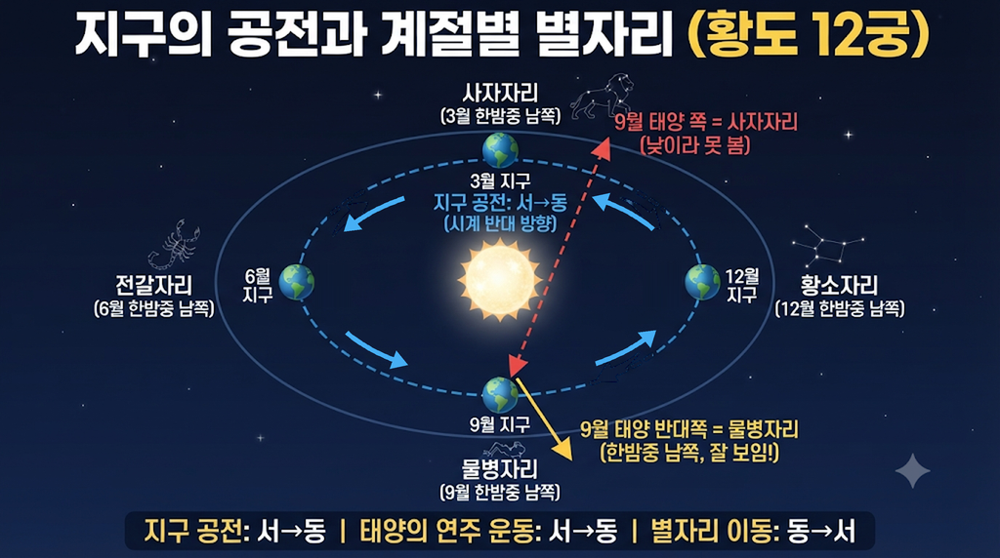
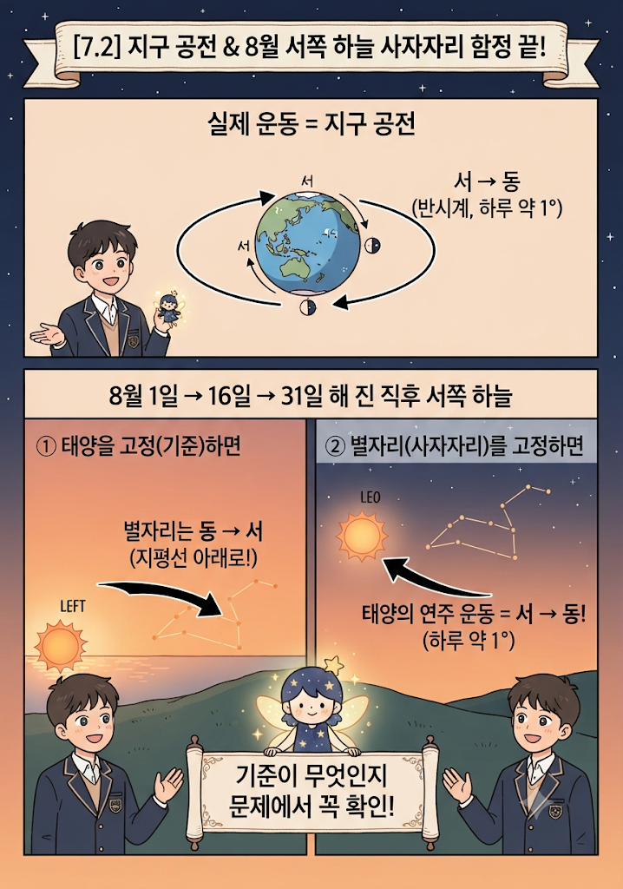
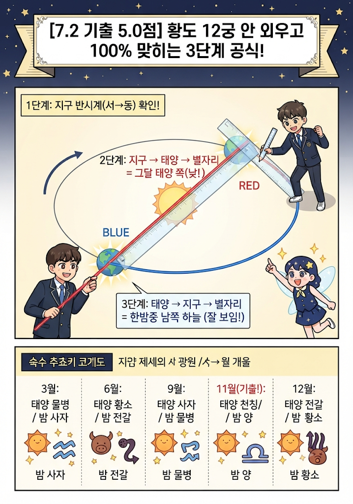
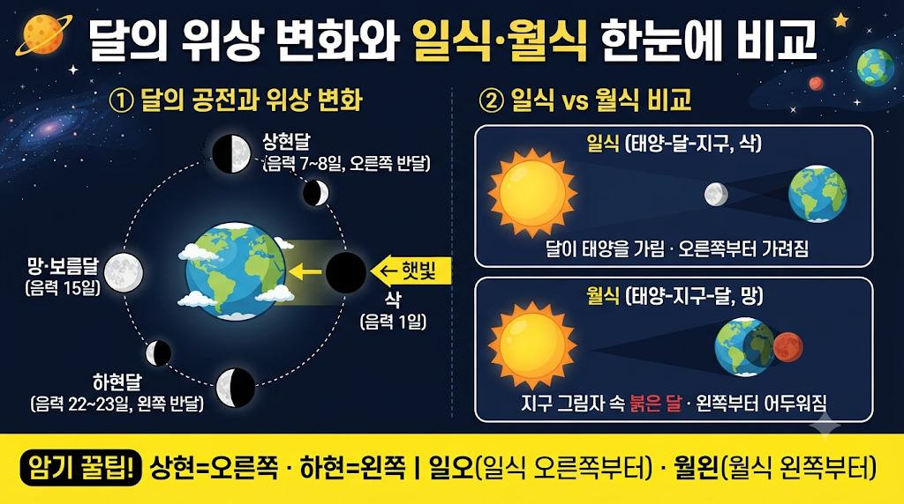
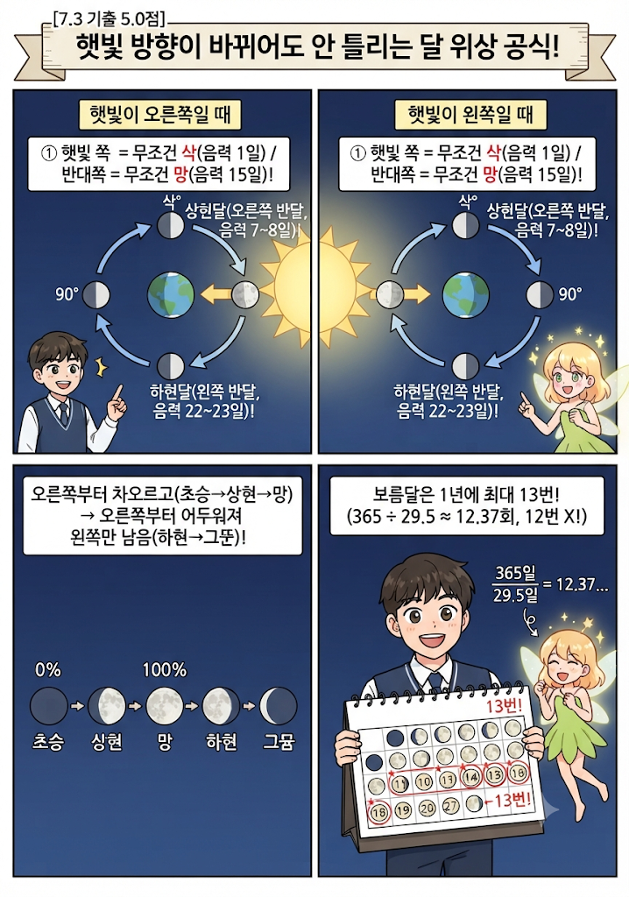
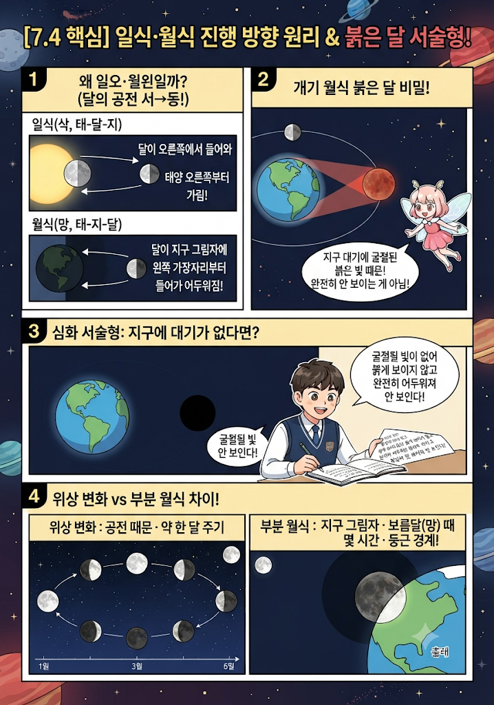

# 📙 7.2~7.4 지구와 달의 운동 — 시험 완벽 정리

> **교과서 범위**: p.248 ~ 266 (VII. 태양계 — 7.2 지구 공전과 별자리 변화 · 7.3 달의 위상 변화 · 7.4 일식과 월식)  
> **연계 기출**: 2025학년도 KIS 7학년 2학기 2차 지필평가 (22~24번, **5.0점 고배점 집중 구간!**)  
> **학습 목표**: 지구 공전과 황도 12궁 월별 별자리 찾기 · 달의 위치별 위상과 음력 날짜 · 일식과 월식 원리 및 진행 방향 완벽 구분

---

## 🎯 한눈에 보는 단원 지도

---

## 01. 지구의 공전과 별자리 변화 (교과서 p.248~251)

> 🎬 **개념 몽타주 영상 (1분 56초)** — 지구 공전 · 태양의 연주 운동 · 황도 12궁 3단계 공식을 한 번에 정리해요.

<video controls preload="metadata" playsinline poster="exam/%EA%B3%BC%ED%95%99_%EC%8B%9C%ED%97%98%EA%B3%B5%EB%B6%80/videos/sci_07_orbit_poster.jpg" src="exam/%EA%B3%BC%ED%95%99_%EC%8B%9C%ED%97%98%EA%B3%B5%EB%B6%80/videos/sci_07_orbit.mp4" style="width:100%;max-width:960px;border-radius:12px;display:block;margin:0 auto 1em;background:#000"></video>

### 1) 지구의 공전과 겉보기 운동 방향 ⭐ 절대 헷갈리지 말기!

- **지구의 공전**: 지구가 태양을 중심으로 **1년에 한 바퀴씩** **서쪽 → 동쪽(북극에서 보면 시계 반대 방향)**으로 도는 실제 운동 (하루에 약 **1°**씩 이동).
- **지구의 공전 때문에 나타나는 겉보기 운동 2가지** (교과서 p.248~249, p.261 3번):

| 기준 | 무엇의 움직임? | 이동 방향 | 속력 |
| :--- | :--- | :---: | :---: |
| **실제 운동** | **지구의 공전** | **서 → 동** *(시계 반대 방향)* | 하루 약 1° (1년 360°) |
| **별자리 기준** | **태양의 연주 운동** *(태양이 별자리 사이를 지나는 길 = 황도)* | **서 → 동** *(지구의 공전 방향과 같음!)* | 하루 약 1° |
| **태양 기준** *(매일 해 진 직후 서쪽 하늘)* | **별자리의 이동** | **동 → 서** *(서쪽 지평선 아래로 점점 내려감!)* | 하루 약 1° |

> ⚠️ **실수 방지 체크 #1 — 교과서 p.249 그림 11 vs 그림 12 (교과서 p.261 3번, p.265 11번)**
> - 8월 1일 → 8월 16일 → 8월 31일 해 진 직후 서쪽 하늘을 보면:
>   - **태양을 고정(기준)**하면: 사자자리가 **동 → 서**(지평선 쪽)로 내려간다.
>   - **별자리(사자자리)를 고정(기준)**하면: 태양이 **서 → 동**(왼쪽 위 방향)으로 이동한다 = **태양의 연주 운동(서 → 동)**!

### 2) 황도 12궁과 월별 별자리 읽기 ⭐ KIS 5.0점 고배점 단골! (2025 기출 22번)

- **황도**: 태양이 1년 동안 별자리 사이로 지나가는 길.
- **황도 12궁**: 황도 부근에 위치하는 12개의 대표적인 별자리.
- **가장 중요한 법칙 (그림으로 푸는 공식!)**:
  1. **『태양 쪽 별자리』** (`지구 → 태양 → 별자리` 일직선): 낮에 태양과 함께 뜨고 지므로 **볼 수 없다!** *(※ 그림에 적힌 '○월'은 바로 그달에 태양이 위치한 별자리를 뜻한다!)*
  2. **『태양 반대쪽 별자리』** (`태양 → 지구 → 별자리` 일직선): 해 진 뒤 동쪽에서 떠서 **한밤중(밤 12시)에 남쪽 하늘에서 가장 높이 보인다!**

#### 📌 우리 교과서(p.250~251, p.260) 기준 황도 12궁 월별 완벽 정리표

| 월 | 지구 위치에서 **태양 쪽 별자리** *(못 봄)* | **한밤중 남쪽 하늘** 별자리 *(태양 반대쪽, 잘 보임!)* | 계절 |
| :---: | :---: | :---: | :---: |
| **1월** | 궁수자리 | **쌍둥이자리** | 겨울 |
| **2월** | 염소자리 | **게자리** | 겨울 |
| **3월** | **물병자리** *(p.250 예시)* | **사자자리** *(p.250 예시)* | 봄 |
| **4월** | 물고기자리 | **처녀자리** | 봄 |
| **5월** | 양자리 | **천칭자리** | 봄 |
| **6월** | **황소자리** | **전갈자리** | 여름 |
| **7월** | 쌍둥이자리 | **궁수자리** | 여름 |
| **8월** | 게자리 | **염소자리** | 여름 |
| **9월** | **사자자리** *(p.251 예시)* | **물병자리** *(p.251 예시)* | 가을 |
| **10월** | 처녀자리 | **물고기자리** | 가을 |
| **11월** | **천칭자리** *(2025 기출 22번)* | **양자리** | 가을 |
| **12월** | **전갈자리** *(p.251 퀴즈)* | **황소자리** *(p.251 퀴즈)* | 겨울 |

> 💡 **시험장에서 안 외우고도 100% 맞히는 법!**  
> 시험지에는 대부분 황도 12궁 원형 그림이 주어집니다!  
> 1. 그림에서 **지구가 시계 반대 방향(서→동)**으로 도는지 확인한다.  
> 2. **지구에서 태양을 통과해 쭉 그은 선** 끝에 있는 별자리 = **그달의 태양 쪽 별자리** (안 보임).  
> 3. **태양에서 지구를 통과해 바깥으로 그은 선** 끝에 있는 별자리 = **그달 한밤중 남쪽 하늘 별자리** (잘 보임!).

---

## 02. 달의 위상 변화 (교과서 p.252~255)

> 🎬 **개념 몽타주 영상 (1분 55초)** — 삭·망·상현·하현 · 햇빛 방향 공식 · 보름달 13번을 한 번에 정리해요.

<video controls preload="metadata" playsinline poster="exam/%EA%B3%BC%ED%95%99_%EC%8B%9C%ED%97%98%EA%B3%B5%EB%B6%80/videos/sci_08_moon_poster.jpg" src="exam/%EA%B3%BC%ED%95%99_%EC%8B%9C%ED%97%98%EA%B3%B5%EB%B6%80/videos/sci_08_moon.mp4" style="width:100%;max-width:960px;border-radius:12px;display:block;margin:0 auto 1em;background:#000"></video>

### 1) 달의 위상이 변하는 까닭
- 달은 스스로 빛을 내지 못하고 **햇빛을 반사**하여 밝게 보인다.
- 달이 지구 주위를 **서쪽 → 동쪽(시계 반대 방향)**으로 **약 한 달(약 29.5일)** 주기로 공전하기 때문에, 지구에서 볼 때 **햇빛을 받아 밝게 보이는 부분의 모양(위상)**이 주기적으로 변한다.

### 2) 달의 위치별 위상·모양·음력 날짜 완벽표 ⭐ KIS 5.0점 고배점! (2025 기출 23번)

*(※ **햇빛이 오른쪽에서 비칠 때** 기준 — 교과서 p.254 그림 16)*

| 순서 | 이름 | 태양-지구-달 배치 | 음력 날짜 | 지구에서 보이는 모양 | 특징 & 암기 팁 |
| :---: | :---: | :--- | :---: | :--- | :--- |
| 1 | **삭** | 태양 — **달** — 지구 | **음력 1일경** | 보이지 않음 (어두움) | 달의 어두운 면이 지구를 향함. **일식 가능!** |
| 2 | **초승달** | 삭과 상현 사이 (오른쪽 위) | 음력 2~4일 | **오른쪽**이 아주 얇은 눈썹 모양 (`☽`) | 초저녁 서쪽 하늘에서 잠깐 보임 |
| 3 | **상현달** | 지구에서 **위쪽(90°)** | **음력 7~8일경** | **오른쪽이 둥근 반달** (`◑`) | **상**현 = **오**른쪽 반달! *(오후~자정)* |
| 4 | **망 (보름달)** | 태양 — 지구 — **달** | **음력 15일경** | **완전히 둥근 달** (`🌕`) | 추석·정월 대보름. 밤새도록 보임. **월식 가능!** |
| 5 | **하현달** | 지구에서 **아래쪽(270°)** | **음력 22~23일경** | **왼쪽이 둥근 반달** (`◐`) | **하**현 = **왼**쪽 반달! *(자정~새벽)* |
| 6 | **그믐달** | 하현과 삭 사이 (오른쪽 아래) | 음력 27~28일 | **왼쪽**이 아주 얇은 눈썹 모양 (`☾`) | 새벽 동쪽 하늘에서 잠깐 보임 |

> ⚠️ **실수 방지 체크 #2 — 햇빛 방향이 바뀌어도 절대 안 틀리는 2단계 공식!**  
> 시험 문제에 따라 **햇빛이 오른쪽**에서 올 수도 있고, **왼쪽**에서 올 수도 있습니다! (작년 기출 23번도 확인 필수!)
> 1. **햇빛이 오는 쪽**에 있는 달이 무조건 **『삭』**, 그 정반대쪽이 무조건 **『망(보름달)』**!
> 2. **삭에서 시계 반대 방향**으로 90° 돌면 무조건 **『상현달(오른쪽 반달)』**, 망에서 시계 반대 방향으로 90° 돌면 무조건 **『하현달(왼쪽 반달)』**!
> 3. **오른쪽이 밝아지면서 커지다가(초승→상현→망) → 오른쪽부터 어두워지며 왼쪽만 남는다(망→하현→그믐)!**

> 💡 **교과서 p.254 스스로 확인하기 3번 — 아드님 필기 정정 포인트!**  
> - *"1년 동안 보름달은 최대 몇 번까지 볼 수 있을까?"*  
> - 음력 한 달(삭→망→삭 주기)은 약 **29.5일**입니다. $365 \div 29.5 \approx 12.37$회이므로, 1월 1~2일에 보름달이 뜨면 그해 12월 30~31일에 한 번 더 떠서 **최대 13번** 볼 수 있습니다! *(교과서에 12번이라고 적혀 있었으니 **13번**으로 꼭 기억하자!)*

---

## 03. 일식과 월식 (교과서 p.256~259) ⭐ 비교 문제 최다 출제!

> 🎬 **개념 몽타주 영상 (1분 44초)** — 일식 vs 월식 · 붉은 달 · 일오 월왼을 한 번에 정리해요.

<video controls preload="metadata" playsinline poster="exam/%EA%B3%BC%ED%95%99_%EC%8B%9C%ED%97%98%EA%B3%B5%EB%B6%80/videos/sci_09_eclipse_poster.jpg" src="exam/%EA%B3%BC%ED%95%99_%EC%8B%9C%ED%97%98%EA%B3%B5%EB%B6%80/videos/sci_09_eclipse.mp4" style="width:100%;max-width:960px;border-radius:12px;display:block;margin:0 auto 1em;background:#000"></video>

### 1) 일식 vs 월식 한눈에 비교표 ⭐ (2025 KIS 기출 24번 · 교과서 p.260)

| 비교 항목 | 일식 (태양이 가려짐) | 월식 (달이 가려짐) |
| :--- | :--- | :--- |
| **천체 배열 순서** | **태양 — 달 — 지구** | **태양 — 지구 — 달** |
| **달의 위상 (음력)** | **삭** (음력 1일경) | **망** (음력 15일경) |
| **원인** | **달**이 태양을 가려서(달의 그림자가 지구에 생김) | **달**이 **지구의 그림자** 속에 들어가서 |
| **개기 vs 부분** | • **개기 일식**: 달의 본그림자 지역 (태양 완전히 가려짐, 코로나 관측 가능) • **부분 일식**: 달의 반그림자 지역 (태양 일부 가려짐) | • **개기 월식**: 달이 지구 그림자 속에 **완전히** 들어감 (**붉게 보임!**) • **부분 월식**: 달의 **일부**만 지구 그림자 속에 들어감 |
| **식의 진행 방향** *(매우 중요!)* | 태양의 **오른쪽 → 왼쪽**으로 가려짐 *(다시 **오른쪽**부터 밝아짐)* | 달의 **왼쪽 → 오른쪽**으로 어두워짐 *(다시 **왼쪽**부터 밝아짐)* |
| **관측 범위 & 시간** | 달의 그림자가 작아 **일부 지역**에서만 **짧은 시간** 관측 | 지구의 그림자가 커서 **밤인 모든 지역**에서 **비교적 오랜 시간** 관측 |

> ⚠️ **실수 방지 체크 #3 — 개기 월식 '붉은 달' 함정! (2025 기출 24번 · 교과서 p.259, p.260 퀴즈 7번)**
> - ❌ *"개기 월식이 일어나면 달을 완전히 볼 수 없게 된다"* → **틀림(X)!**
> - ✅ **정답**: 개기 월식 때는 **지구의 대기를 통과해 굴절된 햇빛 중 붉은색 빛만 달에 비치기 때문에** 달이 **어둡고 붉게(적동색으로) 보인다!**
> - **심화 서술형 (교과서 p.259 스스로 확인하기 2번)**: *"지구에 대기가 없다면 개기 월식은 어떻게 보일까?"* → 햇빛을 굴절시켜 달에 비춰줄 대기가 없으므로 **달이 붉게 보이지 않고 완전히 어두워져 보이지 않을 것이다!**

> ⚠️ **실수 방지 체크 #4 — 왜 '일식은 오른쪽부터', '월식은 왼쪽부터' 가려질까?**
> - 둘 다 원인은 똑같습니다: **달이 서쪽(오른쪽)에서 동쪽(왼쪽)으로 공전**하기 때문!
>   - **일식**: 달이 태양의 **오른쪽(서쪽)**에서 들어와 왼쪽(동쪽)으로 지나가며 태양을 가리므로 **태양의 오른쪽부터** 가려진다.
>   - **월식**: 달이 지구의 그림자 **오른쪽(서쪽)**에서 왼쪽(동쪽)으로 들어가므로, 달의 **왼쪽(동쪽) 가장자리부터** 지구 그림자에 먼저 닿아 어두워진다!
> - **암기 팁**: **『일오 · 월왼』** (일식은 오른쪽부터, 월식은 왼쪽부터!)

---

## ✅ 교과서 핵심 서술형 & 꿀잼 퀴즈 정답 체크

1. **위상 변화에 의한 달(음력 10일경)과 부분 월식 때 달의 차이점 (p.261 5번)**
   > - **원인 차이**: 위상 변화는 달이 공전하며 햇빛을 받는 방향이 달라져 생기는 것이고, 부분 월식은 달의 일부가 **지구의 그림자**에 들어가 어두워지는 것이다.
   > - **모양·시간 차이**: 위상 변화는 **약 한 달 주기**로 천천히 변하지만, 부분 월식은 보름달(망)일 때 **몇 시간 동안** 빠르게 어두워졌다가 다시 밝아지며, 어두운 경계에 둥근 지구 그림자가 나타난다.
2. **해 진 직후 서쪽 하늘을 15일 간격으로 관측했을 때 태양의 연주 운동 방향과 까닭 (p.265 11번)**
   > - **방향**: 별자리를 기준으로 **서쪽에서 동쪽**으로 이동한다.
   > - **까닭**: **지구가 태양 주위를 서쪽에서 동쪽으로 공전**하기 때문에 나타나는 겉보기 운동이다.
3. **교과서 p.260 꿀잼 퀴즈 (온달 장군과 평강 공주) 확인**:
   - 옳은 설명: **1**(지구 자전 서→동), **3**(태양 연주 운동 서→동), **5**(태양-지구-달=망), **6**(왼쪽이 둥근 반달=하현달) → 합계: $1 + 3 + 5 + 6 = \mathbf{15}$일 (**보름달 / 망**)!
   - 틀린 설명: 2(북쪽 하늘은 시계 **반대** 방향), 4(계절별 별자리는 **공전** 때문), 7(개기 월식 때는 완전히 안 보이는 게 아니라 **붉게 보임**)!
4. **교과서 p.264 9번 학생 대화 오류 찾기**:
   - **가희**가 틀림! "(가) 부분 일식은 달의 위상이 망일 때 찍은 사진이야" → 일식은 달의 위상이 **삭**일 때 일어난다!
   - 나영(개기 일식=달이 태양을 직접 가림), 한수(개기 일식은 오른쪽부터, 개기 월식은 왼쪽부터)는 **모두 옳음!**
