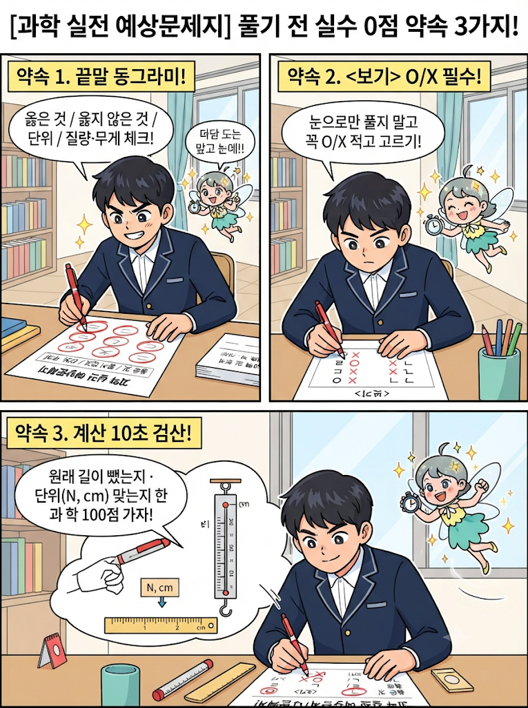

# 📝 2026학년도 7학년 2학기 2차 지필평가 대비 — 과학 실전 예상 문제지

> **시험 범위**: 5.2 힘과 우리 생활 · 6.2 기체의 온도와 부피 · 7.2~7.4 지구와 달의 운동  
> **구성**: 선택형 21문항 (82점) + 서술형 3문항 (18점) = **총 100점** | **제한 시간**: 45분  
> **참고**: 호치민시한국국제학교(KIS) 2025 2학기 2차 · 2026 2학기 1차 기출 유형 반영

### ✅ 풀기 전 「실수 0점」 약속 3가지
- [ ] 문제 끝의 **"옳은 것 / 옳지 않은 것 / 단위 / 질량·무게"**에 동그라미 치기
- [ ] `<보기>` 문제는 ㄱ·ㄴ·ㄷ·ㄹ 옆에 반드시 **O / X** 표시하고 답 고르기
- [ ] 계산 문제는 **원래 길이 뺐는지·단위 맞는지** 한 번 더 검산하기



---

## [선택형 1~21번]

### 5.2 힘과 우리 생활 (1~8번)

**1.** 수평면 위에 놓인 물체에 왼쪽으로 $18\text{ N}$, 오른쪽으로 $7\text{ N}$의 힘이 나란하게 동시에 작용하고 있다. 이 물체에 작용하는 알짜힘의 크기와 방향을 옳게 짝 지은 것은? [3.0점]
① $11\text{ N}$, 왼쪽  
② $11\text{ N}$, 오른쪽  
③ $18\text{ N}$, 왼쪽  
④ $25\text{ N}$, 왼쪽  
⑤ $25\text{ N}$, 오른쪽  

---

**2.** 거친 바닥에 놓인 무거운 상자를 오른쪽으로 $250\text{ N}$의 힘으로 밀었으나 상자는 움직이지 않고 정지해 있었다. 이때 상자에 작용하는 마찰력과 알짜힘의 크기를 옳게 짝 지은 것은? [3.5점]
① 마찰력 $0\text{ N}$, 알짜힘 $0\text{ N}$  
② 마찰력 $0\text{ N}$, 알짜힘 $250\text{ N}$  
③ 마찰력 $250\text{ N}$, 알짜힘 $0\text{ N}$  
④ 마찰력 $250\text{ N}$, 알짜힘 $250\text{ N}$  
⑤ 마찰력 $500\text{ N}$, 알짜힘 $250\text{ N}$  

---

**3.** 스카이다이버가 (가) 낙하산을 펴기 전에는 아래쪽으로 속력이 점점 빨라지며 떨어지다가, (나) 낙하산을 편 후 일정한 운동 방향과 속력으로 내려오고 있다. 이에 대한 설명으로 옳은 것만을 `<보기>`에서 있는 대로 고른 것은? [4.0점]

> **<보기>**  
> ㄱ. (가)에서 스카이다이버에 작용하는 알짜힘의 방향은 운동 방향과 같다.  
> ㄴ. (나)에서 스카이다이버에 작용하는 알짜힘은 $0\text{ N}$이다.  
> ㄷ. (나)에서 스카이다이버에게는 중력이 작용하지 않는다.

① ㄱ  
② ㄴ  
③ ㄱ, ㄴ  
④ ㄴ, ㄷ  
⑤ ㄱ, ㄴ, ㄷ  

---

**4.** 다음은 탁구공이 진행하는 모습을 1초 간격으로 관찰한 결과이다. 탁구공은 오른쪽 위로 휘어지며 날아갔고, 시간이 지날수록 속력을 나타내는 화살표의 길이가 점점 짧아졌다. 이에 대한 설명으로 옳은 것만을 `<보기>`에서 있는 대로 고른 것은? [4.0점]

> **<보기>**  
> ㄱ. 탁구공은 속력과 운동 방향이 모두 변하는 운동을 하였다.  
> ㄴ. 탁구공에 작용하는 알짜힘은 $0$이 아니다.  
> ㄷ. 탁구공의 운동 방향과 비스듬한 방향으로 알짜힘이 작용하였다.

① ㄱ  
② ㄷ  
③ ㄱ, ㄴ  
④ ㄴ, ㄷ  
⑤ ㄱ, ㄴ, ㄷ  

---

**5.** 다음은 **무빙워크(등속 직선 운동)**, **대관람차(일정한 속력의 원운동)**, **그네**의 운동을 분류한 순서도이다. A, B, C에 해당하는 운동으로 옳게 짝 지은 것은? [3.0점]

```
[무빙워크, 대관람차, 그네]
        │
  물체의 속력은 일정한가?
    ├── 아니요 ──▶ ( A )
    └── 예 ──▶ 물체의 운동 방향은 일정한가?
                  ├── 예 ──▶ ( B )
                  └── 아니요 ──▶ ( C )
```

① A: 그네 / B: 무빙워크 / C: 대관람차  
② A: 그네 / B: 대관람차 / C: 무빙워크  
③ A: 대관람차 / B: 무빙워크 / C: 그네  
④ A: 무빙워크 / B: 대관람차 / C: 그네  
⑤ A: 무빙워크 / B: 그네 / C: 대관람차  

---

**6.** 일상생활에서 이용하는 힘의 종류가 나머지 넷과 **다른** 것은? [3.5점]
① 아기 양말 바닥에 붙인 고무 돌기  
② 자전거 핸들 회전축에 바르는 윤활유  
③ 진흙길에서도 잘 달리는 트랙터의 깊은 바퀴 홈  
④ 키보드 자판을 눌렀다가 떼면 원래대로 되돌아오는 용수철  
⑤ 미끄러짐을 막기 위해 볼펜에 끼운 고무 손잡이  

---

**7.** 원래 길이가 $10\text{ cm}$인 용수철에 무게가 $3\text{ N}$인 추를 매달았더니 전체 길이가 $12\text{ cm}$가 되었다. 같은 용수철에 물체 X를 매달았더니 전체 길이가 $16\text{ cm}$가 되었다. 물체 X의 무게는 몇 $\text{N}$인가? (단, 용수철은 탄성 한계를 벗어나지 않았고 용수철의 무게는 무시한다.) [4.0점]
① $6\text{ N}$  
② $9\text{ N}$  
③ $12\text{ N}$  
④ $15\text{ N}$  
⑤ $18\text{ N}$  

---

**8.** 무게가 $6\text{ N}$인 추 1개를 용수철저울에 매달아 물속에 **완전히** 잠기게 했더니 용수철저울의 눈금이 $4\text{ N}$을 가리켰다. 같은 추 **2개**를 함께 매달아 모두 물속에 완전히 잠기게 하면, 전체 부력의 크기와 용수철저울의 눈금은 각각 얼마인가? [5.0점]
① 부력 $2\text{ N}$, 눈금 $10\text{ N}$  
② 부력 $2\text{ N}$, 눈금 $8\text{ N}$  
③ 부력 $4\text{ N}$, 눈금 $8\text{ N}$  
④ 부력 $4\text{ N}$, 눈금 $6\text{ N}$  
⑤ 부력 $6\text{ N}$, 눈금 $6\text{ N}$  

---

### 6.2 기체의 온도와 부피 (9~14번)

**9.** 압력이 일정할 때 일정량의 기체에 대한 온도와 부피의 관계를 나타낸 그래프에서, 온도가 낮은 지점부터 차례대로 **A(0 ℃) → B(20 ℃) → C(40 ℃)**로 올라가는 직선 그래프가 그려졌다. 이에 대한 설명으로 옳은 것은? [4.0점]
① A점($0\ ^\circ\text{C}$)에서 기체의 부피는 $0\text{ mL}$이다.  
② 기체 입자의 개수는 C가 A보다 많다.  
③ 기체 입자의 크기는 C가 A보다 크다.  
④ 기체 입자의 운동은 C에서 가장 활발하다.  
⑤ 기체 입자 사이의 거리는 A, B, C 모두 같다.  

---

**10.** 압력이 일정한 상태에서 밀폐된 실린더 속 기체의 온도를 높여 부피가 커졌다. 이때 **변하는 것**만을 `<보기>`에서 있는 대로 고른 것은? [4.0점]

> **<보기>**  
> ㄱ. 기체 입자의 개수  
> ㄴ. 기체 입자의 크기  
> ㄷ. 기체 입자의 운동 빠르기  
> ㄹ. 기체 입자 사이의 거리

① ㄱ, ㄴ  
② ㄴ, ㄷ  
③ ㄷ, ㄹ  
④ ㄱ, ㄷ, ㄹ  
⑤ ㄴ, ㄷ, ㄹ  

---

**11.** 유리병에 피펫을 연결하고 피펫 입구에 글리세롤 방울을 떨어뜨린 뒤, 뜨거운 물이 든 비커에 담갔다가 물이 서서히 식는 동안의 변화를 관찰하였다. 이에 대한 설명으로 옳지 **않은** 것은? [3.5점]
① 유리병 속 기체의 온도는 비커 속 물의 온도와 같다고 가정하고 측정한다.  
② 기체의 전체 부피는 유리병의 부피와 피펫으로 읽은 부피의 합이다.  
③ 비커의 물이 식으면 유리병 속 기체의 부피가 작아진다.  
④ 비커의 물이 식을수록 글리세롤 방울은 피펫 관 바깥쪽(위쪽)으로 밀려 올라간다.  
⑤ 온도에 따라 기체의 부피가 변하는 정도는 기체의 종류와 관계없이 같다.  

---

**12.** 찌그러진 탁구공을 뜨거운 물에 넣었더니 탁구공이 원래대로 펴졌다. 이와 **같은 원리**로 설명할 수 있는 현상은? [4.0점]
① 운동장 웅덩이에 고인 빗물이 햇볕에 사라진다.  
② 물에 잉크를 한 방울 떨어뜨리면 물 전체로 퍼진다.  
③ 뜨거운 라면이 담긴 그릇이 식탁 위에서 스스로 움직인다.  
④ 갯벌에서 뻘배를 이용하면 진흙에 발이 빠지지 않는다.  
⑤ 물이 가득 든 유리병을 냉동실에 넣어 얼리면 병이 깨진다.  

---

**13.** `<보기>`에서 **보일 법칙**과 **샤를 법칙**으로 설명할 수 있는 현상을 옳게 짝 지은 것은? [4.0점]

> **<보기>**  
> ㄱ. 비행기가 이륙한 후 기내의 과자 봉지가 부풀어 오른다.  
> ㄴ. 잠수부가 물속에서 내뿜은 기포는 수면으로 올라갈수록 커진다.  
> ㄷ. 물이 조금 담긴 페트병의 뚜껑을 닫고 냉장고에 넣어 두면 찌그러진다.  
> ㄹ. 겨울철 날씨가 추워지면 자동차 타이어가 수축한다.

① 보일 법칙: ㄱ, ㄴ / 샤를 법칙: ㄷ, ㄹ  
② 보일 법칙: ㄱ, ㄷ / 샤를 법칙: ㄴ, ㄹ  
③ 보일 법칙: ㄱ, ㄹ / 샤를 법칙: ㄴ, ㄷ  
④ 보일 법칙: ㄴ, ㄷ / 샤를 법칙: ㄱ, ㄹ  
⑤ 보일 법칙: ㄷ, ㄹ / 샤를 법칙: ㄱ, ㄴ  

---

**14.** 다음 두 상황 (가), (나)에서 과자 봉지가 부풀어 오른 까닭을 옳게 짝 지은 것은? [3.5점]
- **(가)** 뜯지 않은 과자 봉지를 햇빛이 강하게 비치는 창가에 두었더니 부풀었다.  
- **(나)** 뜯지 않은 과자 봉지를 가지고 높은 산 정상에 올라갔더니 부풀었다.

① (가) 외부 압력 감소 / (나) 온도 상승  
② (가) 외부 압력 증가 / (나) 외부 압력 감소  
③ (가) 온도 상승 / (나) 외부 압력 감소  
④ (가) 온도 상승 / (나) 온도 하강  
⑤ (가) 온도 하강 / (나) 외부 압력 증가  

---

### 7.2~7.4 지구와 달의 운동 (15~21번)

**15.** 8월 1일, 8월 16일, 8월 31일에 해가 진 직후 서쪽 하늘의 사자자리와 태양의 위치를 관찰하여 비교하였다. 이에 대한 설명으로 옳은 것만을 `<보기>`에서 있는 대로 고른 것은? [4.0점]

> **<보기>**  
> ㄱ. 태양을 기준으로 하면 사자자리는 동쪽에서 서쪽으로 이동하는 것처럼 보인다.  
> ㄴ. 별자리를 기준으로 하면 태양은 서쪽에서 동쪽으로 이동하는 것처럼 보인다.  
> ㄷ. 이러한 현상은 지구가 자전하기 때문에 나타나는 겉보기 운동이다.

① ㄱ  
② ㄴ  
③ ㄱ, ㄴ  
④ ㄴ, ㄷ  
⑤ ㄱ, ㄴ, ㄷ  

---

**16.** 다음은 교과서 기준 **황도 12궁**과 지구의 공전 배치를 표로 정리한 것이다. 지구가 태양 주위를 서에서 동(시계 반대 방향)으로 공전할 때, 이에 대한 설명으로 옳은 것만을 `<보기>`에서 있는 대로 고른 것은? [5.0점]

| 월 | 3월 | 6월 | 9월 | 12월 |
| :---: | :---: | :---: | :---: | :---: |
| **태양 쪽 별자리** | 물병자리 | 황소자리 | 사자자리 | 전갈자리 |
| **태양 반대쪽 별자리** | 사자자리 | 전갈자리 | 물병자리 | 황소자리 |

> **<보기>**  
> ㄱ. 3월 한밤중에 남쪽 하늘에서 가장 잘 볼 수 있는 별자리는 사자자리이다.  
> ㄴ. 9월에 태양 쪽에 위치한 사자자리는 낮에 태양과 함께 뜨고 지므로 볼 수 없다.  
> ㄷ. 12월 한밤중에 남쪽 하늘에서 관측할 수 있는 별자리는 전갈자리이다.

① ㄱ  
② ㄷ  
③ ㄱ, ㄴ  
④ ㄴ, ㄷ  
⑤ ㄱ, ㄴ, ㄷ  

---

**17.** 북극 위에서 내려다보았을 때 **햇빛이 오른쪽에서 왼쪽으로** 비치고 있고, 달이 지구 주위를 시계 반대 방향으로 공전하고 있다. 다음 A~D 위치 중 **상현달**과 **하현달**을 관측할 수 있는 위치를 옳게 짝 지은 것은? [5.0점]
- **A**: 지구와 태양 사이 (오른쪽, 3시 방향)  
- **B**: 지구의 위쪽 (12시 방향)  
- **C**: 태양의 반대쪽 (왼쪽, 9시 방향)  
- **D**: 지구의 아래쪽 (6시 방향)

① 상현달: A / 하현달: C  
② 상현달: B / 하현달: D  
③ 상현달: C / 하현달: A  
④ 상현달: D / 하현달: B  
⑤ 상현달: B / 하현달: C  

---

**18.** 달의 위상 변화에 대한 설명으로 옳지 **않은** 것은? [3.5점]
① 달은 스스로 빛을 내지 못하고 햇빛을 반사하여 밝게 보인다.  
② 삭에서 망으로 갈 때 나타나는 오른쪽이 둥근 반달을 상현달이라고 한다.  
③ 망에서 삭으로 갈 때 나타나는 왼쪽이 둥근 반달을 하현달이라고 한다.  
④ 추석과 정월 대보름(음력 15일경)에는 보름달(망)을 볼 수 있다.  
⑤ 달의 위상 변화 주기는 정확히 30일이므로, 1년 동안 보름달은 최대 12번까지만 볼 수 있다.  

---

**19.** **일식**에 대한 설명으로 옳은 것만을 `<보기>`에서 있는 대로 고른 것은? [4.0점]

> **<보기>**  
> ㄱ. 태양 — 달 — 지구 순으로 일직선상에 놓이는 삭일 때 일어난다.  
> ㄴ. 개기 일식이 일어날 때 태양은 오른쪽 부분부터 가려지기 시작한다.  
> ㄷ. 지구의 낮인 모든 지역에서 개기 일식을 동시에 볼 수 있다.

① ㄱ  
② ㄷ  
③ ㄱ, ㄴ  
④ ㄴ, ㄷ  
⑤ ㄱ, ㄴ, ㄷ  

---

**20.** **월식**에 대한 설명으로 옳은 것만을 `<보기>`에서 있는 대로 고른 것은? [4.0점]

> **<보기>**  
> ㄱ. 태양 — 지구 — 달 순으로 일직선상에 놓이는 망일 때 일어난다.  
> ㄴ. 달이 지구의 그림자 속에 완전히 들어가는 개기 월식 때는 달이 완전히 사라져 전혀 보이지 않는다.  
> ㄷ. 월식은 달의 왼쪽 부분부터 어두워지기 시작한다.

① ㄱ  
② ㄴ  
③ ㄱ, ㄷ  
④ ㄴ, ㄷ  
⑤ ㄱ, ㄴ, ㄷ  

---

**21.** 다음은 일식과 월식을 찍은 사진을 보고 나눈 세 학생의 대화이다. 옳게 말한 학생을 모두 고른 것은? [3.5점]
- **민수**: "부분 일식은 달의 위상이 **삭**일 때 달이 태양의 일부를 가려 일어나."  
- **지연**: "개기 월식과 위상 변화는 모두 달이 **지구의 그림자**에 가려져 생기는 현상이야."  
- **현우**: "일식은 태양의 **오른쪽**부터, 월식은 달의 **왼쪽**부터 가려지기 시작해."

① 민수  
② 지연  
③ 민수, 지연  
④ 민수, 현우  
⑤ 민수, 지연, 현우  

---

## [서술형 1~3번]

> ※ 서술형은 **제시된 핵심 단어**를 반드시 포함하여 완전한 문장으로 쓰세요!

**서술형 1.** 물속에 가라앉아 있던 장난감 잠수함(물이 채워진 집기병) 속 풍선에 공기 펌프로 공기를 넣었더니 집기병이 물 위로 떠올랐다. 집기병이 떠오르는 까닭을 **『무게(중력)』**와 **『부력』**이라는 단어를 사용하여 서술하시오. [6.0점]

> 답안 작성란:  
> ________________________________________________________________________  
> ________________________________________________________________________  

---

**서술형 2.** 삼각 플라스크 입구에 비누막을 만든 뒤, 삼각 플라스크를 뜨거운 물이 담긴 비커에 담갔다. 이때 **비누막의 모양이 어떻게 변하는지** 쓰고, 그렇게 변하는 까닭을 **『기체 입자의 운동』, 『충돌』, 『부피』**를 포함하여 서술하시오. [6.0점]

> 답안 작성란:  
> ________________________________________________________________________  
> ________________________________________________________________________  

---

**서술형 3.** 개기 월식이 일어날 때 달이 어둡고 **붉게 보이는 까닭**을 서술하고, 만약 **지구에 대기가 없다면** 개기 월식이 일어날 때 달이 어떻게 보일지 함께 서술하시오. [6.0점]

> 답안 작성란:  
> ________________________________________________________________________  
> ________________________________________________________________________  
