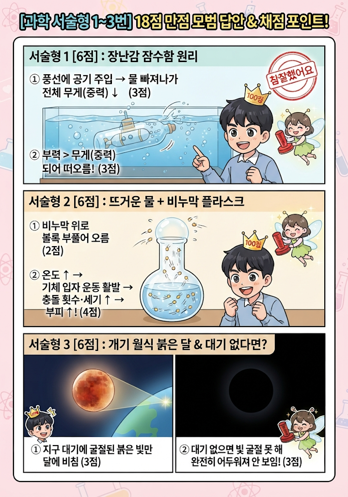

# ✅ 2026학년도 7학년 2학기 2차 지필평가 대비 — 과학 예상 문제지 정답 및 해설

> **채점 기준**: 선택형 21문항(82점) + 서술형 3문항(18점) = **총 100점**  
> *(풀이 형식: 문제 + 선지 전체 → 답 → 이유)*

---

## 📊 빠른 정답표 (채점용)

| 번호 | 1 | 2 | 3 | 4 | 5 | 6 | 7 | 8 | 9 | 10 | 11 |
| :---: | :---: | :---: | :---: | :---: | :---: | :---: | :---: | :---: | :---: | :---: | :---: |
| **정답** | ① | ③ | ③ | ⑤ | ① | ④ | ② | ③ | ④ | ③ | ④ |

| 번호 | 12 | 13 | 14 | 15 | 16 | 17 | 18 | 19 | 20 | 21 |
| :---: | :---: | :---: | :---: | :---: | :---: | :---: | :---: | :---: | :---: | :---: |
| **정답** | ③ | ① | ③ | ③ | ③ | ② | ⑤ | ③ | ③ | ④ |

---

## 📖 문항별 상세 풀이

### 1번 [3.0점]
수평면 위에 놓인 물체에 왼쪽으로 $18\text{ N}$, 오른쪽으로 $7\text{ N}$의 힘이 나란하게 동시에 작용하고 있다. 이 물체에 작용하는 알짜힘의 크기와 방향을 옳게 짝 지은 것은?
① $11\text{ N}$, 왼쪽 / ② $11\text{ N}$, 오른쪽 / ③ $18\text{ N}$, 왼쪽 / ④ $25\text{ N}$, 왼쪽 / ⑤ $25\text{ N}$, 오른쪽

- **답)** ①
- **이유)** 반대 방향으로 작용하는 두 힘의 알짜힘은 **큰 힘 − 작은 힘** ($18 - 7 = 11\text{ N}$)이고, 방향은 **더 큰 힘의 방향(왼쪽)**이다.

---

### 2번 [3.5점]
거친 바닥에 놓인 무거운 상자를 오른쪽으로 $250\text{ N}$의 힘으로 밀었으나 상자는 움직이지 않고 정지해 있었다. 이때 상자에 작용하는 마찰력과 알짜힘의 크기를 옳게 짝 지은 것은?
① 마찰력 $0\text{ N}$, 알짜힘 $0\text{ N}$ / ② 마찰력 $0\text{ N}$, 알짜힘 $250\text{ N}$ / ③ 마찰력 $250\text{ N}$, 알짜힘 $0\text{ N}$ / ④ 마찰력 $250\text{ N}$, 알짜힘 $250\text{ N}$ / ⑤ 마찰력 $500\text{ N}$, 알짜힘 $250\text{ N}$

- **답)** ③
- **이유)** 상자가 정지해 있으므로 힘의 평형 상태(**알짜힘 = $0\text{ N}$**)이며, 미는 힘($250\text{ N}$)과 크기가 같고 방향이 반대인 **마찰력 $250\text{ N}$**이 작용하고 있다.

---

### 3번 [4.0점]
스카이다이버가 (가) 낙하산을 펴기 전에는 아래쪽으로 속력이 점점 빨라지며 떨어지다가, (나) 낙하산을 편 후 일정한 운동 방향과 속력으로 내려오고 있다.
`<보기>` ㄱ. (가)에서 알짜힘 방향은 운동 방향과 같다. / ㄴ. (나)에서 알짜힘은 $0\text{ N}$이다. / ㄷ. (나)에서 중력이 작용하지 않는다.
① ㄱ / ② ㄴ / ③ ㄱ, ㄴ / ④ ㄴ, ㄷ / ⑤ ㄱ, ㄴ, ㄷ

- **답)** ③
- **이유)** (가)는 속력이 빨라지므로 운동 방향과 알짜힘 방향이 같고(ㄱ O), (나)는 등속 직선 운동이므로 알짜힘이 $0\text{ N}$이다(ㄴ O). 하지만 (나)에서도 **중력은 계속 작용**하며 공기 저항력과 평형을 이룬 것이다(ㄷ X).

---

### 4번 [4.0점]
탁구공이 오른쪽 위로 휘어지며 날아갔고, 시간이 지날수록 속력을 나타내는 화살표의 길이가 점점 짧아졌다.
`<보기>` ㄱ. 속력과 운동 방향이 모두 변하는 운동을 하였다. / ㄴ. 알짜힘은 $0$이 아니다. / ㄷ. 운동 방향과 비스듬한 방향으로 알짜힘이 작용하였다.
① ㄱ / ② ㄷ / ③ ㄱ, ㄴ / ④ ㄴ, ㄷ / ⑤ ㄱ, ㄴ, ㄷ

- **답)** ⑤
- **이유)** 화살표의 길이(속력)와 방향(운동 방향)이 모두 변했으므로(ㄱ O), 알짜힘은 $0$이 아니고(ㄴ O), 운동 방향과 **비스듬한 방향**으로 알짜힘이 작용했다(ㄷ O).

---

### 5번 [3.0점]
무빙워크, 대관람차, 그네의 운동을 분류한 순서도: 속력이 일정한가? 아니요→(A), 예→운동 방향 일정한가? 예→(B), 아니요→(C).
① A: 그네 / B: 무빙워크 / C: 대관람차  
② A: 그네 / B: 대관람차 / C: 무빙워크  
③ A: 대관람차 / B: 무빙워크 / C: 그네  
④ A: 무빙워크 / B: 대관람차 / C: 그네  
⑤ A: 무빙워크 / B: 그네 / C: 대관람차

- **답)** ①
- **이유)** 속력이 변하는 것은 **그네(A)**, 속력과 방향 모두 일정한 것은 **무빙워크(B)**, 속력은 일정하지만 방향이 계속 변하는 것은 **대관람차(C)**이다.

---

### 6번 [3.5점]
일상생활에서 이용하는 힘의 종류가 나머지 넷과 다른 것은?
① 아기 양말 바닥에 붙인 고무 돌기 / ② 자전거 핸들 회전축에 바르는 윤활유 / ③ 진흙길에서도 잘 달리는 트랙터의 깊은 바퀴 홈 / ④ 키보드 자판을 눌렀다가 떼면 원래대로 되돌아오는 용수철 / ⑤ 미끄러짐을 막기 위해 볼펜에 끼운 고무 손잡이

- **답)** ④
- **이유)** ①, ②, ③, ⑤는 모두 **마찰력**(크게 하거나 줄이기)을 이용한 예이고, ④ 키보드 용수철만 **탄성력**을 이용한 예이다.

---

### 7번 [4.0점]
원래 길이가 $10\text{ cm}$인 용수철에 무게가 $3\text{ N}$인 추를 매달았더니 전체 길이가 $12\text{ cm}$가 되었다. 같은 용수철에 물체 X를 매달았더니 전체 길이가 $16\text{ cm}$가 되었다. 물체 X의 무게는 몇 $\text{N}$인가?
① $6\text{ N}$ / ② $9\text{ N}$ / ③ $12\text{ N}$ / ④ $15\text{ N}$ / ⑤ $18\text{ N}$

- **답)** ②
- **이유)** 무게는 용수철의 **『늘어난 길이』**에 비례한다. $3\text{ N}$일 때 늘어난 길이 = $12 - 10 = 2\text{ cm}$. 물체 X일 때 늘어난 길이 = $16 - 10 = 6\text{ cm}$ (3배). 따라서 무게도 3배인 $3\text{ N} \times 3 = \mathbf{9\text{ N}}$이다.  
  *(⚠️ 주의: 원래 길이 $10\text{ cm}$를 빼지 않고 $12 : 16$으로 계산하면 틀린다!)*

---

### 8번 [5.0점]
무게가 $6\text{ N}$인 추 1개를 용수철저울에 매달아 물속에 완전히 잠기게 했더니 용수철저울의 눈금이 $4\text{ N}$을 가리켰다. 같은 추 2개를 함께 매달아 모두 물속에 완전히 잠기게 하면, 전체 부력의 크기와 용수철저울의 눈금은 각각 얼마인가?
① 부력 $2\text{ N}$, 눈금 $10\text{ N}$ / ② 부력 $2\text{ N}$, 눈금 $8\text{ N}$ / ③ 부력 $4\text{ N}$, 눈금 $8\text{ N}$ / ④ 부력 $4\text{ N}$, 눈금 $6\text{ N}$ / ⑤ 부력 $6\text{ N}$, 눈금 $6\text{ N}$

- **답)** ③
- **이유)** 추 1개의 부력 = 공기 중 무게($6\text{ N}$) − 물속 눈금($4\text{ N}$) = **$2\text{ N}$**. 같은 추 2개가 모두 잠기면 잠긴 부피가 2배이므로 전체 부력은 **$4\text{ N}$**이고, 전체 무게($12\text{ N}$) − 전체 부력($4\text{ N}$) = 용수철 눈금 **$8\text{ N}$**이다.

---

### 9번 [4.0점]
압력이 일정할 때 일정량의 기체 온도-부피 그래프에서 A($0\ ^\circ\text{C}$) → B($20\ ^\circ\text{C}$) → C($40\ ^\circ\text{C}$)로 올라가는 직선 그래프에 대한 설명으로 옳은 것은?
① A점($0\ ^\circ\text{C}$)에서 기체의 부피는 $0\text{ mL}$이다. / ② 기체 입자의 개수는 C가 A보다 많다. / ③ 기체 입자의 크기는 C가 A보다 크다. / ④ 기체 입자의 운동은 C에서 가장 활발하다. / ⑤ 기체 입자 사이의 거리는 A, B, C 모두 같다.

- **답)** ④
- **이유)** 온도가 가장 높은 C에서 **기체 입자 운동이 가장 활발**하고 입자 사이 거리도 가장 멀다. ($0\ ^\circ\text{C}$에서도 부피는 $0$이 아니며, 입자의 개수와 크기는 변하지 않는다.)

---

### 10번 [4.0점]
압력이 일정한 상태에서 밀폐된 실린더 속 기체의 온도를 높여 부피가 커졌다. 이때 변하는 것만을 `<보기>`에서 있는 대로 고른 것은?
`<보기>` ㄱ. 기체 입자의 개수 / ㄴ. 기체 입자의 크기 / ㄷ. 기체 입자의 운동 빠르기 / ㄹ. 기체 입자 사이의 거리
① ㄱ, ㄴ / ② ㄴ, ㄷ / ③ ㄷ, ㄹ / ④ ㄱ, ㄷ, ㄹ / ⑤ ㄴ, ㄷ, ㄹ

- **답)** ③
- **이유)** 온도가 올라가면 **입자의 운동 빠르기(ㄷ)**와 **입자 사이의 거리(ㄹ)**가 증가한다. 밀폐 용기이므로 **입자의 개수(ㄱ)**와 **입자의 크기(ㄴ)**는 절대 변하지 않는다.

---

### 11번 [3.5점]
유리병에 피펫을 연결하고 글리세롤 방울을 떨어뜨린 뒤, 뜨거운 물이 든 비커에 담갔다가 물이 서서히 식는 동안의 변화를 관찰한 실험에 대한 설명으로 옳지 않은 것은?
① 유리병 속 기체의 온도는 비커 속 물의 온도와 같다고 가정하고 측정한다. / ② 기체의 전체 부피는 유리병의 부피와 피펫으로 읽은 부피의 합이다. / ③ 비커의 물이 식으면 유리병 속 기체의 부피가 작아진다. / ④ 비커의 물이 식을수록 글리세롤 방울은 피펫 관 바깥쪽(위쪽)으로 밀려 올라간다. / ⑤ 온도에 따라 기체의 부피가 변하는 정도는 기체의 종류와 관계없이 같다.

- **답)** ④
- **이유)** 비커의 물이 식으면 유리병 속 기체의 온도가 낮아져 부피가 줄어드므로, 글리세롤 방울은 피펫 관 **안쪽(아래쪽)으로 빨려 내려간다.**

---

### 12번 [4.0점]
찌그러진 탁구공을 뜨거운 물에 넣었더니 탁구공이 원래대로 펴졌다. 이와 같은 원리로 설명할 수 있는 현상은?
① 운동장 웅덩이에 고인 빗물이 햇볕에 사라진다. / ② 물에 잉크를 한 방울 떨어뜨리면 물 전체로 퍼진다. / ③ 뜨거운 라면이 담긴 그릇이 식탁 위에서 스스로 움직인다. / ④ 갯벌에서 뻘배를 이용하면 진흙에 발이 빠지지 않는다. / ⑤ 물이 가득 든 유리병을 냉동실에 넣어 얼리면 병이 깨진다.

- **답)** ③
- **이유)** 탁구공과 뜨거운 라면 그릇 모두 **샤를 법칙**(온도↑ → 기체 부피↑)이다. (① 증발, ② 확산, ④ 압력-넓이, ⑤ 물의 상태 변화에 따른 얼음 부피 팽창)

---

### 13번 [4.0점]
`<보기>`에서 보일 법칙과 샤를 법칙으로 설명할 수 있는 현상을 옳게 짝 지은 것은?
`<보기>` ㄱ. 비행기 이륙 후 과자 봉지 부풀음 / ㄴ. 잠수부 기포 커짐 / ㄷ. 냉장고 페트병 찌그러짐 / ㄹ. 겨울철 타이어 수축
① 보일: ㄱ, ㄴ / 샤를: ㄷ, ㄹ | ② 보일: ㄱ, ㄷ / 샤를: ㄴ, ㄹ | ③ 보일: ㄱ, ㄹ / 샤를: ㄴ, ㄷ | ④ 보일: ㄴ, ㄷ / 샤를: ㄱ, ㄹ | ⑤ 보일: ㄷ, ㄹ / 샤를: ㄱ, ㄴ

- **답)** ①
- **이유)** ㄱ(고도↑ → 기압↓), ㄴ(수심↓ → 수압↓)은 **압력 변화(보일 법칙)**, ㄷ(냉장고), ㄹ(겨울철)은 **온도 변화(샤를 법칙)**이다.

---

### 14번 [3.5점]
(가) 햇빛이 비치는 창가의 과자 봉지가 부풀었다. (나) 높은 산 정상에서 과자 봉지가 부풀었다. 각각의 까닭은?
① (가) 외부 압력 감소 / (나) 온도 상승  
② (가) 외부 압력 증가 / (나) 외부 압력 감소  
③ (가) 온도 상승 / (나) 외부 압력 감소  
④ (가) 온도 상승 / (나) 온도 하강  
⑤ (가) 온도 하강 / (나) 외부 압력 증가

- **답)** ③
- **이유)** (가) 햇빛은 **온도 상승(샤를 법칙)**, (나) 높은 산은 **외부 압력(대기압) 감소(보일 법칙)** 때문에 과자 봉지가 부풀어 오른다.

---

### 15번 [4.0점]
8월 1일, 16일, 31일 해 진 직후 서쪽 하늘의 사자자리와 태양의 위치 변화에 대한 설명으로 옳은 것은?
`<보기>` ㄱ. 태양 기준 사자자리는 동→서 이동 / ㄴ. 별자리 기준 태양은 서→동 이동 / ㄷ. 지구의 자전 때문
① ㄱ / ② ㄴ / ③ ㄱ, ㄴ / ④ ㄴ, ㄷ / ⑤ ㄱ, ㄴ, ㄷ

- **답)** ③
- **이유)** 태양을 기준으로 별자리는 **동→서**(ㄱ O), 별자리를 기준으로 태양은 **서→동**(ㄴ O)으로 이동한다. 이는 지구의 자전이 아니라 **지구의 공전** 때문에 나타나는 겉보기 운동이다(ㄷ X).

---

### 16번 [5.0점]
교과서 기준 황도 12궁 표(3월 물병/사자, 6월 황소/전갈, 9월 사자/물병, 12월 전갈/황소)에 대한 설명으로 옳은 것은?
`<보기>` ㄱ. 3월 한밤중 남쪽 하늘 = 사자자리 / ㄴ. 9월 태양 쪽 사자자리는 낮이라 못 봄 / ㄷ. 12월 한밤중 남쪽 하늘 = 전갈자리
① ㄱ / ② ㄷ / ③ ㄱ, ㄴ / ④ ㄴ, ㄷ / ⑤ ㄱ, ㄴ, ㄷ

- **답)** ③
- **이유)** 한밤중에 남쪽 하늘에서 잘 보이는 별자리는 **태양 반대쪽 별자리**이다. 따라서 3월 한밤중은 사자자리(ㄱ O), 9월 태양 쪽 사자자리는 태양과 함께 떠서 못 본다(ㄴ O). 12월 한밤중 남쪽 별자리는 전갈자리(태양 쪽)가 아니라 **황소자리**이다(ㄷ X).

---

### 17번 [5.0점]
햇빛이 오른쪽에서 왼쪽으로 비치고 달이 시계 반대 방향으로 공전할 때, A(오른쪽 3시), B(위쪽 12시), C(왼쪽 9시), D(아래쪽 6시) 중 상현달과 하현달의 위치는?
① 상현달: A / 하현달: C | ② 상현달: B / 하현달: D | ③ 상현달: C / 하현달: A | ④ 상현달: D / 하현달: B | ⑤ 상현달: B / 하현달: C

- **답)** ②
- **이유)** 햇빛 쪽인 A가 **삭**, 시계 반대 방향으로 90° 이동한 B(위쪽)가 **상현달**, 태양 반대쪽 C(왼쪽)가 **망(보름달)**, 망에서 90° 더 이동한 D(아래쪽)가 **하현달**이다.

---

### 18번 [3.5점]
달의 위상 변화에 대한 설명으로 옳지 않은 것은?
① 달은 햇빛을 반사해 밝게 보인다. / ② 삭→망 오른쪽 반달 = 상현달 / ③ 망→삭 왼쪽 반달 = 하현달 / ④ 추석·정월 대보름 = 보름달(망) / ⑤ 위상 주기가 30일이므로 1년 동안 보름달은 최대 12번까지만 볼 수 있다.

- **답)** ⑤
- **이유)** 달의 위상 변화 주기(삭망월)는 약 **29.5일**이다. $365 \div 29.5 \approx 12.37$회이므로 1월 초에 보름달이 뜨면 그해 12월 말에 한 번 더 떠서 **최대 13번**까지 볼 수 있다.

---

### 19번 [4.0점]
일식에 대한 설명으로 옳은 것은?
`<보기>` ㄱ. 태양—달—지구 순, 삭일 때 / ㄴ. 태양 오른쪽부터 가려짐 / ㄷ. 낮인 모든 지역에서 개기 일식 동시 관측
① ㄱ / ② ㄷ / ③ ㄱ, ㄴ / ④ ㄴ, ㄷ / ⑤ ㄱ, ㄴ, ㄷ

- **답)** ③
- **이유)** 일식은 태양—달—지구(삭) 배열일 때(ㄱ O) 달이 서→동으로 공전하므로 **태양의 오른쪽부터** 가려진다(ㄴ O). 달의 그림자는 작기 때문에 지구 **일부 지역**에서만 개기 일식을 볼 수 있다(ㄷ X).

---

### 20번 [4.0점]
월식에 대한 설명으로 옳은 것은?
`<보기>` ㄱ. 태양—지구—달 순, 망일 때 / ㄴ. 개기 월식 때 달이 완전히 사라져 전혀 안 보임 / ㄷ. 달의 왼쪽부터 어두워짐
① ㄱ / ② ㄴ / ③ ㄱ, ㄷ / ④ ㄴ, ㄷ / ⑤ ㄱ, ㄴ, ㄷ

- **답)** ③
- **이유)** 월식은 태양—지구—달(망) 배열일 때(ㄱ O) **달의 왼쪽부터** 지구 그림자에 들어가 어두워진다(ㄷ O). 개기 월식 때는 지구 대기를 통과한 붉은빛이 달에 비쳐 **어둡고 붉게 보인다**(ㄴ X).

---

### 21번 [3.5점]
세 학생의 대화 중 옳게 말한 학생은?
민수(부분 일식은 삭일 때) / 지연(개기 월식과 위상 변화는 모두 지구 그림자 때문) / 현우(일식은 오른쪽부터, 월식은 왼쪽부터)
① 민수 / ② 지연 / ③ 민수, 지연 / ④ 민수, 현우 / ⑤ 민수, 지연, 현우

- **답)** ④
- **이유)** 민수(O), 현우(O — 암기 팁 **『일오·월왼』**). 지연이는 틀렸다: 월식은 지구 그림자 때문이지만, **달의 위상 변화**는 달이 공전하며 햇빛을 받는 면을 지구에서 보는 방향이 달라져 생기는 현상이다.

---

## ✍️ 서술형 모범 답안 및 채점 기준

### 서술형 1 [6.0점]
- **모범 답안**: 풍선에 공기를 넣으면 풍선이 부풀면서 집기병 속 물이 빠져나가 **집기병 전체의 무게(중력)가 작아지고**, 위로 작용하는 **부력이 무게(중력)보다 커지므로** 집기병이 떠오른다.
- **채점 포인트**: ① 물이 빠져나가 무게(중력)가 작아짐 (3점) / ② 부력 > 무게(중력)가 되어 떠오름 (3점)

### 서술형 2 [6.0점]
- **모범 답안**: 비누막이 **위쪽으로 볼록하게 부풀어 오른다.** 뜨거운 물에 의해 플라스크 속 기체의 온도가 높아지면 **기체 입자의 운동**이 활발해져 벽에 **충돌**하는 횟수와 세기가 늘어나 기체의 **부피**가 커지기 때문이다.
- **채점 포인트**: ① 비누막이 위쪽으로 부풀어 오름 (2점) / ② 온도↑ → 기체 입자 운동 활발 → 충돌 횟수·세기 증가 → 부피 증가 (4점)

### 서술형 3 [6.0점]
- **모범 답안**: 개기 월식 때 달이 붉게 보이는 까닭은 **지구 대기를 통과해 굴절된 햇빛 중 붉은색 빛만 달에 비치기 때문**이다. 만약 지구에 대기가 없다면 빛을 굴절시켜 달에 비춰줄 대기가 없으므로 **달이 완전히 어두워져 보이지 않을 것이다.**
- **채점 포인트**: ① 지구 대기에 의해 붉은색 빛만 달에 비침 (3점) / ② 대기가 없으면 달이 완전히 어두워져 보이지 않음 (3점)

