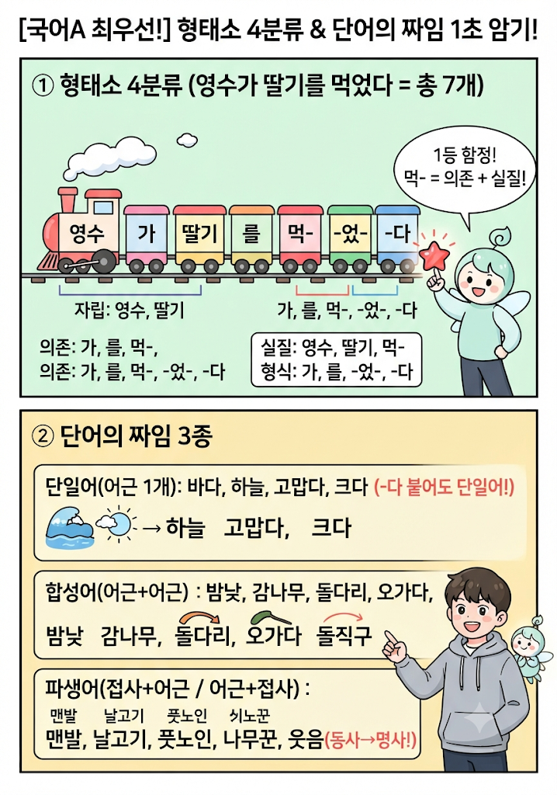
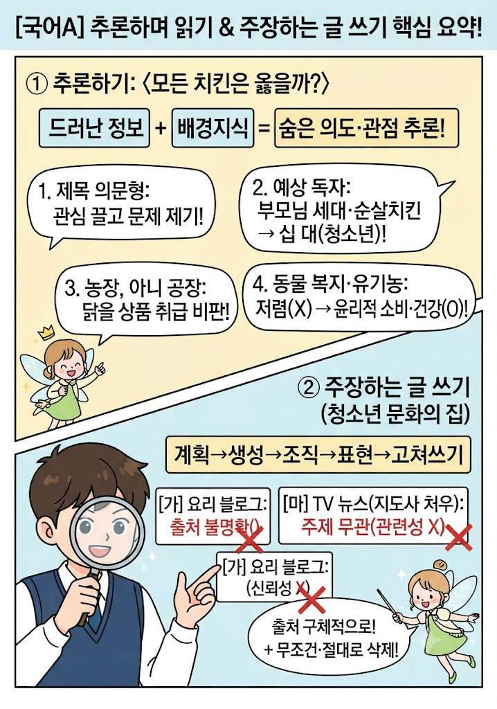
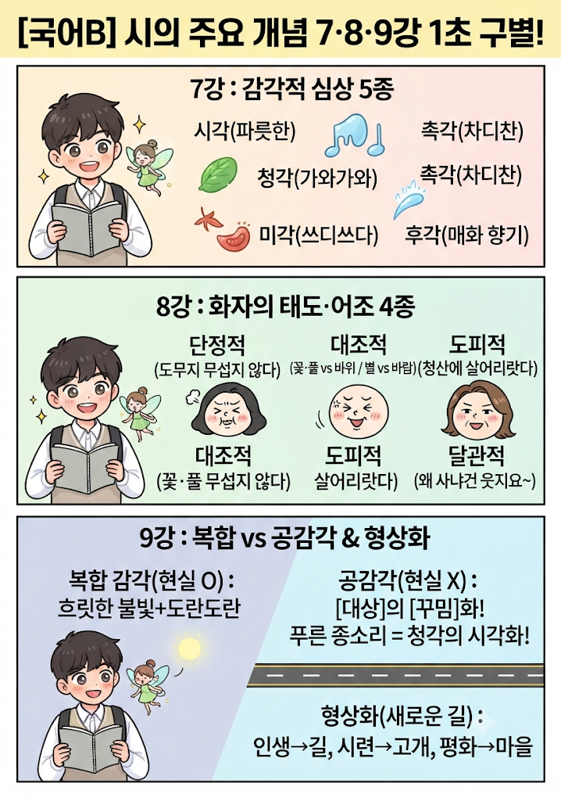
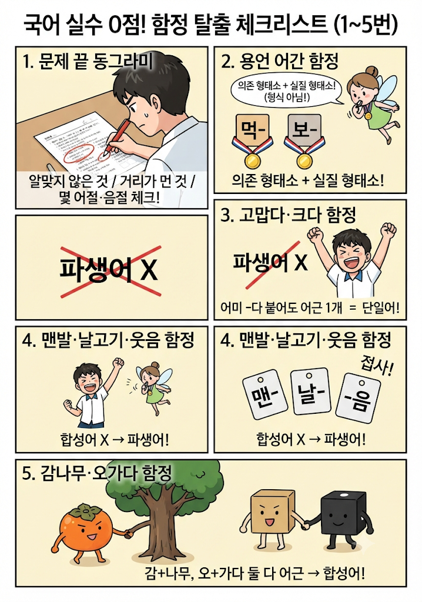
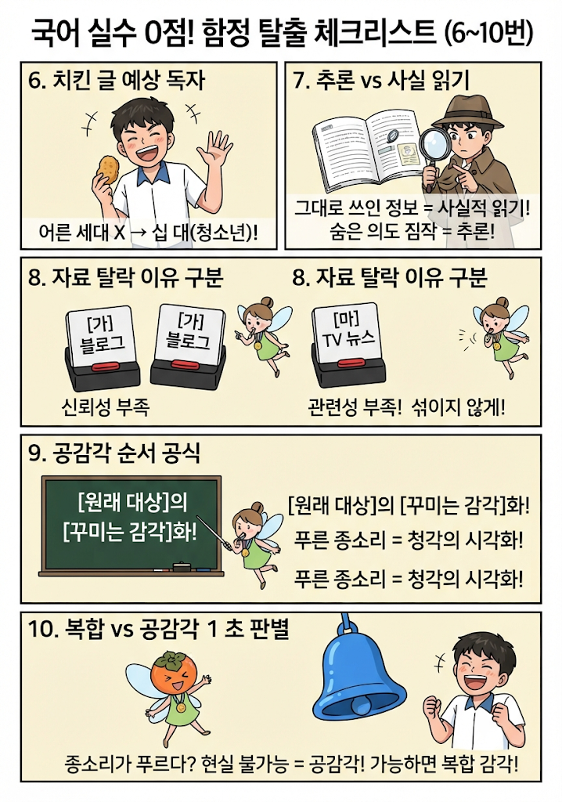

# ⚡ 시험 직전 10분 최종 치트시트 — 2026 7학년 2학기 2회고사 국어

> **시험 전날 밤 & 시험 직전 쉬는 시간용 1장 압축본**  
> **범위**:  
> - **국어A**: 2-(1) 추론하며 이해하기(p.66~75) · 3-(2) 단어의 짜임(p.126~141) · 4-(2) 주장하는 글 쓰기(p.168~181)  
> - **국어B**: 시의 주요 개념 · 교과서 필수 어휘(29개) · 사자성어(18개) [7, 8, 9강]

---

## 🧠 마인드맵 정리

> 가지를 누르면 접고 펼 수 있어요. 먼저 큰 그림을 보고 아래 표로 내려가세요.

```mindmap
국어 2회고사
  단어의 짜임 (국어A)
    형태소
      자립(영수·딸기) vs 의존(조사·어간·어미)
      실질(영수·딸기·먹-) vs 형식(조사·어미·접사)
      용언의 어간 = 의존 + 실질 (함정!)
    단일어
      어근 1개
      바다, 고맙다, 크다
    합성어
      어근 + 어근
      밤낮, 감나무, 오가다
    파생어
      접두사 + 어근: 맨발, 날고기, 풋사랑
      어근 + 접미사: 나무꾼, 웃음, 달리기
      접사: 뜻 더하기 · 품사 바꾸기
    새말
      합성 돌직구 · 파생 사랑꾼
      줄임·결합: 남사친, 웃프다
  추론하며 읽기 (국어A)
    추론 = 글의 정보 + 배경지식
    〈모든 치킨은 옳을까?〉
      관점: 공장식 축산 비판
      제목: 의문형으로 문제 제기
      예상 독자: 십 대
      대안: 동물 복지 농장, 윤리적 소비
  주장하는 글 쓰기 (국어A)
    쓰기 5단계
      계획 → 내용 생성 → 조직
      표현 → 고쳐쓰기
    자료 선별
      관련성: [마] TV 뉴스 탈락
      신뢰성: [가] 개인 블로그 탈락
    고쳐쓰기
      구체적 출처 밝히기
      단정적 표현(무조건) 삭제
  시의 개념 (국어B)
    심상 5종
      시각 · 청각 · 촉각
      미각 · 후각
    화자의 태도
      단정적: 〈바다와 나비〉
      대조적: 〈오우가〉, 〈서시〉
      도피적: 〈청산별곡〉
      달관적: 〈남으로 창을 내겠소〉
    복합 감각
      두 감각을 나란히 (현실 가능)
    공감각
      감각의 전이 (현실 불가능)
      [원래 감각]의 [꾸미는 감각]화
      푸른 종소리 = 청각의 시각화
    형상화
      추상 → 구체적 사물 (인생 → 길)
  어휘·사자성어 (국어B)
    사자성어 18개
      7강: 독야청청, 마이동풍, 망양보뢰
      8강: 명실상부, 물아일체, 미사여구
      9강: 반포지효, 배은망덕, 백골난망
    필수 어휘 29개
      7강: 거처, 견문, 금슬, 발품
      8강: 도량, 명분, 면목, 발원
      9강: 복선, 소임, 술책, 승화
```

---

## 1️⃣ [국어A 최우선!] 단어의 짜임 & 형태소 1초 암기표

### ① 형태소 4분류 (예문: `영수가 딸기를 먹었다.` → 총 **7개**)
| 분류 기준 | 종류 | 한 줄 기준 | 예시 (`영수 / 가 / 딸기 / 를 / 먹- / -었- / -다`) |
| :---: | :---: | :--- | :--- |
| **혼자 쓰일 수 있나?** | **자립 형태소** | 혼자 설 수 있음 (명사 등) | `영수`, `딸기` |
| | **의존 형태소** | 다른 말에 붙어야 함 (조사·어간·어미·접사) | `가`, `를`, **`먹-`**, `-었-`, `-다` |
| **구체적 뜻이 있나?** | **실질 형태소** | 구체적 대상·동작·상태 뜻 있음 | `영수`, `딸기`, **`먹-`** |
| | **형식 형태소** | 문법적 기능·관계만 있음 (조사·어미·접사) | `가`, `를`, `-었-`, `-다` |

> 🔥 **1등 함정 공식**: 용언의 어간(`먹-`, `보-`, `크-`)은 **『의존 형태소』이면서 동시에 『실질 형태소』**다!

### ② 단어의 짜임 분류표
| 대분류 | 소분류 | 구조 공식 | 교과서 핵심 예시 |
| :---: | :---: | :--- | :--- |
| **단일어** | — | **어근 1개** *(어미 `-다`가 붙어도 단일어!)* | `바다`, `하늘`, `얼굴`, `마음`, `구름`, `마을`, `우리`, **`고맙다`**, **`크다`** |
| **복합어** | **합성어** | **어근 + 어근** | `밤낮`, `감나무`, `논밭`, `돌다리`, `집안`, `손발`, `찬밥`, `노을빛`, **`오가다`**, **`오르내리다`**, `돌아보다`, `돌직구` |
| | **파생어** | **접사 + 어근** *(접두사)* | `햇밤`, `한겨울`, **`맨발`**, `맨주먹`, `민소매`, **`날고기`**, `헛수고`, `군침`, `새파랗다`, **`풋사랑`**, **`풋노인`** |
| | | **어근 + 접사** *(접미사)* | `나무꾼`, `사랑꾼`, `멋쟁이`, `고집쟁이`, `재롱둥이`, **`웃음`**, **`믿음`**, **`얼음`**, `달리기` |

- **접사 기능 2가지**: ① **뜻 더하기** (`맨-`: 아무것도 없는, `햇-`: 그해 새로 난, `풋-`: 덜 익은·서툰, `날-`: 익히지 않은) / ② **품사 바꾸기** (`-음`: 동사 `웃다` → 명사 `웃음`)
- **새말 형성법**: 합성(`돌직구`), 파생(`사랑꾼`, `풋노인`), **줄임·결합**(`남사친` ← 남자 사람 친구, `열일하다` ← 열심히+일하다, `웃프다` ← 웃기다+슬프다)



---

## 2️⃣ [국어A] 추론하며 읽기 & 주장하는 글 쓰기 핵심

### ① 2-(1) 추론하며 이해하기 — 〈모든 치킨은 옳을까?〉 (이지선)
- **추론하기 공식**: `글에 드러난 정보(제목·표현·문맥)` + `독자의 배경지식·경험` = **숨은 뜻·글쓴이의 의도와 관점** 파악!
- **글쓴이의 관점**: 닭을 '상품'으로만 보고 효율성만 따지는 **품종 개량·공장식 축산에 비판적**!
- **시험 단골 추론 4세트**:
  1. **제목 `'모든 치킨은 옳을까?'`**: 흔한 말('치킨은 옳다')을 **의문형**으로 바꿔 호기심을 끌고 기존 현실에 **문제 제기**!
  2. **예상 독자**: 어른들을 `'부모님 세대'`라 부르고 `순살치킨·치킨너깃`을 언급 → **십 대(청소년)**! *(어른 세대 아님!)*
  3. **표현 의도**: `'재난'`, `'처참한 이 현실'`(닭의 심각한 고통 강조) / `'가금류 농장, 아니 공장'`(닭을 생명체가 아닌 **물건·상품**으로 찍어 내는 공간임을 비판)
  4. **동물 복지 농장·유기농 운동**: 저렴하게 키우는 게 아니라(X), **닭과 인간 모두 건강하고 올바르게(윤리적 소비)** 나아가려는 대안!

### ② 4-(2) 주장하는 글 쓰기 — 〈우리 동네에 청소년 문화의 집을 설치해야 한다〉
- **글쓰기 5단계**: **계획하기**(주제·목적·독자·매체) → **내용 생성하기**(자료 수집·선별) → **내용 조직하기**(서론-본론-결론 개요) → **표현하기** → **고쳐쓰기**(& 공유하기)
- **자료 선별 2대 기준** *(시험 단골!)*:
  1. **관련성**: 주장과 직접 관련 있는가? → ❌ `[마] TV 뉴스(청소년 지도사 처우 개선)` **탈락!**
  2. **신뢰성(출처)**: 출처가 명확하고 믿을 만한가? → ❌ `[가] 요리 블로거 개인 블로그("아는 사람 말에 따르면...")` **탈락!**
- **고쳐쓰기 핵심 2가지 (교과서 p.175)**:
  1. `"연구에 따르면"` → **구체적 출처** 밝히기 (`장여옥·임양지의 연구에 따르면`)
  2. `"무조건 필요하다"` → 지나치게 강한 **단정적 표현(`무조건`, `절대로`) 삭제**! (거부감 유발, 설득력 하락!)



---

## 3️⃣ [국어B] 시의 주요 개념 · 필수 어휘(29개) · 사자성어(18개)

### ① 시의 주요 개념 1초 구별 (7·8·9강)
- **7강 감각적 심상 5종**: **시각**(파릇한, 오물거리는) · **청각**(가와가와, 풀피리 소리) · **촉각**(열이 오른다, 차디찬, 부드러운) · **미각**(쓰디쓰다) · **후각**(매화 향기, 보리 내음새)
- **8강 화자의 태도·어조 4종**:
  - **단정적**: 딱 잘라 확고하게 말함 (`도무지 바다가 무섭지 않다` — 〈바다와 나비〉)
  - **대조적**: 서로 반대되어 대비 (`꽃·풀[가변]` vs `바위[불변]` — 〈오우가〉 / `별[이상]` vs `바람[현실]` — 〈서시〉)
  - **도피적**: 현실을 벗어나 이상향으로 피함 (`청산에 살어리랏다` — 〈청산별곡〉)
  - **달관적**: 근심 없이 초월·여유로움 (`분별 없이 늙으리라` — 〈말 없는 청산이요〉 / `왜 사냐건 웃지요` — 〈남으로 창을 내겠소〉)
- **9강 심상 심화 & 형상화** ⭐ *(최고 빈출 함정!)*:
  - **복합 감각**: 2개 감각이 **단순 나열** (`흐릿한 불빛[시각]` + `도란도란거리는[청각]`, `흰 옷고름` + `향기로워라`)
  - **공감각적 심상**: **현실 불가능!** 감각이 **전이(이동)**됨 → 공식: **`[원래 대상 감각]의 [꾸미는 감각]화`**
    - `푸른 종소리` / `금빛 게으른 울음` / `부르는 소리는 비껴가지만` → **청각의 시각화**
    - `새파란 초생달이 시리다` / `먼 산이 이마에 차라` → **시각의 촉각화**
    - `파아란 바람` → **촉각의 시각화** / `물소리에 이가 시리다` → **청각의 촉각화** / `향긋한 목소리` → **청각의 후각화**
  - **형상화**: 추상적 개념·정서를 구체적 사물로 표현 (`인생 → 길`, `시련 → 고개`, `평화 → 마을` — 윤동주 〈새로운 길〉)



### ② 7·8·9강 사자성어 18개 1초 암기표
| 강 | 사자성어 (한자) | 3단어 핵심 뜻 | 강 | 사자성어 (한자) | 3단어 핵심 뜻 |
| :-: | :--- | :--- | :-: | :--- | :--- |
| **7** | **독야청청**(獨也靑靑) | 홀로 절개 지킴 | **8** | **물아일체**(物我一體) | 자연과 내가 하나 |
| **7** | **동분서주**(東奔西走) | 사방으로 바삐 뜀 | **8** | **미사여구**(美辭麗句) | 속 빈 화려한 말 |
| **7** | **두문불출**(杜門不出) | 집 안에만 틀어박힘 | **8** | **미풍양속**(美風良俗) | 아름답고 좋은 풍속 |
| **7** | **마이동풍**(馬耳東風) | 남의 말 흘려들음 *(소 귀에 경 읽기)* | **9** | **박학다식**(博學多識) | 지식이 넓고 많음 |
| **7** | **망양보뢰**(亡羊補牢) | 실패 뒤 뉘우침 *(소 잃고 외양간)* | **9** | **반포지효**(反哺之孝) | 까마귀 효성·보은 |
| **7** | **망연자실**(茫然自失) | 황당해 멍 때림 | **9** | **배은망덕**(背恩忘德) | 은혜 배신·원수 |
| **8** | **매점매석**(買占賣惜) | 사재기 후 비싸게 팜 | **9** | **백골난망**(白骨難忘) | 죽어도 은혜 못 잊음 |
| **8** | **명실상부**(名實相符) | 이름과 실제가 같음 | **9** | **백년대계**(百年大計) | 먼 앞날의 큰 계획 |
| **8** | **묵묵부답**(默默不答) | 침묵하며 대답 안 함 | **9** | **백년해로**(百年偕老) | 부부가 평생 함께 늙음 |

### ③ 7·8·9강 필수 어휘 29개 초압축 체크
- **7강(10)**: **거처**(사는 곳) · **곁길**(갈라진 길/벗어난 방향) · **구천**(죽은 뒤 영혼 가는 곳) · **군락**(식물 집단/모인 마을) · **남루**(낡아 해진 옷) · **담수**(염분 없는 민물) · **견문**(보고 들은 지식) · **금슬**(부부 사랑) · **대목**(명절 성수기/글의 특정 부분) · **발품**(걸어 다니는 수고)
- **8강(9)**: **도량**(너그럽고 깊은 마음) · **권위**(이끄는 힘/인정받는 실력) · **딴전**(관계없는 딴짓) · **명분**(내세우는 이유·핑계) · **명성**(널리 알려진 이름) · **면목**(겉모습/떳떳한 체면) · **박제**(죽은 동물 원래 모양 보존) · **반열**(높은 지위·등급) · **발원**(물줄기·사상이 처음 생김)
- **9강(10)**: **뱃심**(고집대로 버티는 힘) · **병폐**(오랜 잘못과 피해) · **복선**(앞으로의 사건 미리 암시) · **비수**(날카로운 짧은 칼) · **사생**(풍경·실물 그대로 그림) · **소임**(맡은 일·책임) · **수렵**(짐승 사냥) · **술책**(꾸미는 꾀·방법) · **슬하**(부모가 자식 보살피는 아래) · **승화**(더 높은 상태로 발전)

---

## 4️⃣ ⚠️ 아들을 위한 「국어 실수 0점」 함정 탈출 체크리스트 10선

1. **[문제 끝 동그라미]** "알맞은 것" vs "알맞지 **않은** 것", "거리가 **먼** 것", "몇 어절/몇 음절" 반드시 체크!
2. **[용언 어간 함정]** `먹-`, `보-`는 **의존 형태소**이면서 **실질 형태소**다! (형식 형태소 아님!)
3. **[`고맙다`·`크다` 함정]** 어미 `-다`가 붙어 있어도 어근이 1개이므로 **단일어**다! (파생어 X)
4. **[`맨발`·`날고기`·`웃음` 함정]** `맨-`, `날-`, `-음`은 모두 **접사** → 합성어가 아니라 **파생어**!
5. **[`감나무`·`오가다` 함정]** `감`+`나무`, `오(다)`+`가다`는 둘 다 어근 → 파생어가 아니라 **합성어**!
6. **[치킨 글 예상 독자 함정]** 〈모든 치킨은 옳을까?〉의 예상 독자는 어른이 아니라 **십 대(청소년)**!
7. **[추론 vs 사실 읽기 함정]** 글에 그대로 쓰인 사실을 찾는 건 '사실적 읽기'지 '추론'이 아니다!
8. **[자료 탈락 이유 구분]** `[가] 개인 블로그` = **출처 불명확(신뢰성 부족)** / `[마] TV 뉴스` = **주제와 무관(관련성 부족)** — 둘이 섞이지 않게!
9. **[공감각 순서 공식]** **`[원래 대상 감각]의 [꾸미는 감각]화`**! `푸른 종소리`는 시각의 청각화가 아니라 **청각의 시각화**!
10. **[복합 감각 vs 공감각]** `"A가 B하다"`로 바꿨을 때 **현실에서 가능하면 복합 감각**, **말이 안 되면 공감각**! (`종소리가 푸르다` → 불가능 = 공감각!)




