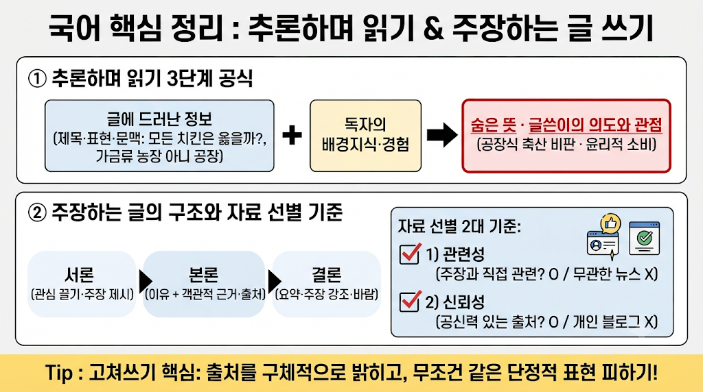
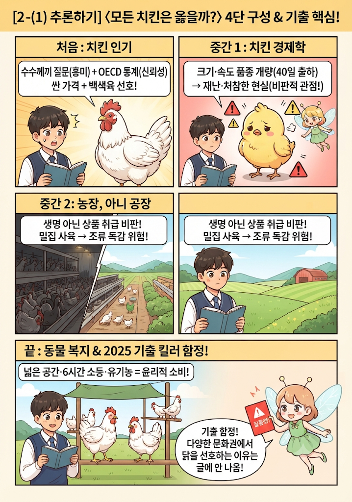
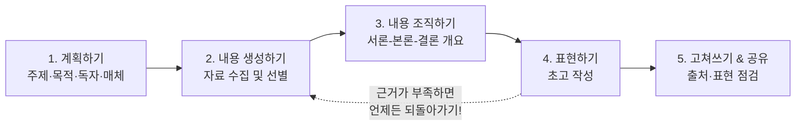
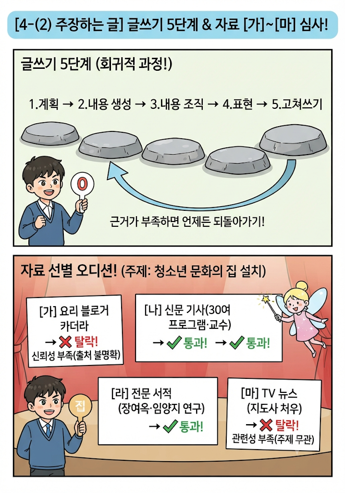
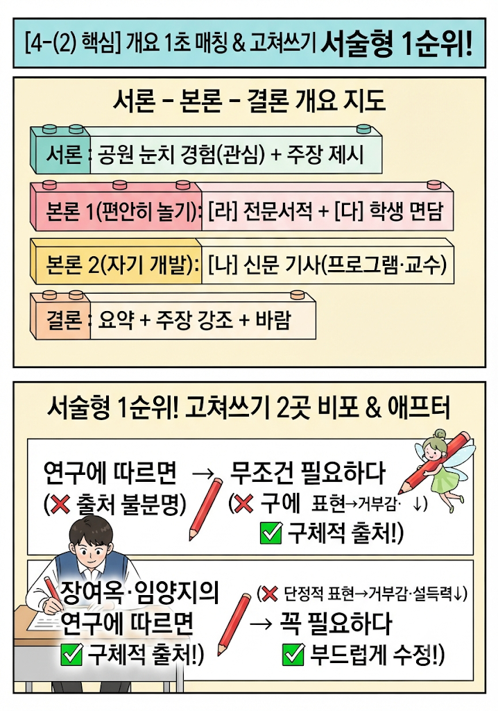

# 📘 국어A — 2-(1) 추론하며 이해하기 & 4-(2) 주장하는 글 쓰기 완벽 정리

> **교과서 범위**: 2-(1) 추론하며 이해하기 (p.66~75) · 4-(2) 주장하는 글 쓰기 (p.168~181)  
> **연계 기출**: 2025학년도 KIS 7학년 2학기 2차 지필평가 6~8번 (〈모든 치킨은 옳을까?〉 그대로 출제!)  
> **학습 목표**: 글쓴이의 숨은 의도·관점 추론하기 · 타당한 근거와 적절한 표현으로 설득력 있는 주장하는 글 쓰기

---

---

# PART 1. 2-(1) 추론하며 이해하기 (교과서 p.66~75)

## 01. 추론하며 읽기란? (p.66, p.75)

### 1) 개념
- **추론(推論)**: 글에 직접 쓰여 있지 않은 **생략된 내용, 숨은 뜻, 글쓴이의 의도와 관점**을 단서를 바탕으로 미루어 짐작하는 것.
- **추론 공식**:
  $$\text{글에 드러난 정보 (제목·표현·문맥)} + \text{나의 배경지식 · 경험} = \textbf{글쓴이의 의도와 관점 추론}$$

### 2) 글쓴이의 의도와 관점을 추론하는 3가지 방법 (p.75 개념 쏙쏙 ⭐)
1. **외적 단서 활용**: **제목, 책 표지, 차례, 작가 정보**와 같은 단서를 바탕으로 추론한다.
2. **내적 단서 활용**: **글에 나타난 정보와 문맥(특정 단어·표현)**을 활용하여 추론한다.
3. **독자 요인 활용**: **자신의 배경지식이나 경험**을 바탕으로 추론한다.

> ⚠️ **2025 KIS 기출 함정 체크! (8번 실제 출제!)**  
> *"글에서 사실 그대로 제시된 정보를 정확히 추론해 내며 읽었는가?"* → **틀림(X)!**  
> 글에 **사실 그대로** 적혀 있는 정보를 확인하는 것은 '사실적 읽기'이며, **추론**은 드러나지 않은 **의도·관점·생략된 내용**을 미루어 짐작하는 활동이다!

---

## 02. 본문 완벽 분석 — 〈모든 치킨은 옳을까?〉 (이지선, p.68~72)

### 1) 글의 전체 구성과 핵심 내용 (교과서 p.73 학습활동 1번 정답 포함)

| 구성 | 소제목 | 핵심 내용 요약 | 글쓴이의 전략·표현 |
| :---: | :--- | :--- | :--- |
| **처음** | **식을 줄 모르는 치킨의 인기** | • 우리나라 성인 1년 약 16 kg 섭취, 10가구 중 7가구가 주 1회 이상 섭취, 전 세계 가축 300억 중 230억 마리가 닭 • 21세기 들어 닭고기 소비량이 돼지고기를 추월해 계속 **증가**하고 있음 • **이유 2가지**: ① 가격이 상대적으로 **쌈** ② 건강을 생각해 적색육보다 **백색육** 소비 증가 | • 수수께끼 같은 **질문**("이것은 무엇일까요?")으로 **흥미(관심)** 유발 • **OECD 통계** 제시로 신뢰성 확보 |
| **중간 1** | **치킨 경제학의 시작** | • 닭이 '동물'이 아니라 **'상품'**이 되면서 **최소 비용·최대 효과**의 경제학 원리가 적용됨 • **품종 개량 2방향**: ① **크기**(가슴살을 비정상적으로 크게) ② **성장 속도**(1970년대 10주 → 현재 **40일** 만에 출하, 수명 5~13년인데 병아리 시절에 고기가 됨) • **부작용**: 가늘고 약한 다리에 관절·근육 무리, 살이 흐물흐물해지고 수분 빠짐 → 업체는 **인산염·소금 등 첨가물** 투입 | • `'큰 재난'`, `'처참한 이 현실'` 같은 표현으로 닭의 고통 강조 |
| **중간 2** | **공장에 사는 닭들이 위험해** | • 전통적 **방목형 축산**과 달리, 효율성을 우선시해 좁은 공간에 대량 밀집 사육하는 **공장식 축산** 도입 • 좁은 공간 스트레스 + 배설물 비위생 + 품종 개량으로 인한 면역력 저하 → **조류 독감** 같은 치명적 감염병에 매우 취약 • 닭이 병들면 **그 여파가 결국 인간에게도 돌아옴** | • `'가금류 농장, 아니 공장'`이라는 표현으로 생명체를 공산품처럼 찍어 내는 현실 비판 |
| **끝** | **진정으로 옳은 치킨을 위하여** | • 치킨을 아예 안 먹을 수는 없지만, **더 건강하고 올바르게** 먹을 방법이 있음 • 사육 환경 개선(축사 면적 넓히기), 소비자 관심 증가, **유기농 운동** 확산 • 닭과 인간의 관계가 어떤 모습으로 변화해야 할지 질문을 던지며 마무리 | • 질문으로 마무리하여 독자가 스스로 생각하고 실천하도록 유도 |

### 2) 시험 100% 적중! 추론하기 6대 핵심 질문 & 모범 답안 (p.68~75) ⭐

| 번호 | 교과서 추론 질문 | 시험에 통하는 모범 답안 (핵심 키워드) |
| :-: | :--- | :--- |
| **1** | **제목에 `'모든 치킨은 옳다'`는 표현을 의문형(`모든 치킨은 옳을까?`)으로 활용한 이유는?** | 독자의 **관심(흥미)**을 끌고, 우리가 흔히 먹는 치킨의 생산 과정이 정말 옳은지 **기존의 현실이나 인식에 문제를 제기**하기 위해서이다. |
| **2** | **이 글의 예상 독자는 누구이며, 그 근거는?** | **십 대(청소년)**이다. 근거: ① 어른들을 `'부모님 세대'`라고 표현함 ② 십 대가 좋아하는 `'순살치킨, 치킨너깃'`에 대해 질문함 *(⚠️ 2025 기출 함정: '어른 세대'라고 하면 오답!)* |
| **3** | **`'재난'`, `'처참한 이 현실'`이라는 표현을 사용한 이유는?** | 경제학적으로는 효율적이지만, **닭의 입장에서는 생명을 위협받고 큰 고통을 겪는 심각한 상황**임을 강조하고 **비판적 관점**을 드러내기 위해서이다. |
| **4** | **`'가금류 농장, 아니 공장'`이라고 표현한 이유는?** | 닭을 살아 있는 생명으로 대우하지 않고, **효율성만 따져 대량으로 찍어 내는 물건(상품)처럼 취급하는 공간**임을 강조·비판하기 위해서이다. |
| **5** | **작은 공간에서 많은 가축을 생산하다 보면 또 어떤 문제가 생길 수 있을까?** *(배경지식 활용)* | • **가축 배설물**이 너무 많아 처리가 어렵고 **악취·수질·토양 등 환경 오염**이 발생한다. • 조류 독감 등으로 대규모 살처분이 일어나면 **닭고기·달걀 가격이 폭등**하거나 식량 수급에 문제가 생긴다. |
| **6** | **유기농 운동이 닭을 올바르게 먹을 수 있는 방법이 되는 이유는?** | 합성 화학 물질·비위생적 밀집 사육 대신 **자연적이고 건강한 환경**에서 기른 닭을 소비함으로써, **동물의 생명 존중(윤리적 소비)**과 **인간의 건강**을 함께 지킬 수 있기 때문이다. *(⚠️ 2025 기출 함정: '더 저렴하게 키우기 때문'은 오답!)* |

### 3) 외부 자료(신문 기사) 연결 추론 (p.74) & 글쓴이의 궁극적 의도 (p.75)
- **p.74 신문 기사 핵심 (경남 하동군 동물 복지 축산 농장)**:
  - 공장식 닭장보다 사육 밀도가 **3배 이상 넓음**, 최소 **6시간 이상 불을 끔**(공장식 닭장은 산란율을 높이려고 밤에도 불을 켬).
  - **자유 방목** 인증 조건: 뛰어다니거나 날 수 있는 공간, **횃대**, 모래 목욕용 **깔짚**, 맹금류 공포심을 줄이는 **차양막** 설치.
  - **추론**: 글쓴이가 *"사육 환경을 개선하는 양계장이 나타나고 있다"*고 말한 이유는, **닭의 본래 습성을 존중하고 스트레스를 줄여 주는 '동물 복지 축산 농장'이 공장식 축산의 실제 대안이 될 수 있음**을 알리기 위해서이다.
- **글쓴이가 궁극적으로 하고 싶은 말 (주제·의도)**:
  > **"효율성만 추구하는 공장식 축산의 문제점을 인식하고, 동물과 인간이 함께 건강해질 수 있도록 닭을 더 올바르고 윤리적인 방식으로 생산하고 소비하자."**

> ⚠️ **2025 KIS 기출 6번 킬러 함정 주의!**  
> 본문에 *"돼지고기나 소고기와는 달리 다양한 문화권에서 선호하는 육류이지요."*라고만 적혀 있을 뿐, **『왜 다양한 문화권에서 닭을 선호하는지(종교적 이유 등)』는 글에 나와 있지 않다!**  
> → *"글을 통해 알 수 있는 내용이 아닌 것은?"* 문제에서 **`다양한 문화권에서 닭을 선호하는 이유`**가 정답(알 수 없음)으로 출제되었다!

---

# PART 2. 4-(2) 주장하는 글 쓰기 (교과서 p.168~181)

## 01. 설득력 있는 주장 vs 설득력 약한 주장 (p.168)

- **힘찬이**: *"지은이를 반장으로 뽑아야 합니다. 왜냐하면 리더십이 있기 때문입니다."* → **구체적 근거 부족 (설득력 약함)**
- **하늘이**: *"진형이를 반장으로 뽑아야 합니다. 왜냐하면 리더십이 있기 때문입니다. **지난번 체육 대회에서 우리 반 아이들을 모아 주도적으로 응원하기도 했습니다.**"* → **구체적인 사례(근거) 제시 (설득력 높음!)**

---

## 02. 주장하는 글 쓰기 5단계 완벽 정리 (p.170~175)

> 💡 **교과서 p.173·179 중요 포인트**: 글쓰기는 한 방향으로만 가는 것이 아니라, **표현하기 단계에서 근거가 잘 어울리지 않거나 막힐 때 '내용 생성하기'나 '내용 조직하기' 단계로 다시 돌아가(회귀적 과정)** 타당한 근거를 보완할 수 있다!

### ① 1단계: 계획하기 (p.170)
- **주제**: 우리 동네에 청소년 문화의 집이 필요하다.
- **목적**: 나의 주장을 설득력 있게 펼치기 위해서 (설득)
- **예상 독자**: 학교 학생들
- **매체**: 학교 신문 (주제: '청소년 복지')

### ② 2단계: 내용 생성하기 — 자료 선별의 2대 기준 ⭐ (p.171~173)
자료를 고를 때는 반드시 **① 자신의 주장과 관련이 있는가(관련성)**, **② 출처가 명확하고 믿을 만한가(신뢰성)** 두 가지를 따져야 한다!

| 자료 | 종류 및 내용 요약 | 사용 여부 | 판단 이유 (시험 단골 서술형!) |
| :---: | :--- | :---: | :--- |
| **[가]** | **인터넷 개인 블로그** (요리 블로거 OOO: *"제가 아는 사람의 말에 따르면 청소년 문화 시설이 부족한 지역은 대학 진학률이 매우 낮다고 하네요"*) | ❌ **사용 금지** | **출처가 명확하지 않고** 개인의 카더라식 이야기이므로 **믿을 만한 자료가 아님 (신뢰성 부족)** |
| **[나]** | **신문 기사** (아시아경제, 2023.8.30.): OO구 청소년 문화의 집 개관 — 문화·예술, 진로, 자치 등 30여 개 프로그램 + 전문가 장◇◇ 교수 의견 | ✅ **사용** | 신뢰할 수 있는 신문 기사 + 주장(자기 개발 기회)과 직접 관련 |
| **[다]** | **면담 자료** (이용 학생 김OO·고△△): 자유롭고 피시방·노래방 대신 자주 이용, 춤춰도 이상하게 쳐다보는 사람 없음 | ✅ **사용** | 실제 이용자의 생생한 경험 + 주장(편안하고 자유롭게 놈)과 직접 관련 |
| **[라]** | **전문 서적** (장여옥·임양지, 『청소년 전용 공간에 대한 청소년의 이용 경험 연구』): 성인 눈치·잔소리 없이 편안하게 쉴 수 있는 공간 | ✅ **사용** | 전문가가 쓴 신뢰도 높은 연구 자료 + 주장과 직접 관련 |
| **[마]** | **텔레비전 뉴스** (OBS 뉴스, 2022.2.28.): *"청소년 지도사 처우 개선 이번엔? 낮은 처우에 평균 근속 연수 3.9년"* | ❌ **사용 금지** | 뉴스라 신뢰성은 있지만, **주장(청소년 문화의 집 설치 필요)과 관련이 없는 자료임 (관련성 부족)** |

> ⚠️ **자료 출처 표기법 (p.177 도움말)**  
> - **도서**: 저자, 제목, 출판사, 발행 연도 / **신문 기사**: 기사 제목, 신문사명, 날짜 / **인터넷**: 사이트 주소 / **그래프·표**: 조사 기관, 연도

### ③ 3단계: 내용 조직하기 — 개요의 정확한 매칭 ⭐ (p.173)

| 구성 | 역할 | 힘찬이의 개요 핵심 (교과서 p.173 정답 완성본!) |
| :---: | :--- | :--- |
| **서론** | 읽는 이의 **관심** 끌기(질문·경험·속담·명언) + **주장** 제시 + 본론 내용 **예고** | • 동네에 청소년 복지 공간이 부족해 불편했던 경험(공원에서 영상 찍다 어른들 눈치 본 일) 제시 • 청소년 문화의 집 설치로 해결할 수 있다는 주장 제시 & 이유 예고 |
| **본론 1** | **이유 1** + 타당한 **근거 자료** 제시 | • **이유 1**: 청소년 문화의 집에서는 **편안하고 자유롭게 놀 수 있음** • **근거 1 (`[라]` 전문 서적)**: 장여옥·임양지 연구 — 잔소리·눈치 주는 사람 없이 아늑하게 쉴 수 있음 • **근거 2 (`[다]` 면담 자료)**: 김OO·고△△ 학생 — 피시방 대신 자유롭게 이용, 눈치 안 보고 춤 연습 가능 |
| **본론 2** | **이유 2** + 타당한 **근거 자료** 제시 | • **이유 2**: 청소년 문화의 집은 청소년의 **자기 개발을 돕는 공간임** • **근거 1 (`[나]` 신문 기사)**: 문화·예술, 진로, 지역 청소년 자치 활동 등 30여 개의 다양한 프로그램 운영 • **근거 2 (`[나]` 신문 기사)**: 아동 청소년 전문가 장◇◇ 교수 — 성취감·만족감 느끼고 자신의 역량 발견 |
| **결론** | 본론 **요약** + 주장 **강조** + **제안·바람** 언급 | • 본론의 두 가지 이유(편안히 놀기 + 자기 개발) 간단히 요약 • 하루빨리 설치되어 건강하고 풍요로운 삶을 살기를 희망하며 마무리 |

### ④ 4~5단계: 표현하기 & 고쳐쓰기 ⭐ (p.174~175, p.180~181)

선생님이 힘찬이의 초고(p.175)에서 짚어 준 **고쳐쓰기 핵심 2곳**은 서술형 1순위!

| 고치기 전 (초고) | 문제점 | 고친 후 (수정본) |
| :--- | :--- | :--- |
| `"연구에 따르면 청소년 전용 공간 이용자들은..."` | 어떤 연구인지 **근거의 출처가 불분명**하여 신뢰성이 떨어짐 | **`"장여옥·임양지의 연구에 따르면"`** (구체적 출처 밝히기!) |
| `"...공간이라는 점에서 무조건 필요하다."` | `'무조건'`, `'절대로'` 같은 **지나치게 강한 어조·단정적 표현**은 독자에게 거부감을 주어 설득력을 떨어뜨림 | **`"...공간이라는 점에서 꼭 필요하다."`** 또는 **`"필요하다."`** |

### ⑤ 소단원 핵심 용어 4개 (p.181 정리하기)
- **주장**: 상대를 설득하기 위한 글쓴이의 생각
- **근거**: 주장을 뒷받침하는 객관적인 자료
- **개요**: 글을 어떻게 쓸 것인지 계획하여 한눈에 보이게 정리한 것
- **출처**: 글을 쓸 때 인용하는 자료가 수록된 곳

---

## ✅ 교과서 핵심 서술형 모범 답안 체크 (시험 전 암기!)

1. **〈모든 치킨은 옳을까?〉에서 글쓴이가 `'가금류 농장, 아니 공장'`이라고 표현한 의도는?**
   > 닭을 살아 있는 생명체가 아니라 효율성만 따져 대량으로 생산하는 **물건(상품)처럼 취급하는 공장식 축산의 현실을 비판하고 강조하기 위해서**이다.
2. **힘찬이가 자료 `[가]`와 `[마]`를 사용하지 말아야 하는 까닭을 각각 서술하시오.**
   > `[가]` 인터넷 개인 블로그는 **출처가 명확하지 않고 믿을 만한 자료가 아니기 때문(신뢰성 부족)**이고, `[마]` 텔레비전 뉴스는 **자신의 주장(청소년 문화의 집 설치 필요성)과 관련이 없는 자료이기 때문(관련성 부족)**이다.
3. **주장하는 글에서 `"무조건 필요하다."`와 같은 표현을 고쳐야 하는 까닭은?**
   > `'무조건'`처럼 **지나치게 강한 어조나 단정적인 표현**을 사용하면 **읽는 사람에게 거부감을 주어 오히려 글의 설득력이 떨어지기 때문**이다.

