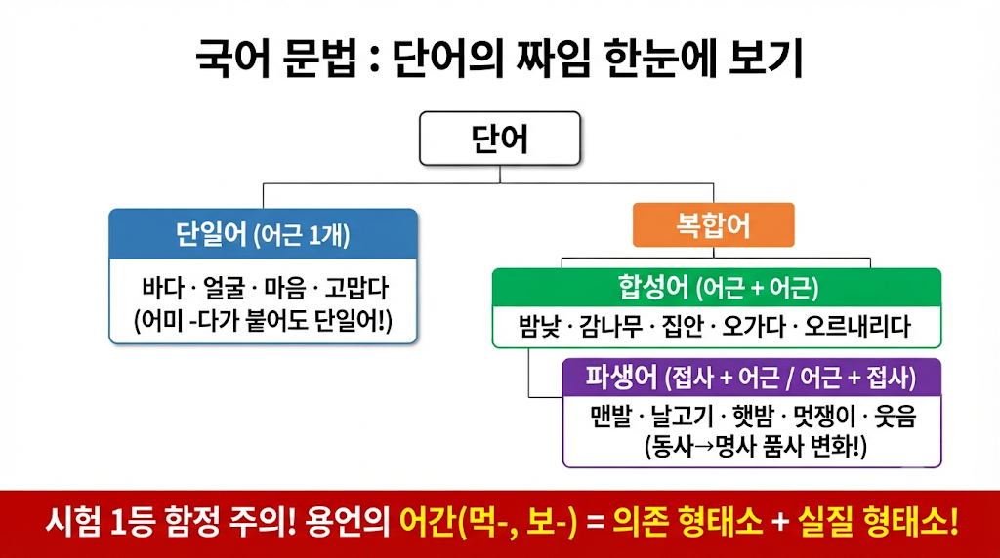
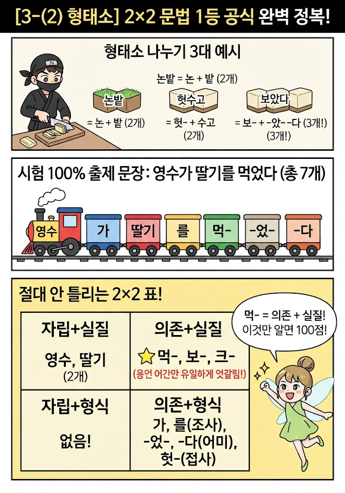
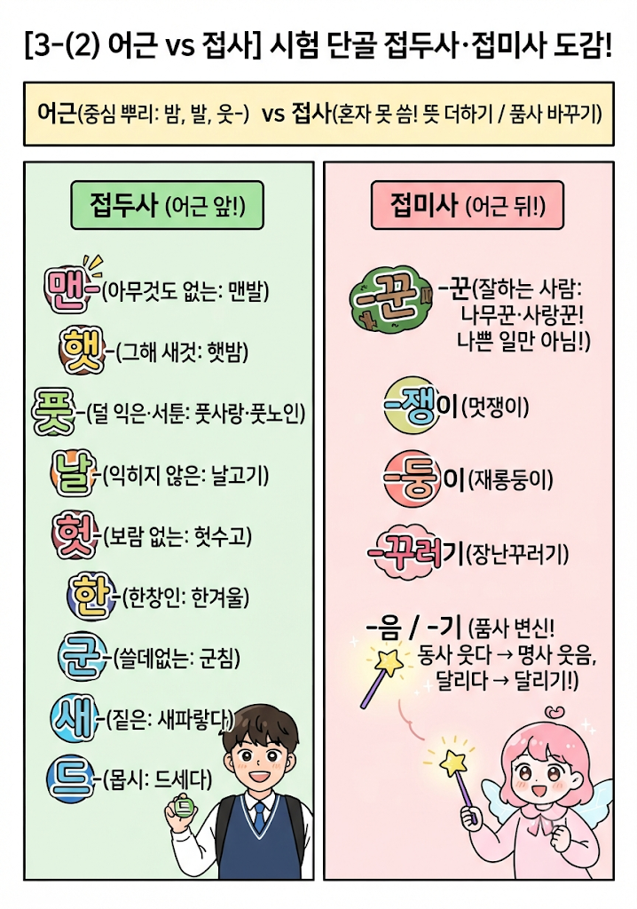
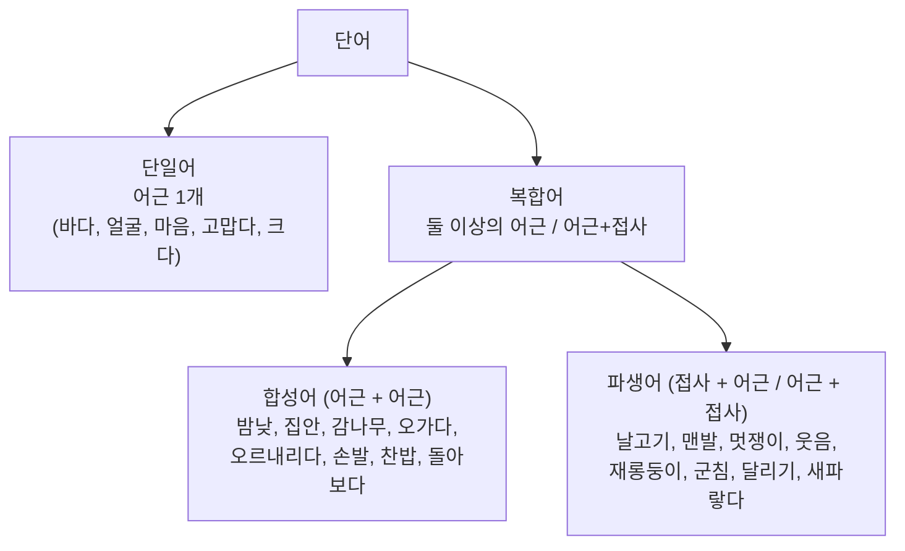
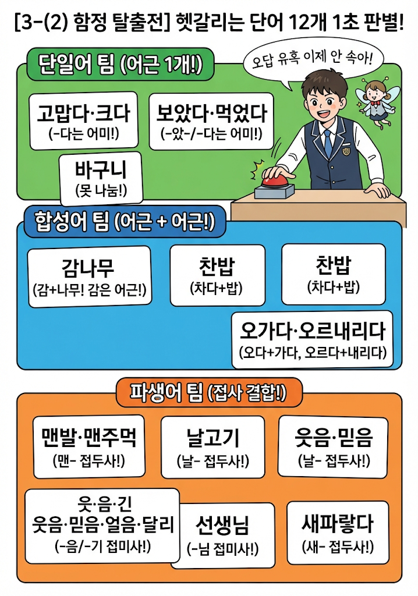
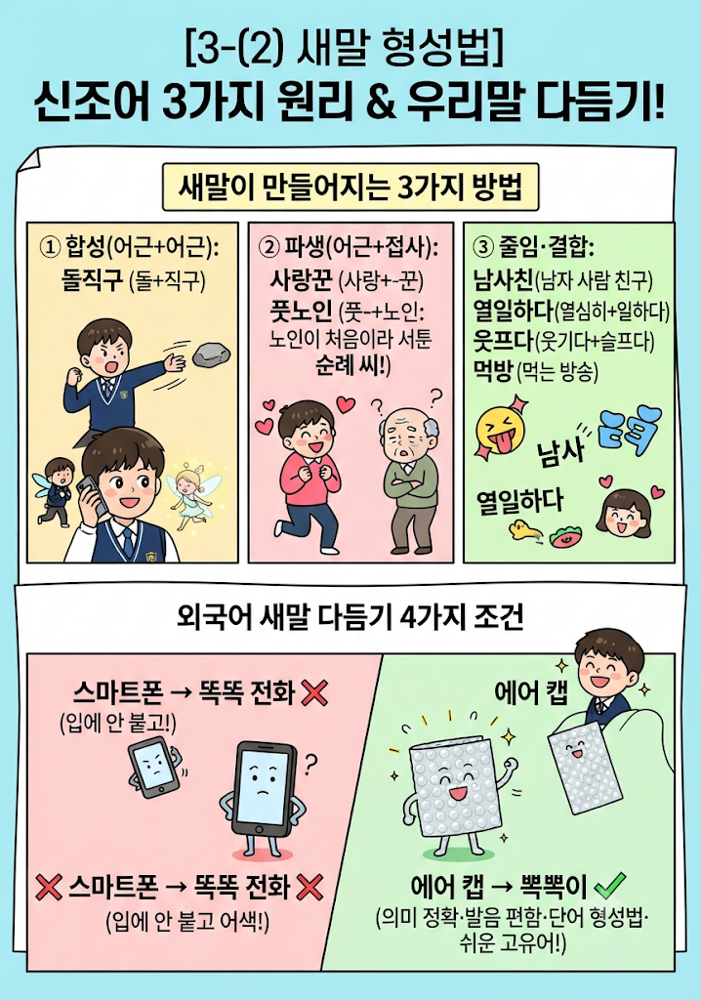

# 📘 국어A — 3-(2) 단어의 짜임 완벽 정리 ⭐ 변별력 1순위

> **교과서 범위**: 3-(2) 단어의 짜임 (p.126~141)  
> **연계 기출**: 2025학년도 KIS 7학년 2학기 2차 지필평가 21~22번, 서답형 5번  
> **학습 목표**: 형태소의 개념과 4가지 종류 분석하기 · 어근과 접사 구별하기 · 단일어/합성어/파생어 판별 및 새말 형성 원리 이해하기

> 💡 **왜 이 단원이 가장 중요할까?**  
> 아드님 교과서에서 이 단원 빈칸이 아직 비어 있고, 문법은 **개념을 정확히 한 번만 잡으면 100% 다 맞힐 수 있는 효자 단원**이지만, 대충 외우면 함정에 줄줄이 걸리는 단원이기 때문입니다! 아래 표와 훈련 문제만 끝내면 완벽하게 정복됩니다.

---

---

## 01. 형태소의 개념과 4가지 분류 (교과서 p.127~128)

### 1) 형태소란?
- **뜻을 가진 가장 작은 말의 단위** (더 나누면 본래 가지고 있던 뜻이 사라지거나 관계없는 말이 됨).
- 예: `'꽃나무'` → `'꽃'` + `'나무'` (2개의 형태소). `'나무'`를 `'나'`와 `'무'`로 더 나누면 본래 뜻이 사라지므로 더 나눌 수 없다!
- **표기 약속**: 혼자 쓰일 수 없고 다른 말에 붙어야 하는 의존 형태소는 다른 형태소가 필요한 자리에 **`'-'`(붙임표)**를 붙인다. *(예: `헛-`, `먹-`, `-었-`, `-다`)*

### 2) 교과서 p.127 단어 형태소 분석 정답표
| 단어 | 형태소 분석 | 형태소 개수 | 참고 |
| :---: | :--- | :---: | :--- |
| **하늘** | `하늘` | 1개 | 더 나누면 뜻 사라짐 |
| **바다** | `바다` | 1개 | 더 나누면 뜻 사라짐 |
| **논밭** | `논` + `밭` | 2개 | 자립·실질 + 자립·실질 |
| **돌다리** | `돌` + `다리` | 2개 | 자립·실질 + 자립·실질 |
| **헛수고** | `헛-` + `수고` | 2개 | `헛-`(접사: 의존·형식) + `수고`(자립·실질) |
| **보았다** | `보-` + `-았-` + `-다` | **3개** | `보-`(어간: **의존·실질**) + `-았-`(과거 어미: 의존·형식) + `-다`(종결 어미: 의존·형식) |

### 3) 형태소의 2가지 분류 기준 ⭐ (교과서 p.128 핵심!)

| 분류 기준 | 종류 | 의미 | 해당하는 말 |
| :---: | :---: | :--- | :--- |
| **① 자립성 유무** *(홀로 쓰일 수 있는가?)* | **자립 형태소** | 혼자서도 문장에 쓰일 수 있음 | 명사, 대명사, 수사, 관형사, 부사, 감탄사 |
| | **의존 형태소** | 반드시 다른 형태소에 붙어서 쓰임 | 조사, **용언의 어간**, 용언의 어미, 접사 |
| **② 실질적 의미 유무** *(구체적 뜻이 있는가?)* | **실질 형태소** | 구체적인 대상·동작·상태의 뜻을 가짐 | 명사 등 자립 형태소 전체 + **용언의 어간** |
| | **형식 형태소** | 구체적 뜻 없이 문법적 관계·기능만 나타냄 | 조사, 용언의 어미, 접사 |

### 4) 시험 100% 출제! 교과서 문장 분석 (p.128 2번 정답 완성본)

> **문장**: **`영수가 딸기를 먹었다.`**  
> **형태소 분석**: `영수` / `가` / `딸기` / `를` / `먹-` / `-었-` / `-다` (**총 7개**)

| 형태소 종류 | 해당하는 형태소 | 개수 |
| :---: | :--- | :---: |
| **자립 형태소** | `영수`, `딸기` | 2개 |
| **의존 형태소** | `가`, `를`, **`먹-`**, `-었-`, `-다` | 5개 |
| **실질 형태소** | `영수`, `딸기`, **`먹-`** | 3개 |
| **형식 형태소** | `가`, `를`, `-었-`, `-다` | 4개 |

> 🔥 **절대 잊지 마! 문법 1등 공식 — 2×2 표로 끝내기**
> | | **자립 형태소** | **의존 형태소** |
> | :---: | :---: | :---: |
> | **실질 형태소** | `영수`, `딸기`, `하늘`, `논`, `밭` | ⭐ **`먹-`, `보-`, `크-` (용언의 어간!)** |
> | **형식 형태소** | *(없음!)* | `가`, `를`(조사), `-었-`, `-다`(어미), `헛-`, `맨-`(접사) |
>
> **핵심**: 자립 형태소는 100% 실질 형태소다! 유일하게 엇갈리는 **『용언의 어간(`먹-`, `보-`, `고맙-`)』**만 **`의존 + 실질`**이라고 기억하면 형태소 문제는 절대 틀리지 않는다!

---

## 02. 어근과 접사 (교과서 p.129, p.132)

### 1) 개념 구별
- **어근(語根, 단어의 뿌리)**: 단어를 분석할 때 **실질적인 의미를 나타내는 중심 부분** (예: `하늘`, `산`, `물`, `가방`, `책`, `밤`, `겨울`, `나무`, `웃-`)
- **접사(接辭, 붙는 말)**: 어근의 **앞이나 뒤에 붙어** 특정한 **의미를 더하거나 품사를 바꾸는** 주변 부분 (절대 혼자 쓰이지 못함!)
  - **접두사** (어근의 **앞**에 붙음): `햇-`, `한-`, `맨-`, `민-`, `날-`, `헛-`, `풋-`, `군-`, `새-`, `덧-`, `드-`
  - **접미사** (어근의 **뒤**에 붙음): `-꾼`, `-쟁이`, `-개`, `-둥이`, `-꾸러기`, `-음`, `-기`, `-님`

### 2) 교과서 p.129 표 정답 (함정 단어 `감나무` 주의! ⚠️)
| 단어 | 어근 (중심 부분) | 접사 (주변 부분) | 짜임 분류 |
| :---: | :---: | :---: | :---: |
| **햇밤** | `밤` | `햇-` (그해에 새로 난) | 파생어 |
| **한겨울** | `겨울` | `한-` (한창인) | 파생어 |
| **감나무** ⭐ | **`감`, `나무`** | *(없음!)* | **합성어!** *(※ `감`은 과일 이름 = 어근!)* |
| **나무꾼** | `나무` | `-꾼` (어떤 일을 전문·습관적으로 하는 사람) | 파생어 |

### 3) 시험에 단골로 나오는 필수 접사 뜻·기능 총정리 (교과서 + 2025 KIS 기출 22번!)

| 접사 | 위치 | 뜻 또는 기능 | 대표 예시 |
| :---: | :---: | :--- | :--- |
| **`맨-`** | 앞(접두) | **'다른 것이 없는', '아무것도 섞지 않은'** (뜻 더함) | `맨발`, `맨주먹`, `맨입`, `맨손` |
| **`햇-`** | 앞(접두) | **'그해에 새로 난'** | `햇밤`, `햇감자`, `햇과일`, `햇곡식` |
| **`풋-`** | 앞(접두) | **'덜 익은'**, **'처음 나온·미숙하고 서툰'** | `풋감`, `풋고추`, `풋사랑`, **`풋노인`** |
| **`날-`** | 앞(접두) | **'익히지 않거나 가공하지 않은'** | **`날고기`**, `날달걀`, `날생선` |
| **`헛-`** | 앞(접두) | **'이유 없는', '보람 없는'** | `헛수고`, `헛고생`, `헛걸음` |
| **`한-`** | 앞(접두) | **'한창인', '큰', '정확한'** | `한겨울`, `한여름`, `한가운데` |
| **`군-`** | 앞(접두) | **'쓸데없는', '덧붙은'** | `군침`, `군살`, `군소리` |
| **`덧-`** | 앞(접두) | **'거듭된', '겹쳐 신거나 입는'** | `덧버선`, `덧신`, `덧니` |
| **`드-`** | 앞(접두) | **'심하게', '몹시'** *(2025 기출!)* | `드세다`, `드높다`, `드넓다` |
| **`새-`** | 앞(접두) | **'매우 짙고 선명하게'** | `새파랗다`, `새빨갛다`, `새까맣다` |
| **`-꾼`** | 뒤(접미) | **'어떤 일을 전문적·습관적으로 잘하는 사람'** *(⚠️ 나쁜 일만 아님! 2025 기출 함정!)* | `나무꾼`, `사랑꾼`, `노래꾼`, `장사꾼` |
| **`-쟁이`** | 뒤(접미) | **'그것이 나타내는 속성을 많이 가진 사람'** | `멋쟁이`, `고집쟁이`, `욕심쟁이` |
| **`-둥이`** | 뒤(접미) | **'그런 성질을 가진 귀여운 사람·아이'** | `재롱둥이`, `귀염둥이`, `막둥이` |
| **`-꾸러기`** | 뒤(접미) | **'그것이 심하거나 많은 사람'** | `장난꾸러기`, `잠꾸러기`, `욕심꾸러기` |
| **`-음 / -기`** ⭐ | 뒤(접미) | **동사·형용사를 『명사』로 품사를 바꿈!** | `웃다→웃음`, `믿다→믿음`, `얼다→얼음`, `달리다→달리기` |

---

## 03. 단어의 짜임: 단일어 vs 복합어(합성어 · 파생어) (교과서 p.130~132)

### 1) 교과서 p.130 & p.131 학습 활동 정답표

#### [p.130 1번] 6개 단어 분류
- **단일어**: `바다`, **`고맙다`** *(어근 `고맙-` 1개 + 어미 `-다`)*
- **합성어**: `밤낮`(`밤`+`낮`), **`오가다`**(`오-`+`가다`)
- **파생어**: **`날고기`**(`날-`+`고기`), `멋쟁이`(`멋`+`-쟁이`)

#### [p.131 2번] 일기 속 밑줄 친 7개 단어 분석
| 단어 | 단어의 짜임 | 단어 형성 방식 | 주의 포인트 |
| :---: | :---: | :---: | :--- |
| **집안** | `집`(어근) + `안`(어근) | **합성어** | 둘 다 뜻이 있는 중심 부분 |
| **웃음** ⭐ | `웃-`(어근) + `-음`(접사) | **파생어** | 동사 → 명사로 **품사 변경**! |
| **재롱둥이** | `재롱`(어근) + `-둥이`(접사) | **파생어** | `-둥이`는 접미사 |
| **맨발** ⭐ | `맨-`(접사) + `발`(어근) | **파생어** | `맨-`은 접두사! 합성어 아님! |
| **얼굴** | `얼굴`(어근) | **단일어** | 더 나눌 수 없음 |
| **오르내리다** | `오르다` + `내리다` (`오르-`+`내리-`+`-다`) | **합성어** | 용언 어근 + 용언 어근 |
| **마음** | `마음`(어근) | **단일어** | 더 나눌 수 없음 |

### 2) 🔥 헷갈리는 단어 판별 훈련표 (시험 100% 함정 탈출!)

시험에서 가장 많이 틀리는 단어 12개를 **왜 그것인지** 한눈에 정리했습니다!

| 헷갈리는 단어 | 오답 유혹 | 실제 정답 | 왜? (1줄 결정적 이유) |
| :---: | :---: | :---: | :--- |
| **`고맙다` / `크다`** | 파생어? | **단일어** | `-다`는 접사가 아니라 **어미**! 어근이 1개뿐! |
| **`보았다` / `먹었다`** | 파생어? | **단일어** | `-았-`, `-었-`, `-다`는 모두 **어미**! 어근은 `보-`, `먹-` 1개! |
| **`맨발` / `맨주먹`** | 합성어? | **파생어** | `맨-`은 혼자 못 쓰는 **접두사**('아무것도 없는')! |
| **`날고기`** | 합성어? | **파생어** | `날-`은 '익히지 않은' 뜻을 더하는 **접두사**! |
| **`웃음` / `믿음` / `얼음`** | 단일어? | **파생어** | 어간(`웃-`, `믿-`, `얼-`) + 명사 만드는 접사 **`-음`**! |
| **`달리기`** | 단일어? | **파생어** | 어간(`달리-`) + 명사 만드는 접사 **`-기`**! |
| **`새파랗다`** | 합성어? | **파생어** | `새-`('매우 짙게')는 **접두사** + `파랗다`(어근)! |
| **`선생님`** *(2025 기출)* | 합성어? | **파생어** | `선생`(어근) + 높임 **접미사 `-님`**! |
| **`감나무` / `호두나무`** | 파생어? | **합성어** | `감`·`호두`와 `나무` 둘 다 혼자 쓰이는 **어근**! |
| **`찬밥`** | 파생어? | **합성어** | `차다`(`찬`, 어근) + `밥`(어근) → 어근+어근! |
| **`오가다` / `오르내리다`** | 단일어? | **합성어** | `오다`+`가다`, `오르다`+`내리다` → 두 어근 결합! |
| **`바구니`** *(2025 기출)* | 합성어? | **단일어** | `바구`+`니`로 나눌 수 없는 **어근 1개**! |

> 📌 **참고 심화 (통사적·비통사적 합성어 관련 — 교과서 수준 가이드)**  
> 우리 7학년 교과서(p.126~141)에서는 고등학교 문법 용어인 *'통사적/비통사적 합성어'*를 직접 다루지 않고, **단일어 vs 합성어 vs 파생어** 구분에 집중합니다!  
> 다만 참고로, 교과서에 나오는 합성어 중 `찬밥`('차다'에 관형사형 어미 `-ㄴ`이 붙은 자연스러운 배열), `돌아보다`('돌다'에 연결어미 `-아`가 붙은 배열)처럼 우리말 문장 순서와 같은 것도 있고, `오가다`·`오르내리다`(연결어미 `-고/-아` 없이 어간끼리 바로 붙음)처럼 줄여서 붙은 것도 있지만, **둘 다 똑같이 『어근 + 어근 = 합성어』**라는 점만 확실히 기억하면 충분합니다!

---

## 04. 새말의 형성 원리와 외국어 다듬기 (교과서 p.133~139)

### 1) 새말(신조어)이 만들어지는 3가지 방법 (p.133~135)
사회와 언어 환경이 변하면서 새말이 만들어지고, 바뀌고, 사라진다.

| 형성 방식 | 설명 | 교과서 핵심 예시 |
| :---: | :--- | :--- |
| **① 합성** *(기존 방식)* | 어근 + 어근 | **`돌직구`** (`돌` + `직구`: 상대 입장 고려 않고 직설적으로 말함) |
| **② 파생** *(기존 방식)* | 어근 + 접사 / 접사 + 어근 | **`사랑꾼`** (`사랑` + `-꾼`), **`풋노인`** (`풋-` + `노인`: 75세 순례 씨가 노인이 된 지 얼마 안 되어 아직 서툴다는 뜻, 『순례 주택』) |
| **③ 새롭고 다양한 방법** *(줄임·결합)* | 각 말의 일부(앞글자 등)를 따서 줄이거나 합침 | • **`열일하다`**: `열심히`의 `'열'` + `'일하다'` • **`남사친`**: `'남자 사람 친구'`의 앞글자만 줄임 • **`웃프다`**: `'웃기다'` + `'슬프다'`에서 한 글자씩 따서 합침 • **`먹방`**: `'먹는 방송'`을 줄임 |

### 2) 외국어에서 차용된 새말의 문제점 & 우리말 다듬기 기준 (p.136~139)
- **문제점**: `신스틸러`, `꽃캉스`, `배리어프리`, `꿀잠템`처럼 외국어가 무분별하게 섞인 새말은 세대나 배경에 따라 뜻을 알기 어려워 **원활한 의사소통에 어려움**을 준다.
- **잘 정착되는 우리말 새말의 4가지 조건 (p.138~139 ⭐)**:
  1. 새말의 **의미가 정확하게 잘 전달**되는가?
  2. **발음하기에 좋고 편한가?** *(입에 잘 붙는가?)*
  3. **우리말의 단어 형성법(합성·파생)**을 고려하여 만들었는가?
  4. **쉬운 말(고유어 등)**을 이용하여 단어를 만들었는가?
- **교과서 비교 예시**:
  - `'스마트폰'` → `'똑똑 전화'`: 입에 잘 붙지 않고 어색해 정착하기 어려움 (❌)
  - `'에어 캡'` → **`'뽁뽁이'`**: 쉬운 말을 써서 의미 전달이 잘되고 발음도 편해 널리 정착됨 (✅)

---

## ✅ 교과서 핵심 서술형 모범 답안 체크 (시험 전 암기!)

1. **`영수가 딸기를 먹었다.`를 형태소로 나누고, 의존 형태소이면서 동시에 실질 형태소인 것을 찾아 쓰시오.**
   > 형태소 분석: `영수 / 가 / 딸기 / 를 / 먹- / -었- / -다` (7개).  
   > 의존 형태소이면서 실질 형태소인 것은 **`먹-`**이다. (혼자 쓰일 수 없지만 '먹다'라는 구체적인 뜻을 가지고 있기 때문이다.)
2. **`맨발`과 `웃음`에 쓰인 접사를 각각 찾고, 그 접사의 뜻 또는 기능을 서술하시오.**
   > - `맨발`의 접사 **`맨-`**: 어근 앞에 붙어 **'아무것도 신지 않은(다른 것이 없는)'**이라는 뜻을 더해 준다.  
   > - `웃음`의 접사 **`-음`**: 동사 어간 `'웃-'` 뒤에 붙어 **품사를 동사에서 명사로 바꾸어 준다.**
3. **『순례 주택』에서 순례 씨가 만든 새말 `'풋노인'`의 짜임과 의미를 서술하시오.**
   > 짜임: 접사 **`풋-`** + 어근 **`노인`** (파생어).  
   > 의미: `'풋-'`이 '덜 익은, 처음이라 서툰'이라는 뜻을 더해 주므로, **노인이 된 것이 처음이라 아직 서툴고 익숙하지 않은 노인**을 뜻한다.
