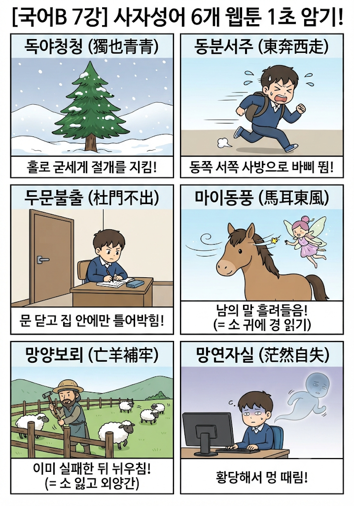
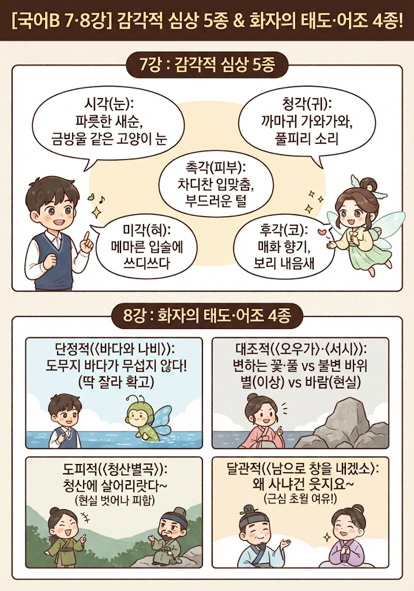
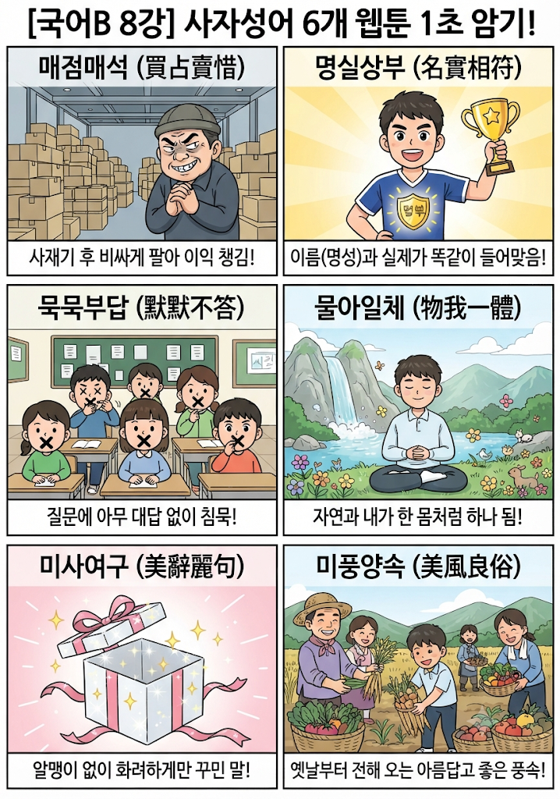
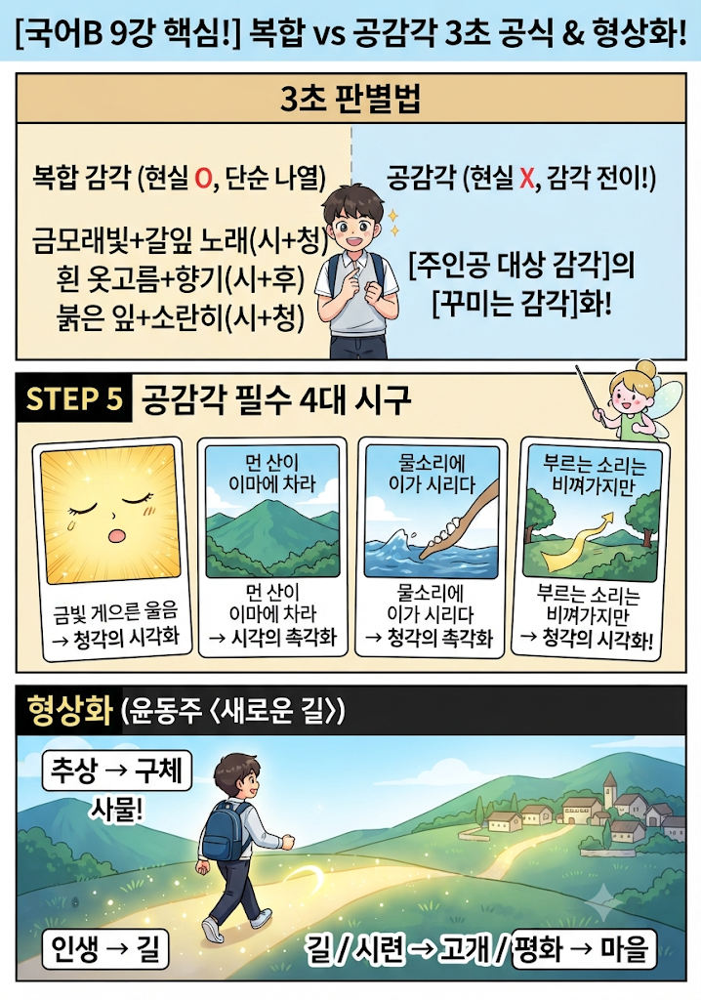
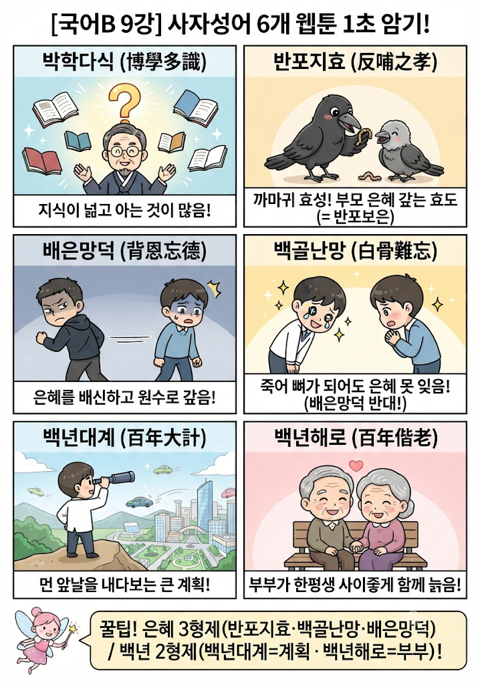

# 📘 국어B — 7·8·9강 시의 주요 개념 · 필수 어휘(29개) · 사자성어(18개) 완벽 정리

> **시험 범위**: 국어B 교재 **7강, 8강, 9강** 전체  
> *(※ 7강 앞쪽 06강 마무리 및 9강 뒤쪽 10강 STEP 1은 시험 범위 외!)*  
> **학습 현황 체크**: 7·8강은 수업 완료, **9강(복합·공감각 심상 & 형상화, 어휘 10개, 사자성어 6개)은 교재가 비어 있으므로 특히 집중 복습!**

---

# 📌 7강: 감각적 심상 · 필수 어휘 10개 · 사자성어 6개

> 🎬 **개념 몽타주 영상 (1분 33초)** — 7강 감각적 심상·어휘·사자성어를 한 번에 정리해요.

<video controls preload="metadata" playsinline poster="exam/%EA%B5%AD%EC%96%B4_%EC%8B%9C%ED%97%98%EA%B3%B5%EB%B6%80/videos/kor_05_gang7_poster.jpg" src="exam/%EA%B5%AD%EC%96%B4_%EC%8B%9C%ED%97%98%EA%B3%B5%EB%B6%80/videos/kor_05_gang7.mp4" style="width:100%;max-width:960px;border-radius:12px;display:block;margin:0 auto 1em;background:#000"></video>

## 01. 시의 주요 개념 — 심상(心象, 이미지)
> **심상(마음 心, 코끼리·모양 象)**: 시를 읽을 때 마음속에 떠오르는 빛깔, 모양, 소리, 냄새, 맛, 촉감 등의 **감각적인 느낌**. 독자가 시를 생생하게 느끼게 하고 화자의 정서와 태도를 드러낸다.

| 심상 (한자) | 느끼는 감각 | 교과서 핵심 예시 시구 (밑줄 키워드 암기!) |
| :---: | :--- | :--- |
| **시각적 심상** *(볼 視 깨달을 覺)* | 색채, 모양, 명암, 움직임, 풍경 등 **눈**으로 느끼는 심상 | • 정지용 〈춘설〉: 미나리 **파릇한** 새순 돋고 / 고기 입이 **오물거리는** • 이장희 〈봄은 고양이로다〉 2연: **금방울**과 같이 **호동그란** 고양이의 눈 / **미친 봄의 불길** |
| **청각적 심상** *(들을 聽 깨달을 覺)* | 소리, 음성, 음향 등 **귀**로 느끼는 심상 | • 김소월 〈길〉: 까마귀 **가왁가왁** 울며 새었소 • 정지용 〈고향〉: 어린 시절 불던 **풀피리 소리** 아니 나고 |
| **촉각적 심상** *(닿을 觸 깨달을 覺)* | 감촉, 차가움, 뜨거움 등 **피부**로 느끼는 심상 | • 정지용 〈유리창 2〉: 나는 **열이 오른다** / 유리에 부빈다, **차디찬** 입맞춤을 마신다 • 이장희 〈봄은 고양이로다〉 1연 1행: 꽃가루와 같이 **부드러운** 고양이의 털 |
| **미각적 심상** *(맛 味 깨달을 覺)* | 짜다, 쓰다, 맵다, 달콤하다 등 **혀(맛)**로 느끼는 심상 | • 정지용 〈고향〉: 메마른 입술에 **쓰디쓰다** *(※ 〈고향〉은 청각 + 미각 2개 사용!)* |
| **후각적 심상** *(맡을 嗅 깨달을 覺)* | 냄새, 향기 등 **코**로 느끼는 심상 | • 이육사 〈광야〉: **매화 향기** 홀로 아득하니 • 김동환 〈산 너머 남촌에는〉: **진달래 향기** / **보리 내음새** • 이장희 〈봄은 고양이로다〉 1연 2행: 고운 봄의 **향기**가 어리우도다 |

## 02. 7강 필수 어휘 (10개)

| 번호 | 어휘 | 한자 (훈음) | 정확한 뜻 | 교재 예문 |
| :-: | :---: | :---: | :--- | :--- |
| 1 | **거처** | 居處 (살 거, 곳 처) | 일정하게 자리를 잡고 머물러 사는 장소 | 도시 생활에 지친 그는 시골로 **거처**를 옮겼다. |
| 2 | **곁길** | *(순우리말)* | ① 큰길에서 갈라져서 난 길 ② 이야기·계획 등이 원래 방향에서 벗어난 방향 | 대화가 **곁길**로 새는 바람에 아직 결론을 맺지 못했다. |
| 3 | **구천** | 九泉 (아홉 구, 샘 천) | '땅속 깊은 밑바닥' → 사람이 죽은 후 영혼이 가는 곳 | 한이 많아 **구천**을 떠도는 영혼을 위한 제사가 시작되었다. |
| 4 | **군락** | 群落 (무리 군, 떨어질 락) | ① 같은 범위 안에 함께 생활하는 식물의 집단 ② 같은 지역에 모여 있는 여러 마을 | 화담숲에 무궁화 **군락**이 형성되었다. |
| 5 | **남루** | 襤褸 (해진옷 남, 해진옷 루) | 낡아 해진 옷 | 행색이 **남루**한 아이가 담 밑에 웅크려 있었다. |
| 6 | **담수** | 淡水 (맑을 담, 물 수) | 강이나 호수와 같이 염분이 없는 물 (민물) | 바닷물을 마실 수 있는 **담수**로 바꾸는 사업이 본격화되었다. |
| 7 | **견문** | 見聞 (볼 견, 들을 문) | 보거나 듣거나 하여 깨달아 얻은 지식 | 세계 여러 나라를 여행하며 **견문**을 넓히고 싶다. |
| 8 | **금슬(금실)** | 琴瑟 (거문고 금, 큰거문고 슬) | 부부간의 사랑 | 우리 부부는 **금슬**이 좋아 잉꼬부부라는 말을 자주 듣는다. |
| 9 | **대목** | *(순우리말)* | ① 명절을 앞두고 물건이 많이 팔리는 시기 ② 이야기나 글 따위의 특정한 부분 | 추석 **대목**이라 시장은 사람들로 붐볐다. 주인공이 가족과 재회하는 **대목**에서 눈물이 났다. |
| 10 | **발품** | *(순우리말)* | 걸어 다니는 수고 | 좋은 재료를 사기 위해 직접 **발품**을 팔며 시장을 돌아다녔다. |

## 03. 7강 사자성어 (6개)

| 번호 | 사자성어 | 한자 | 글자별 훈음 | 겉뜻 & 속뜻 (시험 핵심!) | 활용 예문 & 연관 속담 |
| :-: | :---: | :---: | :--- | :--- | :--- |
| 1 | **독야청청** | 獨也靑靑 | 홀로 독, 어조사 야, 푸를 청, 푸를 청 | '홀로 푸르다' → **남들이 모두 절개를 버린 상황에서도 홀로 절개를 굳세게 지킴** | 모두가 불의에 굴복할 때 그는 소나무처럼 **독야청청** 신념을 지켰다. |
| 2 | **동분서주** | 東奔西走 | 동녘 동, 달릴 분, 서녘 서, 달릴 주 | '동쪽으로 뛰고 서쪽으로 뛴다' → **여기저기 사방으로 분주하게 돌아다님** | 축제 준비를 맡은 학생회는 하루 종일 **동분서주**하며 바쁘게 움직였다. |
| 3 | **두문불출** | 杜門不出 | 막을 두, 문 문, 아닐 불, 날 출 | '문을 닫고 나가지 않는다' → **외출을 전혀 하지 않고 집 안에만 틀어박혀 있음** | 시험 기간이 되자 형은 방에서 **두문불출**하며 공부에만 매달렸다. |
| 4 | **마이동풍** | 馬耳東風 | 말 마, 귀 이, 동녘 동, 바람 풍 | '말의 귀에 동풍이 불어도 아랑곳하지 않는다' → **남의 말을 귀 기울이지 않고 흘려버림** | 아무리 충고해도 **마이동풍**이라 답답하다. *(※ 유사 속담: **소 귀에 경 읽기**)* |
| 5 | **망양보뢰** | 亡羊補牢 | 망할 망, 양 양, 기울 보, 우리 뢰 | '양을 잃고 우리를 고친다' → **이미 실패한 뒤에 뉘우쳐도 아무 소용이 없음** | 사고가 난 뒤에야 대책을 세우니 **망양보뢰**가 따로 없다. *(※ 유사 속담: **소 잃고 외양간 고친다**)* |
| 6 | **망연자실** | 茫然自失 | 아득할 망, 그럴 연, 스스로 자, 잃을 실 | '제정신을 잃고 어리둥절함' → **황당한 일을 당하거나 어찌할 줄 몰라 정신이 나간 듯 멍하게 있음** | 공들여 쓴 보고서 파일이 날아가자 그는 **망연자실**하여 앉아 있었다. |

---

# 📌 8강: 화자의 태도·어조 · 필수 어휘 9개 · 사자성어 6개

> 🎬 **개념 몽타주 영상 (1분 37초)** — 8강 화자의 태도·어휘·사자성어를 한 번에 정리해요.

<video controls preload="metadata" playsinline poster="exam/%EA%B5%AD%EC%96%B4_%EC%8B%9C%ED%97%98%EA%B3%B5%EB%B6%80/videos/kor_06_gang8_poster.jpg" src="exam/%EA%B5%AD%EC%96%B4_%EC%8B%9C%ED%97%98%EA%B3%B5%EB%B6%80/videos/kor_06_gang8.mp4" style="width:100%;max-width:960px;border-radius:12px;display:block;margin:0 auto 1em;background:#000"></video>

## 01. 시의 주요 개념 — 화자의 태도·어조 4종

| 개념 (한자) | 정확한 의미 | 교과서 예시 작품 & 핵심 분석 |
| :---: | :--- | :--- |
| **단정적** *(끊을 斷 정할 定)* | 어떤 사실에 대하여 **딱 잘라 판단·결정**함. 의지·결의·확고한 입장을 분명히 밝힘. | **김기림 〈바다와 나비〉**: *"흰 나비는 도무지 바다가 무섭지 않다."* → 모더니즘 시. 나비의 순진함과 현실(바다)에 대한 좌절을 단정적 어조로 제시. |
| **대조적** *(대할 對 비칠 照)* | **서로 반대되어 대비**를 이룸. | • **윤선도 〈오우가〉** *(시조: 초장·중장·종장)*: 빨리 지는 **꽃**·누렇게 변하는 **풀(가변성)** vs **변치 않는 바위(불변성)**를 대조해 바위의 덕성 예찬! • **윤동주 〈서시〉**: 이상적 삶의 세계 **`별`(1음절)** vs 어두운 현실 **`바람`(2음절)** 대조! |
| **도피적** *(도망할 逃 피할 避)* | 어떤 대상에서 **벗어나려 하거나** 적극적으로 나서야 할 일에 몸을 사려 빠짐. | **작자 미상 〈청산별곡〉**: *"살어리 살어리랏다 청산에 살어리랏다 / 머루랑 다래랑(야생 과일) 먹고..."* + 후렴구 *"얄리얄리 얄라셩 얄라리 얄라"* → 괴로운 현실을 떠나 이상향인 **'청산'**으로 도피하고 싶은 마음! |
| **달관적** *(통달할 達 볼 觀)* | 사소한 일에 집착하지 않고 넓고 멀리 바라봄. **근심·걱정에서 벗어난 초월적 자세**. | • **성혼 〈말 없는 청산이요〉**: 자연(청산·유수·청풍·명월)과 더불어 **분별(근심·걱정) 없이** 늙어 가는 즐거움 노래. • **김상용 〈남으로 창을 내겠소〉**: 달관적 태도가 집약된 3어절 구절 = **`왜 사냐건 웃지요`**! |

## 02. 8강 필수 어휘 (9개)

| 번호 | 어휘 | 한자 (훈음) | 정확한 뜻 | 교재 예문 |
| :-: | :---: | :---: | :--- | :--- |
| 1 | **도량** | 度量 (법도 도, 헤아릴 량) | 너그럽게 받아들이고 깊게 이해할 수 있는 마음과 생각 | 인품이 훌륭하고 **도량**이 넓어 그를 따르는 사람이 많다. |
| 2 | **권위** | 權威 (권세 권, 위엄 위) | ① 특별한 능력·자격·지위로 남을 이끌어 따르게 하는 힘 ② 사회적으로 인정받을 만한 지식·기술·실력 | 그분은 인공지능 분야에서 **권위**가 있는 학자이다. |
| 3 | **딴전** | *(순우리말)* | 어떤 일을 하는 데 그 일과는 전혀 관계없는 일이나 행동 | 그는 묻는 말에 대답하지 않고 **딴전**을 피우고 있다. |
| 4 | **명분** | 名分 (이름 명, 나눌 분) | 어떤 일을 하기 위해 내세우는 이유나 핑계 | 공공성을 위한 정책이지만 반대할 **명분**이 필요했다. |
| 5 | **명성** | 名聲 (이름 명, 소리 성) | 세상 사람들의 평이 높아 세상에 널리 알려진 이름 | 한때 그녀는 컴퓨터 전문가로 **명성**을 날렸다. |
| 6 | **면목** | 面目 (낯 면, 눈 목) | ① 사람이나 사물의 겉모습 ② 남을 대하기에 떳떳한 마음이나 처지 | 큰 잘못을 하여 그 친구를 볼 **면목**이 없다. |
| 7 | **박제** | 剝製 (벗길 박, 지을 제) | 죽은 동물을 썩지 않게 처리하고 솜 등을 넣어 원래 모양대로 만듦 | 멸종된 동물을 **박제**로나마 볼 수 있었다. |
| 8 | **반열** | 班列 (나눌 반, 벌일 열) | 다른 사람이나 조직이 인정하는 높은 지위나 등급 | 이 영화 덕분에 그는 인기 스타의 **반열**에 올랐다. |
| 9 | **발원** | 發源 (필 발, 근원 원) | ① 흐르는 물줄기가 처음 생김 ② 사회 현상이나 사상 따위가 맨 처음 생겨남 | 동학 농민 운동의 **발원**은 전라도 고부군이었다. |

## 03. 8강 사자성어 (6개)

| 번호 | 사자성어 | 한자 | 글자별 훈음 | 겉뜻 & 속뜻 (시험 핵심!) | 활용 예문 |
| :-: | :---: | :---: | :--- | :--- | :--- |
| 1 | **매점매석** | 買占賣惜 | 살 매, 점령할 점, 팔 매, 아낄 석 | **물건값이 오를 것을 예상해 많이 사두었다가 값이 오른 뒤 다시 팔아 이익을 챙기는 일** | 마스크 부족 시기에 **매점매석** 행위는 엄격히 처벌받았다. |
| 2 | **명실상부** | 名實相符 | 이름 명, 열매 실, 서로 상, 부호 부 | '이름과 실상이 서로 들어맞는다' → **알려진 사실(명성)과 실제 내용이 같음** | 그는 실력과 인품을 모두 갖춘 **명실상부**한 팀의 주장이다. |
| 3 | **묵묵부답** | 默默不答 | 잠잠할 묵, 잠잠할 묵, 아닐 부, 대답 답 | **질문에 대해 아무런 대답 없이 침묵을 지킴** | 누가 유리창을 깼는지 묻자 모두 **묵묵부답**으로 일관했다. |
| 4 | **물아일체** | 物我一體 | 물건 물, 나 아, 한 일, 몸 체 | '물체와 내가 한 몸이 됨' → **주로 자연과 자신이 하나가 됨, 어떤 대상에 완전히 몰입된 상태** | 깊은 산속 폭포 소리를 들으며 자연과 **물아일체**가 된 기분이었다. |
| 5 | **미사여구** | 美辭麗句 | 아름다울 미, 말씀 사, 고울 려, 글귀 구 | **내용은 별로 없이 아름다운 말로 그럴듯하게 꾸민 글귀** | 알맹이 없이 **미사여구**만 늘어놓는 연설은 감동이 없다. |
| 6 | **미풍양속** | 美風良俗 | 아름다울 미, 바람 풍, 어질 량, 풍속 속 | **옛날부터 그 사회에 전해 오는 아름답고 좋은 습관(풍속)** | 어려운 이웃을 돕는 품앗이는 우리 조상의 훌륭한 **미풍양속**이다. |

---

# 📌 9강: 복합·공감각 심상 & 형상화 · 필수 어휘 10개 · 사자성어 6개 ⭐ 집중 학습!

> 🎬 **개념 몽타주 영상 (1분 50초)** — 9강 공감각·형상화·어휘·사자성어를 한 번에 정리해요.

<video controls preload="metadata" playsinline poster="exam/%EA%B5%AD%EC%96%B4_%EC%8B%9C%ED%97%98%EA%B3%B5%EB%B6%80/videos/kor_07_gang9_poster.jpg" src="exam/%EA%B5%AD%EC%96%B4_%EC%8B%9C%ED%97%98%EA%B3%B5%EB%B6%80/videos/kor_07_gang9.mp4" style="width:100%;max-width:960px;border-radius:12px;display:block;margin:0 auto 1em;background:#000"></video>

> ⚠️ **아드님 교재에 9강이 전부 비어 있습니다!** 아래 개념과 STEP 5 연습문제 7개 정답까지 완벽히 내 것으로 만들면 9강은 100점입니다!

## 01. 시의 주요 개념 — 복합 감각 vs 공감각적 심상 & 형상화 ⭐

### 1) 복합 감각 심상 vs 공감각적 심상 (시험 1순위 함정!)

| 구분 | 복합 감각 심상 | 공감각적 심상 *(한가지 共 느낄 感 깨달을 覺)* |
| :---: | :--- | :--- |
| **핵심 원리** | 두 개 이상의 감각이 서로 영향을 주지 않고 **단순히 나열**됨 | 원래 나타내려는 **대상 감각**을 **다른 감각으로 전이(이동)**시켜 하나로 통합 |
| **현실 가능 여부** | **현실적으로 가능!** | **현실적으로 불가능!** *(이걸로 1초 판별!)* |
| **판별 테스트** *(주어+서술어로 바꾸기)* | `불빛이 흐릿하다`(O) + `도란도란거린다`(O) → 각각 말이 됨 = **복합 감각** | `종소리가 푸르다`(X! 소리에 색깔이 있을 수 없음!) → **공감각!** |
| **적는 공식** | **`(복합 감각, 감각1 + 감각2)`** | **`(공감각, [표현 대상 감각]의 [전이된 감각]화)`** |

> 🔥 **공감각 공식 절대 안 틀리는 3초 스텝!**  
> 1. **"진짜 말하려는 주인공(대상)이 뭐지?"** 찾기 → `분수처럼 흩어지는 푸른 종소리`의 주인공은 **`종소리`(청각)**!  
> 2. **"그걸 어떤 감각으로 꾸며 줬지?"** 찾기 → **`푸른`(시각)**!  
> 3. 공식에 넣기: **`[주인공 감각]의 [꾸미는 감각]화`** = **`청각의 시각화`**!

- **교과서 STEP 2 핵심 예시 4개**:
  - `흐릿한 불빛(시각)에 돌아앉아 도란도란거리는(청각) 곳` → **복합 감각 (시각 + 청각)**
  - `분수처럼 흩어지는 푸른(시각) 종소리(청각)` → **공감각 (청각의 시각화)**
  - `새파란 초생달(시각)이 시리다(촉각)` → **공감각 (시각의 촉각화)**
  - `파아란(시각) 바람(촉각)이 불고` → **공감각 (촉각의 시각화)**
  - `향긋한(후각) 그녀의 목소리(청각)에` → **공감각 (청각의 후각화)**

### 2) 9강 STEP 5 실전 문제 7개 완벽 정답 & 해설 (교재 빈칸 채우기용!)

| 번호 | 제시된 시구 (작품) | 정답 (구분 + 심상) | 1초 해설 (주인공 감각 확인!) |
| :-: | :--- | :--- | :--- |
| **(1)** | 해설피 **금빛** 게으른 **울음**을 우는 곳 *(정지용 〈향수〉)* | **공감각, 청각의 시각화** | 주인공 `울음`(청각)을 `금빛`(시각)으로 표현! |
| **(2)** | **먼 산**이 이마에 **차라**. *(정지용 〈춘설〉)* | **공감각, 시각의 촉각화** | 주인공 `먼 산`(눈으로 보는 시각)을 `차다`(촉각)로 표현! |
| **(3)** | 뜰에는 **반짝이는 금모래빛** / 뒷문 밖에는 **갈잎의 노래** *(김소월 〈엄마야 누나야〉)* | **복합 감각, 시각적 + 청각적** | 금모래빛이 반짝임(O) + 갈잎 소리(O) → 단순 나열! |
| **(4)** | **흰** 옷고름 절로 **향기로워라**. *(정지용 〈춘설〉)* | **복합 감각, 시각적 + 후각적** | 옷고름이 희다(O) + 향기롭다(O) → 현실 가능, 단순 나열! |
| **(5)** | **물소리**에 / 이가 **시리다**. *(정지용 〈조찬〉)* | **공감각, 청각의 촉각화** | 주인공 `물소리`(청각)를 `이가 시리다`(촉각)로 전이! |
| **(6)** | **붉은** 잎 잎 / **소란히** 밟고 간다 *(정지용 〈비〉)* | **복합 감각, 시각적 + 청각적** | 잎이 붉다(O) + 소란히 밟는 소리(O) → 단순 나열! |
| **(7)** | **부르는 소리**는 **비껴가지만** *(김소월 〈초혼〉)* | **공감각, 청각의 시각화** | 주인공 `부르는 소리`(청각)가 눈앞에서 `비껴가는`(움직임=시각) 것처럼 표현! |

### 3) 형상화 (모양 形, 코끼리 象, 될 化)
- **정의**: 형체가 분명하지 않은 **추상적 개념·사상·정서**를 **구체적이고 명확한 사물·모양**으로 그려 내는 것. *(예: 보이지 않는 '사랑'을 '하트 모양'으로 표현)*
- **교과서 예시 — 윤동주 〈새로운 길〉**:
  > *"내를 건너서 숲으로 / **고개**를 넘어서 **마을**로 / 어제도 가고 오늘도 갈 / 나의 **길** 새로운 **길**"*
  - **인생** → **`길`**로 형상화 / **시련** → **`고개`**로 형상화 / **평화** → **`마을`**로 형상화!

## 02. 9강 필수 어휘 (10개)

| 번호 | 어휘 | 한자 (훈음) | 정확한 뜻 | 교재 예문 |
| :-: | :---: | :---: | :--- | :--- |
| 1 | **뱃심** | *(순우리말)* | 조금도 굽히지 않고 제 고집대로 버티어 내는 힘 | 모두가 반대하는 일이지만 그는 **뱃심**으로 밀고 나갔다. |
| 2 | **병폐** | 病弊 (병 병, 폐단 폐) | 오랜 시간에 걸쳐 생긴 잘못과 그로 인한 피해 | 산업화 사회의 대표적인 **병폐**는 물질 숭배이다. |
| 3 | **복선** | 伏線 (숨을 복, 줄 선) | ① 만일의 경우에 대비해 남모르게 미리 꾸며 놓은 일 ② (소설·희곡 등에서) **앞으로 일어날 사건을 독자에게 넌지시 알려 주는 것** | 이 소설에는 비극적 결말을 암시하는 **복선**이 곳곳에 깔려 있다. |
| 4 | **비수** | 匕首 (비수 비, 머리 수) | 날이 매우 날카로운 짧은 칼 | 그녀의 말은 **비수**가 되어 그의 가슴에 박혔다. |
| 5 | **사생** | 寫生 (베낄 사, 날 생) | 어떠한 풍경이나 실물을 있는 그대로 그리는 일 | 학교에서 열린 **사생** 대회에서 풍경화를 그려 우수상을 받았다. |
| 6 | **소임** | 所任 (바 소, 맡길 임) | 맡은 일이나 책임 | 할머니는 가족들의 뒷바라지를 평생의 **소임**으로 여기셨다. |
| 7 | **수렵** | 狩獵 (사냥할 수, 사냥 렵) | 총이나 그 밖의 도구를 가지고 산이나 들에서 짐승을 잡는 일 | 이곳은 야생 동물 보호를 위한 **수렵** 금지 구역이다. |
| 8 | **술책** | 術策 (재주 술, 꾀 책) | 어떤 일을 꾸미는 꾀나 방법 | 경쟁 회사의 교묘한 **술책**으로 소유권이 넘어갔다. |
| 9 | **슬하** | 膝下 (무릎 슬, 아래 하) | '무릎의 아래' → 부모가 자식을 키우고 보살피는 상태 | 그는 **슬하**에 아들 형제만 두었다. |
| 10 | **승화** | 昇華 (오를 승, 빛날 화) | 어떤 현상이 더 높은 상태로 발전하는 일 | 그의 그림은 슬픔을 예술적으로 **승화**시킨 작품이다. |

## 03. 9강 사자성어 (6개)

| 번호 | 사자성어 | 한자 | 글자별 훈음 | 겉뜻 & 속뜻 (시험 핵심!) | 활용 예문 & 유의어 |
| :-: | :---: | :---: | :--- | :--- | :--- |
| 1 | **박학다식** | 博學多識 | 넓을 박, 배울 학, 많을 다, 알 식 | '학문의 지식이 넓고 아는 것이 많음' → **지식의 범위가 넓고 깊이도 심오함** | 어떤 질문을 해도 막힘없이 답하는 선생님은 정말 **박학다식**하시다. |
| 2 | **반포지효** | 反哺之孝 | 돌이킬 반, 먹일 포, 갈 지, 효도 효 | '까마귀 새끼가 자란 뒤 늙은 어미에게 먹이를 물어다 주는 효성' → **어버이의 은혜를 갚으려는 자식의 지극한 효도** | 어른이 되어 부모님을 정성껏 모시는 모습이 **반포지효**를 떠올리게 한다. *(※ 유의어: **반포보은** 反哺報恩)* |
| 3 | **배은망덕** | 背恩忘德 | 등 배, 은혜 은, 잊을 망, 클 덕 | '은혜를 배신하고 베풀어 준 덕을 잊는다' → **남의 은혜에 보답하기는커녕 은혜를 원수로 갚음** | 힘든 시절에 도와준 친구를 속이다니 정말 **배은망덕**한 일이다. |
| 4 | **백골난망** | 白骨難忘 | 흰 백, 뼈 골, 어려울 난, 잊을 망 | '죽어서 뼈가 흰 가루가 되더라도 잊지 못한다' → **다른 사람이 베풀어 준 은혜를 결코 잊지 못함** | 위기에 빠진 저를 구해 주신 은혜는 **백골난망**입니다. *(※ `배은망덕`과 **반대** 의미!)* |
| 5 | **백년대계** | 百年大計 | 일백 백, 해 년, 클 대, 셀 계 | '백 년 후까지의 큰 계획' → **먼 앞날까지 미리 내다보고 세우는 크고 중요한 계획** | 교육은 나라의 미래를 좌우하는 **백년대계**이므로 신중해야 한다. |
| 6 | **백년해로** | 百年偕老 | 일백 백, 해 년, 함께 해, 늙을 로 | '백 년 동안 함께 늙어간다' → **부부가 되어 한평생을 사이좋게 지내고 즐겁게 함께 늙어 감** | 새로 결혼하는 두 분이 오래오래 **백년해로**하시길 바랍니다. |

> 🧠 **9강 `백(百/白)` & `은혜` 사자성어 헷갈림 방지 팁!**  
> - **은혜 3형제**: 부모님께 보답 = **`반포지효`** / 남의 은혜 죽어도 못 잊음 = **`백골난망`** / 은혜를 원수로 갚음 = **`배은망덕`**!  
> - **`백년~` 2형제**: 먼 앞날의 큰 계획 = **`백년대계`**(셀 계 計) / 부부가 평생 함께 늙음 = **`백년해로`**(함께 해 偕, 늙을 로 老)!

