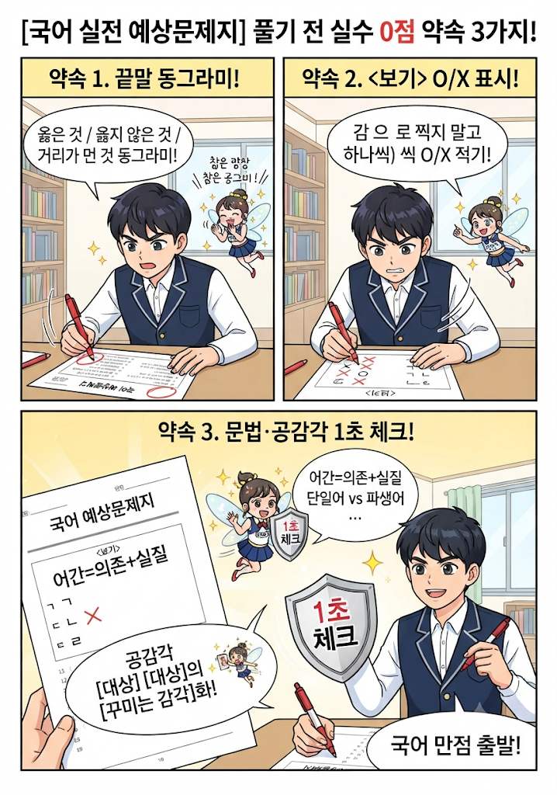

# 📝 2026학년도 7학년 2학기 2차 지필평가 대비 — 국어 실전 예상 문제지

> **시험 범위**:  
> - **국어A**: 2-(1) 추론하며 이해하기(p.66~75) · 3-(2) 단어의 짜임(p.126~141) · 4-(2) 주장하는 글 쓰기(p.168~181)  
> - **국어B**: 시의 주요 개념 · 필수 어휘 · 사자성어 (7, 8, 9강)  
> **구성**: 선택형 22문항 (82.0점) + 서술형 3문항 (18.0점) = **총 100.0점** | **제한 시간**: 45분  
> **참고**: 호치민시한국국제학교(KIS) 2025 2학기 2차 기출 유형 및 2026 교과서·학습자료 반영

### ✅ 풀기 전 「국어 실수 0점」 약속 3가지
- [ ] 문제 끝의 **"옳은 것 / 옳지 않은 것 / 거리가 먼 것"**에 반드시 동그라미 치기
- [ ] `<보기>` 문제는 ㄱ·ㄴ·ㄷ·ㄹ 옆에 하나씩 **O / X** 표시한 뒤 선지 고르기
- [ ] 문법(`어간 = 의존+실질`, `고맙다 = 단일어`, `맨발·날고기·웃음 = 파생어`)과 공감각 공식(**`[대상]의 [꾸미는 감각]화`**) 한 번 더 확인하기

---

## [선택형 1~22번]

### [1~4] 다음 글을 읽고 물음에 답하시오. (국어A 2-(1) 추론하며 이해하기)

> **모든 치킨은 옳을까?** — 이지선
>
> **(가) 식을 줄 모르는 치킨의 인기**  
> 우리나라의 성인은 1년에 약 16킬로그램 정도 이 고기를 먹어요. 열 가구 가운데 일곱 가구는 1주일에 한 번 이상 이것을 먹지요. 전 세계에서 기르는 가축 약 300억 마리 가운데 대략 230억 마리는 이것이에요. 이것은 무엇일까요?  
> 바로 닭이에요. 닭고기로 말할 것 같으면, **부모님 세대**의 '통닭'에서부터 지금 십 대에게 익숙한 '치킨'에 이르기까지 외식을 할 때 빠지지 않는 메뉴 중 하나이지요. 닭고기는 세계적으로도 인기 만점입니다. 돼지고기나 소고기와는 달리 다양한 문화권에서 선호하는 육류이지요. 경제 협력 개발 기구(OECD) 통계에 따르면, 20세기까지는 돼지고기가 세계에서 가장 많이 소비되는 육류였어요. 하지만 21세기에 들어와서 닭고기 소비량이 돼지고기를 추월하기 시작했지요. 1990년대 이후 돼지고기와 소고기의 소비량은 정체된 반면, 닭고기 소비량은 지금도 계속 늘어나고 있어요. 닭고기 값이 상대적으로 싼 데다, 사람들이 건강을 생각하다 보니 적색육보다는 백색육 소비가 늘어났기 때문이죠.
>
> **(나) 치킨 경제학의 시작**  
> 여러분은 닭 한 마리를 통째로 사서 먹는 경우가 많은가요? 아니면 닭 다리, 닭 가슴살 등 부위별로 포장된 상품이나 순살치킨, 치킨너깃처럼 아예 가공된 상품을 구매하나요? (중략)  
> 일단 상품으로서의 닭은 최대한 커져야 해요. 특히 패스트푸드 업체를 중심으로 너깃과 치킨버거에 쓰이는 닭고기 패티 등의 수요가 늘자, 닭의 가슴 부분을 비정상적으로 크게 키운 품종이 생산되기 시작했어요. (중략) 1970년대에는 닭이 판매 가능한 몸무게에 도달하려면 10주가 걸렸는데, 개량된 닭 품종은 40일이면 다 커요. 닭의 수명이 5년에서 13년인 점을 감안하면 아주 어린 병아리 시절에 이미 고기가 되어 버리는 것이지요.  
> 경제학적 측면에서 본다면 순조로운 변화일지 모르나, 이 변화는 닭으로서는 ㉠**큰 재난**이에요. 불어난 몸에 비해 다리는 지나치게 가늘고 약하다 보니 관절과 근육에 무리가 가는 것이죠. 닭에게 **처참한 이 현실**은, 양계 업체에게는 '상품'의 맛이 떨어진다는 고민으로 이어졌어요. 그래서 가공 과정에서 수분이 빠져나가지 못하도록 인산염이나 소금 등의 첨가물을 넣게 되었어요.
>
> **(다) 공장에 사는 닭들이 위험해**  
> 닭을 마당에 풀어놓고 키우는 전통적인 방목형 축산과 달리 공장식 축산은 효율성을 우선시하여 작은 공간에서 많은 가축을 생산하는 방식이에요. 이 과정에서 여러 문제점이 생겨났지만 가장 주목할 점은 ㉡**가금류 농장, 아니 공장**은 조류 독감 같은 치명적인 감염병에 매우 취약하다는 거예요. 공장식 축산 환경에서 자라는 닭들은 좁은 공간 때문에 스트레스를 받고, 배설물 등으로 인해 비위생적인 환경에 처하게 됩니다. 게다가 품종 개량으로 인해 닭의 몸집은 크지만 면역력은 떨어질 수 있지요. 대규모 축산으로 닭이 병들면 그 여파가 당연히 인간에게도 돌아오게 되겠지요.
>
> **(라) 진정으로 옳은 치킨을 위하여**  
> 그렇다고 치킨을 아예 먹지 않을 수는 없겠지요. 하지만 더 건강하게, 더 올바르게 닭을 먹을 방법은 있을 거예요. 최근 닭이 스트레스와 질병에 노출되지 않도록 축사 면적을 넓히는 등 사육 환경을 개선하는 양계장이 나타나고 있습니다. 나아가 더 자연적인 방법으로 기른 농축산물을 소비하고자 하는 **유기농 운동**도 벌어지고 있어요. 앞으로 닭이 어떤 모습으로 우리 식탁에 오르게 될지 궁금합니다.

---

**1.** 윗글을 통해 알 수 있는 내용이 **아닌** 것은? [3.5점]  
① 21세기 들어 닭고기 소비량이 늘어난 이유  
② 품종 개량으로 인해 닭의 몸에 나타난 변화와 건강 문제  
③ 공장식 축산이 조류 독감 같은 감염병에 취약한 까닭  
④ 다양한 문화권에서 돼지고기·소고기보다 닭고기를 선호하는 이유  
⑤ 더 건강하고 올바르게 닭을 생산·소비하기 위한 최근의 변화  

---

**2.** 윗글과 관련된 `<보기>`의 추론하기 질문과 답을 알맞게 짝 지은 것만을 있는 대로 고른 것은? [4.0점]

> **<보기>**  
> ㄱ. **질문**: 글쓴이가 `'모든 치킨은 옳을까?'`처럼 의문형 제목을 쓴 이유는?  
>     → **답**: 독자의 흥미를 끌고, 닭고기 생산의 기존 현실과 인식에 문제를 제기하기 위해서이다.  
> ㄴ. **질문**: `'부모님 세대'`라고 표현한 것으로 보아 이 글의 예상 독자는 누구일까?  
>     → **답**: 청소년에게 치킨을 사 줄 수 있는 어른 세대를 예상 독자로 삼았을 것이다.  
> ㄷ. **질문**: 작은 공간에서 많은 가축을 생산하면 또 어떤 문제가 생길 수 있을까?  
>     → **답**: 가축 배설물 처리가 어렵고 악취나 수질 오염 같은 환경 오염이 생길 수 있다.  
> ㄹ. **질문**: 유기농 운동이 닭을 올바르게 먹는 방법이 되는 이유는?  
>     → **답**: 공장식 축산보다 닭을 더 저렴한 가격으로 대량 생산하여 소비할 수 있기 때문이다.

① ㄱ, ㄴ  
② ㄴ, ㄷ  
③ ㄱ, ㄷ  
④ ㄱ, ㄷ, ㄹ  
⑤ ㄴ, ㄷ, ㄹ  

---

**3.** 윗글의 ㉠과 ㉡에 담긴 글쓴이의 의도와 관점으로 가장 적절한 것은? [3.5점]  
① ㉠은 양계 업체의 경제적 손실이 크다는 점을 강조하고, ㉡은 현대 축산 기술의 발전을 긍정적으로 평가하고 있다.  
② ㉠은 품종 개량이 닭의 생명을 위협할 만큼 심각한 고통임을 강조하고, ㉡은 닭을 생명체가 아닌 물건(상품)으로 찍어 내는 공장식 축산을 비판하고 있다.  
③ ㉠은 조류 독감으로 인한 인간의 피해를 경고하고, ㉡은 전통적인 방목형 축산의 비효율성을 비판하고 있다.  
④ ㉠은 패스트푸드 업체의 매출 감소를 우려하고, ㉡은 닭고기 가공 공장의 위생 관리가 철저함을 강조하고 있다.  
⑤ ㉠은 닭고기 맛이 떨어지는 원인을 분석하고, ㉡은 닭이 좁은 공간에 잘 적응하여 자라고 있음을 드러내고 있다.  

---

**4.** 윗글을 추론하며 읽은 과정을 스스로 점검하려고 할 때, 점검 기준으로 **거리가 먼** 것은? [3.0점]  
① 글에서 사실 그대로 제시된 정보를 빠짐없이 추론해 내며 읽었는가?  
② 제목이나 차례, 작가 정보와 같은 단서들을 바탕으로 추론하며 읽었는가?  
③ 글에 드러난 정보와 문맥을 활용하여 숨은 뜻을 추론하며 읽었는가?  
④ 자신의 배경지식이나 경험을 바탕으로 글의 내용을 추론하며 읽었는가?  
⑤ 글에 사용된 특정 표현을 통해 글쓴이의 의도와 관점을 추론하며 읽었는가?  

---

### [5~10] 단어의 짜임 (국어A 3-(2))

**5.** `<보기>`의 문장을 형태소로 분석하고 분류한 내용으로 옳지 **않은** 것은? [4.5점]

> **<보기>**  
> 영수가 딸기를 먹었다.

① 이 문장은 총 7개의 형태소로 나눌 수 있다.  
② 자립 형태소는 `영수`, `딸기`로 총 2개이다.  
③ 의존 형태소는 `가`, `를`, `먹-`, `-었-`, `-다`로 총 5개이다.  
④ `먹-`은 혼자 쓰일 수 없으므로 의존 형태소이면서 형식 형태소이다.  
⑤ 실질 형태소는 `영수`, `딸기`, `먹-`이고, 형식 형태소는 `가`, `를`, `-었-`, `-다`이다.  

---

**6.** 다음 단어의 어근과 접사를 분석한 내용으로 옳지 **않은** 것은? [4.0점]  
① `햇밤` : 어근 `밤` + 접사 `햇-`  
② `한겨울` : 어근 `겨울` + 접사 `한-`  
③ `나무꾼` : 어근 `나무` + 접사 `-꾼`  
④ `재롱둥이` : 어근 `재롱` + 접사 `-둥이`  
⑤ `감나무` : 어근 `나무` + 접사 `감-`  

---

**7.** 다음 중 둘 이상의 어근이 결합하여 이루어진 **합성어**로만 묶인 것은? [4.0점]  
① 맨발 — 밤낮 — 집안  
② 감나무 — 밤낮 — 오르내리다  
③ 날고기 — 돌다리 — 손발  
④ 논밭 — 웃음 — 찬밥  
⑤ 고맙다 — 노을빛 — 오가다  

---

**8.** `<보기>`의 단어들에 대한 설명으로 옳은 것만을 있는 대로 고른 것은? [4.0점]

> **<보기>**  
> 바다, 고맙다, 날고기, 오가다, 웃음, 맨발

> ㄱ. `바다`와 `고맙다`는 모두 하나의 어근으로 이루어진 단일어이다.  
> ㄴ. `날고기`와 `맨발`은 어근 앞에 접두사가 결합한 파생어이다.  
> ㄷ. `웃음`은 어근 `웃-`에 접사 `-음`이 붙어 뜻만 더해지고 품사는 그대로 유지된다.  
> ㄹ. `오가다`는 어근 `오-`와 어근 `가-`가 결합한 합성어이다.

① ㄱ, ㄴ  
② ㄴ, ㄷ  
③ ㄱ, ㄴ, ㄹ  
④ ㄱ, ㄷ, ㄹ  
⑤ ㄱ, ㄴ, ㄷ, ㄹ  

---

**9.** 다음 밑줄 친 접사의 의미나 기능에 대한 설명으로 옳지 **않은** 것은? [3.5점]  
① <u>햇</u>감자가 나와서 저녁 반찬으로 조림을 만들었다. → 그해에 새로 난  
② <u>맨</u>손으로 밭을 일구며 하루 종일 땀을 흘렸다. → 다른 것이 없는, 아무것도 끼지 않은  
③ 아직 어설픈 <u>풋</u>사랑의 기억을 떠올렸다. → 덜 익은, 처음이라 미숙하고 서툰  
④ 동사 `믿다`에 접사 `-음`이 붙어 `믿<u>음</u>`이 되었다. → 품사를 명사로 바꾸어 줌  
⑤ 우리 선생님은 학생들에게 사랑<u>꾼</u>으로 소문났다. → 어떤 나쁜 일을 자주 저지르는 사람  

---

**10.** `<보기>`의 새말과 외국어 다듬기에 대한 설명으로 옳지 **않은** 것은? [3.5점]

> **<보기>**  
> 돌직구, 사랑꾼, 풋노인, 열일하다, 남사친

① `돌직구`는 어근 `돌`과 어근 `직구`가 결합한 합성 방식으로 만들어진 새말이다.  
② `사랑꾼`과 `풋노인`은 어근과 접사가 결합한 파생 방식으로 만들어진 새말이다.  
③ `열일하다`는 `'열심히'`의 `'열'`과 `'일하다'`가 결합하여 만들어진 새말이다.  
④ `'에어 캡'`을 다듬은 `'뽁뽁이'`처럼 쉬운 말을 쓰고 발음하기 편해야 새말이 잘 정착된다.  
⑤ `남사친`은 어근에 접사가 붙은 파생 방식으로 만들어진 새말이다.  

---

### [11~14] 다음 자료와 글을 읽고 물음에 답하시오. (국어A 4-(2) 주장하는 글 쓰기)

> **[힘찬이가 수집한 자료]**  
> **[가] 인터넷 개인 블로그**: "안녕하세요.^^ 요리 블로거 OOO입니다. 제가 아는 사람의 말에 따르면 청소년 문화 시설이 부족한 지역은 대학 진학률이 매우 낮다고 하네요."  
> **[나] 신문 기사 (아시아경제, 2023.8.30.)**: "OO구 청소년 문화의 집은 문화·예술, 진로, 지역 청소년 자치 활동 등 30여 개 프로그램을 운영한다. 아동 청소년 전문가 장◇◇ 교수는 프로그램 참여를 통해 성취감과 만족감을 느끼고 자신의 역량을 발견할 수 있다고 평가했다."  
> **[다] 면담 자료**: 이용 학생 김OO("자유롭고 피시방·노래방 대신 자주 와요"), 고△△("춤 연습을 해도 이상하게 쳐다보는 사람이 없어 편해요").  
> **[라] 전문 서적 (장여옥·임양지, 『청소년 전용 공간에 대한 청소년의 이용 경험 연구』)**: "청소년 전용 공간은 잔소리하는 사람, 눈치 주는 사람이 없어 편안하게 쉴 수 있는 공간이다."  
> **[마] 텔레비전 뉴스 (OBS 뉴스, 2022.2.28.)**: "청소년 지도사 처우 개선 이번엔? 낮은 처우에 평균 근속 연수 3.9년..."
>
> **[힘찬이가 쓴 글의 초고 일부]**  
> **제목: 우리 동네에 청소년 문화의 집을 설치해야 한다**  
> **(서론)** 우리 동네에는 청소년들이 편하게 활동할 수 있는 공간이 충분히 있을까? 얼마 전 공원에서 친구들과 영상을 찍으며 놀고 있는데, 지나가는 어른들이 이상하다는 듯이 쳐다본 일이 있었다. 이렇게 우리 동네에 청소년들을 위한 복지 공간이 부족한 문제는 청소년 문화의 집을 설치하면 해결할 수 있다. 이제부터 청소년 문화의 집을 설치해야 하는 이유에 대해 알아보자.  
> **(본론 1)** 먼저 청소년 문화의 집이 있으면 청소년들이 편안하고 자유롭게 놀 수 있다. ㉠**연구에 따르면** 청소년 전용 공간 이용자들은 잔소리하는 사람, 눈치 주는 사람이 없기 때문에 청소년 문화의 집에서 아늑하게 쉴 수 있어서 좋았다고 한다. 또한 김OO 학생과 고△△ 학생도 자유롭고 편하다고 말했다. 이렇게 청소년 문화의 집은 청소년이 편안하게 즐길 수 있는 공간이라는 점에서 ㉡**무조건 필요하다.**  
> **(본론 2)** 청소년들은 청소년 문화의 집에서 자기 개발을 할 수 있다. 문화·예술, 진로, 자치 활동 등 다양한 프로그램에 참여하며 성취감과 만족감을 느끼고 자신의 역량을 발견할 수 있기 때문이다.  
> **(결론)** 청소년 문화의 집이 있으면 청소년들이 편안하게 놀 수 있고 자기 개발의 기회를 얻을 수 있다. 하루빨리 우리 동네에도 청소년 문화의 집이 설치되어 청소년들이 건강하고 풍요로운 삶을 살아갈 수 있기를 희망한다.

---

**11.** 힘찬이가 위 글을 쓰기 위해 세운 **1단계(계획하기)** 내용으로 옳지 **않은** 것은? [3.5점]  
① 매체: 전국 단위의 유명 일간 신문  
② 주제: 우리 동네에 청소년 문화의 집이 필요하다.  
③ 목적: 나의 주장을 설득력 있게 펼치기 위해서  
④ 예상 독자: 학교 학생들  
⑤ 글의 갈래: 타당한 근거를 들어 독자를 설득하는 주장하는 글  

---

**12.** 힘찬이가 **2단계(내용 생성하기)**에서 사용하지 말아야 할 자료 2개와 그 이유를 옳게 짝 지은 것은? [4.0점]  
① [가] 주장과 관련이 없음 / [라] 출처가 불명확함  
② [가] 출처가 명확하지 않고 믿을 수 없음 / [마] 주장과 관련이 없음  
③ [나] 주장과 관련이 없음 / [다] 개인의 의견이라 믿을 수 없음  
④ [다] 출처가 명확하지 않음 / [마] 오래된 자료라 믿을 수 없음  
⑤ [가] 주장과 관련이 없음 / [마] 출처가 명확하지 않고 믿을 수 없음  

---

**13.** 힘찬이의 초고와 주장하는 글 쓰기 과정에 대한 설명으로 옳지 **않은** 것은? [3.5점]  
① '서론 – 본론 – 결론'의 구성을 갖추어 논리적으로 전개하였다.  
② 서론에서 질문과 자신의 불편했던 경험을 제시하여 독자의 관심을 끌고 있다.  
③ 본론 1에서는 자료 [라]와 [다]를, 본론 2에서는 자료 [나]를 근거로 활용하였다.  
④ 결론에서는 본론의 내용을 간단히 요약하고 바람을 언급하며 마무리하고 있다.  
⑤ 표현하기 단계에서 근거가 주장과 어울리지 않더라도 이전 단계로 되돌아가서는 안 된다.  

---

**14.** **5단계(고쳐쓰기)**에서 선생님이 초고의 ㉠과 ㉡에 대해 해 줄 수 있는 조언으로 가장 적절한 것은? [3.5점]  
① ㉠은 근거의 출처를 구체적으로 밝혀 신뢰성을 높이고, ㉡은 지나치게 단정적인 표현을 고쳐 거부감을 줄여야 한다.  
② ㉠은 어려운 연구 내용을 아예 삭제하고, ㉡은 `'절대로 필요하다'`로 고쳐 주장을 더 강하게 드러내야 한다.  
③ ㉠은 서론으로 위치를 옮기고, ㉡은 이유와 근거가 없으므로 문단 전체를 삭제해야 한다.  
④ ㉠은 자신의 경험담으로 바꾸어 쓰고, ㉡은 의문문으로 고쳐 독자의 호기심을 끌어야 한다.  
⑤ ㉠과 ㉡ 모두 주장하는 글의 특성에 잘 맞으므로 고치지 않고 그대로 두어야 한다.  

---

### [15~18] 시의 주요 개념 (국어B 7·8·9강)

**15.** 다음 시구에 나타난 주된 심상을 바르게 연결하지 **못한** 것은? [3.0점]  
① 미나리 **파릇한** 새순 돋고 / 고기 입이 **오물거리는** — 시각적 심상  
② 까마귀 **가와가와** 새며 울었소 — 청각적 심상  
③ 꽃가루와 같이 **부드러운** 고양이의 털에 — 촉각적 심상  
④ 메마른 입술에 **쓰디쓰다** — 후각적 심상  
⑤ 꽃 피는 사월이면 **진달래 향기** / 밀 익는 오월이면 **보리 내음새** — 후각적 심상  

---

**16.** 다음 (가)~(다)의 시에 두드러지게 나타나는 화자의 태도·성격을 순서대로 바르게 짝 지은 것은? [4.0점]

> **(가)** 꽃은 무슨 일로 피면서 쉬이 지고 / 풀은 어이하여 푸르는 듯 누르나니 / 아마도 변치 않는 건 바위뿐인가 하노라. — 윤선도, 〈오우가〉  
> **(나)** 살어리 살어리랏다 청산에 살어리랏다 / 머루랑 다래랑 먹고 청산에 살어리랏다 — 작자 미상, 〈청산별곡〉  
> **(다)** 남(南)으로 창(窓)을 내겠소. (중략) 강냉이가 익걸랑 함께 와 자셔도 좋소 / 왜 사냐건 / 웃지요. — 김상용, 〈남으로 창을 내겠소〉

① (가) 단정적 — (나) 달관적 — (다) 대조적  
② (가) 대조적 — (나) 도피적 — (다) 달관적  
③ (가) 대조적 — (나) 달관적 — (다) 도피적  
④ (가) 도피적 — (나) 단정적 — (다) 대조적  
⑤ (가) 달관적 — (나) 도피적 — (다) 단정적  

---

**17.** `<보기>`의 시구 중 두 감각이 단순 나열된 '복합 감각 심상'이 아니라, 한 감각을 다른 감각으로 전이시켜 표현한 **공감각적 심상**에 해당하는 것만을 있는 대로 고른 것은? [4.5점]

> **<보기>**  
> ㄱ. 흐릿한 불빛에 돌아앉아 도란도란거리는 곳 *(정지용, 〈향수〉)*  
> ㄴ. 해설피 금빛 게으른 울음을 우는 곳 *(정지용, 〈향수〉)*  
> ㄷ. 먼 산이 이마에 차라. *(정지용, 〈춘설〉)*  
> ㄹ. 흰 옷고름 절로 향기로워라. *(정지용, 〈춘설〉)*  
> ㅁ. 물소리에 / 이가 시리다. *(정지용, 〈조찬〉)*

① ㄱ, ㄴ  
② ㄴ, ㄷ  
③ ㄱ, ㄹ, ㅁ  
④ ㄴ, ㄷ, ㅁ  
⑤ ㄴ, ㄷ, ㄹ, ㅁ  

---

**18.** 다음 중 시의 개념(**형상화** 및 **공감각적 심상**)에 대한 설명으로 옳지 **않은** 것은? [3.5점]  
① 형상화란 형체가 분명하지 않은 추상적 개념이나 정서를 구체적이고 명확한 모양으로 표현하는 것이다.  
② 윤동주의 〈새로운 길〉에서는 '인생'을 '길'로, '시련'을 '고개'로 형상화하였다.  
③ `'새파란 초생달이 시리다'`는 시각적 대상인 초생달을 촉각적으로 표현한 **시각의 촉각화**이다.  
④ `'향긋한 그녀의 목소리에'`는 청각적 대상인 목소리를 후각적으로 표현한 **청각의 후각화**이다.  
⑤ `'분수처럼 흩어지는 푸른 종소리'`는 푸른빛을 종소리로 표현한 **시각의 청각화**이다.  

---

### [19~22] 필수 어휘 & 사자성어 (국어B 7·8·9강)

**19.** 다음 교과서 필수 어휘와 그 뜻풀이가 바르게 연결되지 **않은** 것은? [3.5점]  
① **거처(居處)**: 일정하게 자리를 잡고 머물러 사는 장소  
② **명분(名分)**: 세상 사람들의 평이 높아 세상에 널리 알려진 이름  
③ **담수(淡水)**: 강이나 호수와 같이 염분이 없는 물  
④ **도량(度量)**: 너그럽게 받아들이고 깊게 이해할 수 있는 마음과 생각  
⑤ **복선(伏線)**: 소설·희곡 등에서 앞으로 일어날 사건을 독자에게 넌지시 알려 주는 것  

---

**20.** 다음 문장의 (가), (나), (다)에 들어갈 알맞은 필수 어휘를 순서대로 짝 지은 것은? [3.5점]

> • 세계 여러 나라를 여행하며 다양한 경험을 쌓아 **( 가 )**을/를 넓히고 싶다.  
> • 이 영화의 흥행 덕분에 그는 단숨에 인기 스타의 **( 나 )**에 올랐다.  
> • 화가는 깊은 슬픔을 아름다운 예술 작품으로 **( 다 )**시켰다.

① (가) 면목 — (나) 발원 — (다) 사생  
② (가) 대목 — (나) 권위 — (다) 박제  
③ (가) 견문 — (나) 반열 — (다) 승화  
④ (가) 견문 — (나) 명분 — (다) 소임  
⑤ (가) 발품 — (나) 반열 — (다) 승화  

---

**21.** 다음 상황에서 사자성어의 쓰임이 적절하지 **않은** 것은? [4.0점]  
① 모두가 두려움에 굴복했을 때 끝까지 신념과 절개를 지킨 모습이 **독야청청(獨也靑靑)**이었다.  
② 학교 축제를 성공적으로 치르기 위해 학생회 임원들이 하루 종일 **동분서주(東奔西走)**하였다.  
③ 큰 사고가 터지고 나서야 뒤늦게 안전 대책을 세우니 **마이동풍(馬耳東風)**이 따로 없다.  
④ 실력과 인품을 모두 갖춘 그는 우리 학교 **명실상부(名實相符)**한 최고의 주장이다.  
⑤ 알맹이는 하나도 없이 그럴듯한 **미사여구(美辭麗句)**만 늘어놓은 글이라 감동이 없다.  

---

**22.** `<보기>`의 (가), (나), (다) 뜻풀이에 알맞은 사자성어를 순서대로 바르게 짝 지은 것은? [4.0점]

> **<보기>**  
> **(가)** 까마귀 새끼가 자란 뒤 늙은 어미에게 먹이를 물어다 주는 효성으로, 어버이의 은혜를 갚으려는 자식의 지극한 효도  
> **(나)** 죽어서 뼈가 흰 가루가 되더라도 다른 사람이 베풀어 준 은혜를 결코 잊지 못함  
> **(다)** 먼 앞날까지 미리 내다보고 세우는 크고 중요한 계획

① (가) 반포지효 — (나) 백골난망 — (다) 백년대계  
② (가) 반포지효 — (나) 배은망덕 — (다) 백년해로  
③ (가) 백골난망 — (나) 반포지효 — (다) 백년대계  
④ (가) 배은망덕 — (나) 백골난망 — (다) 박학다식  
⑤ (가) 백년해로 — (나) 반포지효 — (다) 백년대계  

---

## [서술형 1~3번]

> ※ 서술형은 **조건과 핵심 단어**를 반드시 포함하여 완전한 문장으로 쓰세요!

**서술형 1.** [11~14]의 힘찬이가 쓴 글의 초고에서 고쳐야 할 표현 ㉠(`연구에 따르면`)과 ㉡(`무조건 필요하다.`)에 대해, **각각 어떤 문제점이 있는지** 쓰고 **어떻게 고쳐야 하는지** 서술하시오. [각 3.0점, 총 6.0점]

> 답안 작성란:  
> ㉠ ____________________________________________________________________  
> ㉡ ____________________________________________________________________  

---

**서술형 2.** 단어의 짜임과 형태소에 관한 다음 물음에 답하시오. [각 3.0점, 총 6.0점]  
(1) 단어 **`보았다`**를 형태소로 나누어 쓰고, 그중 **의존 형태소이면서 동시에 실질 형태소**인 것을 찾아 쓰시오. [3.0점]  
(2) 단어 **`맨발`**과 **`웃음`**에 쓰인 **접사**를 각각 찾고, 각 접사의 **뜻 또는 기능**을 서술하시오. [3.0점]

> 답안 작성란:  
> (1) ___________________________________________________________________  
> (2) ___________________________________________________________________  

---

**서술형 3.** 국어B 7·9강에 관한 다음 물음에 답하시오. [총 6.0점]  
(1) 윤동주의 〈자화상〉에 나오는 시구 **`파아란 바람이 불고`**가 **공감각적 심상**인 까닭을 **평서문(`주어 + 서술어`)**으로 바꾸어 설명하고, 감각의 전이 방향을 **`『○○의 △△화』`** 형식으로 쓰시오. [4.0점]  
(2) 다음 설명에 알맞은 **사자성어**를 한글 4글자로 쓰시오. [2.0점]  
> *"양을 잃고 우리를 고친다는 뜻으로, 이미 어떤 일을 실패한 뒤에 뉘우쳐도 아무 소용이 없음을 일컫는 말. (비슷한 속담: 소 잃고 외양간 고친다)"*

> 답안 작성란:  
> (1) ___________________________________________________________________  
> (2) ___________________________________________________________________  
