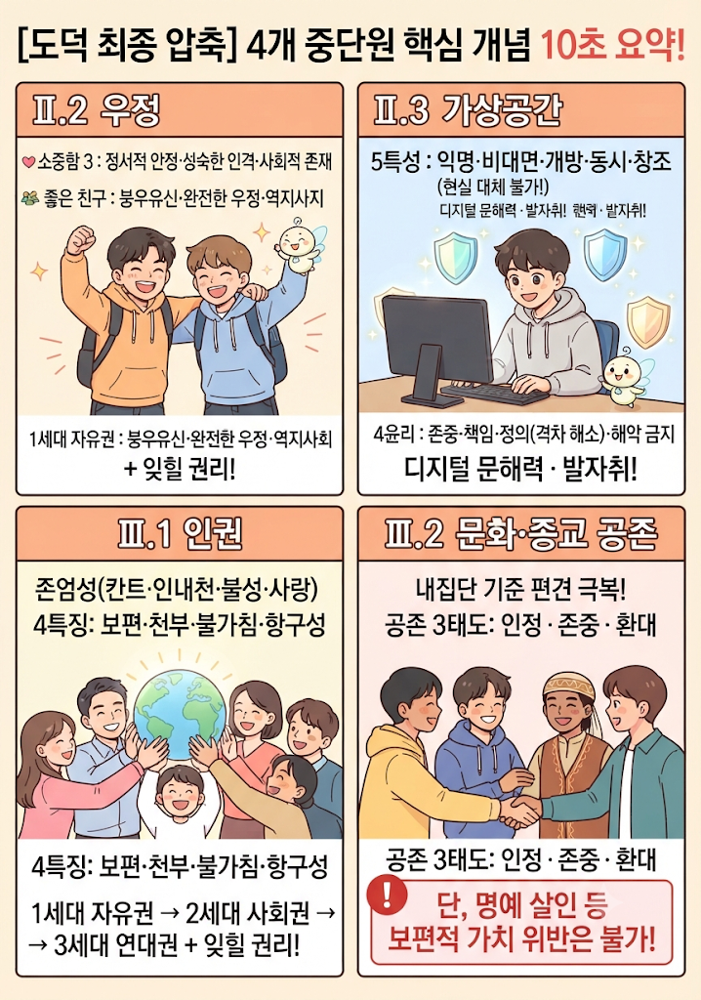
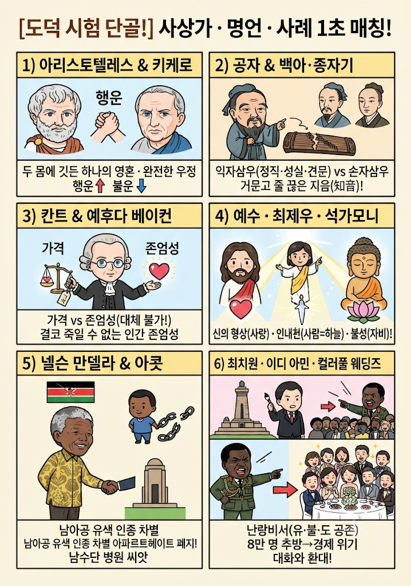
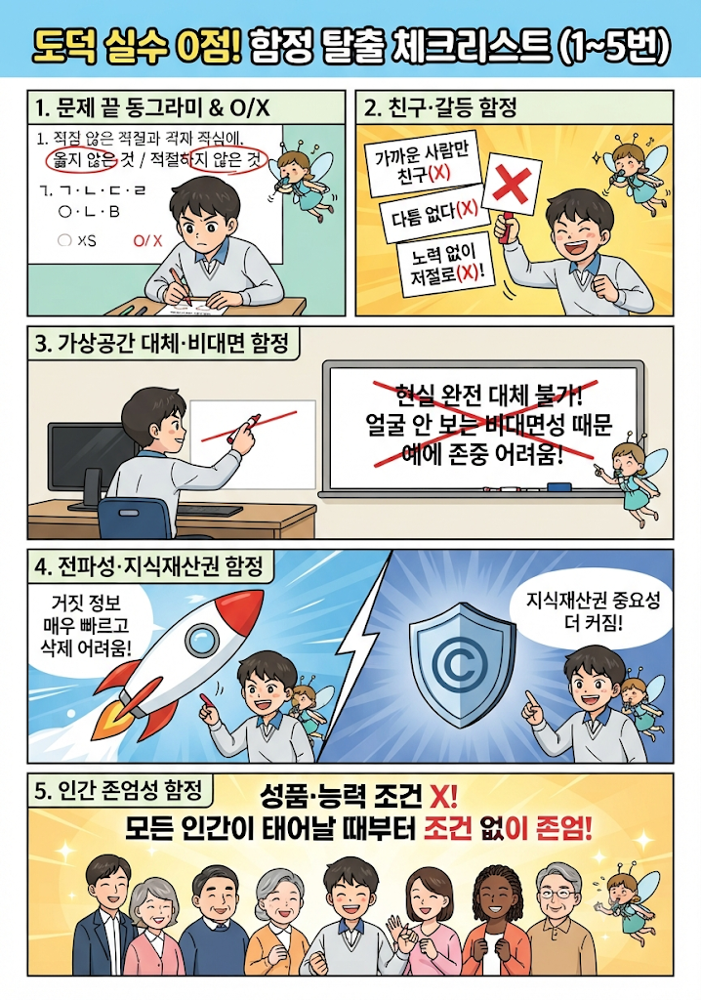
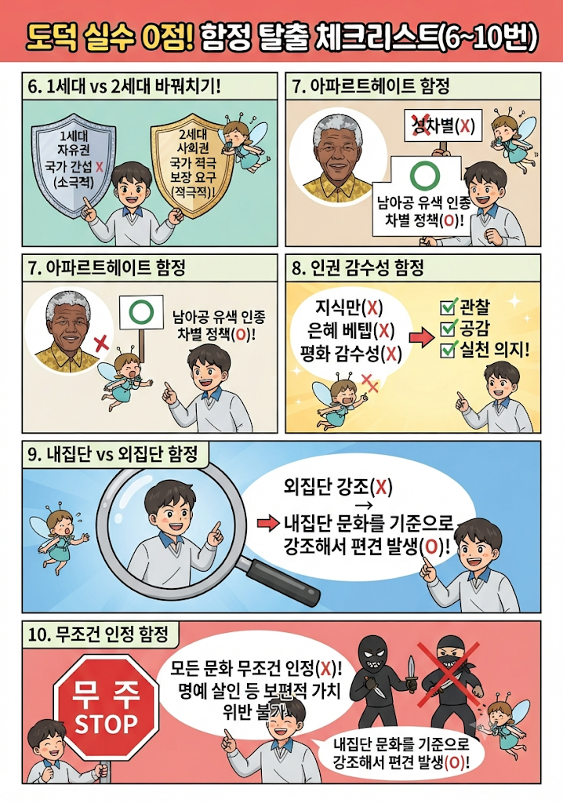

# ⚡ 시험 직전 10분 최종 치트시트 — 2026 7학년 2학기 2회고사 도덕

> **시험 전날 밤 & 시험 직전 쉬는 시간용 1장 압축본**  
> **범위**: 교과서 p.74~145 (Ⅱ.2 우정이 소중한 이유 · Ⅱ.3 가상공간과 타인 · Ⅲ.1 인권은 보편적 가치일까? · Ⅲ.2 다양한 문화·종교의 공존)

---

## 🧠 마인드맵 정리

> 가지를 누르면 접고 펼 수 있어요. 먼저 큰 그림을 보고 아래 표로 내려가세요.

```mindmap
도덕 2회고사
  Ⅱ.2 우정
    소중한 이유
      정서적 안정감
      성숙한 인격 형성
      사회적 존재로 성장
    좋은 친구의 모습
      믿음 (붕우유신)
      인격적 존중 (완전한 우정)
      이해·배려 (역지사지)
    좋은 친구 되는 방법
      언어 예절 · 관심과 실천
      다름 인정 · 자기 성찰
    인물
      아리스토텔레스: 두 몸에 깃든 한 영혼
      공자: 익자삼우 vs 손자삼우
      백아와 종자기: 지음
  Ⅱ.3 가상공간
    특성
      익명성 · 비대면성
      개방성 · 동시성 · 창조성
      현실을 완전히 대체할 수는 없음
    도덕 문제
      가짜 뉴스 (딥페이크)
      사이버 중독 · 사이버 폭력
      지식 재산권·사생활 침해
    원인
      책임 회피
      빠른 전파, 삭제 어려움
      정보 편향성
    윤리 원칙
      존중 · 책임 · 정의 · 해악 금지
      디지털 문해력, 디지털 발자취
  Ⅲ.1 인권
    인간 존엄성
      조건 없이 모든 인간
      칸트: 가격이 아니라 존엄성
      인내천 · 불성 · 이웃 사랑
    4대 특징
      보편성: 누구나
      천부성: 태어날 때부터
      불가침성: 침해·양도 불가
      항구성: 영원히
    세대 확장
      1세대 자유권 (소극적)
      2세대 사회권 (적극적)
      3세대 연대권 (국제 협력)
      현대: 잊힐 권리
    침해 해결
      법·제도 개선 (국가인권위원회)
      윤리적 소비
      인권 감수성: 관찰 → 공감 → 실천
      만델라: 아파르트헤이트(인종 차별) 폐지
  Ⅲ.2 문화·종교의 공존
    편견의 원인
      내집단을 기준으로 외집단 평가
    문화 이해 태도
      자문화 중심주의 ✕
      문화 사대주의 ✕
      문화 상대주의 ○
      극단적 문화 상대주의 ✕
    공존 3태도
      인정 · 존중 · 환대
    인정의 한계
      보편적 가치를 해치는 악습은 ✕
      예: 명예 살인
    사례
      난랑비서: 유교·도교·불교 공존
      우간다: 다양성 상실 → 경제 위기
```

---

## 1️⃣ 4개 중단원 핵심 개념 10초 요약표

|       중단원        | 핵심 키워드                                        | 시험에 꼭 나오는 핵심 내용                                                                                                                                                                                                                                                                                                                                                                 |
| :--------------: | :-------------------------------------------- | :------------------------------------------------------------------------------------------------------------------------------------------------------------------------------------------------------------------------------------------------------------------------------------------------------------------------------------------------------------------------------ |
|  **Ⅱ.2<br>우정**   | **우정의 소중함 3가지**<br>**좋은 친구 3모습 · 4방법**        | • **우정이 소중한 이유**: ① 정서적 안정감 ② 성숙한 인격 형성 ③ 사회적 존재로 성장<br>• **좋은 친구의 모습**: ① 서로 믿음(**붕우유신·교우이신**) ② 인격적 존중(**아리스토텔레스 완전한 우정**) ③ 처지 이해·배려(**역지사지**)<br>• **좋은 친구 되는 방법**: ① 언어 예절 ② 관심과 실천 ③ 다름 인정·존중 ④ 자기 성찰(말·행동 살피기 + 자신 긍정)                                                                                                                                                   |
| **Ⅱ.3<br>가상공간**  | **5대 특성 · 5대 도덕 문제**<br>**원인 3가지 · 4대 윤리 원칙** | • **5대 특성**: 익명성·비대면성 / 개방성·동시성 / 창조성 *(현실과 상호 작용하지만 **현실을 완전히 대체할 수는 없음**)*<br>• **5대 도덕 문제**: 허위 정보·가짜 뉴스(**딥페이크**), 사이버 중독, 지식 재산권 침해(**CCL**), 사생활 침해, 사이버 폭력(동기 1위=보복)<br>• **발생 원인**: ① 책임 회피 ② 빠른 전파성과 삭제의 어려움 ③ **정보 편향성**(내 생각과 같은 정보만 수용)<br>• **4대 윤리 원칙**: **존중 · 책임 · 정의**(디지털 격차 해소) **· 해악 금지** / 핵심 실천: **디지털 문해력**, **디지털 발자취** 인식                             |
|  **Ⅲ.1<br>인권**   | **인간 존엄성 · 4대 특징**<br>**1·2·3세대 · 인권 감수성**    | • **인간 존엄성**: 조건·능력과 무관, 가격 매기거나 대체 불가(**칸트**). 동서양 사상: 크리스트교(**사랑**), 동학(**인내천**), 불교(**불성·자비**)<br>• **인권 4대 특징**: **보편성**(누구나), **천부성**(태어날 때부터), **불가침성**(빼앗거나 양도 불가), **항구성**(영원히 보장)<br>• **세대 확장**: 1세대 **자유권**(소극적) → 2세대 **사회권**(적극적) → 3세대 **연대권**(국제 협력) + 현대 **잊힐 권리**<br>• **침해 원인/해결**: 사회 구조적(**법·제도 개선, 국가인권위원회**) + 개인적(**윤리적 소비, 인권 감수성** 3단계)                |
| **Ⅲ.2<br>문화·종교** | **열린 마음 · 내/외집단**<br>**공존 3태도 · 보편적 가치**      | • **차이와 다양성**: 맞고 틀림이 아닌 자연스러운 다름 → 사회를 풍요롭게 함 (5월 21일 문화 다양성의 날)<br>• **편견의 원인**: **내집단**(우리, 무조건 긍정) 기준으로 **외집단**(남, 무조건 부정)을 평가하는 경향 → 비판적 성찰로 극복!<br>• **다문화 사회**: OECD 외국인 비율 **5% 이상**. 의도하지 않은 차별('흑형', '다문화' 별명)도 경계!<br>• **공존 3대 태도**: **인정**(차이 긍정·평등 기회) · **존중**(귀중하게 대함) · **환대**(귀한 손님으로 맞이함)<br>• **인정의 한계**: **인간 존엄성 등 보편적 가치**에 어긋나는 악습(**명예 살인** 등)은 인정 불가! |



---

## 2️⃣ 시험 단골! 사상가 · 명언 · 사례 1초 매칭표

| 인물 / 사례 | 단원 | 시험에 나오는 핵심 한 줄 (이 문장이 보이면 바로 매칭!) |
| :--- | :---: | :--- |
| **아리스토텔레스** | Ⅱ.2 | **"진정한 친구는 두 개의 몸에 깃든 하나의 영혼"** / **완전한 우정**(즐거움·이익 대가 X, 그 자체로 친구가 잘되길 바람) |
| **공자** (『논어』) | Ⅱ.2 | **익자삼우**(정직·성실·견문 넓은 벗) vs **손자삼우**(아첨·줏대 없음·말만 번지르르한 벗) |
| **키케로** | Ⅱ.2 | **"우정은 행운을 더욱 빛나게 하고, 불운을 나누어 가볍게 해 준다."** |
| **석가모니 / 이백** | Ⅱ.2 | 석가모니: "좋은 벗과 함께 있는 것은 성스러운 길의 전부" / 이백: "고난과 불행이 찾아올 때 비로소 친구임을 안다" |
| **백아와 종자기** | Ⅱ.2 | 마음을 알아주는 참된 친구 **지음(知音)**의 유래 (종자기가 죽자 거문고 줄을 끊음) |
| **헵번·지방시 / 이오덕·권정생** | Ⅱ.2 | 헵번·지방시(40년 신뢰와 예술적 영감) / 이오덕·권정생(띠동갑 나이 차이를 뛰어넘은 격려·편지 우정) |
| **마르셀 프루스트** | Ⅱ마무리 | "우리를 행복하게 해 주는 사람들에게 감사해야 한다. 영혼에 꽃을 피우는 **신비스러운 정원사**" |
| **칸트** | Ⅲ.1 | **"모든 것은 가격을 가지거나 존엄성을 가진다."** → 인간은 가격을 매기거나 다른 것으로 대치할 수 없는 존엄한 존재 |
| **예수 / 최제우 / 석가모니** | Ⅲ.1 | 크리스트교(**신의 형상·이웃 사랑**) / 동학(**인내천: 사람이 곧 하늘**) / 불교(**불성·차별 없는 자비**) |
| **예후다 베이컨 / 아콧** | Ⅲ.1 | 베이컨(홀로코스트 생존자: "결코 죽일 수 없는 인간 존엄성") / 아콧(이태석 신부 제자, 남수단 병원 씨앗) |
| **넬슨 만델라** | Ⅲ.1 | 남아프리카 공화국 백인 정권의 유색 인종 차별 정책 **아파르트헤이트(Apartheid)**를 1994년 완전 폐지 |
| **최치원 「난랑비서」** | Ⅲ.2 | 신라 시대 **유교(효·충)·도교(자연)·불교(선행)**가 모순되지 않고 공존 가능함을 강조 |
| **우간다 이디 아민** | Ⅲ.2 | 1972년 인도계 등 이주민 8만 명 추방 → **다양성 상실 → 경제 위기·투자 급감** (다양성의 소중함 역설!) |
| **영화 『컬러풀 웨딩즈』** | Ⅲ.2 | 편견 가득한 프랑스 부부가 대화·공통점 발견을 통해 아프리카 사돈을 안방에 모시는 **환대와 상호 배려**로 공존 |



---

## 3️⃣ 헷갈리는 개념 1초 비교표

### ① 인권의 4대 특징 vs 1·2·3세대 인권 ⭐ KIS 기출 1순위!

| 인권의 4대 특징 | 핵심 키워드 | 인권의 세대 발전 | 별칭 · 성격 · 예시 |
| :--- | :--- | :--- | :--- |
| **보편성** | 성·인종·국적 무관 **모든 사람** | **1세대 인권** | **자유권** (시민적·정치적 / 국가 간섭 배제, **소극적** 자유) — 신체·표현·종교의 자유 |
| **천부성** | **태어날 때부터** 하늘이 부여 | **2세대 인권** | **사회권** (경제·사회·문화적 / 국가에 요구, **적극적** 권리) — 인간다운 생활·교육·여가 |
| **불가침성** | 넘겨주거나(양도) **침해·박탈 불가** | **3세대 인권** | **연대권** (인류 공동체 책임, **국제적 협력** 보장) — 평화·환경·재난 구제 권리 |
| **항구성** | 일시적 X, **영원히** 보장 | *(현대 확장)* | **잊힐 권리** (가상공간 속 자신의 개인 정보 삭제 요구권) |

### ② 문화 이해 태도 4종 & 공존 3대 태도 ⭐ KIS 기출 단골!

| 구분 | 핵심 의미 | 바람직한가? |
| :--- | :--- | :---: |
| **자문화 중심주의** | 자기 문화를 기준으로 다른 문화를 **열등·틀린 것**으로 판단 (다문화 갈등·편견의 원인!) | ❌ (X) |
| **문화 사대주의** | 자기 문화를 **낮게 평가**하고 다른 나라 문화를 무조건 우월하게 여김 | ❌ (X) |
| **문화 상대주의** | 문화 간 **우열은 없으며**, 해당 문화의 자연환경·역사·사회적 맥락에서 이해 | ⭕ (O) |
| **극단적 문화 상대주의** | **보편적 인권**(인간 존엄성)을 침해하는 악습(**명예 살인** 등)까지 무조건 인정 | ❌ (X) |
| **공존 3대 태도** | **인정**(차이 긍정·평등 기회) / **존중**(귀중히 대함·박해 금지) / **환대**(귀한 손님처럼 반갑게 맞이함) | ⭕ (O) |

---

## 4️⃣ ⚠️ 아들을 위한 「실수 0점」 도덕 함정 탈출 체크리스트 10선

2025 KIS 도덕 기출과 교과서 확인 문제에서 **가장 많이 낚이는 함정 10가지**만 골랐습니다!

1. **[문제 끝 동그라미]** "옳은 것" vs "옳지 **않은** 것", "적절한 것" vs "적절하지 **않은** 것", `<보기>`는 반드시 **ㄱ·ㄴ·ㄷ·ㄹ 옆에 O/X 표시**!
2. **[친구·갈등 함정]** "친구는 가까운 곳에 사는 사람만 의미한다(X)", "친한 친구끼리는 다툼이 없다(X)", "오래 함께 있으면 노력 없이도 좋은 친구가 된다(X)"!
3. **[가상공간 대체 함정]** 가상공간은 현실과 서로 영향을 주고받지만, **현실 세계를 완전히 대체할 수는 없다!** (가상공간에서는 직접 얼굴을 마주하지 않는 **비대면성** 때문에 존중이 어렵다 — "직접 얼굴을 마주해서 어렵다" 나오면 바로 X!)
4. **[전파성·지식 재산권 함정]** 거짓 정보는 **"느리게 퍼진다"(X)** → **매우 빠르게 퍼지고 삭제가 어렵다!** / 정보를 쉽게 활용할수록 지식 재산권 보호의 중요성은 감소가 아니라 **더 커진다!**
5. **[인권 존엄성 함정]** 인간 존엄성은 도덕적 성품이 훌륭하거나 능력이 뛰어난 사람만 가지는 것이 아니다! **모든 인간이 조건 없이** 가진다.
6. **[1세대 vs 2세대 바꿔치기 함정]** **1세대(자유권)** = 국가 간섭 받지 않을 소극적 권리 / **2세대(사회권)** = 국가의 적극적 역할을 요구하는 권리! *(2025 KIS 16번에서 둘의 설명을 서로 바꿔 함정을 팠음!)*
7. **[아파르트헤이트 함정]** 아파르트헤이트는 **성차별 정책(X)**이 아니라 남아프리카 공화국의 **유색 인종 차별 정책(O)**! *(2025 KIS 20번 실제 함정!)*
8. **[인권 감수성 함정]** 인권 지식만 알면 인권 침해가 해결된다(X), 인권 보호는 약자에게 은혜를 베푸는 태도다(X), "평화 감수성"(X) → **인권 감수성**(관찰 → 결과 예측·공감 → 책임감·실천 의지)!
9. **[내집단 vs 외집단 함정]** 편견은 **'외집단'** 문화를 강조해서 생기는 게 아니라 **'내집단'**의 문화를 강조하고 기준으로 삼기 때문에 생긴다! *(2025 KIS 15번 실제 함정!)*
10. **[무조건 인정 함정]** 다문화 사회에서는 세계의 **모든** 문화를 무조건 인정해야 한다(X)! **명예 살인**처럼 **인간 존엄성(보편적 가치)**을 해치는 문화는 인정할 수 없다!




