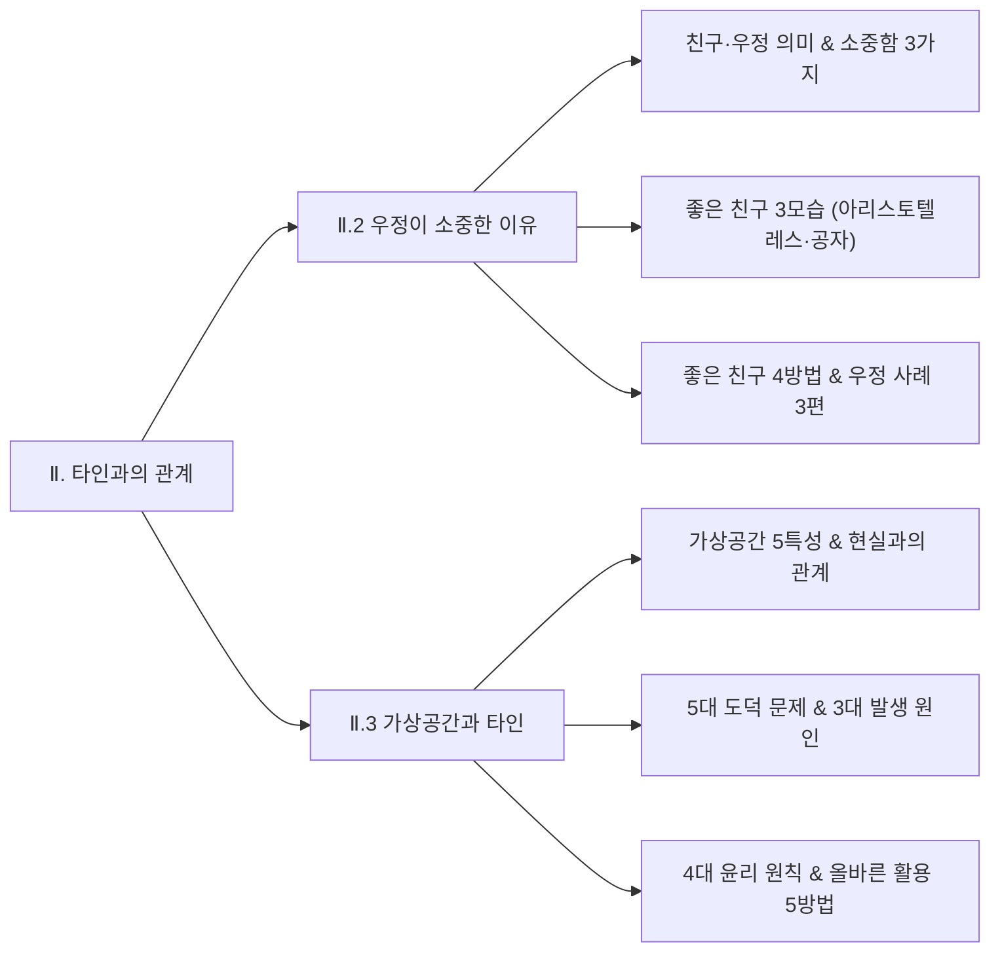
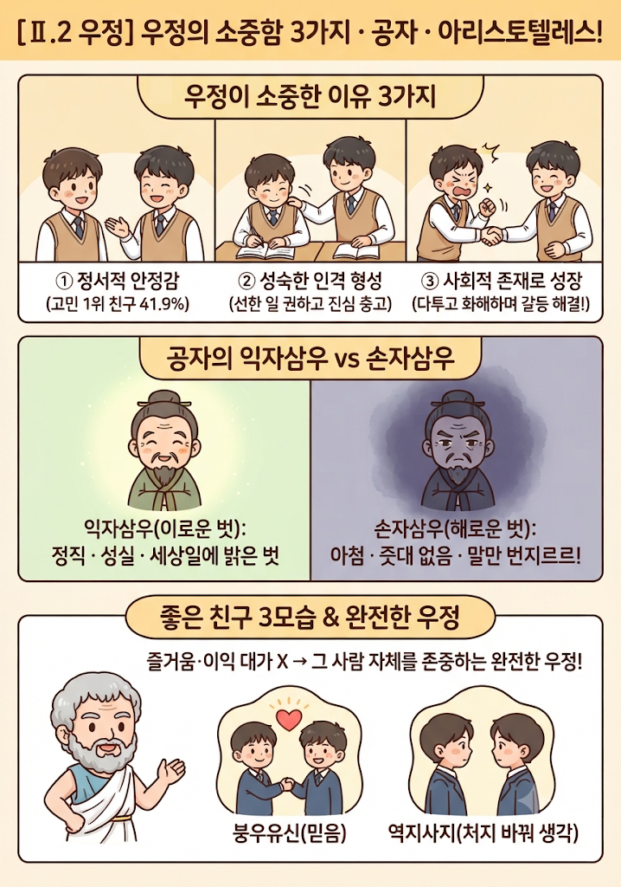
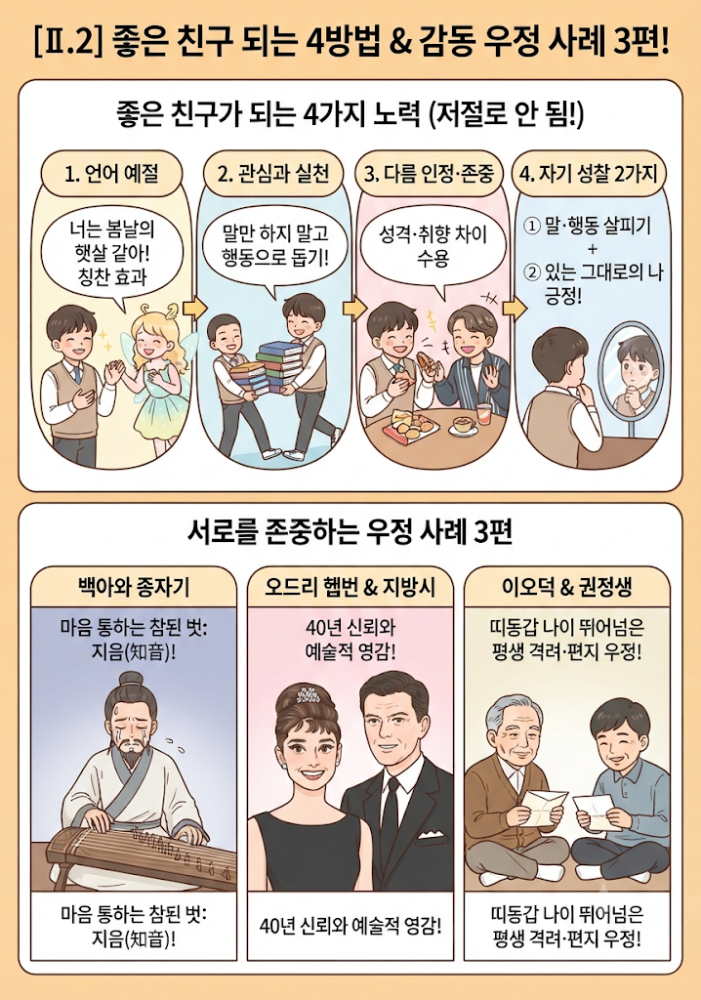
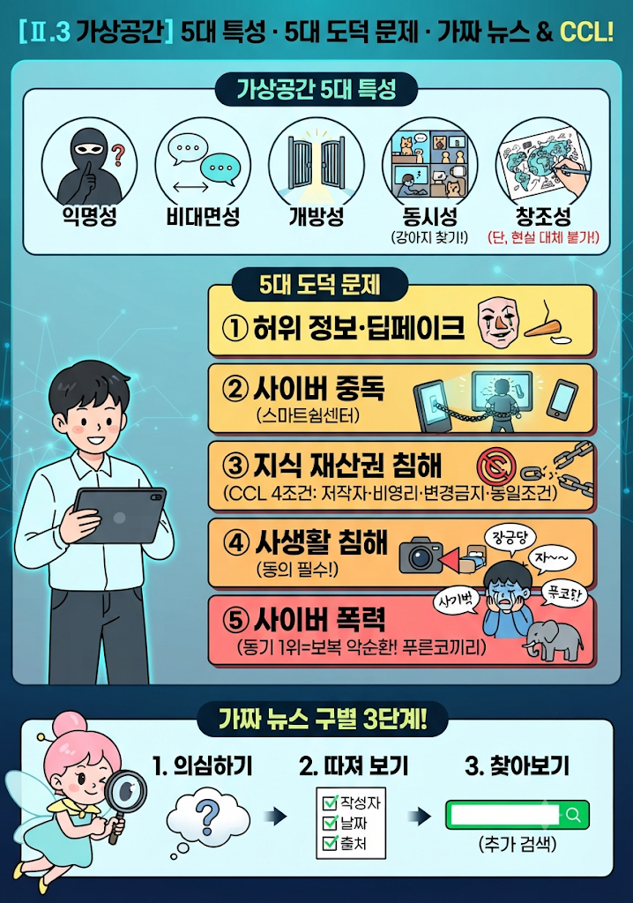
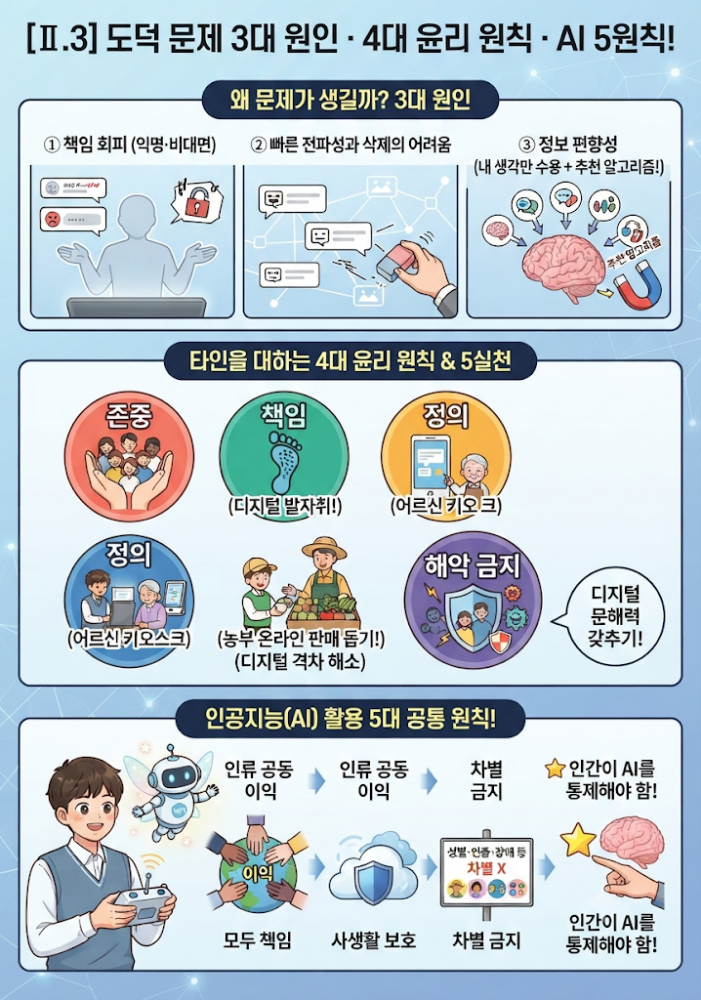

# 📘 2단원 (Ⅱ.2~Ⅱ.3) 우정이 소중한 이유 & 가상공간과 타인 — 완벽 정리

> **교과서 범위**: p.74 ~ 109 (Ⅱ. 타인과의 관계 — 2. 우정이 소중한 이유는 무엇일까? / 3. 가상공간에서 타인을 어떻게 대해야 할까? / 대단원 마무리)  
> **연계 기출**: 2025학년도 KIS 7학년 2학기 2차 지필평가 (2번, 4번, 10번, 13번, 18번)  
> **학습 목표**: 우정의 의미·소중함·좋은 친구가 되는 방법 이해하기 / 가상공간의 특성·도덕 문제·원인·올바른 활용 태도 실천하기

---

## 🎯 한눈에 보는 2단원 지도

---

## PART 1. Ⅱ.2 우정이 소중한 이유는 무엇일까? (교과서 p.74~87)

> 🎬 **개념 몽타주 영상 (1분 52초)** — 우정의 의미 · 소중한 이유 · 익자삼우와 손자삼우 · 좋은 친구를 한 번에 정리해요.

<video controls preload="metadata" playsinline poster="exam/%EB%8F%84%EB%8D%95_%EC%8B%9C%ED%97%98%EA%B3%B5%EB%B6%80/videos/mor_01_friendship_poster.jpg" src="exam/%EB%8F%84%EB%8D%95_%EC%8B%9C%ED%97%98%EA%B3%B5%EB%B6%80/videos/mor_01_friendship.mp4" style="width:100%;max-width:960px;border-radius:12px;display:block;margin:0 auto 1em;background:#000"></video>

### 01. 친구야, 너는 소중한 사람이야 (p.76~79)

#### 1) 친구와 우정의 의미
- **친구의 의미**: 일반적으로 **나와 가깝게 오래 사귄 사람**을 뜻하지만, 일상생활에서는 더 다양한 의미로 쓰인다.
  - 지구 반대편의 사람이나 가상공간에서 만난 사람
  - 오래 사귀지 않았지만 나와 마음이 통하는 사람
  - 절친한 사이는 아니지만 학급처럼 같은 공동체에 속한 구성원
- **우정의 의미**: 기쁨·즐거움·슬픔·노여움 등을 함께 겪으며 **마음을 나누며 쌓은 친구 사이의 정**.
  - **청소년기의 특징**: 가족을 넘어 새로운 사회적 관계를 맺으려는 욕구가 강해져 친구 관계가 특히 중요해진다.

#### 2) 친구와 우정에 관한 명언 ⭐ 암기!

| 인물 | 명언 내용 | 핵심 의미 |
| :--- | :--- | :--- |
| **석가모니** | "좋은 벗이 있고, 좋은 동지와 함께 있는 것은 성스러운 길의 전부이다." | 좋은 친구의 절대적 가치 |
| **이백** | "고난과 불행이 찾아올 때 비로소 친구가 친구임을 안다." | 어려울 때 드러나는 진정한 우정 |
| **아리스토텔레스** | "진정한 친구란 **두 개의 몸에 깃든 하나의 영혼**이다." | 깊이 마음이 통하는 진정한 우정 |
| **키케로** *(고대 로마)* | "우정은 **행운을 더욱 빛나게 하고, 불운을 나누어 가볍게 해 준다.**" | 기쁨은 두 배, 슬픔은 절반! |

#### 3) 우정이 소중한 이유 3가지 (p.78) ⭐ 서술형·객관식 단골!
교과서 은서와 지호의 시험 준비 만화처럼 우정은 서로의 부족한 점을 채우고 함께 성장하게 한다.

1. **정서적 안정감**: 함께 즐거움을 느끼고, 힘들 때 고민을 털어놓고 위로·지지·조언을 주고받으며 어려움을 이겨 낸다.
   - *참고 자료(2022 한국인의 의식·가치관 조사)*: 심리·감정적 문제에 맞닥뜨렸을 때 가장 먼저 도움을 요청하는 대상 1위는 **친구(41.9%)**, 2위는 가족(35.2%)!
2. **성숙한 인격 형성**: *"선한 일을 하도록 서로 권하는 것이 친구의 도리이다."* → 옳은 일은 서로 권하고, 그른 일은 하지 않도록 **진심 어린 충고**를 나누며 서로의 장점을 본받는 과정에서 인격이 성숙해진다.
3. **사회적 존재로 성장**: 학급·동아리 등 공동체에서 자신의 역할을 알고 배려하는 방법을 익힌다. 친구와 **다투고 화해하는 과정**에서 타인의 처지를 생각하고 갈등을 평화롭게 해결하는 법을 배운다.

---

### 02. 우리는 좋은 친구가 될 거야 (p.80~85)

> 🎬 **개념 몽타주 영상 (2분 11초)** — 좋은 친구의 조건 · 공자의 익자삼우 · 서로를 존중하는 아름다운 우정 이야기 3편(백아와 종자기, 오드리 헵번과 지방시, 이오덕과 권정생)을 이야기식으로 만나 봐요.

<video controls preload="metadata" playsinline poster="exam/%EB%8F%84%EB%8D%95_%EC%8B%9C%ED%97%98%EA%B3%B5%EB%B6%80/videos/mor_01b_good_friend_stories_poster.jpg" src="exam/%EB%8F%84%EB%8D%95_%EC%8B%9C%ED%97%98%EA%B3%B5%EB%B6%80/videos/mor_01b_good_friend_stories.mp4" style="width:100%;max-width:960px;border-radius:12px;display:block;margin:0 auto 1em;background:#000"></video>

#### 1) 공자가 말한 이로운 벗 vs 해로운 벗 (『논어』, p.80) ⭐ 시험 단골!
공자는 *"나를 이롭게 하는 벗이 세 부류 있고, 나를 해치는 벗이 세 부류 있다(益者三友 損者三友)"*라며 모든 친구가 나에게 좋은 친구는 아니므로 바르게 분별하여 사귀어야 한다고 가르쳤다.

| 구분 | 한자어(참고) | 세 부류의 벗 | 핵심 특징 및 시험 대비 포인트 |
| :--- | :---: | :--- | :--- |
| **나를 이롭게 하는 벗** | **익자삼우(益者三友)** | ① **정직한** 사람 (우직 友直) ② **성실한** 사람 (우량 友諒) ③ 들어서 아는 것이 많아 **세상일에 밝은** 사람 (우다문 友多聞) | 거짓 없이 바른 말을 해 주며, 신의와 성실함으로 믿음을 주고, 풍부한 식견과 배움으로 삶의 지혜를 넓혀 주는 참된 벗 |
| **나를 해치는 벗** | **손자삼우(損者三友)** | ① **아첨**을 잘하는 사람 (우편벽 友便辟) ② 착하지만 **줏대가 없는** 사람 (우선유 友善柔) ③ **말만 번지르르하게** 하는 사람 (우편녕 友便佞) | 겉으로는 비위를 맞추며 아첨하고, 줏대 없이 남의 눈치만 보며 영합하고, 실천과 진심 없이 번드르르한 말솜씨로 남을 속이는 벗 |

> ⚠️ **시험 함정 체크**: "단순히 성격이 착하고 순한 친구는 무조건 이로운 벗이다?" → **X!** 자기 주관이나 올바른 도덕적 줏대 없이 남의 말에 휩쓸리는 사람(선유 善柔)은 손자삼우에 해당한다. 친구의 잘못을 보았을 때는 도덕적 줏대를 가지고 바르게 충고할 수 있어야 한다!

#### 2) 좋은 친구의 모습 3가지 (p.80~81) ⭐ 핵심!

| 좋은 친구의 모습 | 핵심 개념 · 사상가 · 고사성어 | 설명 및 교과서 세부 내용 |
| :--- | :--- | :--- |
| **① 서로 믿을 수 있는 친구** | **붕우유신**(朋友有信: 친구 사이의 도리는 믿음에 있다) **교우이신**(交友以信: 믿음으로 친구를 사귄다) | 진실한 말과 행동으로 서로 믿음을 쌓아 마음을 온전히 터놓을 수 있는 사람. 약속을 지키고 정직하게 대할 때 신뢰가 싹튼다. |
| **② 인격적으로 존중하는 친구** | **아리스토텔레스의 『완전한 우정』** | 즐거움이나 이익(특별한 대가·조건) 때문이 아니라, **그 사람 자체를 한 인격으로서 사랑하고 친구가 잘되기를 진심으로 바라는 우정**. |
| **③ 서로의 처지를 이해하고 배려하는 친구** | **역지사지**(易地思之: 자신과 다른 사람의 처지를 바꾸어 생각함) | 친구가 약속을 어겼을 때 감정적으로 화부터 내기보다, 그렇게 행동할 수밖에 없었던 친구의 사정과 처지를 먼저 헤아리는 자세. |

> 💡 **아리스토텔레스의 우정 구분 (p.80 만화 핵심 정리!)**
> 
> 아리스토텔레스는 『니코마코스 윤리학』에서 우정을 세 가지로 엄격히 구분했다:
> 1. **즐거움(쾌락)에 바탕을 둔 우정**: 함께 놀 때 재미있고 즐겁기 때문에 사귀는 관계 → 흥미나 재미가 사라지면 쉽게 깨지는 불완전한 우정
> 2. **유용성(이익)에 바탕을 둔 우정**: 나에게 이익이 되거나 공부·숙제 등에 도움이 되기 때문에 사귀는 관계 → 상대방에게서 얻을 이익이 사라지면 끝나는 불완전한 우정
> 3. **완전한 우정 (덕에 바탕을 둔 우정)**: 어떤 조건이나 보상, 외적 유용성 때문이 아니라 **친구 그 자체를 고귀한 인격으로 사랑하고, 친구가 행복하고 잘되기를 순수하게 바라는 참된 우정!** (진정한 친구란 "두 개의 몸에 깃든 하나의 영혼"이다.)

#### 3) 좋은 친구가 되는 방법 4가지 (p.82~84)
좋은 친구 관계는 시간이 흐른다고 **저절로 얻어지지 않으며**, 나와 친구 모두의 지속적인 정성과 노력이 필요하다!

1. **언어 예절 지키기**: *"혀는 칼보다 날카롭다."* 아무리 친한 사이라도 함부로 말하거나 비속어·조롱을 쓰지 않고, 바르고 고운 언어를 사용하며 따뜻한 격려와 칭찬을 건넨다.
   - *드라마 『이상한 변호사 우영우』의 명대사*: 주인공 우영우가 절친 최수연에게 한 말 — **"너는 봄날의 햇살 같아. 로스쿨 때부터 지금까지 나를 따뜻하게 챙겨준 다정하고 따뜻한 사람이야."**
   - *칭찬의 3대 효과(p.83)*:
     • 상대방이 자신의 능력과 가치를 높게 평가하게 만든다 (자아존중감 향상)
     • 상처받은 마음을 치유하고 용기를 북돋운다
     • 원만한 인간관계를 유지하게 돕는다 (칭찬을 건네는 사람과 듣는 사람 모두에게 긍정적!)
2. **서로의 일에 관심을 가지고 돕기**: 좋은 친구가 되는 길은 상대방을 향한 **진심 어린 관심**에서 출발한다. 친구의 기쁨과 슬픔, 고민을 눈여겨보고 적절한 도움을 준다.
   - *『숫타니파타를 읽는 즐거움』(보경 스님)*: *"말로만 도와주겠다고 하고 행동이 따르지 않는 사람은 진실한 친구가 아니다."* → 친구가 곤경에 처했을 때 계산하지 않고 실제로 행동하며 손을 내미는 것이 진정한 우정이다.
3. **나와 다른 점을 인정하고 존중하기**: 아무리 절친한 친구라도 자라온 환경, 성격, 취향, 가치관, 의견이 서로 다를 수밖에 없다.
   - *교과서 사례*: 음식을 함께 나누어 먹는 것을 좋아하는 친구와, 각자 접시에 덜어 온전히 먹는 것을 편하게 여기는 친구처럼 식습관이나 생활 방식의 차이를 틀린 것이 아니라 '다름'으로 인정하고 포용해야 한다.
4. **자기 성찰하기** *(두 가지 차원의 의미 — 서술형 시험 필수 암기!)*:
   - **첫 번째 의미**: 자신의 말과 행동이 좋은 친구 관계를 맺는 데 **적절한지 스스로 살피고, 부족하거나 그릇된 점을 반성하고 고쳐 나가는 것**
   - **두 번째 의미**: 자신이 무엇을 좋아하고 무엇을 잘하는지 자기 자신을 깊이 이해하고, **있는 그대로의 자신을 긍정적으로 소중히 여기는 것** (→ 스스로를 아끼는 사람만이 친구 앞에서도 가식이나 꾸밈없이 자연스럽고 당당하게 자신을 표현할 수 있다!)

> 📌 **우정을 유지하는 방법** (설흔, 『우정 지속의 법칙』, p.82)  
> 자주 만난다 / 약속을 꼭 지킨다 / 잘못을 바로잡도록 충고해 준다 / 모두가 외면할 때 손을 내민다 / 실수했다면 잘못을 인정한다 / 함께하는 지금을 즐긴다.

#### 4) 서로를 존중하는 우정 사례 3편 (p.85) — 감동 이야기 깊이 읽기 ⭐ 시험 서술형 단골!

교과서 85쪽에는 시대와 신분, 나이와 분야를 뛰어넘어 서로를 깊이 존중했던 세 편의 감동적인 우정 이야기가 소개되어 있다.

```mermaid
flowchart TD
    A["상호 존중의 아름다운 참 우정 3편"] --> B["🎵 백아와 종자기 (춘추시대)"]
    A --> C["👗 오드리 헵번 & 위베르 드 지방시 (20세기)"]
    A --> D["✉️ 이오덕 & 권정생 (한국 아동문학)"]
    B --> B1["속마음을 꿰뚫어 보는 소리 · 지음(知音)과 백아절현"]
    C --> C1["서로에게 예술적 영감을 주는 뮤즈 · 40년의 신뢰와 병상 간호"]
    D --> D1["가난과 병마를 보듬은 400통의 편지 · 강아지똥과 몽실언니의 탄생"]
```

##### 📖 이야기 1: 거문고 줄을 끊은 슬픔, 참된 벗 — 백아(伯牙)와 종자기(鍾子期) (『열자』)
- **배경 이야기**: 고대 중국 춘추시대 진(晉)나라의 고관이자 당대 최고의 거문고 명인이었던 **백아**에게는 남루한 옷차림의 나무꾼 **종자기**라는 둘도 없는 벗이 있었다.
- **감동 일화**: 백아가 높은 산에 오르는 웅장한 마음으로 거문고를 타면, 곁에서 듣던 종자기가 무릎을 치며 *"참으로 훌륭하구나! 하늘 높이 솟아오른 태산(泰山)의 기상이 눈앞에 펼쳐지는 듯하구나!"* 하고 감탄했다. 백아가 이번에는 도도하게 흐르는 강물을 그리며 연주하자, 종자기는 *"아, 넓고 거칠 것 없이 도도히 흐르는 거대한 황하(黃河) 같구나!"* 하고 백아의 마음속 정경을 소리 하나로 완벽하게 꿰뚫어 보았다.
- **백아절현(伯牙絶絃)**: 그러던 어느 날, 종자기가 불의의 병으로 세상을 떠났다. 깊은 슬픔에 빠진 백아는 종자기의 무덤을 찾아가 마지막으로 혼신을 다해 곡을 연주한 뒤, **거문고 줄을 스스로 모두 끊어 버리고 죽을 때까지 다시는 거문고를 타지 않았다.** 세상에 자신의 마음과 소리를 알아줄 참된 사람이 더 이상 없었기 때문이다.
- **도덕적 교훈 & 고사성어**: 여기서 **'소리를 알아듣는다'**는 뜻의 **『지음(知音)』**이라는 고사성어가 유래했다. 지음은 단순한 친구를 넘어 **나의 참된 가치와 속마음을 온전히 이해하고 알아주는 세상에 둘도 없는 벗**을 뜻한다.

##### 📖 이야기 2: 40년간 서로의 예술 세계를 빛낸 영혼의 단짝 — 오드리 헵번과 위베르 드 지방시
- **배경 이야기**: 1953년, 영화 『로마의 휴일』로 갓 스타가 된 여배우 **오드리 헵번**은 차기작 『사브리나』의 의상을 고르기 위해 프랑스 파리의 젊은 신예 디자이너 **위베르 드 지방시(Hubert de Givenchy)**의 아틀리에를 찾아갔다.
- **감동 일화**: 당시 마른 체형 때문에 전통적인 글래머 배우들과 달랐던 헵번은 지방시의 절제되고 우아한 디자인(리틀 블랙 드레스 등)을 입으며 자신만의 독보적인 스타일을 세계에 각인시켰다. 지방시 역시 헵번의 맑고 순수한 매력에서 무한한 창작의 영감을 얻었다. 두 사람은 패션과 영화 역사상 가장 아름다운 콤비가 되어 헵번은 지방시의 평생의 **뮤즈(Muse)**가 되었고, 지방시는 오직 헵번만을 위한 향수(렝떼르디)를 선물하기도 했다.
- **신뢰와 헌신**: 둘의 관계는 화려한 상업적 비즈니스를 뛰어넘은 '완전한 우정'이었다. 헵번이 말년에 대장암으로 고통받으며 스위스 집으로 돌아가기를 간절히 원할 때, 상업용 비행기를 탈 수 없던 헵번을 위해 지방시는 친구들이 마련한 전용기에 헵번이 좋아하는 꽃을 가득 채워 편안히 이동하도록 도왔다. 헵번이 눈을 감을 때까지 지방시는 그녀의 침상 곁을 지키며 마지막 순간까지 따뜻하게 손을 잡아 주었다.
- **도덕적 교훈**: 40여 년 동안 서로의 개성과 인격을 존중하고, 상대의 능력을 한층 더 빛나게 이끌어 주며, 고난의 순간에도 끝까지 곁을 지킨 현대적 상호 존중의 우정이다.

##### 📖 이야기 3: 400통의 편지로 가난과 병마를 보듬은 — 이오덕과 권정생
- **배경 이야기**: 경북 안동 일직면 조탑리의 허물어져 가는 흙집 문간방에서, 평생 결핵과 신장 질환으로 소변 주머니를 찬 채 모진 가난 속에서 동화를 쓰던 **권정생** 선생님. 1973년, 당시 초등학교 교사이자 우리말과 어린이 문학을 연구하던 12살 연상의 **이오덕** 선생님은 우연히 잡지에서 권정생의 글을 읽고 큰 충격과 감동을 받았다.
- **감동 일화**: 이오덕 선생님은 비포장 흙길을 걸어 안동의 낡은 시골집으로 권정생을 찾아갔다. 차가운 방에서 아픔을 견디며 글을 쓰던 권정생을 만난 이오덕은 *"당신의 글은 우리 민족 어린이들의 영혼을 울리는 위대한 문학"*이라며 깊은 경의를 표했다.
- **400통의 편지**: 이후 두 사람은 2003년 이오덕 선생님이 세상을 떠날 때까지 30여 년 동안 무려 **400여 통의 편지**를 주고받았다. 이오덕은 권정생의 건강과 끼니를 끊임없이 걱정하며 약과 원고지를 부쳤고, 권정생의 명작인 **『강아지똥』**과 **『몽실 언니』**가 세상의 빛을 볼 수 있도록 출판사를 백방으로 설득하고 추천사를 썼다. 권정생은 자신의 모든 외로움과 고통, 문학에 대한 순수한 고뇌를 이오덕에게 털어놓으며 삶의 용기를 얻었다.
- **도덕적 교훈**: 나이 차이와 병마, 세상의 편견을 넘어, 가장 어둡고 추운 곳에 홀로 남겨진 친구의 가치를 알아보고 평생 손을 잡아 준 한국 문학사의 가장 눈물겹고 숭고한 참된 우정의 모범이다.

#### 5) Ⅱ.2 교과서 확인 O/X (p.87) ⭐ 시험 직전 총정리!
- ㄱ. 친구는 나와 가까운 곳에서 자주 얼굴을 마주하는 사람만을 의미한다. → **X** *(지구 반대편의 친구, 편지를 주고받는 친구, 가상공간에서 만난 사람도 참된 친구가 될 수 있음)*
- ㄴ. 친한 친구 사이라면 어떤 다툼이나 갈등도 일어나지 않아야 한다. → **X** *(갈등과 다툼을 피하는 것이 능사가 아니며, 서로 다투고 화해하는 과정에서 타인을 배려하고 사회적 존재로 성숙해짐)*
- ㄷ. 아리스토텔레스는 완전한 우정이란 즐거움이나 이익 같은 조건이 아니라, 친구 그 자체를 한 인격으로서 사랑하는 것이라고 하였다. → **O** *(두 몸에 깃든 하나의 영혼)*
- ㄹ. 인격적으로 존중하는 친구 관계는 오랜 시간을 함께 보내기만 하면 별다른 노력 없이도 저절로 맺어진다. → **X** *(언어 예절, 관심과 도움, 다름의 인정, 자기 성찰 등 양쪽 모두의 꾸준한 노력이 필수적임)*
- ㅁ. 백아가 종자기의 죽음 이후 거문고 줄을 끊었다는 고사에서 유래한 말은 '익자삼우'이다. → **X** *(백아절현에서 유래한 말은 자신의 마음을 온전히 알아주는 참된 벗을 뜻하는 **지음(知音)**임)*

---

## PART 2. Ⅱ.3 가상공간에서 타인을 어떻게 대해야 할까? (교과서 p.88~109)

> 🎬 **개념 몽타주 영상 (1분 47초)** — 가상공간 · 5대 도덕 문제 · 3가지 원인 · 4대 자세를 한 번에 정리해요.

<video controls preload="metadata" playsinline poster="exam/%EB%8F%84%EB%8D%95_%EC%8B%9C%ED%97%98%EA%B3%B5%EB%B6%80/videos/mor_02_cyber_poster.jpg" src="exam/%EB%8F%84%EB%8D%95_%EC%8B%9C%ED%97%98%EA%B3%B5%EB%B6%80/videos/mor_02_cyber.mp4" style="width:100%;max-width:960px;border-radius:12px;display:block;margin:0 auto 1em;background:#000"></video>

### 01. 가상공간, 삶에서 접하는 또 다른 세계 (p.90~93)

#### 1) 가상공간의 의미와 5대 특성 ⭐ KIS 기출 2번 적중!
- **가상공간의 의미**: 컴퓨터나 인터넷과 같은 **정보통신 기술**을 활용하여 만들어진 가상의 세계 (게임, SNS, 온라인 학습 등)
- **가상공간의 5대 특성**:
  1. **익명성과 비대면성**: 자신의 신분·얼굴을 드러내지 않고 비대면으로 소통 → 생각·감정을 더 쉽게 표현하고 평등하게 소통 가능 *(단점: 무책임한 행동·사이버 폭력 유발)*
  2. **개방성과 동시성**: 시간과 공간의 제약 없이 누구나 자유롭게 정보에 접근하고, 언제 어디서든 소통·협력 가능
  3. **창조성**: 사용자가 원하는 정보와 규칙으로 현실에서는 경험할 수 없는 새로운 세계 창조
- **관련 핵심 용어**:
  - **디지털 정체성**: 가상공간에서 스스로 공개·제작한 정보로 재구성된 자신의 모습 (현실의 나와 다를 수 있으며, 활동 공간에 따라 다양한 정체성 보유 가능)
  - **아바타(avatar)**: 가상공간에서 자신의 신분으로 표시되는 상징물·특징물
  - **메타버스(metaverse, 확장 가상 세계)**: 아바타로 현실과 같은 사회·경제·교육·문화 활동을 하는 3차원 공간 (인간뿐 아니라 인공지능과도 친밀한 관계 형성 가능)

#### 2) 가상공간과 현실 세계의 관계 (p.92~93) ⭐ 단골 함정 주의!
- **공통점**: 사람들과의 만남·경험이 이루어지며, 우리가 한 행동의 결과에는 **늘 책임이 따른다.**
- **상호 작용**: 서로 영향을 주고받는다.
  - *교과서 긍정 사례(p.93)*: 박○○ 씨가 잃어버린 강아지 사진·특징을 SNS에 올려(**개방성·동시성** 활용) 지역 주민의 제보로 빠르게 찾음!
- **한계와 규범**: 가상공간은 삶의 중요한 일부가 되었지만, 우리는 현실 세계에 살고 있으므로 **가상공간이 현실 세계를 완전히 대체할 수는 없다.** 따라서 가상공간에서도 현실과 똑같이 **도덕규범**을 지켜야 한다.

---

### 02. 가상공간에서 발생하는 도덕 문제 (p.94~97) ⭐ KIS 기출 4번 적중!

| 도덕 문제 | 내용 및 교과서 핵심 포인트 | 해결·예방 태도 |
| :--- | :--- | :--- |
| **① 허위 정보와 가짜 뉴스** | 잘못·왜곡된 정보가 빠르게 퍼져 혼란·피해 유발 • **딥페이크(deepfake)**: AI로 사진·영상에 다른 이미지를 덧씌우는 기술 *(2023년 미국 정부 기관 폭발 합성 사진 사례)* | **출처와 정확성 확인** 습관 • **구별 3단계**: **의심하기**(건강한 회의적 태도) → **따져 보기**(작성자·날짜·출처) → **찾아보기**(추가 검색) • **판별 6법**: 선입견 점검, 본문 읽기, 출처 확인, 근거 확인, 전문가 문의, 날짜 확인 |
| **② 사이버 중독** | 가상공간에 지나치게 빠져 일상생활이 방해받는 상태 → 신체·정신 건강, 가족·친구 관계, 학업 문제, **정체성 혼란** 유발 | 목적에 맞게 사용, 사용 시간 스스로 조절 *(예방·상담 기관: **스마트쉼센터**)* |
| **③ 지식 재산권 침해** | 글·그림·음악·영화 등 타인의 창작물을 무단 사용·복사·공유 → **원작자**의 노력과 창작 과정 무시 | 반드시 허가를 받거나 출처 표기 • **저작물 이용 허락 표시(CCL)** 4조건: ① 저작자 표시 ② 비영리 ③ 변경 금지 ④ 동일 조건 변경 허락 |
| **④ 사생활 침해** | 친구가 보낸 사진이나 개인 정보를 동의 없이 SNS에 공개 → 범죄 악용 위험 | 타인이 나온 사진·영상 공유 전 반드시 **동의** 구하기, 본인 동의도 신중히 |
| **⑤ 사이버 폭력** | 가상공간에서 타인을 고의로 괴롭힘(불쾌한 농담, 악성 댓글, 비하·혐오 표현, 가짜 계정). **비대면성** 때문에 현실보다 더 쉽게 발생 • *2022 실태 조사 동기 1위*: **"상대방이 먼저 해서 보복하기 위해"** → 피해가 가해로 이어지는 악순환! | 가상공간에서도 서로 존중·배려 *(예방 기관: **푸른코끼리**)* |
| **기타 문제 (p.97)** | • **해킹** / **금전 거래 사기** / **바이러스 유포** • **동영상 추천 알고리즘의 한계**: 비슷한 영상만 계속 추천해 **한쪽으로 치우친 시각(편향)**을 심어 줄 수 있음! | 다양한 관점의 정보를 균형 있게 탐색 |

---

### 03. 가상공간을 올바르게 활용하자 (p.98~105)

#### 1) 가상공간에서 도덕 문제가 발생하는 3가지 원인 (p.98) ⭐ KIS 기출 10번 적중!

| 원인 | 구체적 내용 | 주의할 함정! |
| :--- | :--- | :--- |
| **① 책임 회피** | **익명성·비대면성** + "가상공간은 진짜 세계가 아니다"는 생각 → 죄책감 감소 → 무책임·비도덕적 행동 | 가상공간 자유는 타인 권리 침해까지 허용 X! 오히려 현실보다 **더 큰 법적 책임**을 질 수도 있음 |
| **② 빠른 전파성과 삭제의 어려움** | 무제한 복제·저장, 매우 빠른 확산, 쉬운 왜곡, **완전 삭제 거의 불가능** → 피해가 매우 크고 복잡함 | "거짓 정보가 느리게 퍼진다" → **절대 X!** |
| **③ 정보 편향성** | 자신이 동의·좋아하는 정보만 관심을 갖고 **반대 정보는 무시**하는 경향 *(확증 편향)* → 편견·차별·혐오·증오·폭력으로 이어짐 | 추천 알고리즘과 맞물려 더욱 심화됨 |

#### 2) 가상공간에서 타인을 대할 때 필요한 4대 도덕적 자세 (p.99) ⭐ 그림 핵심!

| 4대 원칙 | 핵심 내용 | 생활 연결 사례 |
| :--- | :--- | :--- |
| **존중** | 상대방을 직접 만나지 않더라도 함부로 대하지 않기 | 올바른 언어 사용, 인격체로 대우 |
| **책임** | 내 행동이 나와 타인에게 미칠 결과를 예상하고 책임지기 | 디지털 발자취 의식, 신중한 댓글 |
| **정의** | 차별 없는 공정함을 누릴 수 있도록 **가상공간 활용에 어려움을 겪는 사람 돕기** | **디지털 격차 해소 배려 광고 (p.102~103)**: 농부에게 온라인 판매 돕기, 어르신께 무인 단말기 주문·스마트폰 길 찾기 알려 드리기! |
| **해악 금지** | 다른 사람에게 해를 끼치지 않기 | 사이버 폭력·사생활 침해·허위 정보 유포 금지 |

> 📌 **메타버스 참여 8대 윤리 원칙 (과학기술정보통신부, p.99)**  
> **책임성**(미래 영향 책임) · **포용성**(다양성·접근성) · **개인 정보 보호** · **공정성**(타인의 창작물 권리 존중) · **진정성**(가상 자아가 현실 자아에 영향, 진실하게) · **자율성**(외부 압력 없이 선택권) · **호혜성**(긍정적 상호 작용) · **사생활 존중**

#### 3) 가상공간을 올바르게 활용하는 5가지 실천 방법 (p.100~101)
1. **디지털 문해력 갖추기**: 가상공간의 특성을 이해하여 **정보를 올바르게 활용하는 능력**
   - *4개 영역*: ① 디지털 기기의 이해와 활용 ② 정보의 정확성과 적절성 판단 ③ 기술·정보 활용 의식과 태도 함양 ④ 정보 공유·협력을 통한 새로운 창작물 생성
2. **상호 존중과 배려하기**: 화면 너머의 상대방도 생각과 감정을 가진 **실재하는 사람**!
   - *인공지능(AI) 활용 5대 공통 원칙 (p.100, 2025 KIS 기출 13번 연계!)*: ① 인류 공동 이익 추구 ② 개발자·생산자·사용자 모두 책임 의식 ③ 개인 사생활 보호 ④ 차별 금지·다양성 보장 ⑤ **인간이 인공지능을 통제**해야 함을 잊지 않기
3. **지식 재산권 존중과 개인 정보 지키기**: 사용·공유·변경 가능 여부 확인, 원작자 허가, 개인 정보 보호
4. **디지털 발자취 인식하기**: 가상공간에서 우리가 한 **모든 행동의 흔적**(방문 기록, 작성 글, 공유 사진·동영상) → 다른 사람이 나를 평가하는 중요한 근거가 되므로 언행 신중!
5. **건강을 지키며 가상공간 활용하기**: 사용 시간 정해 지키기, 현실과 균형 유지, **선행 캠페인·크라우드 펀딩**(온라인으로 여러 사람에게 자금을 모으는 방식, p.106) 등 긍정적 활용!

#### 4) Ⅱ.3 교과서 확인 & 대단원 마무리 (p.105, 108)
- **교과서 빈칸 확인(p.105)**: ㄱ. **비대면** / ㄴ. **영향** / ㄷ. **디지털 문해력** / ㄹ. **배려** / ㅁ. **디지털 발자취**
- **마음이 자라는 한마디(p.108, 마르셀 프루스트)**: *"우리를 행복하게 해 주는 사람들에게 감사해야 한다. 그들은 우리의 영혼에 꽃이 피도록 가꾸어 주는 신비스러운 정원사와 같기 때문이다."*

