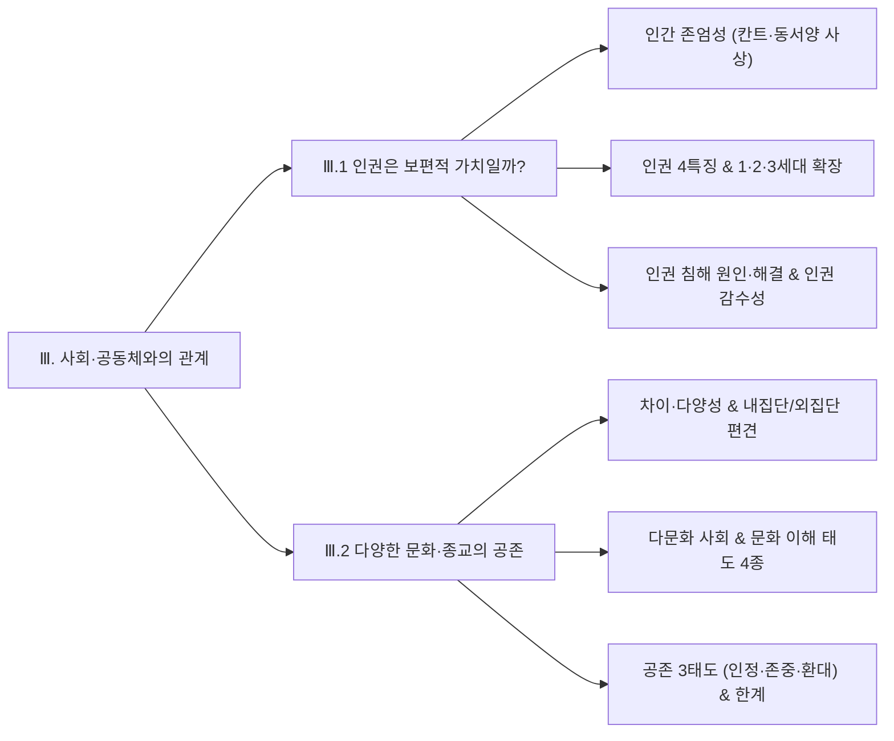
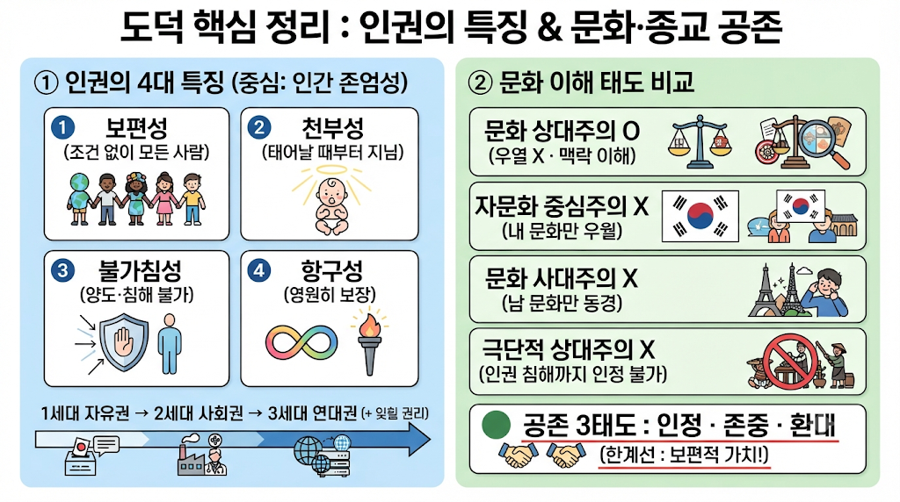
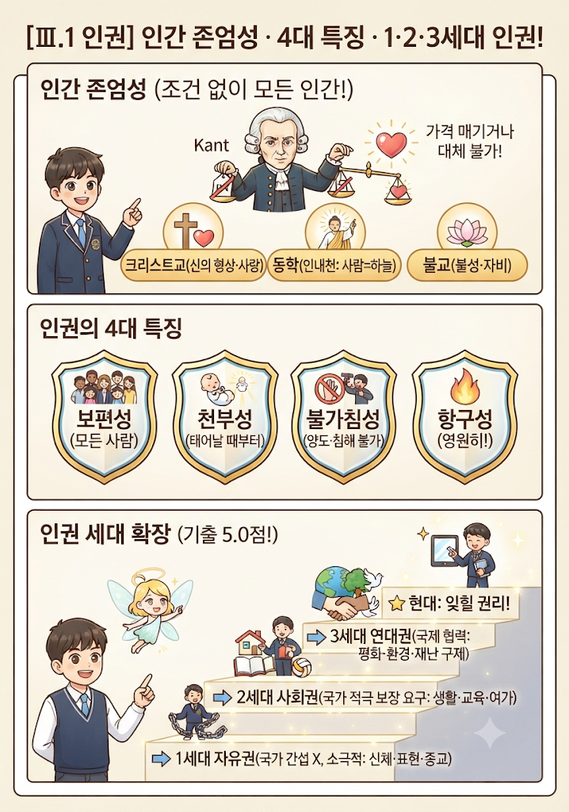
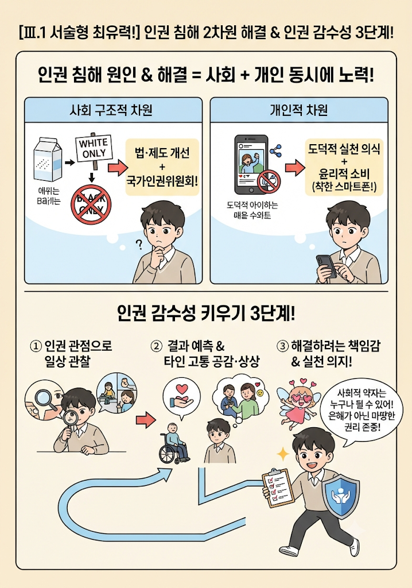
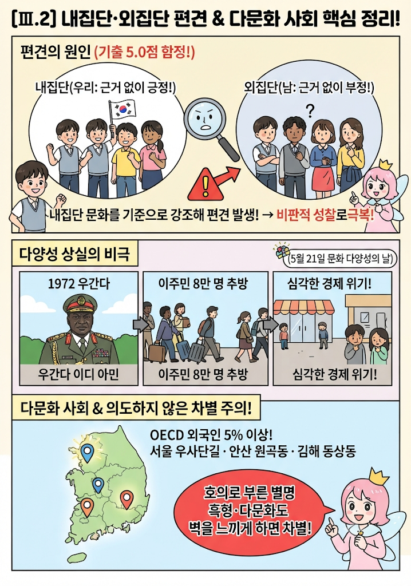
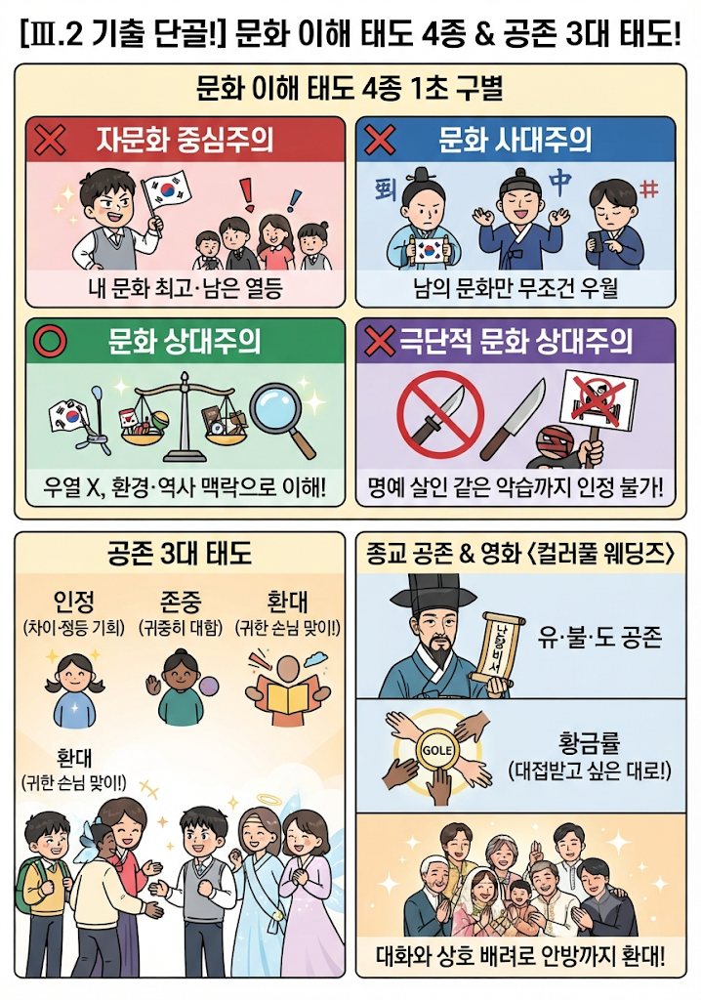

# 📘 3단원 (Ⅲ.1~Ⅲ.2) 인권은 보편적 가치일까? & 다양한 문화·종교의 공존 — 완벽 정리

> **교과서 범위**: p.110 ~ 145 (Ⅲ. 사회·공동체와의 관계 — 1. 인권은 보편적 가치일까? / 2. 다양한 문화·종교는 어떻게 공존할 수 있을까?)  
> **연계 기출**: 2025학년도 KIS 7학년 2학기 2차 지필평가 (1번, 3번, 6번, 9번, 12번, 14번, 15번, 16번, 17번, 20번 — **기출 최다 출제 단원!**)  
> **학습 목표**: 인권의 의미·특징·발전 과정과 인권 감수성 이해하기 / 편견을 비판적으로 분석하고 다양한 문화·종교가 공존하는 태도 익히기

---

## 🎯 한눈에 보는 3단원 지도

---

## PART 1. Ⅲ.1 인권은 보편적 가치일까? (교과서 p.112~129)

### 01. 인권, 한 사람 안에 깃든 우주의 가치 (p.114~119)

#### 1) 인간 존엄성과 동서양의 인간 존중 사상 ⭐ KIS 기출 1번 적중!
- **인간 존엄성**: 인간이 **인간이기 때문에** 가지는 높고 귀한 성질.
  - 외모, 성적, 능력, 도덕적 성품과 같은 **조건과 관계없이** 모든 인간이 태어날 때부터 지닌다.
  - **칸트** (『윤리 형이상학 정초』, p.118): *"모든 것은 가격을 가지거나 존엄성을 가진다."* → 인간은 가격을 매기거나 다른 것으로 **대신(대치)할 수 없는 존엄한 존재**!
  - **예후다 베이컨** (p.115): 나치 독일 홀로코스트 생존자 — 참혹한 학살 속에서도 *"내 안에는 저들이 결코 죽일 수 없는 무언가(인간 존엄성)가 있다"*고 말함.
- **동서양의 인간 존중 사상 3가지 (p.114)** ⭐ 비교 암기!

| 사상 / 종교 | 대표 인물 | 핵심 사상 및 근거 | 강조한 덕목 |
| :--- | :---: | :--- | :---: |
| **크리스트교** | **예수** | 모든 인간은 **신의 형상**을 따라 창조됨 → *"네 이웃을 네 몸과 같이 사랑하라."* | **사랑**의 정신 |
| **동학** | **최제우** | **인내천(人乃天)** — *"사람이 곧 하늘이다."* | 높고 낮음 없는 **평등** |
| **불교** | **석가모니** | 모든 인간이 **불성(佛性)**(부처의 마음)을 지님 | 차별 없는 **자비** |

> *(공통점: 모두 인간의 평등과 보편적 존엄성을 강조!)*

#### 2) 인권의 의미와 세계 인권 선언 (p.116)
- **인권의 의미**: 인간이 인간으로서 **존엄성을 보장받기 위해 마땅히 누려야 하는 권리** (생존·안전, 인간다운 삶의 조건, 자유·평등, 행복 추구 등)
- **세계 인권 선언 (1948년, UN 총회 채택)**:
  - **제1조**: 태어날 때부터 자유롭고 존엄성과 권리에서 평등 → 형제자매의 정신으로 대함
  - **제2조**: 피부색·성별·종교·언어·국적·의견 등이 달라도 차별 금지
  - **제3조**: 생명·자유·안전하게 살아갈 권리
  - **제12조**: 사생활·가족·집·편지·전화 등 통신에 대한 간섭 금지

#### 3) 인권 개념의 발전과 확장: 1·2·3세대 인권 (p.117) ⭐ KIS 기출 16번(5.0점) 적중!

| 세대 | 명칭 | 핵심 성격 (함정 주의!) | 대표 권리 예시 |
| :---: | :--- | :--- | :--- |
| **1세대** | **자유권** *(시민적·정치적 권리)* | 국가 권력의 **부당한 간섭을 막고** 개인의 자유 확대 (**소극적** 자유) | 신체의 자유, 표현의 자유, 종교의 자유 |
| **2세대** | **사회권** *(경제·사회·문화적 권리)* | 국가에 실질적인 **인간다운 삶을 보장하도록 요구**하는 **적극적** 권리 (사회 불평등 해결) | 인간다운 생활을 할 권리, 교육을 받을 권리, 여가를 누릴 권리 |
| **3세대** | **연대권** | 인류 공동체 모두가 더불어 살기 위해 서로 지는 책임, **국제적 협력**으로 보장 | 평화에 대한 권리, 환경에 대한 권리, 재난으로부터 구제받을 권리 |

> ⚠️ **KIS 기출 함정 주의!**  
> 1세대(자유권 = 국가 간섭 배제)와 2세대(사회권 = 국가의 적극적 역할 요구)의 설명을 **서로 바꿔서** 오답 선지로 만드는 경우가 매우 많습니다!

#### 4) 인권의 4대 특징과 도덕적 가치 (p.118~119) ⭐ KIS 기출 6번 적중!

| 특징 | 정확한 의미 (키워드 암기!) |
| :--- | :--- |
| **보편성** | 성, 인종, 연령, 국적, 종교, 사회적 신분 등과 관계없이 **모든 사람**에게 보장되는 권리 |
| **천부성** | 인간이 **태어날 때부터** 가지는 자연스러운 권리 (**천부인권**: 하늘이 부여한 권리) |
| **불가침성** | 다른 사람에게 **넘겨주거나(양도) 포기하거나 빼앗길 수 없으며**, 국가 권력도 침해할 수 없는 권리 |
| **항구성** *(기출 보강!)* | 일시적이지 않고 **영원히** 보장되는 권리 *(2025 KIS 6번 출제!)* |

- **인권의 시대적 변화**: 인권의 구체적 내용은 시대와 상황에 따라 확장된다 → 예: 가상공간 등장 이후 **『잊힐 권리』** (가상공간에 남아 있는 자신의 개인 정보 삭제를 요구할 권리) 대두!
- **인권의 도덕적 가치**: 인권은 기본적 **권리**이자 동시에 자신과 타인도 권리를 누리도록 지켜야 하는 **도덕적 의무**를 포함한다!
  - *실천 사례(p.119)*: **토머스 타반 아콧** — 남수단에서 헌신한 이태석 신부의 제자로, 한국에서 의사가 된 뒤 고통받는 사람들을 살리기 위해 "병원이라는 씨앗"을 심으러 남수단으로 돌아가려 함.

---

### 02. 인권 감수성으로 인권 침해를 극복하자 (p.120~127)

#### 1) 인권 침해의 모습 (p.120~121)
- **인권 침해의 의미**: 개인이 누려야 할 인간다운 삶을 가로막고 정당한 권리를 제한하는 것.
- **사회적 약자**: 빈곤·장애·국적 등 상대적으로 불리한 삶의 여건 때문에 기본적 권리를 보장받지 못하는 사람 (빈곤층, 장애인, 이주 노동자, 북한 이탈 주민, 아동, 노인 등).
  - **중요 포인트**: 사회적 약자는 처음부터 정해진 것이 아니라 **누구나** 사고(장애), 유학·해외 취업(외국인), 노화 등으로 사회적 약자가 될 수 있다!
- **현대·역사적 인권 침해 사례**:
  - **어린이 노동자**: 전 세계 아동 10명 중 1명(약 1억 6천만 명, ILO)이 노동 현장(벽돌 공장 등)에서 위험한 일에 시달림.
  - **이주 노동자**: 고용주 동의 없이 사업장 이동이 어려워 임금 체불, 열악한 숙소, 폭력 등 부당한 대우를 받아도 맞서기 어려움.
  - **아파르트헤이트(Apartheid)** *(p.122, 2025 KIS 20번 출제!)*: 과거 남아프리카 공화국 백인 정권이 법으로 공식화한 **유색 인종 차별 정책** *(※ 성차별 X!)* → 1994년 **넬슨 만델라** 대통령이 완전 폐지.
  - **일상생활 속 인권 침해**: 인권은 공기와 같아 무심코 침해하기 쉽다 → 온라인 혐오 표현, 장애인 비하 표현("꿀 먹은 벙어리", "결정 장애" 등 → "우유부단하다" 같은 인권 친화적 표현으로 바꾸기), 박완서 소설 『그 많던 싱아는 누가 다 먹었을까』(p.127, 남아선호·성 역할 고정관념).

#### 2) 인권 침해의 원인 2가지 vs 해결 방안 2가지 (p.122~124) ⭐ 서술형 최유력!

| 차원 | 인권 침해의 원인 | 교과서 대표 사례 | 인권 침해 해결 방안 |
| :---: | :--- | :--- | :--- |
| **사회 구조적 차원** | 모든 사람의 인권을 보장하는 **법과 제도가 충분하지 못함** | • 시각 장애인 지수가 우유에 **점자 표기가 없어** 잘못 구매 • 과거 남아공의 아파르트헤이트 | **법과 제도의 개선** • UN 아동 권리 협약, 청소년 기본법, 아동 복지법, 헌법, 장애인 복지법 • **국가인권위원회**(인권 침해 상담·조사 및 제도 개선) |
| **개인적 차원** | 개인의 **인권 의식 부족**, 타인의 권리를 존중하지 않음 | • 친구의 비밀을 허락 없이 폭로(**사생활 침해**) • 타인의 얼굴 사진을 동의 없이 게시(**초상권 침해**) | **도덕적 실천 의식 함양** • 타인의 권리 존중·배려 • **윤리적 소비**: 인간·동물·자연에 해를 가하지 않는 상품 구매 *(예: 네덜란드 사회적 기업의 '착한 스마트폰')* |

> 💡 **핵심**: 인권 침해 해결은 사회(법·제도)와 개인(도덕적 실천 의식) **두 차원의 노력이 동시에** 이루어져야 한다! ("정부 노력만 중요하다" → X!)

#### 3) 인권 감수성 (p.126) ⭐ KIS 기출 12번 연계!
- **인권 감수성의 의미**: 단순히 인권이 무엇인지 아는 것을 넘어, **인권 문제에 민감하게 반응할 수 있는 능력**.
  - 자신에게 직접적인 해가 없는 상황에서도 타인이 겪는 인권 침해에 도덕적 문제의식을 느낀다.
  - *(주의: 약자에게 '은혜를 베푸는 태도'가 아니라 마땅한 권리를 존중하는 태도!)*
- **인권 감수성을 키우기 위한 3가지 노력 (p.126)**:
  1. 일상의 다양한 상황을 **인권의 관점에서 바라보기** *(인권 지식을 바탕으로 관찰)*
  2. 인권 침해의 **결과를 예측하고 타인의 고통에 공감·상상하기**
  3. 인권 침해 상황을 해결하려는 **책임감과 실천 의지 가지기**

#### 4) Ⅲ.1 교과서 확인 O/X (p.129)
- ㄱ. 인간 존엄성은 도덕적으로 성품이 훌륭한 사람만 가지는 것이다. → **X** *(모든 인간)*
- ㄴ. 인권에는 자유와 평등을 누릴 권리, 행복을 추구할 권리 등의 기본적 권리가 포함된다. → **O**
- ㄷ. 인권의 개념은 시대와 상황에 따라 1세대, 2세대, 3세대 인권으로 발전해 왔다. → **O**
- ㄹ. 인권의 불가침성은 인권이 조건에 구애받지 않고 모든 사람에게 적용됨을 의미한다. → **X** *(그것은 **보편성**!)*
- ㅁ. 인권 침해는 일상생활에서는 잘 일어나지 않고 국가 차원에서만 발생한다. → **X** *(일상에서도 흔히 발생)*
- ㅂ. 우리가 인권에 관한 지식을 갖추기만 하면 인권 침해를 해결할 수 있다. → **X** *(공감·책임감·실천 의지와 법·제도 개선 필요)*

---

## PART 2. Ⅲ.2 다양한 문화·종교는 어떻게 공존할 수 있을까? (교과서 p.130~145)

### 01. 편견을 넘어 다양성으로 (p.130~135)

#### 1) 차이와 다양성, 그리고 열린 마음
- **역사 속 종교 공존 (p.130)**: 신라의 학자 **최치원**은 **「난랑비서」**에서 유교(효도·충성), 도교(자연스러운 삶), 불교(악을 행하지 않고 선을 행함)가 서로 모순되지 않고 공존할 수 있다고 강조하였다.
- **차이와 다양성**: 사람·문화·종교 사이의 차이는 자연스러운 것이며 **특정 기준에 따라 맞거나 틀렸다고 말할 수 없다.**
  - **생물 다양성**을 보전해야 생태계가 건강한 것처럼, 인간의 삶도 **문화 다양성** 속에서 조화롭게 살아갈 때 더욱 풍요로워진다.
  - **문화 다양성의 날**: 국제연합(UN) 지정 **매년 5월 21일**.
- **차이와 다양성에 대한 열린 마음**: 문화·종교·인종 등의 차이를 이해하고, 다양성을 바탕으로 서로 존중하고 배려하는 태도.
- **다양성이 사라진 사회의 비극 (p.133)**: 1972년 우간다의 독재자 **이디 아민**이 인도계 등 이주민 약 8만 명을 추방 → 이주민이 운영하던 5천여 회사·공장·농장이 멈춰 **심각한 경제 위기**, 편견·차별 심화, 관광·투자 급감 → 결국 새 대통령이 이주민을 다시 불러들임.

#### 2) 편견과 내집단·외집단 (p.134~135) ⭐ KIS 기출 15번(5.0점) 적중!
- **편견의 의미**: 공정하지 못하고 **한쪽으로 치우친 생각**.

| 집단 구분 | 의미 | 우리가 보이는 편향된 태도 |
| :---: | :--- | :--- |
| **내집단(內集團)** | 자신이 소속되어 있으며 **'우리'라는 소속감·애착**을 느끼는 집단 | 타당한 근거 없이 **긍정적**으로 평가 (**내집단 편향**) |
| **외집단(外集團)** | 자신이 소속되어 있지 않으며 **소속감을 느끼지 않는 낯선** 집단 | 타당한 근거 없이 **부정적**으로 평가, 불쾌감·공격적 태도 |

- **편견의 주된 원인**: 자신에게 익숙한 환경(예: 젓가락 사용, 집 안에서 신발 벗기)을 정상으로 여기고, **내집단의 기준에 비추어 외집단을 평가**하려는 경향!
  - ⚠️ **2025 KIS 15번 실제 함정**: *"외집단의 문화를 강조하는 사회 분위기가 외집단에 대한 편견을 형성한다"* → **X!** **『내집단』의 문화를 강조**하는 사회 분위기가 외집단에 대한 편견을 형성한다!
- **편견의 문제와 극복**: 다양성 수용의 걸림돌이 되며 **혐오와 차별**로 이어짐 → 당연하다고 여기는 자신의 판단과 생각을 늘 **비판적으로 성찰**해야 한다. *(p.135 사례: 동양인에게 어울리지 않는다며 주문한 화장품 색상을 임의 변경 / 자기 집 담벼락에 낙서한 동양인 남성을 경찰에 신고하려 한 백인 부부)*

---

### 02. 낯선 타인들과 더불어 살아가려면 (p.136~143)

#### 1) 다문화 사회의 모습과 문제 (p.136~139) ⭐ KIS 기출 3번·14번 적중!
- **다문화 사회의 의미**: 문화적 배경이 다른 사람들이 한 공간에서 서로 영향을 주고받으며 살아가는 사회.
- **등장 원인**: 교통·통신의 발달, 국제결혼(다문화 가정), 이주 노동자, 외국인 유학생, 난민 등의 증가.
  - ⚠️ *2025 KIS 14번 함정*: 우리나라에서 난민을 법적으로 인정하는 사례가 급증해서 다문화 사회가 되었다? → **X!**
- **우리나라의 다문화 모습 (p.137)**:
  - **OECD 기준**: 외국인 비율이 전체 인구의 **5% 이상**이면 다문화 사회 (한국도 2024년 5% 돌파 예정).
  - **대표 외국인 마을 3곳**: ① **서울 용산구 우사단길**(최초 이슬람 사원 서울중앙성원) ② **경기 안산시 단원구 원곡동**(2009년 국내 최초 다문화 마을 특구) ③ **경남 김해시 동상동·서상동**('제2의 이태원', 14개국 음식).
- **다문화 사회의 문제 (p.138)**:
  - **의도적 혐오·차별**: 다문화 가정 2세에게 "야, 코로나!", "불법 체류자" 등 인종 차별 발언.
  - **의도하지 않은 차별**: 친구가 호의로 부른 **'흑형'**, **'다문화'** 같은 별명도 특정 인종의 피부색을 강조해 벽을 느끼게 하면 **차별**이 된다!

#### 2) 다른 집단의 사람들과 공존하기 위한 3대 태도 & 인정의 한계 (p.140) ⭐ 초핵심!

| 공존의 3대 태도 | 정확한 의미 (서술형·객관식 필수!) |
| :---: | :--- |
| **인정** | 차이를 있는 그대로 긍정하고, 단순 이해·관용을 넘어 **이를 보호하고 평등한 기회를 보장**하려는 적극적 태도 |
| **존중** | 다른 집단의 사람을 함부로 대하지 않고 **귀중하게 대하며**, 혐오·박해하지 않고 배려하는 태도 |
| **환대** | 내 공간(공동체)에 들어온 타인을 **귀한 손님으로 반갑게 맞이하고 정성껏 대접**하는 태도 |

> 👉 인정·존중·환대는 **도덕적 고려의 범위를 내집단 바깥으로 확장**하는 일이며, 개인의 태도와 함께 **사회 제도 개선**도 병행해야 한다!

> 🚨 **시험 최빈출 함정! — "세계의 모든 문화를 무조건 인정해야 할까?" (p.140 질문 있어요)**  
> **NO!** **인간 존엄성 같은 보편적 가치**의 관점에서 도덕적으로 옳지 않은 신념이나 문화까지는 인정할 수 없다!  
> - **대표 사례**: 집안의 명예를 훼손했다는 이유로 가족을 살해하는 **『명예 살인』**은 보편적 가치(인간 존엄성)에 어긋나므로 인정할 수 없는 악습이다!

#### 3) 문화 이해 태도 4종 비교 & 종교 공존 (2025 KIS 기출 3·9·17번 완벽 대비!)

| 문화 이해 태도 | 핵심 내용 | 특징 및 평가 |
| :--- | :--- | :--- |
| **자문화 중심주의** | **자기 문화를 기준**으로 다른 문화를 열등하거나 틀린 것으로 판단 | 편견·고정관념·다문화 갈등의 원인 ❌ |
| **문화 사대주의** | 자기 문화를 낮게 평가하고 다른 사회 문화를 무조건 우월하게 여김 | 자기 문화의 주체성 상실 ❌ |
| **문화 상대주의** | **문화 간에 우열은 없으며**, 해당 문화가 발생한 **자연환경·역사적·사회적 맥락**을 고려해 이해 | 다양성을 이해하는 바람직한 태도 ⭕ |
| **극단적 문화 상대주의** | 보편적 인권을 침해하는 악습(**명예 살인** 등)까지 문화라는 이유로 무조건 인정 | 보편적 가치 훼손으로 경계해야 함 ❌ |

- **다문화 감수성** *(2025 KIS 17번 출제!)*: 다른 문화에 대한 열린 마음을 가지고 문화의 차이를 민감하게 인식하여 타인의 입장을 진심으로 이해·배려하는 태도.
- **종교 공존과 관용·황금률**:
  - 서로 다른 종교도 사랑·자비·인(仁) 등 **"네가 대접받고 싶은 대로 남을 대접하라"(황금률)**는 보편적 도덕 원리를 공유한다.
  - *공존 사례(p.140)*: **3개 종교 사랑 나눔 연합 바자회**(수익금 장학금 기부), 신라 **최치원 「난랑비서」**.
- **다문화 태도 3요소 (p.141)**: **개방성**(관심·호기심) / **수용성**(차이·생활방식 존중) / **공존성**(함께 어울려 지냄).
- **영화 『컬러풀 웨딩즈』 (p.142~143)**: 보수적인 프랑스 클로티드 부부가 아랍·유대·중국·아프리카인 사위들을 처음엔 반대·편견으로 대했지만, **대화와 공통점 발견**을 통해 아프리카식 전통을 받아들이고 안방까지 내어 주는 **환대**를 실천하며, 사돈 측도 양복을 입는 **상호 배려**로 평화롭게 공존함!

#### 4) Ⅲ.2 교과서 확인 문제 정답 (p.145)
- ㄱ. **다양성**(3글자)은 인간의 삶을 더욱 풍요롭게 만든다.
- ㄴ. **편견**(2글자)은 혐오와 차별 등의 심각한 사회 문제를 일으킬 수도 있다.
- ㄷ. 편견을 극복하려면 당연하다고 여기는 판단과 생각을 비판적으로 **성찰**(2글자)하려는 노력이 필요하다.
- ㄹ. 우리는 자신이 소속 **되지 않은**(4글자) 외집단에 대해 쉽게 편견을 가지는 경향이 있다.
- ㅁ. 환대는 내 공간에 들어온 타인을 **반갑게 맞이하는**(7글자) 것이다.

