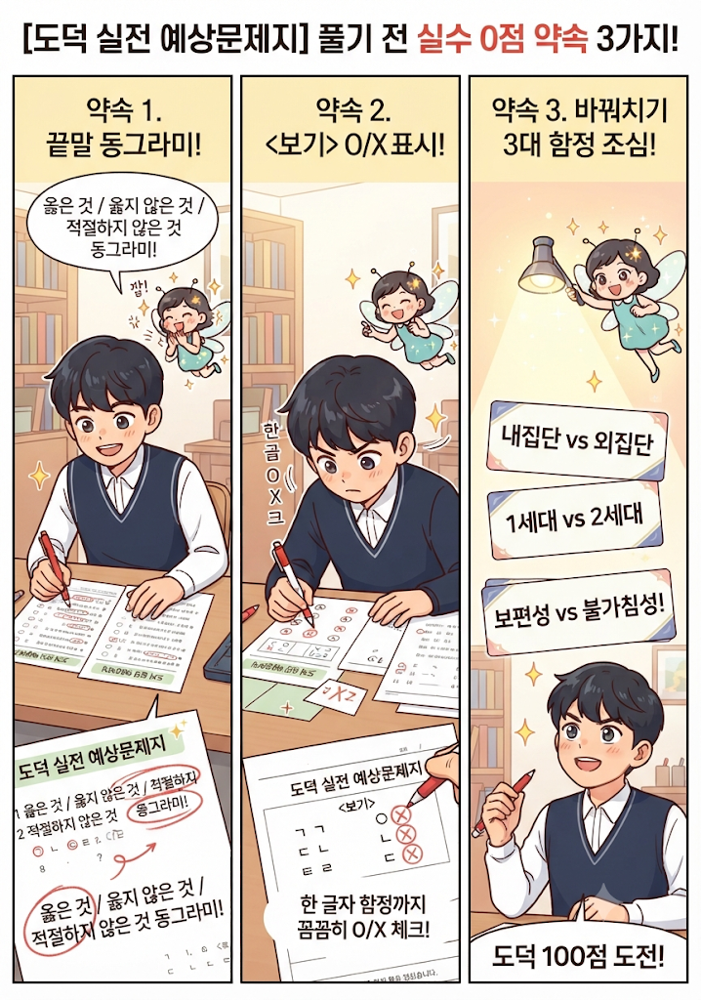

# 📝 2026학년도 7학년 2학기 2차 지필평가 대비 — 도덕 실전 예상 문제지

> **시험 범위**: 교과서 p.74~145 (Ⅱ.2 우정이 소중한 이유 · Ⅱ.3 가상공간과 타인 · Ⅲ.1 인권은 보편적 가치일까? · Ⅲ.2 다양한 문화·종교의 공존)  
> **구성**: 선택형 21문항 (82.0점) + 서술형 3문항 (18.0점) = **총 100.0점** | **제한 시간**: 45분  
> **참고**: 호치민시한국국제학교(KIS) 2025 2학기 2차 도덕 기출 유형 및 2026 교과서 반영

### ✅ 풀기 전 「실수 0점」 약속 3가지
- [ ] 문제 끝의 **"옳은 것 / 옳지 않은 것 / 적절하지 않은 것"**에 반드시 동그라미 치기
- [ ] `<보기>` 문제는 ㄱ·ㄴ·ㄷ·ㄹ 옆에 하나씩 **O / X** 표시한 뒤 정답 고르기
- [ ] **내집단 vs 외집단 / 1세대 vs 2세대 / 보편성 vs 불가침성** 바꿔치기 함정 꼭 확인하기!

---

## [선택형 1~21번]

### Ⅱ.2 우정이 소중한 이유는 무엇일까? (1~5번)

**1.** 다음 글에서 공통적으로 강조하고 있는 **우정이 소중한 이유**로 가장 적절한 것은? [3.5점]

> - 고대 로마의 철학자 키케로는 "우정은 행운을 더욱 빛나게 하고, 불운을 나누어 가볍게 해 준다."라고 말하였다.
> - 힘든 일이 있을 때 친구에게 고민을 털어놓고 위로를 주고받으며 어려움을 이겨 내기도 한다.

① 경제적 이익을 얻을 수 있다.  
② 정서적 안정감을 얻을 수 있다.  
③ 다른 사람과 경쟁에서 이길 수 있다.  
④ 자신의 취향을 남에게 강요할 수 있다.  
⑤ 가족과의 관계를 완전히 대신할 수 있다.  

---

**2.** 공자가 『논어』에서 말한 **『나를 이롭게 하는 벗』**과 **『나를 해치는 벗』**에 대한 설명으로 옳지 **않은** 것은? [3.5점]
① 정직한 사람과 벗하면 나에게 이롭다.  
② 성실한 사람과 벗하면 나에게 이롭다.  
③ 들어서 아는 것이 많아 세상일에 밝은 사람과 벗하면 나에게 이롭다.  
④ 아첨을 잘하고 말만 번지르르하게 하는 사람과 벗하면 나에게 해가 된다.  
⑤ 착하지만 줏대가 없는 사람과 벗하면 갈등이 없으므로 언제나 나에게 이롭다.  

---

**3.** 다음 만화 속 아리스토텔레스가 설명하는 **『완전한 우정』**에 해당하는 사례로 가장 적절한 것은? [4.0점]

> **아리스토텔레스**: "완전한 우정은 상대방이 가지고 있는 것이나 자신에게 주는 즐거움·이익 때문이 아니라, **그 자체로 친구를 사랑하고 친구를 위해서 친구가 잘되기를 진심으로 바라는 것**입니다."

① 민수: "지호는 우리 반에서 게임 아이템이 가장 많아서 같이 놀면 이득이 많아."  
② 서연: "유진이는 웃긴 이야기를 잘해 줘서 심심할 때만 불러내서 같이 놀아."  
③ 현우: "준서가 시험을 망쳐 속상해할 때 진심으로 위로하고, 준서가 다음엔 꼭 잘되기를 응원했어."  
④ 수빈: "다은이는 공부 1등이니까 노트 필기를 빌리기 위해서 친하게 지내고 있어."  
⑤ 태호: "성민이가 내 숙제를 대신 해 줄 때만 좋은 친구라고 생각해."  

---

**4.** 좋은 친구 관계를 맺는 방법 중 **『자기 성찰하기』**의 의미로 옳은 것만을 `<보기>`에서 있는 대로 고른 것은? [4.0점]

> **<보기>**  
> ㄱ. 자신의 말과 행동이 좋은 친구 관계를 맺는 데 적절한지 살피는 것  
> ㄴ. 친구의 단점만을 찾아내어 다른 친구들에게 이야기하는 것  
> ㄷ. 자신이 무엇을 좋아하고 잘하는지 알고, 있는 그대로의 자신을 긍정적으로 생각하는 것  
> ㄹ. 친구의 의견에 무조건 반대하며 자신의 주장만 끝까지 밀어붙이는 것

① ㄱ, ㄴ  
② ㄱ, ㄷ  
③ ㄴ, ㄷ  
④ ㄴ, ㄹ  
⑤ ㄷ, ㄹ  

---

**5.** 친구와 우정에 대한 설명으로 옳은 것만을 `<보기>`에서 있는 대로 고른 것은? [5.0점]

> **<보기>**  
> ㄱ. 친구는 반드시 나와 물리적으로 가까운 곳에 오래 산 사람만을 의미한다.  
> ㄴ. 『열자』에 나오는 백아와 종자기의 이야기는 마음이 서로 통하는 친구인 '지음(知音)'의 유래가 되었다.  
> ㄷ. 좋은 친구는 역지사지의 자세로 친구가 약속을 어겼을 때 화부터 내기보다 친구의 처지를 헤아린다.  
> ㄹ. 인격적으로 존중하는 좋은 친구 관계는 별다른 노력을 하지 않아도 시간만 지나면 저절로 맺어진다.

① ㄱ, ㄴ  
② ㄱ, ㄹ  
③ ㄴ, ㄷ  
④ ㄴ, ㄷ, ㄹ  
⑤ ㄱ, ㄴ, ㄷ, ㄹ  

---

### Ⅱ.3 가상공간에서 타인을 어떻게 대해야 할까? (6~11번)

**6.** 다음에서 설명하는 가상공간의 특성으로 가장 적절한 것은? [3.5점]

> 가상공간에서는 자신의 신분이나 얼굴을 드러내지 않고 활동할 수 있기 때문에 자신의 생각과 감정을 더 쉽게 표현하고 서로 평등하게 소통할 수 있는 장점이 있다.

① 익명성과 비대면성  
② 창조성  
③ 동시성  
④ 개방성  
⑤ 영구성  

---

**7.** 가상공간과 현실 세계의 관계에 대한 설명으로 옳지 **않은** 것은? [3.5점]
① 가상공간과 현실 세계는 모두 사람들과의 만남과 경험이 이루어지는 곳이다.  
② 가상공간과 현실 세계에서 우리가 한 행동의 결과에는 늘 책임이 따른다.  
③ 온라인 게임에서 타인을 대하는 태도는 현실 세계의 친구 관계에 영향을 미칠 수 있다.  
④ SNS에 잃어버린 강아지 글을 올려 지역 주민의 제보로 찾은 것은 긍정적 상호 작용의 사례이다.  
⑤ 가상공간이 우리 삶의 중요한 일부가 되었으므로 이제 가상공간은 현실 세계를 완전히 대체할 수 있다.  

---

**8.** 가상공간에서 발생하는 도덕 문제와 그에 대한 설명으로 옳지 **않은** 것은? [4.0점]
① **딥페이크**: 인공지능 기술을 활용해 사진이나 영상에 다른 이미지를 덧씌워 가짜 뉴스나 범죄에 악용되기도 한다.  
② **사이버 중독**: 가상공간에 지나치게 빠져 일상생활·학업에 지장을 주고 정체성의 혼란을 일으킬 수 있다.  
③ **지식 재산권 침해**: 많은 정보를 쉽게 활용할 수 있게 되면서 지식 재산권 보호의 중요성은 점점 감소하고 있다.  
④ **사생활 침해**: 친구가 보낸 사진이나 개인 정보를 본인 동의 없이 SNS에 올리면 범죄에 악용될 위험이 크다.  
⑤ **사이버 폭력**: 조사에 따르면 청소년 사이버 폭력의 주된 동기 중 '상대방이 먼저 그런 행동을 해서 보복하기 위해'라는 응답이 가장 높았다.  

---

**9.** 다음 밑줄 친 현상과 가장 관련이 깊은 가상공간 도덕 문제의 발생 원인은? [4.0점]

> 우리는 온라인상에서 정보를 찾을 때 <u>주로 자신이 동의하거나 좋아하는 정보에만 관심을 가지며, 자신의 생각과 반대되는 정보는 무시하거나 받아들이지 않는 경향</u>이 있다. 동영상 추천 알고리즘은 이러한 경향을 더욱 심화시켜 편견과 혐오로 이어지기도 한다.

① 창조성  
② 정보 편향성  
③ 디지털 격차  
④ 개방성과 동시성  
⑤ 디지털 발자취  

---

**10.** 다음 수업 대화에서 밑줄 친 **『아쉬운 점이 발견된 학생』**을 모두 고른 것은? [5.0점]

> **교사**: 가상공간에서 도덕 문제가 발생하는 원인과 우리가 지녀야 할 태도에 대해 발표해 볼까요?  
> **갑**: 가상공간은 자신이 누구인지 밝히지 않고 활동할 수 있는 경우가 많아 무책임한 행동을 하기 쉽습니다.  
> **을**: 가상공간에서는 직접 얼굴을 마주하고 소통하기 때문에 상대방을 존중하는 자세를 갖기가 어렵습니다.  
> **병**: 가상공간에서 남긴 검색 기록, 작성한 글, 공유한 사진 등의 '디지털 발자취'는 타인이 나를 평가하는 중요한 근거가 되므로 언행을 신중히 해야 합니다.  
> **정**: 가상공간에 올라간 거짓 정보는 비교적 느리게 퍼지는 경향이 있지만, 삭제가 어려워 피해자에게 상처를 줍니다.  
> **교사**: 네 사람의 발표 잘 들었습니다. 하지만 <u>아쉬운 점이 발견된 학생</u>이 있습니다.

① 갑, 을  
② 갑, 병  
③ 을, 병  
④ 을, 정  
⑤ 병, 정  

---

**11.** 가상공간에서 타인을 대할 때 필요한 4대 도덕적 자세 중, 다음 광고 사례에서 가장 잘 드러나는 원칙은? [3.0점]

> - 농산물 판매를 걱정하는 농부에게 온라인 판매 방법을 친절하게 알려 주어 판로를 열어 주었다.  
> - 무인 단말기(키오스크) 앞에서 당황하는 어르신께 음식 주문 방법과 스마트폰 길 찾기 방법을 도와드렸다.

① 정의 *(가상공간 활용에 어려움을 겪는 사람을 도와 차별 없는 공정함을 실현)*  
② 해악 금지 *(다른 사람에게 해를 끼치지 않음)*  
③ 익명성 *(자신의 신분을 감추고 자유롭게 소통함)*  
④ 창조성 *(새로운 규칙과 가상 세계를 만들어 냄)*  
⑤ 자율성 *(외부의 간섭 없이 혼자서만 결정함)*  

---

### Ⅲ.1 인권은 보편적 가치일까? (12~16번)

**12.** 다음 설명에서 (가)에 들어갈 핵심 개념과 이를 뒷받침하는 사상가의 연결이 **틀린** 것은? [3.5점]

> 모든 인간은 외모·능력·지위와 같은 조건과 관계없이 인간이라는 이유만으로 높고 귀한 가치를 지니는데, 이를 **(가)**(이)라고 한다.

① (가)는 '인간 존엄성'이다.  
② **칸트**: 인간은 가격을 매기거나 다른 것으로 대신할 수 없는 존엄한 존재이다.  
③ **예수**(크리스트교): 모든 인간이 신의 형상을 따라 창조되었으므로 이웃을 네 몸과 같이 사랑해야 한다.  
④ **최제우**(동학): "사람이 곧 하늘이다"라는 인내천(人乃天) 사상으로 인간의 평등을 강조하였다.  
⑤ **석가모니**(불교): 특별한 신분을 가진 사람만이 불성(佛性)을 지니므로 신분에 따라 구별해 대해야 한다.  

---

**13.** 다음 글의 (가), (나)에 들어갈 인권의 특징을 옳게 짝 지은 것은? [3.5점]

> - **(가)**: 인권은 성별, 인종, 연령, 국적, 종교, 사회적 신분 등과 관계없이 **모든 사람**에게 보장되어야 하는 권리이다.  
> - **(나)**: 인권은 다른 사람에게 넘겨주거나 포기할 수 없으며, 국가를 비롯한 그 어떤 권위 있는 존재도 **함부로 빼앗거나 침해할 수 없는** 권리이다.

| | (가) | (나) |
| :---: | :---: | :---: |
| ① | 천부성 | 보편성 |
| ② | 보편성 | 불가침성 |
| ③ | 항구성 | 불가침성 |
| ④ | 보편성 | 천부성 |
| ⑤ | 불가침성 | 항구성 |

---

**14.** 다음은 인권 개념이 발전·확장되어 온 과정을 세대별로 정리한 표이다. 이에 대한 설명으로 옳은 것은? [4.0점]

| 구분 | 명칭 | 주요 내용 |
| :---: | :---: | :--- |
| 1세대 인권 | ( ㉠ ) | (가) |
| 2세대 인권 | 사회권 | (나) |
| 3세대 인권 | ( ㉡ ) | (다) |

① ㉠은 '연대권'을 의미한다.  
② ㉡은 '자유권'을 의미한다.  
③ (가)에는 '국가의 적극적인 역할을 요구하여 인간다운 삶을 보장받는 권리(교육권 등)'가 들어간다.  
④ (나)에는 '국가 권력의 부당한 간섭을 막고 개인의 소극적 자유를 확대하는 권리(표현의 자유 등)'가 들어간다.  
⑤ (다)에는 '인류 공동체 구성원이 서로 지는 책임을 바탕으로 국제적 협력을 통해 보장하는 권리(평화·환경·재난 구제 권리)'가 들어간다.  

---

**15.** 사회적 약자와 인권 침해 사례에 대한 설명으로 옳지 **않은** 것은? [4.0점]
① 누구나 뜻하지 않은 사고나 해외 취업·유학 등으로 사회적 약자가 될 수 있다.  
② 이주 노동자가 임금을 제대로 받지 못하거나 폭력을 당해도 사업장 이동 제한 때문에 맞서기 어려운 경우가 있다.  
③ 과거 남아프리카 공화국의 '아파르트헤이트'는 법으로 공식화한 대표적인 **성차별** 정책이었다.  
④ 친구의 비밀을 허락 없이 다른 사람에게 말하거나 얼굴이 나온 사진을 동의 없이 게시하는 것은 개인적 원인의 인권 침해이다.  
⑤ '결정 장애', '꿀 먹은 벙어리'처럼 무심코 쓰는 장애인 비하 표현도 당사자의 인권을 침해할 수 있다.  

---

**16.** 인권 침해를 해결하기 위한 노력과 **『인권 감수성』**에 대한 설명으로 옳은 것만을 `<보기>`에서 있는 대로 고른 것은? [5.0점]

> **<보기>**  
> ㄱ. 인권 침해를 해결하려면 법과 제도의 개선(국가인권위원회 활동 등)과 개인의 도덕적 실천 의식 함양이 동시에 이루어져야 한다.  
> ㄴ. 노동자 착취나 아동 노동 없이 생산된 '착한 스마트폰'을 구매하는 것은 윤리적 소비의 실천 사례이다.  
> ㄷ. 인권 감수성은 인권이 무엇인지 지식만 외우면 저절로 길러지며, 자신에게 직접 해가 없는 일에는 신경 쓸 필요가 없다.  
> ㄹ. 인권 감수성을 키우려면 일상을 인권의 관점에서 관찰하고, 인권 침해 결과를 예측·공감하며, 해결하려는 책임감과 실천 의지를 가져야 한다.

① ㄱ, ㄴ  
② ㄱ, ㄷ  
③ ㄴ, ㄹ  
④ ㄱ, ㄴ, ㄹ  
⑤ ㄱ, ㄴ, ㄷ, ㄹ  

---

### Ⅲ.2 다양한 문화·종교는 어떻게 공존할 수 있을까? (17~21번)

**17.** 차이와 다양성에 대한 설명으로 옳지 **않은** 것은? [3.5점]
① 신라의 최치원은 「난랑비서」에서 유교·도교·불교가 서로 모순되지 않고 공존할 수 있다고 보았다.  
② 사람과 문화, 종교 사이의 차이는 자연스러운 것이므로 특정 기준에 따라 맞거나 틀렸다고 말할 수 없다.  
③ 생물 다양성이 생태계를 건강하게 유지하듯, 문화 다양성은 인간의 삶을 더욱 풍요롭게 만든다.  
④ 1972년 우간다의 이디 아민이 이주민을 추방한 뒤 우간다는 단일 민족의 단결로 경제가 크게 발전하였다.  
⑤ 국제연합(UN)은 매년 5월 21일을 '문화 다양성의 날'로 지정하여 문화 다양성의 가치를 기념하고 있다.  

---

**18.** 다음 글의 밑줄 친 ㉠~㉤ 중 문맥상 적절하지 **않은** 것은? [3.5점]

> 자신이 ㉠<u>소속해 있으면서 '우리'라는 애착과 소속감을 느끼는 집단</u>을 내집단이라고 한다. 반면 자신이 소속되어 있지 않으면서 소속감을 느끼지 않는 집단은 ㉡<u>외집단</u>이다. 우리는 자신에게 익숙한 환경을 정상으로 여겨 ㉢<u>내집단의 기준에 비추어 외집단을 평가</u>하는 경향이 있다. 특히 ㉣<u>외집단의 문화를 지나치게 강조하는 사회 분위기</u>는 외집단에 대한 편견을 형성하고 혐오와 차별로 이어질 수 있다. 따라서 우리는 스스로 당연하다고 여기는 생각을 늘 ㉤<u>비판적으로 성찰</u>해야 한다.

① ㉠  
② ㉡  
③ ㉢  
④ ㉣  
⑤ ㉤  

---

**19.** 다문화 사회의 모습과 문제에 대한 설명으로 옳지 **않은** 것은? [4.0점]
① 교통과 통신의 발달, 국제결혼, 이주 노동자·유학생 증가 등으로 우리나라도 다문화 사회로 진입하고 있다.  
② 경제협력개발기구(OECD) 기준에 따르면 한 나라의 외국인 비율이 5% 이상이면 다문화 사회로 본다.  
③ 서울 용산구 우사단길, 경기 안산시 원곡동, 경남 김해시 동상동·서상동은 우리나라의 대표적인 외국인 마을이다.  
④ 친구에게 호의를 담아 '흑형'이나 '다문화' 같은 별명으로 부르는 것은 나쁜 의도가 없으므로 결코 차별이 될 수 없다.  
⑤ 다문화 사회에서 발생하는 혐오와 차별은 개인의 존엄을 훼손하고 공동체의 건강한 발전을 가로막는다.  

---

**20.** 다음 글에서 강조하는 문화 이해 태도에 대한 설명으로 가장 적절한 것은? [3.0점]

> 식사 문화에 따라 어떤 사람은 손으로 밥을 먹고, 어떤 사람은 젓가락이나 포크를 사용한다. 주거 문화에 따라 집 안에서 신발을 신기도 하고 벗기도 한다. 따라서 문화를 이해할 때는 자기 문화의 기준으로 평가하지 말고, 해당 문화가 발생한 **자연환경이나 역사적·사회적 맥락을 고려**하여 이해해야 한다.

① 문화 간에는 우열을 가릴 수 없다고 본다.  
② 자기 문화가 가장 우월하다고 믿고 다른 문화를 무시한다.  
③ 자기 문화를 낮게 평가하고 다른 나라 문화를 무조건 동경한다.  
④ 내집단의 문화와 다른 모습을 지닌 문화는 틀린 것으로 판단한다.  
⑤ 다른 문화에 대한 고정관념과 편견을 강화하여 갈등을 유발한다.  

---

**21.** 다양한 문화·종교의 공존 태도에 대한 설명으로 옳은 것만을 `<보기>`에서 있는 대로 고른 것은? [5.0점]

> **<보기>**  
> ㄱ. '인정'은 차이를 있는 그대로 긍정하고 보호하며 평등한 기회를 보장하려는 적극적 공존 태도이다.  
> ㄴ. '환대'는 내 공간에 들어온 타인을 귀한 손님으로 반갑게 맞이하고 정성껏 대접하는 태도이다.  
> ㄷ. 다문화 사회에서는 인정의 태도가 중요하므로, 집안의 명예를 이유로 가족을 죽이는 '명예 살인' 같은 관습도 반드시 인정해야 한다.  
> ㄹ. 영화 『컬러풀 웨딩즈』에서 클로티드 부부가 아프리카 사돈에게 안방을 내어 주고 사돈 측도 양복을 입은 것은 상호 배려와 환대를 통한 공존의 모습이다.

① ㄱ, ㄴ  
② ㄱ, ㄷ  
③ ㄴ, ㄹ  
④ ㄱ, ㄴ, ㄹ  
⑤ ㄱ, ㄴ, ㄷ, ㄹ  

---

## [서술형 1~3번]

> ※ 서술형은 **제시된 핵심 단어**를 반드시 포함하여 완전한 문장으로 쓰세요!

**서술형 1.** 가상공간에서는 현실 세계보다 도덕 문제가 더 쉽게 발생하고 피해도 커지는 경향이 있다.  
(1) 가상공간에서 도덕 문제가 발생하는 **이유 2가지**를 교과서 개념(**『책임 회피(익명성·비대면성)』, 『빠른 전파성과 삭제의 어려움』, 『정보 편향성』** 중 2가지 선택)을 사용하여 서술하시오. [4.0점]  
(2) 가상공간을 올바르게 활용하기 위해 우리가 갖추어야 할 **『디지털 문해력』**의 의미를 한 문장으로 서술하시오. [2.0점]  
**(총 6.0점)**

> 답안 작성란:  
> (1) ____________________________________________________________________  
> (2) ____________________________________________________________________  

---

**서술형 2.** 시각 장애가 있는 지수는 우유를 사려고 했지만 제품에 점자 표기가 되어 있지 않아 원하는 우유를 고르지 못해 어려움을 겪었다.  
(1) 지수가 겪은 인권 침해는 **『사회 구조적 원인』**과 **『개인적 원인』** 중 어디에 해당하는지 쓰고, 그 이유를 서술하시오. [3.0점]  
(2) 우리 사회의 인권 침해를 해결하기 위해 필요한 **『사회적(법·제도) 노력』**과 **『개인적 노력』**을 각각 한 가지씩 서술하시오. [3.0점]  
**(총 6.0점)**

> 답안 작성란:  
> (1) ____________________________________________________________________  
> (2) ____________________________________________________________________  

---

**서술형 3.** 다양한 문화와 종교를 가진 사람들이 더불어 공존하기 위해 필요한 도덕적 태도에 대해 다음 물음에 답하시오.  
(1) 공존을 위한 세 가지 태도는 **인정**, **존중**, **( ㉠ )**이다. ㉠에 들어갈 알맞은 말을 쓰고, 그 의미를 서술하시오. [3.0점]  
(2) '명예 살인'과 같은 문화적 관습을 인정할 수 **없는** 까닭을 **『보편적 가치(또는 인간 존엄성)』**라는 단어를 포함하여 서술하시오. [3.0점]  
**(총 6.0점)**

> 답안 작성란:  
> (1) ____________________________________________________________________  
> (2) ____________________________________________________________________  
