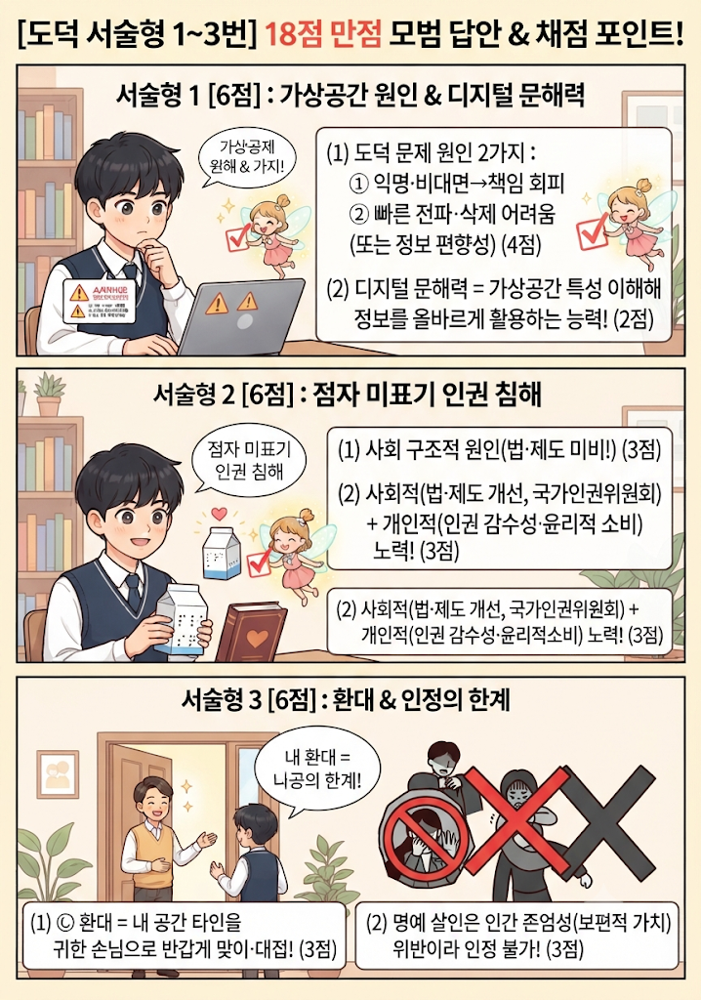

# ✅ 2026학년도 7학년 2학기 2차 지필평가 대비 — 도덕 예상 문제지 정답 및 해설

> **채점 기준**: 선택형 21문항(82.0점) + 서술형 3문항(18.0점) = **총 100.0점**  
> *(풀이 형식: 문제 + 선지 전체 → 답 → 이유)*

---

## 📊 빠른 정답표 (채점용)

| 번호 | 1 | 2 | 3 | 4 | 5 | 6 | 7 | 8 | 9 | 10 | 11 |
| :---: | :---: | :---: | :---: | :---: | :---: | :---: | :---: | :---: | :---: | :---: | :---: |
| **정답** | ② | ⑤ | ③ | ② | ③ | ① | ⑤ | ③ | ② | ④ | ① |

| 번호 | 12 | 13 | 14 | 15 | 16 | 17 | 18 | 19 | 20 | 21 |
| :---: | :---: | :---: | :---: | :---: | :---: | :---: | :---: | :---: | :---: | :---: |
| **정답** | ⑤ | ② | ⑤ | ③ | ④ | ④ | ④ | ④ | ① | ④ |

---

## 📖 문항별 상세 풀이

### 1번 [3.5점]
다음 글에서 공통적으로 강조하고 있는 우정이 소중한 이유로 가장 적절한 것은? (키케로: "우정은 행운을 더욱 빛나게 하고, 불운을 나누어 가볍게 해 준다." / 힘든 일이 있을 때 친구에게 고민을 털어놓고 위로를 주고받으며 어려움을 이겨 낸다.)
① 경제적 이익을 얻을 수 있다. / ② 정서적 안정감을 얻을 수 있다. / ③ 다른 사람과 경쟁에서 이길 수 있다. / ④ 자신의 취향을 남에게 강요할 수 있다. / ⑤ 가족과의 관계를 완전히 대신할 수 있다.

- **답)** ②
- **이유)** 기쁨을 나누고 힘들 때 고민을 털어놓으며 위로·지지를 얻는 것은 우정이 주는 **정서적 안정감**에 해당한다.

---

### 2번 [3.5점]
공자가 『논어』에서 말한 『나를 이롭게 하는 벗』과 『나를 해치는 벗』에 대한 설명으로 옳지 않은 것은?
① 정직한 사람과 벗하면 나에게 이롭다. / ② 성실한 사람과 벗하면 나에게 이롭다. / ③ 들어서 아는 것이 많아 세상일에 밝은 사람과 벗하면 나에게 이롭다. / ④ 아첨을 잘하고 말만 번지르르하게 하는 사람과 벗하면 나에게 해가 된다. / ⑤ 착하지만 줏대가 없는 사람과 벗하면 갈등이 없으므로 언제나 나에게 이롭다.

- **답)** ⑤
- **이유)** 공자는 아첨하는 사람, **착하지만 줏대가 없는 사람**, 말만 번지르르하게 하는 사람을 모두 **나를 해치는 세 부류의 벗(손자삼우)**으로 꼽았다.

---

### 3번 [4.0점]
아리스토텔레스가 설명하는 『완전한 우정』(대가·즐거움·이익 때문이 아니라 그 자체로 친구를 사랑하고 친구가 잘되기를 진심으로 바람)에 해당하는 사례로 가장 적절한 것은?
① 민수(게임 아이템 이득) / ② 서연(심심할 때만 불러냄) / ③ 현우(시험 망친 준서를 진심으로 위로하고 잘되길 응원) / ④ 수빈(노트 필기 빌리기 위해) / ⑤ 태호(숙제 대신 해 줄 때만)

- **답)** ③
- **이유)** ①, ④, ⑤는 이익(유용성), ②는 즐거움(쾌락)을 위한 불완전한 우정이다. 조건이나 대가 없이 **친구 자체를 위하고 잘되기를 진심으로 바라는 ③ 현우**가 완전한 우정이다.

---

### 4번 [4.0점]
좋은 친구 관계를 맺는 방법 중 『자기 성찰하기』의 의미로 옳은 것만을 `<보기>`에서 있는 대로 고른 것은?
`<보기>` ㄱ. 자신의 말과 행동이 좋은 친구 관계를 맺는 데 적절한지 살피는 것 / ㄴ. 친구의 단점만을 찾아내어 다른 친구들에게 이야기하는 것 / ㄷ. 자신이 무엇을 좋아하고 잘하는지 알고, 있는 그대로의 자신을 긍정적으로 생각하는 것 / ㄹ. 친구의 의견에 무조건 반대하며 자신의 주장만 끝까지 밀어붙이는 것
① ㄱ, ㄴ / ② ㄱ, ㄷ / ③ ㄴ, ㄷ / ④ ㄴ, ㄹ / ⑤ ㄷ, ㄹ

- **답)** ②
- **이유)** 교과서(p.84)에서 자기 성찰은 **① 자신의 말과 행동이 적절한지 살피기(ㄱ)**와 **② 자신을 이해하고 있는 그대로 긍정적으로 생각하기(ㄷ)**의 두 가지 의미를 지닌다.

---

### 5번 [5.0점]
친구와 우정에 대한 설명으로 옳은 것만을 `<보기>`에서 있는 대로 고른 것은?
`<보기>` ㄱ. 친구는 반드시 나와 물리적으로 가까운 곳에 오래 산 사람만을 의미한다. / ㄴ. 『열자』의 백아와 종자기 이야기는 '지음(知音)'의 유래가 되었다. / ㄷ. 좋은 친구는 역지사지의 자세로 친구의 처지를 헤아린다. / ㄹ. 인격적으로 존중하는 친구 관계는 별다른 노력 없이 시간만 지나면 저절로 맺어진다.
① ㄱ, ㄴ / ② ㄱ, ㄹ / ③ ㄴ, ㄷ / ④ ㄴ, ㄷ, ㄹ / ⑤ ㄱ, ㄴ, ㄷ, ㄹ

- **답)** ③
- **이유)** 백아와 종자기는 '지음'의 유래이고(ㄴ O), 좋은 친구는 역지사지로 배려한다(ㄷ O). 친구는 멀리 떨어지거나 가상공간에서 만난 사람 등 다양한 의미로 쓰이며(ㄱ X), 좋은 친구 관계는 **저절로 얻어지지 않고 서로의 노력이 필요**하다(ㄹ X).

---

### 6번 [3.5점]
다음에서 설명하는 가상공간의 특성으로 가장 적절한 것은? (자신의 신분이나 얼굴을 드러내지 않고 활동할 수 있어 생각과 감정을 쉽게 표현하고 평등하게 소통할 수 있음)
① 익명성과 비대면성 / ② 창조성 / ③ 동시성 / ④ 개방성 / ⑤ 영구성

- **답)** ①
- **이유)** 자신을 드러내지 않고 얼굴을 마주하지 않은 채 소통하는 특성은 **익명성과 비대면성**이다.

---

### 7번 [3.5점]
가상공간과 현실 세계의 관계에 대한 설명으로 옳지 않은 것은?
① 가상공간과 현실 세계는 모두 사람들과의 만남과 경험이 이루어지는 곳이다. / ② 가상공간과 현실 세계에서 우리가 한 행동의 결과에는 늘 책임이 따른다. / ③ 온라인 게임에서 타인을 대하는 태도는 현실 세계의 친구 관계에 영향을 미칠 수 있다. / ④ SNS에 잃어버린 강아지 글을 올려 지역 주민의 제보로 찾은 것은 긍정적 상호 작용의 사례이다. / ⑤ 가상공간이 우리 삶의 중요한 일부가 되었으므로 이제 가상공간은 현실 세계를 완전히 대체할 수 있다.

- **답)** ⑤
- **이유)** 우리는 여전히 현실 세계에 살고 있으므로, 가상공간이 아무리 발전하더라도 **현실 세계를 완전히 대체할 수는 없다.**

---

### 8번 [4.0점]
가상공간에서 발생하는 도덕 문제와 그에 대한 설명으로 옳지 않은 것은?
① 딥페이크(AI 합성 사진·영상 악용) / ② 사이버 중독(일상·학업 지장, 정체성 혼란) / ③ 지식 재산권 침해(정보 활용이 쉬워져 지식 재산권 보호의 중요성 감소) / ④ 사생활 침해(동의 없는 사진·개인정보 공유의 범죄 악용 위험) / ⑤ 사이버 폭력(주된 동기 1위 = 보복)

- **답)** ③
- **이유)** 가상공간에서 정보를 쉽게 복제·공유할 수 있게 되었기 때문에, 오히려 **지식 재산권 보호의 중요성은 더욱 커졌다.**

---

### 9번 [4.0점]
밑줄 친 현상(주로 자신이 동의하거나 좋아하는 정보에만 관심을 갖고 반대 정보는 무시하는 경향, 추천 알고리즘으로 심화)과 가장 관련이 깊은 도덕 문제의 발생 원인은?
① 창조성 / ② 정보 편향성 / ③ 디지털 격차 / ④ 개방성과 동시성 / ⑤ 디지털 발자취

- **답)** ②
- **이유)** 자신이 동의하는 정보만 수용하고 반대 정보는 배척하는 경향을 **정보 편향성**(확증 편향)이라고 하며, 이는 편견·차별·혐오로 이어질 수 있다.

---

### 10번 [5.0점]
수업 대화에서 밑줄 친 『아쉬운 점이 발견된 학생』을 모두 고른 것은?
갑(익명성 때문에 무책임한 행동 쉬움) / 을(직접 얼굴을 마주하고 소통해 존중이 어려움) / 병(디지털 발자취는 타인이 나를 평가하는 근거이므로 언행 신중) / 정(거짓 정보는 비교적 느리게 퍼지지만 삭제가 어려움)
① 갑, 을 / ② 갑, 병 / ③ 을, 병 / ④ 을, 정 / ⑤ 병, 정

- **답)** ④
- **이유)** 갑(O), 병(O)은 옳게 발표했다. **을(X)**은 가상공간이 직접 얼굴을 마주하지 않는 **비대면** 소통이기 때문에 존중이 어렵고, **정(X)**은 가상공간의 거짓 정보가 느리게가 아니라 **매우 빠르게 퍼지기** 때문에 틀렸다.

---

### 11번 [3.0점]
가상공간에서 타인을 대할 때 필요한 4대 도덕적 자세 중, 광고 사례(농부에게 온라인 판매 돕기, 어르신께 무인 단말기·스마트폰 길 찾기 돕기)에서 가장 잘 드러나는 원칙은?
① 정의 / ② 해악 금지 / ③ 익명성 / ④ 창조성 / ⑤ 자율성

- **답)** ①
- **이유)** 교과서(p.99, p.102~103)에서 가상공간 활용에 어려움을 겪는 사람들을 도와 **디지털 격차를 해소**하고 차별 없는 공정함을 누리게 하는 것은 4대 원칙 중 **정의**에 해당한다.

---

### 12번 [3.5점]
(가)(인간이 인간이기 때문에 가지는 높고 귀한 가치)에 들어갈 핵심 개념과 이를 뒷받침하는 사상가의 연결이 틀린 것은?
① (가) = 인간 존엄성 / ② 칸트(가격이 아닌 존엄성, 대체 불가) / ③ 예수(신의 형상, 이웃 사랑) / ④ 최제우(인내천: 사람이 곧 하늘, 평등) / ⑤ 석가모니(특별한 신분만 불성을 지녀 신분 구별)

- **답)** ⑤
- **이유)** 불교(석가모니)는 특별한 신분이 아니라 **모든 인간이 불성(부처의 마음)**을 지닌 존엄한 존재이므로 **차별 없는 자비**로 대해야 한다고 주장하였다.

---

### 13번 [3.5점]
(가)(성별·인종·국적·신분과 관계없이 모든 사람에게 보장)와 (나)(넘겨주거나 포기할 수 없고 국가도 함부로 침해 불가)에 들어갈 인권의 특징은?
① 천부성 - 보편성 / ② 보편성 - 불가침성 / ③ 항구성 - 불가침성 / ④ 보편성 - 천부성 / ⑤ 불가침성 - 항구성

- **답)** ②
- **이유)** 조건 없이 모든 사람에게 적용됨은 **보편성(가)**, 양도·포기·침해할 수 없음은 **불가침성(나)**이다. *(참고: 태어날 때부터 = 천부성, 영원히 보장 = 항구성)*

---

### 14번 [4.0점]
인권 세대별 표(1세대 ㉠-(가), 2세대 사회권-(나), 3세대 ㉡-(다))에 대한 설명으로 옳은 것은?
① ㉠은 연대권 / ② ㉡은 자유권 / ③ (가)는 국가의 적극적 역할 요구(교육권 등) / ④ (나)는 국가 간섭 배제·소극적 자유(표현의 자유 등) / ⑤ (다)는 인류 공동체 책임·국제적 협력 보장(평화·환경·재난 구제 권리)

- **답)** ⑤
- **이유)** 1세대(㉠)는 **자유권**(소극적 자유, 국가 간섭 배제), 2세대는 **사회권**(적극적 권리, 인간다운 삶 보장 요구), 3세대(㉡)는 **연대권**(국제적 협력으로 보장하는 평화·환경·재난 구제 권리)이다. ①~④는 모두 서로 바뀌어 틀렸다!

---

### 15번 [4.0점]
사회적 약자와 인권 침해 사례에 대한 설명으로 옳지 않은 것은?
① 누구나 사고·유학 등으로 사회적 약자가 될 수 있다. / ② 이주 노동자는 사업장 이동 제한으로 부당한 대우에 맞서기 어렵다. / ③ 남아공의 '아파르트헤이트'는 법으로 공식화한 대표적인 성차별 정책이었다. / ④ 친구의 비밀 폭로·동의 없는 사진 게시는 개인적 원인의 인권 침해이다. / ⑤ '결정 장애', '꿀 먹은 벙어리' 등 장애인 비하 표현도 인권 침해가 될 수 있다.

- **답)** ③
- **이유)** **아파르트헤이트(Apartheid)**는 성차별 정책이 아니라, 남아프리카 공화국 백인 정권이 법으로 공식화한 **유색 인종 차별 정책**이다. (1994년 넬슨 만델라가 완전 폐지)

---

### 16번 [5.0점]
인권 침해 해결 노력과 『인권 감수성』에 대한 설명으로 옳은 것만을 `<보기>`에서 있는 대로 고른 것은?
`<보기>` ㄱ. 법·제도 개선과 개인의 도덕적 실천 의식 함양이 동시에 필요 / ㄴ. '착한 스마트폰' 구매 = 윤리적 소비 / ㄷ. 인권 감수성은 지식만 외우면 저절로 길러지며 남의 일엔 신경 쓸 필요 없음 / ㄹ. 일상 관찰 → 결과 예측·공감 → 책임감·실천 의지
① ㄱ, ㄴ / ② ㄱ, ㄷ / ③ ㄴ, ㄹ / ④ ㄱ, ㄴ, ㄹ / ⑤ ㄱ, ㄴ, ㄷ, ㄹ

- **답)** ④
- **이유)** ㄱ(O), ㄴ(O), ㄹ(O)은 모두 옳다. **인권 감수성**은 단순한 지식 암기를 넘어 인권 문제에 민감하게 반응하는 능력이며, 자신에게 직접 해가 없는 타인의 인권 침해에도 도덕적 문제의식을 느끼는 태도이다(ㄷ X).

---

### 17번 [3.5점]
차이와 다양성에 대한 설명으로 옳지 않은 것은?
① 최치원의 「난랑비서」: 유교·도교·불교 공존 강조 / ② 차이는 자연스러워 맞고 틀림을 말할 수 없음 / ③ 생물 다양성처럼 문화 다양성도 삶을 풍요롭게 함 / ④ 1972년 우간다 이디 아민의 이주민 추방 이후 경제가 크게 발전함 / ⑤ UN 지정 5월 21일 '문화 다양성의 날'

- **답)** ④
- **이유)** 우간다 이디 아민이 이주민 8만 명을 추방한 뒤 다양성이 사라지면서 5천여 회사·공장·농장이 멈춰 **심각한 경제 위기**와 투자·관광 급감을 겪었다.

---

### 18번 [3.5점]
밑줄 친 ㉠~㉤ 중 문맥상 적절하지 않은 것은?
㉠ 소속해 있으며 '우리'라는 애착·소속감을 느끼는 집단 / ㉡ 외집단 / ㉢ 내집단의 기준에 비추어 외집단을 평가 / ㉣ 외집단의 문화를 지나치게 강조하는 사회 분위기 / ㉤ 비판적으로 성찰
① ㉠ / ② ㉡ / ③ ㉢ / ④ ㉣ / ⑤ ㉤

- **답)** ④
- **이유)** 외집단에 대한 편견을 형성하는 것은 '외집단의 문화'가 아니라 **『내집단의 문화』를 지나치게 강조하는 사회 분위기**이다.

---

### 19번 [4.0점]
다문화 사회의 모습과 문제에 대한 설명으로 옳지 않은 것은?
① 교통·통신 발달, 국제결혼, 이주 노동자·유학생 증가로 다문화 사회 진입 / ② OECD 기준 외국인 비율 5% 이상 / ③ 대표 외국인 마을: 우사단길·안산 원곡동·김해 동상동·서상동 / ④ 호의를 담아 '흑형'·'다문화'로 부르는 것은 나쁜 의도가 없으므로 결코 차별이 될 수 없다. / ⑤ 혐오와 차별은 개인 존엄 훼손·공동체 발전 저해

- **답)** ④
- **이유)** 교과서(p.138) 준희의 사례처럼, 친구들의 의도가 호의였더라도 특정 인종의 피부색이나 다름을 강조하는 별명은 당사자에게 벽과 불쾌감을 주는 **의도하지 않은 차별**이 될 수 있다.

---

### 20번 [3.0점]
글에서 강조하는 문화 이해 태도(자기 문화 기준 평가 지양, 자연환경·역사적·사회적 맥락 고려)에 대한 설명으로 가장 적절한 것은?
① 문화 간에는 우열을 가릴 수 없다고 본다. / ② 자기 문화가 가장 우월하다고 믿고 다른 문화를 무시한다. / ③ 자기 문화를 낮게 평가하고 다른 나라 문화를 무조건 동경한다. / ④ 내집단과 다른 문화는 틀린 것으로 판단한다. / ⑤ 고정관념과 편견을 강화해 갈등을 유발한다.

- **답)** ①
- **이유)** 제시문은 **문화 상대주의** 태도를 설명한다. 문화 상대주의는 문화 간에 우열이 없다고 보고 각 문화를 그 사회의 맥락에서 이해한다. (②·④·⑤ 자문화 중심주의, ③ 문화 사대주의)

---

### 21번 [5.0점]
다양한 문화·종교의 공존 태도에 대한 설명으로 옳은 것만을 `<보기>`에서 있는 대로 고른 것은?
`<보기>` ㄱ. '인정' = 차이 긍정·보호·평등 기회 보장 / ㄴ. '환대' = 타인을 귀한 손님으로 반갑게 맞이함 / ㄷ. 인정이 중요하므로 '명예 살인' 같은 관습도 반드시 인정해야 함 / ㄹ. 영화 『컬러풀 웨딩즈』에서 안방 내어 주기·양복 입기는 상호 배려와 환대의 모습
① ㄱ, ㄴ / ② ㄱ, ㄷ / ③ ㄴ, ㄹ / ④ ㄱ, ㄴ, ㄹ / ⑤ ㄱ, ㄴ, ㄷ, ㄹ

- **답)** ④
- **이유)** ㄱ(O), ㄴ(O), ㄹ(O)은 모두 옳다. **명예 살인**은 **인간 존엄성이라는 보편적 가치에 어긋나는 악습**이므로 문화적 관습이라도 절대 인정할 수 없다(ㄷ X).

---

## ✍️ 서술형 모범 답안 및 채점 기준

### 서술형 1 [6.0점]
- **모범 답안**:
  - (1) 첫째, 가상공간은 **익명성과 비대면성** 때문에 현실보다 죄책감을 덜 느껴 **책임을 회피**하고 비도덕적 행동을 저지르기 쉽다. 둘째, 정보가 무제한 복제되어 **빠르게 전파되고 완전 삭제가 어려워** 피해가 매우 커진다. *(또는: 자신이 좋아하는 정보만 수용하고 반대 정보는 무시하는 **정보 편향성** 때문에 편견과 혐오가 커진다.)*
  - (2) **디지털 문해력**이란 가상공간의 특성을 이해하여 정보를 올바르게 활용하는 능력을 말한다.
- **채점 기준**:
  - (1) 가상공간 도덕 문제 발생 원인 2가지를 핵심 개념과 함께 정확히 서술함 (각 2.0점 × 2 = **4.0점**)
  - (2) 디지털 문해력의 의미를 정확히 서술함 (**2.0점**)

---

### 서술형 2 [6.0점]
- **모범 답안**:
  - (1) **사회 구조적 원인**에 해당한다. 우리 사회의 법과 제도가 식품 점자 표기 의무화 등 장애가 있는 소비자의 권리를 충분히 보장하지 못하고 있기 때문이다.
  - (2) **사회적 노력**: 사회적 약자의 권리를 보장하고 인권 침해를 예방할 수 있도록 **법과 제도를 개선**한다(예: 식품 점자 표기 의무화, 장애인 복지법 강화, 국가인권위원회 활동 등).  
    **개인적 노력**: 인권의 소중함을 인식하고 **인권 감수성**을 기르며 **윤리적 소비** 등 도덕적 실천 의식을 함양한다.
- **채점 기준**:
  - (1) '사회 구조적 원인' 명시 (1.0점) + 법과 제도의 미비 때문임을 설명 (2.0점) = **3.0점**
  - (2) 사회적(법·제도) 노력 (1.5점) + 개인적 노력(인권 감수성·윤리적 소비 등) (1.5점) = **3.0점**

---

### 서술형 3 [6.0점]
- **모범 답안**:
  - (1) ㉠은 **환대**이다. 환대란 내 공간(공동체)에 들어온 낯선 타인을 **귀한 손님으로 반갑게 맞이하고 정성껏 대접하는 태도**를 의미한다.
  - (2) 인정의 태도가 모든 문화에 무조건 적용되는 것은 아니며, '명예 살인'은 **인간 존엄성이라는 보편적 가치에 어긋나는(반하는) 악습**이기 때문에 인정할 수 없다.
- **채점 기준**:
  - (1) '환대' 정확히 기입 (1.0점) + 환대의 의미 서술 (2.0점) = **3.0점**
  - (2) '보편적 가치' 또는 '인간 존엄성'을 포함하여 인정할 수 없는 이유를 논리적으로 서술함 (**3.0점**)

