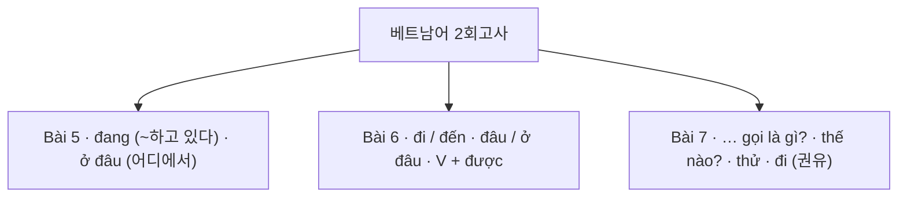

# ⚡ 베트남어 시험 직전 10분 핵심 요약 — 2026 2학기 2회고사

> 범위: 베어A 교재 p.90·91·94·97(Bài 5) · p.101~113(Bài 6) · p.114~121(Bài 7)  
> ※ 교재 p.122~126, 베어B 학습지 4~6과는 자료가 들어오면 추가

## 🎯 한눈에 보는 베트남어 지도

## 1. Bài 5. Bạn đang làm gì đấy? (너 지금 뭐 하고 있어?)

- [ ] **đang**은 동사 **앞**: Tôi **đang** ăn cơm.
- [ ] "뭐 하고 있어?" = **đang làm gì?** / "어디에서?" = **ở đâu?** (문장 끝)
- [ ] 장소 6개: **nhà, nhà hàng, căn tin, tiệm cà phê, thư viện, trường đại học**
- [ ] 짝: xem ti vi–nhà / làm thêm–nhà hàng / uống cà phê–tiệm cà phê / ăn cơm–căn tin / đọc sách–thư viện / học tiếng Việt–trường đại học
- [ ] **hơi, rất** = 형용사 **앞** / **lắm** = 형용사 **뒤** / "별로 ~않다" = **không … lắm**
- [ ] **rất … lắm** 같이 쓰지 않기
- [ ] 예/아니오 질문 = **có + V + không?** → 대답 **Có / Không**
- [ ] 문장 만들기: 시간말(**bây giờ, hôm nay**) 맨 앞 → 주어 → (đang/có) → 동사 → 목적어 → **ở + 장소**
- [ ] 지문: Nam·Lan = **영어** @ Trung tâm Việt - Mỹ / Kenji = **베트남어** @ Trường Đại học Nhân văn / Lan만 책 좋아함 / 오늘 학교 안 감 / **quán cà phê Sách**에서 커피 마시며 이야기 중

---

## 2. Bài 6. Bạn đi đâu đấy? (너 어디 가니?)

- [ ] **đi / về / đến + đâu**, 그 밖의 동사·"있다" + **ở đâu**
- [ ] **trường, công ty, nhà bạn** 은 **(đi) đến**, 집은 **về nhà**
- [ ] **đi + 동사** = ~하러 가다 (đi làm, đi học, đi ngủ, đi du lịch)
- [ ] **đến** = 도착하다 / ~까지 (từ A đến B), **đến = tới**
- [ ] **V + được** (할 수 있다), **không + V + được** (못 한다), **có thể + V**
- [ ] **…, được không?** 허락 구하기 → Được. / Không được. / Dạ, được. Mời anh!
- [ ] 단어: chờ(기다리다), đón(마중하다), mắc(비싸다), sau đó(그 다음), xe buýt(버스), chạy xe máy, sân bay, tiệm ăn, làm thêm
- [ ] 본문: Lan → 도서관 / Nam → 매점 / Kenji 생일 / Lan은 Aeon 근처 식당에서 알바 / Lan 회사는 떤선녓 공항 근처
- [ ] 소유 어순: **quê của chị** (O) / chị của quê (X)

---

## 3. Bài 7. Món này tiếng Việt gọi là gì? (이 음식은 베트남어로 뭐라고 해요?)

- [ ] 이름 묻기: **Món này tiếng Việt gọi là gì?** → Món này gọi là ___. / Đây là ___.
- [ ] 어때? 묻기: **___ thế nào?** (문장 끝). 예/아니오는 **có ___ không?**
- [ ] 정도: **rất** ngon / ngon **lắm** / **hơi** ngọt / **không** cay **lắm**
- [ ] **thử 는 동사 뒤**: ăn thử, uống thử (thử ăn ❌)
- [ ] **đang 은 동사 앞**: Họ đang ăn gì vậy?
- [ ] 문장 끝 **đi** = ~해 봐, ~하자 (Bạn ăn thử đi! / Chúng ta đi xem phim đi!)
- [ ] 의문문: **có muốn ___ thử ___ không?** (có 빠뜨리지 않기)
- [ ] **chúng tôi**(듣는 사람 ❌) vs **chúng ta**(듣는 사람 ⭕, ~하자)
- [ ] 음식: chả giò, bánh xèo, phở, bún chả, bún bò Huế, hủ tiếu, bún đậu, bánh mì / 음료: nước cam, nước dừa, sinh tố, trà sữa, cà phê sữa
- [ ] 맛: ngon, ngọt, chua, cay, đắng / mắc = 비싸다

---
