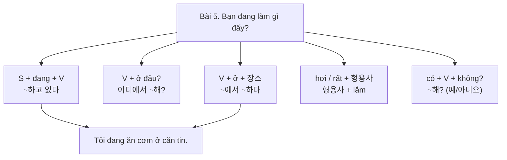

# 📗 Bài 5. Bạn đang làm gì đấy? (너 지금 뭐 하고 있어?) — 시험 완벽 정리
> 범위: 교재 p.90·91·94·97 · **đang**(~하고 있다) 현재진행, **ở đâu**(어디에서) 장소, **hơi / rất / lắm**(정도), 읽기 지문(Kenji·Nam·Lan)

## 🎯 한눈에 보는 단원 지도

## 01. 핵심 단어 (교재 p.90·91·94·97)

> 🎬 **핵심 단어 몽타주 영상 (3분 4초)** — 단어 40개를 🔊 베트남어 발음 → 🇰🇷 뜻 → 📝 예문 순서로 한 번에 정리해요. (묶음마다 💡 시험 포인트)

<video controls preload="metadata" playsinline poster="exam/%EB%B2%A0%ED%8A%B8%EB%82%A8%EC%96%B4_%EC%8B%9C%ED%97%98%EA%B3%B5%EB%B6%80/videos/vie_05_words_poster.jpg" src="exam/%EB%B2%A0%ED%8A%B8%EB%82%A8%EC%96%B4_%EC%8B%9C%ED%97%98%EA%B3%B5%EB%B6%80/videos/vie_05_words.mp4" style="width:100%;max-width:960px;border-radius:12px;display:block;margin:0 auto 1em;background:#000"></video>

### 1) 동작 (무엇을 하고 있나?) — p.90
| 베트남어 | 발음 | 뜻 | 예문 |
|---|---|---|---|
| **học** | 혹 | 공부하다 

💡 외우기
공부를 너무 열심히 해서 책상에 머리를 박고 '혹'이 났다! 혹 = 공부하다
 | Em ấy đang học. (그 아이는 공부하고 있어요.) |
| **làm việc** | 람 비엑 | 일하다 

💡 외우기
일을 너무 많이 해서 '남(람)의 비애(비엑)'까지 느끼는 회사원, 람 비엑 = 일하다
 | Anh ấy đang làm việc. (그는 일하고 있어요.) |
| **ăn cơm** | 안 껌 | 밥을 먹다 

💡 외우기
배고파서 밥상 '안'으로 달려가 씹던 '껌'부터 뱉고 밥을 먹는다! 안 껌 = 밥을 먹다
 | Chị ấy đang ăn cơm. (그녀는 밥을 먹고 있어요.) |
| **đọc sách** | 독 싸익 | 책을 읽다 

💡 외우기
'독'서실에서 책을 읽으며 '싸익' 페이지를 넘긴다, 독 싸익 = 책을 읽다
 | Em ấy đang đọc sách. (그 아이는 책을 읽고 있어요.) |
| **nghe nhạc** | 응애 냑 | 음악을 듣다 

💡 외우기
아기가 '응애' 울다가 음악을 들려주니 '냑냑' 신나게 웃는다, 응애 냑 = 음악을 듣다
 | Em ấy đang nghe nhạc. (그 아이는 음악을 듣고 있어요.) |
| **xem ti vi** | 쌤 띠 비 | TV를 보다 

💡 외우기
'쌤'이 쉬는 시간에 '띠비(TV)'를 몰래 본다! 쌤 띠 비 = TV를 보다
 | Em ấy đang xem ti vi. (그 아이는 TV를 보고 있어요.) |
| **làm thêm** | 람 템 | 아르바이트하다 

💡 외우기
알바생이 '남(람)는 템(아이템)' 사려고 아르바이트한다, 람 템 = 아르바이트하다
 | Tôi làm thêm ở nhà hàng. (나는 식당에서 아르바이트해요.) |
| **uống cà phê** | 우옹 까 페 | 커피를 마시다 

💡 외우기
커피가 너무 써서 '우웅~' 하며 카페(까 페)에서 마신다, 우옹 까 페 = 커피를 마시다
 | Tôi uống cà phê ở tiệm cà phê. (나는 카페에서 커피를 마셔요.) |
| **học tiếng Việt** | 혹 띠엥 비엣 | 베트남어를 공부하다 

💡 외우기
공부(혹)해서 베트남 말(띠엥 비엣)을 배운다, 혹 띠엥 비엣 = 베트남어를 공부하다
 | Tôi học tiếng Việt ở trường đại học. |
| ngủ | 응우 | 자다 

💡 외우기
밤 12시, 졸린 동생이 '응우~' 하고 기지개를 켜더니 바로 잠들었다, 응우 = 자다
 | Con chó đang ngủ rất ngon. (개가 아주 푹 자고 있어요.) |
| lên mạng mua sắm | 렌 망 무어 쌈 | 인터넷 쇼핑하다 

💡 외우기
인터넷에 올라가(렌) 망(網)에서 뭐(무어) 살까(쌈) 고르는 중, 렌 망 무어 쌈 = 인터넷 쇼핑하다
 | Anh ấy đang lên mạng mua sắm. |
| học tiếng Anh | 혹 띠엥 아잉 | 영어를 공부하다 

💡 외우기
공부(혹)해서 영어(띠엥 아잉)를 잘하면 '아잉~' 하고 칭찬받는다, 혹 띠엥 아잉 = 영어를 공부하다
 | Nam và Lan đang học tiếng Anh. |
| chạy bộ | 짜이 보 | 달리기하다, 조깅하다 

💡 외우기
달리다가 '짜이(차이)' 나게 앞서가는 걸 '보'여주자! 짜이 보 = 달리기하다, 조깅하다
 | Anh ấy thích chạy bộ. (그는 달리기를 좋아해요.) |

### 2) 장소 (어디에서?) — p.91, p.97
| 베트남어 | 발음 | 뜻 | 예문 |
|---|---|---|---|
| **nhà** | 냐 | 집 

💡 외우기
학교 끝나고 집에 오니 고양이가 '냐~' 하고 반겨 준다, 우리 집 냐! 냐 = 집
 | Mình xem ti vi ở nhà. (나는 집에서 TV를 봐.) |
| **nhà hàng** | 냐 항 | 식당, 레스토랑 

💡 외우기
집(냐)에 항상(항) 밥이 없으면 식당에 간다, nhà 집 vs nhà hàng 식당! 냐 항 = 식당
 | Tôi làm thêm ở nhà hàng. |
| **căn tin** | 깐 띤 | 구내식당(매점) 

💡 외우기
매점에서 '깐 땅콩' 하나 사서 '띤띤' 씹는다, 깐 띤 = 구내식당, 매점
 | Tôi đang ăn cơm ở căn tin. |
| **tiệm cà phê** | 띠엠 까 페 | 카페, 커피숍 

💡 외우기
가게(띠엠) 중에 커피(까 페) 파는 가게, 띠엠 까 페 = 카페, 커피숍
 | Tôi uống cà phê ở tiệm cà phê. |
| **thư viện** | 트 비엔 | 도서관 

💡 외우기
도서관에선 트림도 '비엔(비밀)'처럼 몰래 조용히 해야 한다! 트 비엔 = 도서관
 | Tôi đọc sách ở thư viện. |
| **trường đại học** | 쯔엉 다이 혹 | 대학교 

💡 외우기
학교(쯔엉) 중에 크고(다이) 공부(혹)하는 곳, 쯔엉 다이 혹 = 대학교
 | Tôi học tiếng Việt ở trường đại học. |
| công ty | 꽁 띠 | 회사 

💡 외우기
아빠가 회사에서 '꽁'짜 '티'셔츠를 받아 오셨다, 회사 최고! 꽁 띠 = 회사
 | Anh ấy đang ở công ty. |
| Trung tâm Việt - Mỹ | 쭝 떰 비엣 미 | 베트남-미국 센터(어학원) 

💡 외우기
센터(쭝 떰)에서 베트남(비엣)과 미국(미)을 함께 배운다, 쭝 떰 비엣 미 = 베트남-미국 센터
 | Nam và Lan học tiếng Anh ở Trung tâm Việt - Mỹ. |
| quán cà phê | 꽌 까 페 | 카페 

💡 외우기
골목 가게(꽌)에서 커피(까 페)를 파니까 카페, 꽌 까 페 = 카페 (tiệm cà phê도 카페)
 | Họ gặp nhau ở quán cà phê Sách. |

> ⚠️ **nhà**(집) ≠ **nhà hàng**(식당). hàng 하나 붙으면 완전히 다른 곳!

### 3) 정도·상태 형용사 — p.94
| 베트남어 | 발음 | 뜻 | 예문 |
|---|---|---|---|
| **hơi** | 허이 | 조금, 약간 (형용사 **앞**) 

💡 외우기
약간 놀라서 '허이?' 하고 살짝 고개를 든다, 허이 = 조금, 약간 (형용사 앞)
 | Tôi hơi mệt. (나는 조금 피곤해.) |
| **rất** | 젓 | 매우, 아주 (형용사 **앞**) 

💡 외우기
새우'젓'처럼 매우매우 짜다! 형용사 앞에 붙여서 rất ngon = 매우 맛있다, 젓 = 매우
 | Bánh mì này rất ngon. (이 빵은 아주 맛있어.) |
| **lắm** | 람 | 매우, 아주 (형용사 **뒤**) 

💡 외우기
'남(람)'다 싶을 만큼 매우 많다, 형용사 뒤에 붙는 람 = 매우, 아주
 | Em đói lắm. (저 너무 배고파요.) |
| đói | 도이 | 배고프다 

💡 외우기
점심 전 4교시, 배가 고파서 '도'저히 못 참겠'이'! 배꼽시계 울림, 도이 = 배고프다
 | Bây giờ em đói lắm. |
| mệt | 멧 | 피곤하다 

💡 외우기
시험공부로 밤새서 '멧'돼지처럼 침대에 털썩 쓰러졌다, 너무 피곤해! 멧 = 피곤하다
 | Hôm nay tôi hơi mệt. |
| khát | 캇 | 목마르다 

💡 외우기
목이 말라서 물 마시고 '캇!' 하고 시원한 소리를 낸다, 캇 = 목마르다
 | Tôi không khát lắm. (별로 목마르지 않아요.) |
| khó | 커 | 어렵다 

💡 외우기
수학 마지막 문제가 너무 어려워서 '커억!' 하고 숨이 막혔다, 커 = 어렵다
 | Tiếng Việt không khó lắm. (베트남어는 별로 어렵지 않아.) |
| ngon | 응온 | 맛있다 / (잠을) 푹 

💡 외우기
쌀국수 한 입 먹고 '응! 온'몸이 녹을 만큼 맛있다! 잠도 푹 잔다, 응온 = 맛있다 / 푹
 | Bánh mì này rất ngon. |
| vui | 부이 | 즐겁다 

💡 외우기
방학식 날 너무 즐거워서 친구들과 '부이부이' 엉덩이 춤을 췄다, 부이 = 즐겁다
 | Họ nói chuyện rất vui. |

### 4) 읽기 지문 단어 — p.97
| 베트남어 | 발음 | 뜻 | 예문 |
|---|---|---|---|
| **người bạn** | 응어이 반 | 친구 

💡 외우기
사람(응어이) 중에 내 반쪽(반) 같은 소중한 사람이 바로 친구, 응어이 반 = 친구
 | Kenji có hai người bạn Việt Nam. |
| **còn** | 꼰 | 한편, ~는(대조) 

💡 외우기
나는 피자, '꼰(한편)' 너는? 하고 꼰지르듯 대조한다, 꼰 = 한편, ~는
 | Còn Kenji học tiếng Việt. (한편 Kenji는 베트남어를 공부해.) |
| **cũng** | 꿍 | ~도 또한 

💡 외우기
친구가 빙판에서 '꿍' 넘어지자 나도 또한 '꿍'! 둘 다 엉덩방아, 꿍 = ~도 또한
 | Nam và Kenji cũng thích nghe nhạc. |
| **nhưng** | 녕 | 그러나, 하지만 

💡 외우기
'안녕~' 하고 인사했지만 하지만 아직 집에 가기 싫다, '녕' = 그러나, 하지만
 | …nhưng không thích đọc sách. |
| **thích** | 틱 | 좋아하다 

💡 외우기
좋아하는 아이돌만 보면 심장이 '틱틱' 뛰고 눈이 반짝인다, 틱 = 좋아하다
 | Lan rất thích nghe nhạc. |
| chơi game | 쩌이 겜 | 게임하다 

💡 외우기
놀기(쩌이) 좋아하는 내가 제일 신나는 건 겜(게임)! 쩌이 겜 = 게임하다
 | Hai bạn ấy rất thích chơi game. |
| **gặp nhau** | 갑 냐우 | 서로 만나다 

💡 외우기
복도에서 '갑'자기 서로 만나서 둘 다 '냐우~' 고양이 인사를 했다, 갑 냐우 = 서로 만나다
 | Họ gặp nhau ở quán cà phê. |
| **nói chuyện** | 노이 쭈옌 | 이야기하다 

💡 외우기
수다쟁이 친구가 '노'는 '이'야기를 '쭈욱' 끝없이 이어간다, 노이 쭈옌 = 이야기하다
 | Họ đang nói chuyện rất vui. |
| đi học | 디 혹 | 학교에 가다 

💡 외우기
가방 메고 '디'딩동 학교에 가서 공부(혹)한다, 가다(디)+공부(혹), 디 혹 = 학교에 가다
 | Hôm nay họ không đi học. |
| **hôm nay** | 홈 나이 | 오늘 

💡 외우기
오늘은 '홈(집)'에서 '나이'스하게 뒹굴뒹굴 쉬는 날! 홈 나이 = 오늘
 | Hôm nay, Kenji, Nam và Lan không đi học. |
| **bây giờ** | 버이 저 | 지금 

💡 외우기
'버'스가 '이'제 '저'기 온다, 바로 지금 뛰어! 버이 저 = 지금
 | Bây giờ họ đang uống cà phê. |
| **họ** | 허 | 그들 

💡 외우기
그들이 한꺼번에 우르르 몰려와서 나는 '허!' 하고 깜짝 놀랐다, 허 = 그들
 | Họ đang làm gì? (그들은 뭐 하고 있어?) |

## 02. 핵심 문법·문형 (교재 p.90·91·94)

> 🎬 **몽타주 영상 (5분 38초)** — 핵심 문법·문형을 🔊 베트남어 예문 → 🇰🇷 해석 → 💡 시험 포인트로 정리해요.

<video controls preload="metadata" playsinline poster="exam/%EB%B2%A0%ED%8A%B8%EB%82%A8%EC%96%B4_%EC%8B%9C%ED%97%98%EA%B3%B5%EB%B6%80/videos/vie_05_02_poster.jpg" src="exam/%EB%B2%A0%ED%8A%B8%EB%82%A8%EC%96%B4_%EC%8B%9C%ED%97%98%EA%B3%B5%EB%B6%80/videos/vie_05_02.mp4" style="width:100%;max-width:960px;border-radius:12px;display:block;margin:0 auto 1em;background:#000"></video>

### 1) S + **đang** + V — "~하고 있다" (현재진행) ⭐ 시험 단골
- **đang**은 동사 **앞**에 와서 "지금 ~하는 중"을 나타냅니다.
- 질문: **S + đang làm gì?** (~는 뭐 하고 있어?) / **Bạn đang làm gì đấy?** (너 지금 뭐 하고 있어?)
  - **đấy**는 문장 끝에 붙어 묻는 말을 부드럽게(친근하게) 만들어요.
- 예문
  - Bạn đang làm gì đấy? → Mình **đang** xem ti vi. (나 TV 보고 있어.)
  - Em ấy đang làm gì? → Em ấy **đang học**. (그 아이는 공부하고 있어요.)
  - Các bạn **đang** làm gì? (너희들 뭐 하고 있어?)
- ⚠️ 어순: **đang + 동사** (O) / 동사 + đang (X). "Tôi ăn đang cơm" ✗ → "Tôi **đang ăn** cơm" ✓

### 2) V + **ở đâu?** / V + **ở** + 장소 — "어디에서 ~해?" / "~에서 ~해" ⭐ 시험 단골
- **ở** = ~에서(장소), **đâu** = 어디 → **ở đâu** = 어디에서
- 장소는 **문장 끝**(동작 뒤)에 옵니다.
- 예문 (p.91)
  - Bạn xem ti vi **ở đâu**? (너는 어디에서 TV를 봐?)
  - Mình xem ti vi **ở nhà**. (나는 집에서 TV를 봐.)
  - Bạn đọc sách ở đâu? → Tôi đọc sách **ở thư viện**.
- **đang + ở đâu 합치기** ⭐
  - Bạn **đang** ăn **ở đâu**? (너 어디에서 먹고 있어?)
  - Tôi **đang** ăn cơm **ở căn tin**. (나는 구내식당에서 밥을 먹고 있어.)
- **Họ đang ở đâu?** (그들은 어디에 있어?) → Anh ấy đang **ở công ty**. — 여기서 ở는 "~에 있다"라는 동사처럼 쓰여요.
- ⚠️ "Bạn ăn ở đâu?"에서 **đâu** 대신 다른 말을 넣지 않도록! 장소를 물을 땐 반드시 **ở đâu**.

### 3) **hơi / rất / lắm** — 정도 표현 ⭐⭐ 시험 단골
| 말 | 뜻 | 위치 | 예문 |
|---|---|---|---|
| **hơi** | 조금, 약간 | 형용사 **앞** | Tôi **hơi** mệt. (조금 피곤해.) |
| **rất** | 매우 | 형용사 **앞** | Bánh mì này **rất** ngon. (아주 맛있어.) |
| **lắm** | 매우 | 형용사 **뒤** | Em đói **lắm**. (너무 배고파요.) |
| **không + 형용사 + lắm** | 별로 ~하지 않다 | lắm은 뒤 | Tiếng Việt **không khó lắm**. (별로 안 어려워.) |

- ⚠️ **rất**과 **lắm**은 한 문장에 같이 쓰지 않아요. "rất đói lắm" ✗
- ⚠️ 부정문 "별로 ~않다"에는 **lắm**! "không rất khó" ✗ → "**không khó lắm**" ✓
- ⚠️ 빈칸이 형용사 **뒤**에 있으면 → **lắm**, 형용사 **앞**에 있으면 → **hơi** 또는 **rất**.

### 4) **có + V + không?** — "~해? 안 해?" (예/아니오 질문)
- 대답: **Có.** (응) / **Không.** (아니)
- 예문 (p.94)
  - Anh ấy **có** làm việc **không**? → **Không.** Anh ấy không làm việc.
  - Anh ấy **có** thích chạy bộ **không**? → **Có.** Anh ấy thích chạy bộ.
  - Hôm nay anh **có** gặp chị Lan **không**? (오늘 형은 Lan 누나를 만나요?)
- ⚠️ 부정문에 không을 붙인다고 질문이 되지 않아요. "Anh ấy không làm việc không?" ✗

### 5) 시간 말(**bây giờ, hôm nay**)의 위치
- 보통 문장 **맨 앞**에 둡니다. (뒤에 와도 됨)
  - **Bây giờ** em đói lắm. (지금 저 너무 배고파요.)
  - **Bây giờ** các bạn đang làm gì? (지금 너희들 뭐 하고 있어?)
  - **Hôm nay** anh có gặp chị Lan không?

## 03. 대화·읽기 본문 (교재 p.97)

> 🎬 **몽타주 영상 (5분 18초)** — 대화·읽기 본문을 한 문장씩 🔊 듣고 🇰🇷 해석해요. (본문 질문과 모범 답 포함)

<video controls preload="metadata" playsinline poster="exam/%EB%B2%A0%ED%8A%B8%EB%82%A8%EC%96%B4_%EC%8B%9C%ED%97%98%EA%B3%B5%EB%B6%80/videos/vie_05_03_poster.jpg" src="exam/%EB%B2%A0%ED%8A%B8%EB%82%A8%EC%96%B4_%EC%8B%9C%ED%97%98%EA%B3%B5%EB%B6%80/videos/vie_05_03.mp4" style="width:100%;max-width:960px;border-radius:12px;display:block;margin:0 auto 1em;background:#000"></video>

### 1) Bài đọc — Kenji, Nam và Lan
| 베트남어 | 한국어 해석 |
|---|---|
| Kenji có **hai người bạn** Việt Nam là Nam và Lan. | Kenji는 베트남 친구가 두 명 있는데, Nam과 Lan이다. |
| Nam và Lan **đang học tiếng Anh ở Trung tâm Việt - Mỹ**. | Nam과 Lan은 베트남-미국 센터에서 영어를 공부하고 있다. |
| **Còn** Kenji **học tiếng Việt ở Trường Đại học Nhân văn**. | 한편 Kenji는 인문대학교에서 베트남어를 공부한다. |
| Lan **rất thích nghe nhạc và đọc sách**. | Lan은 음악 듣기와 책 읽기를 아주 좋아한다. |
| Nam và Kenji **cũng** thích nghe nhạc **nhưng không thích đọc sách**. | Nam과 Kenji도 음악 듣기를 좋아하지만 책 읽기는 좋아하지 않는다. |
| Hai bạn ấy **rất thích chơi game**. | 그 두 친구는 게임하기를 아주 좋아한다. |
| **Hôm nay**, Kenji, Nam và Lan **không đi học**. | 오늘 Kenji, Nam, Lan은 학교에 가지 않는다. |
| Họ **gặp nhau ở quán cà phê Sách**. | 그들은 '책 카페(Sách)'에서 만난다. |
| **Bây giờ** họ **đang uống cà phê và nói chuyện** rất vui. | 지금 그들은 커피를 마시며 아주 즐겁게 이야기하고 있다. |

> 💡 **Hai bạn ấy** = 그 두 친구 = **Nam과 Kenji** (바로 앞 문장의 두 사람)

### 2) 본문 질문과 모범 답 (Trả lời câu hỏi)
> 교재 p.97에는 지문만 있으므로, 시험에 나올 만한 질문으로 정리했어요.

| 질문 | 모범 답 |
|---|---|
| Kenji có mấy người bạn Việt Nam? (Kenji는 베트남 친구가 몇 명?) | Kenji có **hai** người bạn Việt Nam là Nam và Lan. |
| Nam và Lan đang học gì ở đâu? | Nam và Lan đang học **tiếng Anh** ở **Trung tâm Việt - Mỹ**. |
| Kenji học tiếng Việt ở đâu? | Kenji học tiếng Việt ở **Trường Đại học Nhân văn**. |
| Lan thích làm gì? | Lan rất thích **nghe nhạc và đọc sách**. |
| Nam và Kenji có thích đọc sách không? | **Không.** Nam và Kenji không thích đọc sách. |
| Hôm nay họ có đi học không? | **Không.** Hôm nay họ không đi học. |
| Họ gặp nhau ở đâu? | Họ gặp nhau ở **quán cà phê Sách**. |
| Bây giờ họ đang làm gì? | Bây giờ họ đang **uống cà phê và nói chuyện**. |

### 3) Thực hành nghe (p.97 표) — 듣기 활동(녹음 필요)
- 1) **Họ đang ở đâu?** (그들은 어디에 있나?) — Em Lâm / Anh Hải / Anh Nam ↔ a. ở công ty · b. ở nhà · c. ở Trung tâm Việt - Mỹ
- 2) **Họ đang làm gì?** (그들은 뭐 하고 있나?) — Em Lâm / Anh Hải / Anh Nam ↔ a. ngủ · b. lên mạng mua sắm · c. học tiếng Anh
- 녹음을 들어야 풀 수 있는 문제라 정답은 적지 않습니다. 표에 나온 **표현**만 외워 두세요.

## 04. 연습 문제 정답 정리 (교재 p.90·91·94)

> 🎬 **몽타주 영상 (5분 19초)** — 연습 문제를 Q(문제) → A(정답) 순서로 🔊 듣고 확인해요.

<video controls preload="metadata" playsinline poster="exam/%EB%B2%A0%ED%8A%B8%EB%82%A8%EC%96%B4_%EC%8B%9C%ED%97%98%EA%B3%B5%EB%B6%80/videos/vie_05_04_poster.jpg" src="exam/%EB%B2%A0%ED%8A%B8%EB%82%A8%EC%96%B4_%EC%8B%9C%ED%97%98%EA%B3%B5%EB%B6%80/videos/vie_05_04.mp4" style="width:100%;max-width:960px;border-radius:12px;display:block;margin:0 auto 1em;background:#000"></video>

### Bài tập 1.1 — Hỏi và trả lời (p.90) : …… đang làm gì?
| 번호 | 그림 | 모범 답 |
|---|---|---|
| (1) | 공부하는 아이 | Em ấy **đang học**. |
| (2) | 노트북으로 일하는 남자 | Anh ấy **đang làm việc**. |
| (3) | 밥 먹는 여자 | Chị ấy **đang ăn cơm**. |
| (4) | 책 읽는 아이 | Em ấy **đang đọc sách**. |
| (5) | 헤드폰 낀 아이 | Em ấy **đang nghe nhạc**. |
| (6) | TV 보는 아이 | Em ấy **đang xem ti vi**. |

### Bài tập 1.1 — 2) …… ở đâu? (p.91)
| 번호 | 질문 | 모범 답 |
|---|---|---|
| (1) | Bạn xem ti vi ở đâu? | Mình xem ti vi **ở nhà**. |
| (2) | Bạn làm thêm ở đâu? | Mình làm thêm **ở nhà hàng**. |
| (3) | Bạn uống cà phê ở đâu? | Mình uống cà phê **ở tiệm cà phê**. |
| (4) | Bạn ăn cơm ở đâu? | Mình ăn cơm **ở căn tin**. |
| (5) | Bạn đọc sách ở đâu? | Mình đọc sách **ở thư viện**. |
| (6) | Bạn học tiếng Việt ở đâu? | Mình học tiếng Việt **ở trường đại học**. |

### Bài tập 2.1 (p.94, 4번·5번) — 대답을 보고 질문 만들기
| 번호 | 대답 | 알맞은 질문 |
|---|---|---|
| 4) | Không. Anh ấy không làm việc. | Anh ấy **có làm việc không**? |
| 5) | Có. Anh ấy thích chạy bộ. | Anh ấy **có thích chạy bộ không**? |

- ⚠️ 4번 필기 "Anh ấy không làm việc không?" → 틀림. 질문은 **có … không?** 으로! → **Anh ấy có làm việc không?**
- ⚠️ 5번 필기 "Anh ấy thích chạy bộ không?" → **có**를 넣어 **Anh ấy có thích chạy bộ không?** 로 쓰는 것이 교재 문형.

### Bài tập 2.2 — 주어진 단어로 문장 만들기 (p.94)
| 번호 | 주어진 단어 | 정답 문장 |
|---|---|---|
| 1) | ăn cơm / đang / tôi / ở / căn tin | **Tôi đang ăn cơm ở căn tin.** (나는 구내식당에서 밥을 먹고 있다.) |
| 2) | đói / em / bây giờ / lắm | **Bây giờ em đói lắm.** (지금 저 너무 배고파요.) |
| 3) | hôm nay / anh / có / chị Lan / gặp / không? | **Hôm nay anh có gặp chị Lan không?** (오늘 형은 Lan 누나를 만나요?) |
| 4) | các bạn / đang / bây giờ / làm / gì? | **Bây giờ các bạn đang làm gì?** (지금 너희들 뭐 하고 있어?) |
| 5) | ăn / ở đâu / đang / bạn? | **Bạn đang ăn ở đâu?** (너 어디에서 먹고 있어?) |

### Bài tập 2.3 — hơi / rất / lắm 고르기 (p.94)
| 번호 | 문장 | 정답 | 이유 |
|---|---|---|---|
| 1) | Tiếng Việt không khó **lắm**! | **lắm** | không + 형용사 + **lắm** = 별로 ~않다 |
| 2) | Bánh mì này **rất** ngon. | **rất** (hơi도 가능) | 형용사 앞 빈칸 |
| 3) | Hôm nay tôi **hơi / rất** mệt! | **hơi** 또는 **rất** | 형용사 앞 빈칸 |
| 4) | Cảm ơn chị. Tôi không khát **lắm**! | **lắm** | không + 형용사 + **lắm** |
| 5) | Con chó đang ngủ **rất** ngon! | **rất** | ngon 앞 빈칸 (아주 푹 잔다) |
| 6) | Tôi **hơi / rất** đói. | **hơi** / **rất** | 형용사 앞 빈칸 두 개 |

> 💡 요령: 빈칸이 형용사 **뒤** + 앞에 **không** → **lắm** / 빈칸이 형용사 **앞** → **hơi**(조금) 또는 **rất**(매우)

## ✅ 시험 직전 체크
- [ ] **đang**은 동사 **앞**: Tôi **đang** ăn cơm.
- [ ] "뭐 하고 있어?" = **đang làm gì?** / "어디에서?" = **ở đâu?** (문장 끝)
- [ ] 장소 6개: **nhà, nhà hàng, căn tin, tiệm cà phê, thư viện, trường đại học**
- [ ] 짝: xem ti vi–nhà / làm thêm–nhà hàng / uống cà phê–tiệm cà phê / ăn cơm–căn tin / đọc sách–thư viện / học tiếng Việt–trường đại học
- [ ] **hơi, rất** = 형용사 **앞** / **lắm** = 형용사 **뒤** / "별로 ~않다" = **không … lắm**
- [ ] **rất … lắm** 같이 쓰지 않기
- [ ] 예/아니오 질문 = **có + V + không?** → 대답 **Có / Không**
- [ ] 문장 만들기: 시간말(**bây giờ, hôm nay**) 맨 앞 → 주어 → (đang/có) → 동사 → 목적어 → **ở + 장소**
- [ ] 지문: Nam·Lan = **영어** @ Trung tâm Việt - Mỹ / Kenji = **베트남어** @ Trường Đại học Nhân văn / Lan만 책 좋아함 / 오늘 학교 안 감 / **quán cà phê Sách**에서 커피 마시며 이야기 중
