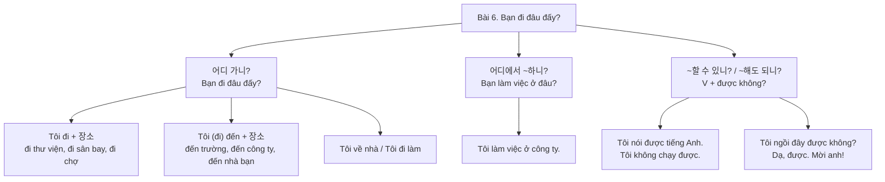

# 📗 Bài 6. Bạn đi đâu đấy? (너 어디 가니?) — 시험 완벽 정리
> 범위: 교재 p.101~113 · 어디 가는지 묻고 답하기(đi/đến + 장소), 위치 묻기(đâu/ở đâu), 할 수 있는지·해도 되는지 묻기(V + được)

## 🎯 한눈에 보는 단원 지도

## 01. 핵심 단어 (교재 p.112 D. Từ vựng + 본문·그림 단어)

> 🎬 **핵심 단어 몽타주 영상 (3분 14초)** — 단어 48개를 🔊 베트남어 발음 → 🇰🇷 뜻 → 📝 예문 순서로 한 번에 정리해요. (묶음마다 💡 시험 포인트)

<video controls preload="metadata" playsinline poster="exam/%EB%B2%A0%ED%8A%B8%EB%82%A8%EC%96%B4_%EC%8B%9C%ED%97%98%EA%B3%B5%EB%B6%80/videos/vie_06_words_poster.jpg" src="exam/%EB%B2%A0%ED%8A%B8%EB%82%A8%EC%96%B4_%EC%8B%9C%ED%97%98%EA%B3%B5%EB%B6%80/videos/vie_06_words.mp4" style="width:100%;max-width:960px;border-radius:12px;display:block;margin:0 auto 1em;background:#000"></video>

### 1) 교재 단어장 (p.112)
| 베트남어 | 뜻 | 예문 |
|---|---|---|
| **bây giờ** | 지금 | **Bây giờ** chúng tôi đang đi taxi về nhà. (지금 우리는 택시 타고 집에 가는 중이다.) |
| **chạy xe máy** | 오토바이를 타다(몰다) | Anh ấy rất thích **chạy xe máy**. (그는 오토바이 타는 걸 아주 좋아한다.) |
| **chờ** | 기다리다 | Tôi **chờ** bạn tôi ở sân bay. (나는 공항에서 친구를 기다린다.) |
| **đón** | (사람을) 마중하다, 데리러 가다 | Tôi đi sân bay **đón** bạn. (나는 친구를 마중하러 공항에 간다.) |
| **được** | ~할 수 있다, ~해도 되다 | Tôi ngồi đây **được không**? (여기 앉아도 돼요?) |
| **gọi** | 부르다, 전화하다 | |
| **hay** | 재미있다 | |
| **hẹn** | 약속하다 | **Hẹn** gặp lại. (또 만나자.) |
| **lại** | 다시 | Hẹn gặp **lại**. (다시 만나요.) |
| **mắc** | (값이) 비싸다 | Nhà hàng này ngon nhưng hơi **mắc**. (이 식당은 맛있지만 좀 비싸다.) |
| **mệt** | 피곤하다 | |
| **một chút** | 조금, 약간 | Em nói được **một chút**. (저는 조금 말할 수 있어요.) |
| **nấu** | 요리하다, (밥을) 짓다 | Hôm nay mẹ có **nấu** cơm không? |
| **nhà hàng** | 식당, 레스토랑 | |
| **ngồi** | 앉다 | Tôi **ngồi** đây được không? |
| **nóng** | 뜨겁다, 덥다 | Tôi uống trà **nóng**. (나는 뜨거운 차를 마신다.) |
| **sân bay** | 공항 | Chị đi **sân bay** Tân Sơn Nhất, phải không? |
| **sau đó** | 그 다음에, 그 후 | Tôi mua cà phê, **sau đó** đi bộ đến công ty. |
| **siêu thị** | 슈퍼마켓, 마트 | Ở một tiệm ăn gần **siêu thị** Aeon. |
| **sống** | 살다 | |
| **thích** | 좋아하다 | Tôi không **thích** cà phê sữa đá lắm. |
| **tiệm ăn** | (작은) 식당 | Lan làm thêm ở một **tiệm ăn**. |
| **tiếng Anh** | 영어 | Cô ấy nói được **tiếng Anh**. |
| **trà đá** | 아이스티(얼음 넣은 차) | |
| **xe buýt** | 버스 | Anh ấy không thích đi **xe buýt**. |
| **xong** | 끝내다, 다 하다 | |

### 2) 본문·그림에 나온 장소·행동 단어
| 베트남어 | 뜻 | 예문 |
|---|---|---|
| **thư viện** | 도서관 | Lan đang đi đến **thư viện**. |
| **căn tin** | 매점, 구내식당 | Mình đi đến **căn tin** mua nước. |
| **bệnh viện** | 병원 | Ông ấy đang đi **bệnh viện**. |
| **chợ** | 시장 | Chúng tôi đang đi **chợ**. |
| **công ty** | 회사 | Công ty của tôi ở gần đó. |
| **trường** | 학교 | Tôi (đi) đến **trường**. |
| **nhà bạn** | 친구 집 | Tôi (đi) đến **nhà bạn**. |
| **về nhà** | 집에 돌아가다 | Tôi đi **về nhà**. |
| **đi làm** | 일하러 가다, 출근하다 | Tôi **đi làm**. |
| **đi học** | 공부하러 가다, 등교하다 | Các em ấy **đi học**. |
| **làm thêm** | 아르바이트하다 | Lan **làm thêm** ở đâu? |
| **sinh nhật** | 생일 | Hôm nay là **sinh nhật** của Kenji. |
| **đi du lịch** | 여행 가다 | Chị **đi du lịch** à? |
| **đi bộ** | 걸어가다 | sau đó **đi bộ** đến công ty |
| **xuống** | 내리다 | Tôi **xuống** ở đây, được không? |
| **tài xế (taxi)** | (택시) 기사 | |
| **uống bia** | 맥주를 마시다 | Bạn uống bia được không? |
| **ăn sầu riêng** | 두리안을 먹다 | |
| **nói tiếng Anh** | 영어를 말하다 | |
| **nấu ăn** | 요리하다 | |
| **hát** | 노래하다 | |
| **cà phê sữa đá** | 아이스 연유 커피 | Bạn tôi uống **cà phê sữa đá**. |

## 02. 핵심 문법·문형 (교재 p.103, p.112~113 E. Ghi chú ngữ pháp)

### 1) đâu / ở đâu — "어디"
- **đâu** : 이동 동사 **đi(가다), đến(도착하다·오다), về(돌아가다), ra(나가다)** 바로 뒤에 붙여서 **목적지**를 묻는다.
  - Bạn **đi đâu** đấy? (너 어디 가니?)
  - Chị **về đâu**? (어디로 돌아가세요?) → Tôi về số 15 đường Lê Thánh Tôn. (레타인똔 거리 15번지로 가요.)
  - Anh muốn **đi đâu**? (어디 가고 싶어요?)
- **ở đâu** : 어떤 일을 **하는 장소(위치)** 를 묻는다.
  - **ăn ở đâu** (어디서 먹다), **làm việc ở đâu** (어디서 일하다), **học ở đâu** (어디서 공부하다)
  - Chị muốn ăn trưa **ở đâu**? (점심을 어디서 먹고 싶어요?)
  - Lan làm thêm **ở đâu**? → **Ở** một tiệm ăn gần siêu thị Aeon.
- ⭐ 시험 단골: "어디에 **있니**?"도 ở đâu → Mẹ đang **ở đâu**? / Nhà thầy **ở đâu**? / Quê của chị **ở đâu**?
- ⚠️ 헷갈림 주의: **đi / về / đến** 다음엔 **đâu**, 그 밖의 동사(làm việc, mua, học, ăn…)나 "있다"의 뜻엔 **ở đâu**.

| 문장 | 정답 | 이유 |
|---|---|---|
| Xin lỗi, bà về ___? | **đâu** | về(돌아가다) = 이동 |
| Cô làm việc ___? | **ở đâu** | 일하는 장소 |
| Bố ơi, mẹ đang ___ ạ? | **ở đâu** | 지금 있는 위치 |
| Đồng hồ này chị mua ___? | **ở đâu** | 산 장소 |
| Các ông đi ___? | **đâu** | đi = 이동 |
| Nhà thầy ___? | **ở đâu** | 집의 위치 |

### 2) đi — "가다"
- **a. đi + 도시·나라·대륙 이름** : Tôi **đi Hà Nội**. (하노이에 가요) / **đi Pháp** (프랑스에 가다) / **đi châu Phi** (아프리카에 가다)
- **b. đi + 자주 가는 곳** : **đi thư viện**(도서관에 가다), **đi sân bay**(공항에 가다), **đi bệnh viện**(진찰받으러 병원에 가다), **đi chợ**(장 보러 시장에 가다), **đi nhà thờ**(예배하러 교회에 가다)
- ⚠️ **예외: trường(학교), nhà bạn(친구 집), công ty(회사)** 는 **(đi) đến** 을 쓴다.
  - Tôi **(đi) đến trường**. / Tôi **(đi) đến công ty**. / Tôi **(đi) đến nhà bạn**.
  - 집에 갈 때는 **về**: Tôi **đi về nhà**. (집에 가요)
- **c. đi + 방향어 + 장소** : đi **xuống** nhà (아래층에 내려가다), đi **lên** tầng 2 (2층에 올라가다), đi **vào** nhà (집에 들어가다) → 이때 đi는 생략 가능: Tôi **lên tầng 2**.
- **d. đi + 동사** : ~하러 가다 → Tôi **đi làm**. (일하러 가요) / Tôi **đi ngủ**. (자러 가요) / **đi học** / **đi du lịch**

### 3) đến — "도착하다, 오다, ~까지"
- **a. 도착하다·오다** : Tôi **đến trường**. (학교에 도착했다) / Tôi về **đến nhà**. (집에 도착했다)
- **b. ~까지 (to, until)** : Từ nhà tôi **đến** trường 2km. (우리 집에서 학교까지 2km) / Tôi thường làm việc **đến** 6 giờ tối. (나는 보통 저녁 6시까지 일한다)
- **c. đến = tới** (뜻이 같다) : Anh **tới** trường chưa? (학교에 도착했어요?) / Tôi học từ 8:00 **tới** 10:00. (8시부터 10시까지 공부해요)
- ⭐ 시험 단골: **từ A đến B** = A부터 B까지

### 4) V + được — "~할 수 있다"
- **동사 + được (+ 목적어)** 또는 **동사 + 목적어 + được**
  - Cô ấy **nói được** tiếng Anh. = Cô ấy nói tiếng Anh **được**. (그녀는 영어를 할 수 있다)
- **có thể + 동사** 로 바꿔 말할 수 있다 (có thể는 동사 **앞**!) → Cô ấy **có thể** nói tiếng Anh.
- 부정: **không + V + được** → Tôi **không** chạy **được**. (나는 (오토바이를) 못 타요) / Tôi **không** uống **được**.
- 질문: **V + được không?** → Chị chạy xe máy **được không**? / Em nói tiếng Việt **được không**? → Dạ, **được**. Em nói được **một chút**.
- ⚠️ 헷갈림 주의: được은 동사 **뒤**, có thể는 동사 **앞**.

### 5) ..., được không? — "~해도 돼요?" (허락 구하기)
- 문장 끝에 **được không?** 을 붙이면 허락을 구하는 말.
  - Anh ơi, tôi **xuống ở đây, được không**? (기사님, 여기서 내려도 돼요?) → **Được**, chị.
  - Tôi **ngồi đây được không**? (여기 앉아도 돼요?) → Dạ, được. **Mời anh!** (네, 앉으세요!)
  - Tôi hỏi một chút, **được không**? (좀 물어봐도 돼요?)
- 대답: 된다 → **Được.** / **Dạ, được.** , 안 된다 → **Không được.**

### 6) 자주 쓰는 표현
- **Bạn đi đâu đấy?** — 어디 가니? (đấy는 말을 부드럽게 해 주는 말, "~니?")
- **Còn + 사람?** — ~는? (Còn Nam? 남은?)
- **..., phải không?** — ~지요?, 맞지요?
- **Đúng rồi.** — 맞아요. / **Không phải.** — 아니에요.
- **Chào bạn. Hẹn gặp lại.** — 안녕. 또 만나.
- **A, còn B** — A는 ~하고, B는 ~한다 (Bạn tôi uống cà phê sữa đá, **còn** tôi uống trà nóng.)
- **không ... lắm** — 별로 ~하지 않다 (Tôi không thích cà phê sữa đá **lắm**.)
- **hơi + 형용사** — 좀(약간) ~하다 (hơi mắc 좀 비싸다)

## 03. 대화·읽기 본문 (교재 p.101~102, p.110)

### 1) Hội thoại 1 (p.101) — Lan và Nam gặp nhau ở sân trường (란과 남이 학교 마당에서 만남)
| 인물 | 베트남어 | 한국어 |
|---|---|---|
| Nam | Lan ơi, **bạn đi đâu đấy**? | 란아, 너 어디 가니? |
| Lan | Lan đang **đi đến thư viện**. **Còn Nam?** | 란은 도서관에 가는 중이야. 남은? |
| Nam | Mình **đi đến căn tin** mua nước. Hôm nay Lan **có đi sinh nhật** Kenji **không**? | 나는 물 사러 매점에 가. 오늘 란은 겐지 생일(파티)에 가니? |
| Lan | Không, mình **phải đi làm thêm**. | 아니, 나는 아르바이트하러 가야 해. |
| Nam | Lan **làm thêm ở đâu**? | 란은 어디서 아르바이트해? |
| Lan | **Ở một tiệm ăn gần siêu thị Aeon.** Chào bạn. **Hẹn gặp lại.** | 이온 마트 근처 작은 식당에서. 안녕. 또 보자. |
| Nam | Ừ. Hẹn gặp lại. | 응. 또 보자. |

> 💡 **phải + 동사** = ~해야 한다. **mình** = 나(친구끼리).

### 2) Hội thoại 2 (p.102) — Lan nói chuyện với tài xế taxi trên đường đi làm (란이 출근길에 택시 기사와 이야기함)
| 인물 | 베트남어 | 한국어 |
|---|---|---|
| Tài xế taxi | Chị **đi sân bay Tân Sơn Nhất, phải không**? | 떤선녓 공항에 가시죠? |
| Lan | **Đúng rồi.** | 맞아요. |
| Tài xế taxi | Chị **đi du lịch à**? | 여행 가세요? |
| Lan | **Không phải.** Tôi **đi làm**. Công ty của tôi **ở gần đó**. | 아니요. 일하러 가요. 제 회사가 그 근처에 있어요. |
| | ….. | (시간이 흐름) |
| Lan | Anh ơi, tôi **xuống ở đây, được không**? | 기사님, 여기서 내려도 될까요? |
| Tài xế taxi | **Được**, chị. | 됩니다. |
| Lan | Tôi mua cà phê, **sau đó đi bộ đến công ty**. | 커피 사고, 그다음에 회사까지 걸어갈게요. |
| Tài xế taxi | Vâng. | 네. |

### 3) Bài đọc (p.110)
> Hôm nay bạn tôi **đến Việt Nam**. Tôi **đi sân bay đón bạn**. Tôi **chờ** bạn tôi **ở sân bay**. Chúng tôi gặp nhau và **đến căn tin uống nước**. Bạn tôi uống **cà phê sữa đá**, **còn** tôi uống **trà nóng**. Tôi **không thích** cà phê sữa đá **lắm**. **Bây giờ**, chúng tôi đang **đi taxi về nhà**. Bạn tôi nói, ở Thành phố Hồ Chí Minh, anh ấy **rất thích chạy xe máy**. Anh ấy **không thích đi xe buýt**.

- 오늘 내 친구가 베트남에 온다. 나는 친구를 마중하러 공항에 간다.
- 나는 공항에서 친구를 기다린다. 우리는 만나서 음료를 마시러 매점에 간다.
- 내 친구는 아이스 연유 커피를 마시고, 나는 뜨거운 차를 마신다. 나는 아이스 연유 커피를 별로 안 좋아한다.
- 지금 우리는 택시를 타고 집에 가는 중이다.
- 친구가 말하길, 호찌민시에서 그는 오토바이 타는 것을 아주 좋아한다. 그는 버스 타는 것을 좋아하지 않는다.

### 4) 본문 질문과 모범 답 (Trả lời câu hỏi)
**Hội thoại 1 (p.101)**
1. Lan đang đi đâu? → **Lan đang đi đến thư viện.**
2. Nam cũng đang đi đến thư viện, phải không? → **Không phải. Nam đi đến căn tin mua nước.**
   - ⚠️ 학생 답 "Không phải, Nam cũng đang đi sinh nhật"은 틀림. 남은 **매점(căn tin)에 물 사러** 간다.
3. Hôm nay là sinh nhật của ai? → **Hôm nay là sinh nhật của Kenji.** (⚠️ "hôm này"가 아니라 **hôm nay**)
4. Lan đi sinh nhật Kenji, được không? Tại sao? → **Không được, vì Lan phải đi làm thêm.**
5. Lan làm thêm ở đâu? → **Lan làm thêm ở một tiệm ăn gần siêu thị Aeon.** (⚠️ "gần siêu thị Aeon"까지 써야 완전한 답)

**Hội thoại 2 (p.102)**
1. Lan đi đâu? → **Lan đi sân bay Tân Sơn Nhất.** (일하러 감: Lan đi làm.)
2. Công ty của Lan ở đâu? → **Công ty của Lan ở gần sân bay Tân Sơn Nhất.**
3. Lan mua gì ở gần công ty? → **Lan mua cà phê.**
   - ⚠️ 학생 답 "Lan mua gì ở gần cà phê"는 틀림. 질문의 gì(무엇) 자리에 답을 넣어야 한다 → **Lan mua cà phê.**

**Bài đọc – Bài tập 4.2 (p.111)**
1. Hôm nay cô ấy đi đâu? → **Hôm nay cô ấy đi sân bay (đón bạn).**
2. Cô ấy đón ai ở sân bay? → **Cô ấy đón bạn (của cô ấy) ở sân bay.**
   - ⚠️ 학생 답 "Cô ấy bạn đón"은 어순이 틀림. 베트남어는 **주어 + 동사 + 목적어** → Cô ấy **đón bạn**.
3. Họ uống gì ở căn tin? → **Bạn cô ấy uống cà phê sữa đá, còn cô ấy uống trà nóng.**
   - ⚠️ 학생 답 "Họ uống ở căn tin uống nước"는 틀림. 마신 것(cà phê sữa đá, trà nóng)을 써야 한다.
4. Bây giờ họ đang đi đâu? → **Bây giờ họ đang đi taxi về nhà.**
   - ⚠️ 학생 답 "đi xe taxi"만 쓰면 부족. "어디"를 물었으니 **về nhà**가 꼭 들어가야 한다.
5. Bạn cô ấy có thích đi xe buýt không? → **Không, anh ấy không thích đi xe buýt. Anh ấy thích chạy xe máy.**
   - ⚠️ 학생 답 "Bạn cô ấy có thích chạy xe máy"는 질문에 대한 답이 아님. 먼저 **Không**으로 답한다.

## 04. 연습 문제 정답 정리 (교재 p.103~111)

### B. Mở rộng từ vựng – ngữ pháp (p.103) — 따라 읽기 문장
1. Lan đi đâu đấy? → Lan đi thư viện. / Tôi đi sân bay. / Tôi đi về nhà. / Tôi đi làm.
2. Anh đi đâu đấy? → Tôi (đi) đến công ty. / Tôi (đi) đến nhà bạn. / Tôi (đi) đến trường.
3. Chị về đâu? → Tôi về số 15 đường Lê Thánh Tôn. / Chị chạy xe máy được không? → Tôi không chạy được.
4. Em nói tiếng Việt được không? → Dạ, được. Em nói được một chút. / Tôi ngồi đây được không? → Dạ, được. Mời anh!

### Bài tập 1.1 Hỏi và trả lời (p.104) — 말하기
- 질문: **Bạn đi đâu đấy?**
- 보기: sân bay, bệnh viện, siêu thị, công ty, nhà (của) bạn, học, làm (việc), ăn
- 그림 번호별 정답 (교재 사진 확대해 확인)

| 번호 | 그림 | 정답 |
|---|---|---|
| (1) | 계산대가 있는 가게 | Tôi đi **siêu thị**. (마트) |
| (2) | 비행기·관제탑 | Tôi đi **sân bay**. (공항) |
| (3) | HOSPITAL 건물 | Tôi đi **bệnh viện**. (병원) |
| (4) | 급식대에서 음식 받는 아이들 | Tôi đi **ăn**. (밥 먹으러) |
| (5) | 가방 메고 학교로 걸어감 | Tôi đi **học**. (공부하러) |
| (6) | 커피·가방 들고 서둘러 출근 | Tôi đi **làm**. (일하러) |
| (7) | SCHOOL 건물 | Tôi đi đến **trường**. (학교) |
| (8) | 높은 회사 건물 | Tôi đi đến **công ty**. (회사) |
| (9) | 친구네 집 | Tôi đi đến **nhà (của) bạn**. (친구 집) |

- 💡 (1)~(3) 장소는 **Tôi đi + 장소**, (4)~(6)은 **Tôi đi + 동사**(ăn·học·làm), (7)~(9)는 **Tôi đi đến + 장소**.

### Bài tập 1.1-2) Bạn ... được không? (p.105) — 말하기
- 예시: Bạn uống bia được không? → Tôi uống được. / Tôi không uống được.
- 그림 번호별: (1) **uống bia** (맥주) (2) **ăn sầu riêng** (두리안) (3) **nấu ăn** (요리) (4) **nói tiếng Anh** (말하는 여자) (5) **hát** (마이크) (6) **chạy xe máy** (오토바이)
- 예) Bạn **ăn sầu riêng được không**? → Tôi ăn được. / Tôi không ăn được.

### Bài tập 1.2 Hoàn thành các mẫu hội thoại (p.106) — 예시 답
- ① A: Bạn đi đâu đấy? B: Tôi đi **thư viện**. Còn bạn? A: Tôi đi **chợ**. Chào **bạn**. Hẹn gặp lại. B: Chào **bạn**. Hẹn gặp lại.
- ② A: **Anh** đi đâu đấy? B: Tôi đi làm. A: **Anh làm** ở đâu? B: Tôi làm ở **công ty …**. Còn **chị**? A: Tôi đi học. B: **Chị học** ở đâu? A: Tôi học ở **trường …**.
  - 💡 "ở đâu" 앞 빈칸에는 **làm / học** (어디서 일해? 어디서 공부해?)

### Bài tập 2.1 알맞은 대답 고르기 (p.106)
| 질문 | 정답 |
|---|---|
| 1) Anh uống cà phê không? | **b.** Không. Tôi không thích cà phê lắm. (예시) |
| 2) Các chị đang đi đâu đấy? | **a.** Chúng tôi đang đi chợ. |
| 3) Hôm nay ông có đi làm không? | **c.** Không. Hôm nay tôi ở nhà. |
| 4) Chị thích ăn ở căn tin không? | **e.** Không. Tôi không thích ăn ở đó lắm. |
| 5) Bây giờ em có ở nhà không? | **d.** Dạ, không. Em đi ra ngoài rồi. |

### Bài tập 2.2 낱말로 문장 만들기 (p.107)
1. **Hôm nay mẹ có nấu cơm không?** (오늘 엄마가 밥 하세요?)
2. **Nhà hàng này ngon nhưng hơi mắc.** (이 식당은 맛있지만 좀 비싸다.)
3. **Lan đọc sách, còn em trai Lan chơi game.** (란은 책을 읽고, 란의 남동생은 게임을 한다.)
4. **Em ấy làm thêm ở một tiệm cà phê.** (그 애는 한 카페에서 아르바이트한다.)
5. **Anh mua điện thoại này ở đâu?** (이 전화기 어디서 샀어요?)
6. **Quê của chị ở đâu?** (언니(당신)의 고향은 어디예요?)
   - ⚠️ 학생 답 "Chị của quê ở đâu"는 틀림. **quê của chị** = 언니의 고향 (꾸미는 말 của chị가 뒤에!)

### Bài tập 2.3 đi / đến 넣기 (p.107)
- 예시: Tôi đang **đi** chợ mua cá.
1. Hôm nay Lan **đến** nhà tôi chơi. (친구 집 → đến)
2. Các anh ấy **đến** công ty làm việc. (회사 → đến)
3. Em đang **đi** mua bánh mì. (đi + 동사)
4. Họ thích **đi** du lịch. (đi + 동사)
5. Anh Michael **đến** Việt Nam để học tiếng Việt. (도착해서 오다 → đến)

### Bài tập 2.4 đâu / ở đâu (p.108)
1) bà về **đâu** 2) Cô làm việc **ở đâu** 3) mẹ đang **ở đâu** ạ 4) Đồng hồ này chị mua **ở đâu** 5) Các ông đi **đâu** 6) Nhà thầy **ở đâu** — (학생 표시 모두 정답)

### Bài tập 2.5 그림 보고 답하기 (p.108)
1. Em đang đi đâu đấy? → **Em đang đi thư viện.**
2. Các chị đang đi đâu đấy? → **Chúng tôi đang đi siêu thị.**
3. Anh đi đâu đấy? → **Tôi đi uống cà phê.**
4. Ông ấy đang đi đâu đấy? → **Ông ấy đang đi bệnh viện.**
5. Các em ấy đi đâu đấy? → **Các em ấy đi học.**
6. Em đang đi đâu đấy? → **Em đang đi về nhà.**
- 💡 질문의 "Anh"에 대한 답은 **Tôi**로 시작하는 게 자연스럽다.

### 3. Thực hành nghe (p.109~110)
- Bài tập 3.1, 3.2 (siêu thị, chợ, trường đại học / Kim, Lisa, nước, cà phê, trà, bánh mì): **듣기 활동(녹음 필요)** — 정답은 녹음을 듣고 확인.

### Bài tập 4.1 알맞은 말 고르기 (p.111)
1. Hôm nay **bạn tôi** đến Việt Nam. → **b**
2. Tôi chờ bạn tôi ở **sân bay**. → **a**
3. Bây giờ chúng tôi **đi xe taxi** về nhà. → **c**
4. Bạn tôi thích **chạy xe máy** ở Thành phố Hồ Chí Minh. → **b**

### Bài tập 4.2 → 03절 4) 참고

## ✅ 시험 직전 체크
- [ ] **đi / về / đến + đâu**, 그 밖의 동사·"있다" + **ở đâu**
- [ ] **trường, công ty, nhà bạn** 은 **(đi) đến**, 집은 **về nhà**
- [ ] **đi + 동사** = ~하러 가다 (đi làm, đi học, đi ngủ, đi du lịch)
- [ ] **đến** = 도착하다 / ~까지 (từ A đến B), **đến = tới**
- [ ] **V + được** (할 수 있다), **không + V + được** (못 한다), **có thể + V**
- [ ] **…, được không?** 허락 구하기 → Được. / Không được. / Dạ, được. Mời anh!
- [ ] 단어: chờ(기다리다), đón(마중하다), mắc(비싸다), sau đó(그 다음), xe buýt(버스), chạy xe máy, sân bay, tiệm ăn, làm thêm
- [ ] 본문: Lan → 도서관 / Nam → 매점 / Kenji 생일 / Lan은 Aeon 근처 식당에서 알바 / Lan 회사는 떤선녓 공항 근처
- [ ] 소유 어순: **quê của chị** (O) / chị của quê (X)
