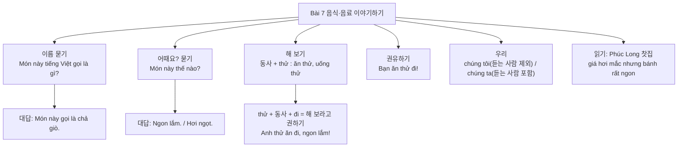

# 📗 Bài 7. Món này tiếng Việt gọi là gì? (이 음식은 베트남어로 뭐라고 해요?) — 시험 완벽 정리
> 범위: 교재 p.114~126 · 음식·음료 이름 묻기(gọi là gì), 맛·상태 묻기(thế nào), 해 보기(thử), 권유하기(đi), 우리(chúng tôi / chúng ta) 구별, 읽기 'Phúc Long 찻집'

## 🎯 한눈에 보는 단원 지도

## 01. 핵심 단어 (교재 p.114~124)

> 🎬 **핵심 단어 몽타주 영상 (5분 40초)** — 단어 78개를 🔊 베트남어 발음 → 🇰🇷 뜻 → 📝 예문 순서로 한 번에 정리해요. (묶음마다 💡 시험 포인트)

<video controls preload="metadata" playsinline poster="exam/%EB%B2%A0%ED%8A%B8%EB%82%A8%EC%96%B4_%EC%8B%9C%ED%97%98%EA%B3%B5%EB%B6%80/videos/vie_07_words_poster.jpg" src="exam/%EB%B2%A0%ED%8A%B8%EB%82%A8%EC%96%B4_%EC%8B%9C%ED%97%98%EA%B3%B5%EB%B6%80/videos/vie_07_words.mp4" style="width:100%;max-width:960px;border-radius:12px;display:block;margin:0 auto 1em;background:#000"></video>

### 1) 장소·기본 표현
| 베트남어 | 뜻 | 예문 |
|---|---|---|
| **món (ăn)** | 음식, 요리 | Món này ngon lắm. (이 음식 정말 맛있어.) |
| **thức uống** | 음료, 마실 것 | Cách nói về các món ăn, thức uống. (음식과 음료에 대해 말하는 법) |
| **nước** | 물; 음료(주스 등) | Nước này gọi là nước gì? (이 음료는 뭐라고 해?) |
| **gọi là** | ~라고 부르다 | Món này gọi là chả giò. (이 음식은 짜조라고 해.) |
| **tiếng Việt** | 베트남어 | Món này tiếng Việt gọi là gì? |
| **tiệm ăn** | (작은) 음식점 | Trong một tiệm ăn gần trường đại học. (대학교 근처 한 음식점에서) |
| **tiệm giải khát** | 음료 가게, 카페 | Ye Ji và Long đang ở một tiệm giải khát. |
| **quán cà phê** | 카페 | Quán cà phê đó thế nào? |
| **nhà hàng** | 식당, 레스토랑 | Chúng ta đến nhà hàng đó đi! |
| **thực đơn** | 메뉴(차림표) | Bạn xem thực đơn đi. |
| **cho mình hỏi một chút** | 좀 물어볼게 | Mai ơi, cho mình hỏi một chút. |
| **mình** | 나 (친구 사이) | Mình muốn ăn thử hai món này. |
| **thử** | (동사 뒤) ~해 보다 | Mình muốn uống thử. (마셔 보고 싶어.) |
| **thích** | 좋아하다 | Mình rất thích. (나 정말 좋아해.) |

### 2) 음식·음료 이름
| 베트남어 | 뜻 | 예문 |
|---|---|---|
| **chả giò** | 짜조(튀긴 스프링롤) | À, đây là món chả giò. |
| **bánh xèo** | 반쎄오(베트남식 부침개) | Còn món đó gọi là gì? – Bánh xèo. |
| **phở** | 쌀국수(퍼) | Món phở này thế nào? |
| **bún chả** | 분짜(숯불고기 국수) | Món này tiếng Việt gọi là bún chả. |
| **bún bò Huế** | 분보후에(후에식 매운 소고기 국수) | Bún bò Huế cay lắm. |
| **hủ tiếu** | 후띠우(남부식 쌀국수) | Món này gọi là hủ tiếu. |
| **bún đậu** | 분더우(쌀국수+두부 튀김) | Em thích ăn bún đậu không? |
| **bánh mì** | 반미(베트남 샌드위치), 빵 | Bánh mì ngon lắm. |
| **cơm gà** | 닭고기 덮밥 | Các bạn có ăn cơm gà không? |
| **nước cam** | 오렌지 주스 | Nước cam hơi chua. |
| **nước cam cà rốt** | 오렌지 당근 주스 | Đây là nước cam cà rốt. |
| **nước dừa** | 코코넛 주스 | Nước đó gọi là nước dừa. |
| **sinh tố** | 스무디(과일 셰이크) | Món này tiếng Việt gọi là sinh tố. |
| **trà sữa** | 밀크티 | Trà sữa hơi ngọt. |
| **trà đá** | 아이스티(차가운 차) | Cơm gà và trà đá. |
| **cà phê sữa** | 연유 커피 | Cà phê sữa ngọt lắm. |

### 3) 맛·상태 형용사
| 베트남어 | 뜻 | 예문 |
|---|---|---|
| **ngon** | 맛있다 | Ngon lắm. (정말 맛있어.) |
| **ngọt** | 달다 | Trà sữa rất ngọt. |
| **chua** | 시다 | Nước cam hơi chua. |
| **cay** | 맵다 | Kim chi không cay lắm. |
| **đắng** | 쓰다 | Cà phê này có đắng lắm không? |
| **đẹp** | 예쁘다, 멋지다 | Quán đó đẹp lắm. |
| **tốt** | 좋다 | Cái điện thoại đó rất tốt. |
| **khó** | 어렵다 | Quyển sách này rất khó. |
| **to** | 크다 | Cái túi xách đó hơi to. |
| **mắc** | 비싸다(남부 말) | Cà phê Starbuck mắc lắm. |
| **mệt** | 피곤하다 | Các bạn mệt rồi, phải không? |

### 4) 동작 동사 (Bài tập 1.2, 2.2)
| 베트남어 | 뜻 | 예문 |
|---|---|---|
| **ăn cơm** | 밥 먹다 | Bạn ăn cơm đi. |
| **uống cà phê** | 커피 마시다 | Bạn uống cà phê đi. |
| **nghe nhạc** | 음악 듣다 | Họ không thích nghe nhạc. |
| **xem phim** | 영화 보다 | Chúng ta đi xem phim đi! |
| **đọc sách** | 책 읽다 | Chị có thích đọc sách không? |
| **mua** | 사다 | Tôi mua túi xách ở Vincom. |
| **nấu** | 요리하다 | Chúng tôi muốn nấu thử món này. |
| **trả lời** | 대답하다 | Bạn trả lời đi. |
| **hỏi cô giáo** | 선생님께 묻다 | Bạn hỏi cô giáo đi. |
| **nghỉ** | 쉬다 | Chúng ta nghỉ một chút! |

### 5) 교재 단어장 D. Từ vựng (p.124) — 위 표에 없는 단어
| 베트남어 | 뜻 | 예문 |
|---|---|---|
| **bán** | 팔다 | Tiệm này có bán trà sữa, cà phê. (이 가게는 밀크티, 커피를 팔아.) |
| **gọi** | 부르다; **(음식을) 주문하다** | Anh Nam gọi món gì? (남 씨는 무슨 음식을 주문해요?) |
| **cho** | ~하게 해 주다 | Cho mình hỏi một chút. (좀 물어보게 해 줘.) |
| **bánh kem** | 케이크(생크림 케이크) | Vợ anh Nam ăn một cái bánh kem nhỏ. |
| **bánh ngọt** | 빵·과자·케이크(단 빵) | Tiệm này có bán bánh ngọt. |
| **bia** | 맥주 | Anh có uống bia không? |
| **cà rốt** | 당근 | nước cam cà rốt (오렌지 당근 주스) |
| **đen** | 검다 | cà phê đen (블랙커피) |
| **nước suối** | 생수(먹는 샘물) | Cho tôi một chai nước suối. |
| **nhà sách** | 서점 | Chúng tôi đang đi nhà sách. |
| **nhỏ** | 작다 | một cái bánh kem nhỏ (작은 케이크 하나) |
| **to / lớn** | 크다 | một tiệm trà sữa lớn (큰 밀크티 가게) |
| **nhưng** | 그러나, 하지만 | Giá hơi mắc nhưng bánh rất ngon. |
| **tối nay** | 오늘 저녁 | Tối nay chúng ta đi xem phim, phải không? |
| **vợ** | 아내 | Vợ anh Nam rất thích ăn ngọt. |

### 6) 읽기·듣기(p.122~123)에 나온 단어
| 베트남어 | 뜻 | 예문 |
|---|---|---|
| **sinh nhật** | 생일 | Hôm nay là sinh nhật cô ấy. (오늘은 그녀의 생일이야.) |
| **ăn ngọt** | 단것을 먹다 | Vợ anh Nam rất thích ăn ngọt. |
| **giá** | 가격 | Giá hơi mắc. (가격이 좀 비싸.) |
| **ly** | 잔, 컵 | một ly cà phê đen nóng (뜨거운 블랙커피 한 잔) |
| **ổ** | (빵을 세는 말) 개 | một ổ bánh mì thịt (고기 반미 하나) |
| **nóng** | 뜨겁다 | cà phê đen nóng (뜨거운 블랙커피) |
| **cô ấy** | 그녀 | Hôm nay là sinh nhật cô ấy. |
| **Thành phố Hồ Chí Minh** | 호찌민시 | một tiệm trà sữa lớn ở Thành phố Hồ Chí Minh |
| **rau / cá** | 채소 / 생선 | Ăn rau. Ăn cá. |
| **bánh sinh nhật** | 생일 케이크 | Đi mua bánh sinh nhật. |
| **chồng** | 남편 | Người chồng không muốn làm gì? |
| **nấu ăn** | 요리하다 | Bạn nấu ăn thế nào? |
| **về nhà** | 집에 돌아가다 | Đi nhà hàng → về nhà |

## 02. 핵심 문법·문형 (교재 p.114~117, 120, 125~126)

> 🎬 **몽타주 영상 (7분 24초)** — 핵심 문법·문형을 🔊 베트남어 예문 → 🇰🇷 해석 → 💡 시험 포인트로 정리해요.

<video controls preload="metadata" playsinline poster="exam/%EB%B2%A0%ED%8A%B8%EB%82%A8%EC%96%B4_%EC%8B%9C%ED%97%98%EA%B3%B5%EB%B6%80/videos/vie_07_02_poster.jpg" src="exam/%EB%B2%A0%ED%8A%B8%EB%82%A8%EC%96%B4_%EC%8B%9C%ED%97%98%EA%B3%B5%EB%B6%80/videos/vie_07_02.mp4" style="width:100%;max-width:960px;border-radius:12px;display:block;margin:0 auto 1em;background:#000"></video>

### 1) ⭐ ~ (tiếng Việt) gọi là gì? — "~은 (베트남어로) 뭐라고 해요?"
- 이름을 모르는 음식·물건의 **이름**을 물을 때.
- 문형: **[명사 + này/đó] + tiếng Việt + gọi là gì?**
- 대답: **[명사 + này/đó] + gọi là + 이름.** 또는 **Đây là + 이름.**
- 예문
  - **Món này tiếng Việt gọi là gì?** – Món này gọi là **chả giò**. (이 음식 베트남어로 뭐라고 해? – 짜조라고 해.)
  - **Nước này gọi là nước gì?** – **Đây là** nước cam cà rốt. (이 음료는 뭐라고 해? – 이건 오렌지 당근 주스야.)
  - **Còn** món đó gọi là gì? – Bánh xèo. (그럼 저 음식은 뭐라고 해? – 반쎄오.)
- ⚠️ **gọi là gì?** = 이름을 묻는 말. 맛을 묻는 **thế nào?** 와 헷갈리지 말기!
- ⚠️ **này** = 이(가까운 것), **đó** = 그·저(떨어진 것). Còn ~ ? = "그럼 ~은?" (화제를 바꿀 때)

### 2) ⭐ ~ thế nào? — "~은 어때요?"
- 맛·모습·상태를 물을 때. 문장 **맨 끝**에 붙인다.
- 문형: **[명사] + thế nào?**
- 대답: 형용사 + **lắm / rất / hơi** 등.
- 예문
  - **Món phở này thế nào?** – Rất ngon. (이 쌀국수 어때? – 아주 맛있어.)
  - **Quán cà phê đó thế nào?** – Quán đó đẹp lắm. (그 카페 어때? – 정말 예뻐.)
  - Nước cam cà rốt **thế nào**? – Ngon lắm. Mình rất thích.
- 비교: **có + 형용사 + không?** 은 "~해요, 안 해요?"(예/아니오 질문)
  - **Trà sữa có ngọt không?** – Trà sữa **hơi** ngọt. (밀크티 달아? – 조금 달아.)
- 정도 표현: **rất** + 형용사 (아주) / 형용사 + **lắm** (정말) / **hơi** + 형용사 (조금, 약간) / **không** + 형용사 + **lắm** (별로 ~하지 않다)
- ⚠️ "Kim chi **không cay lắm**." 의 질문은 "Kim chi **thế nào**?" 또는 "Kim chi **có cay không**?" — "Kim chi không cay thế nào?" ❌

### 3) ⭐ 동사 + thử — "~해 보다"
- 처음 경험해 볼 때. **thử 는 동사 바로 뒤** (또는 동사+목적어 사이)에 온다.
- 문형: **ăn thử / uống thử / mua thử / xem thử / đọc thử / học thử / nấu thử**
- 예문
  - Mình muốn **ăn thử** hai món này. (이 두 음식을 먹어 보고 싶어.)
  - Mình muốn **uống thử**. (마셔 보고 싶어.)
  - Mình muốn **ăn thử bún bò**. (분보를 먹어 보고 싶어.)
- ⚠️ 어순: 기본은 **동사 + thử** → **Em muốn ăn thử món này.** ⭕ (교재 2.4 정답)
- 📌 교재 문법 정리(p.126): **thử 가 동사 앞**에 오면(**thử + 동사 + đi**) "한번 해 봐!" 하고 **권하는·설득하는** 느낌. 예) **Anh thử ăn đi, ngon lắm!** (한번 먹어 봐, 정말 맛있어!)
- 의문문으로: **có + muốn + 동사 + thử + … + không?**
  - Em muốn đọc thử quyển sách này. → **Em có muốn đọc thử quyển sách này không?**

### 4) ⭐ 동사 (+ thử) + đi — "~해!, ~하자!" (권유·명령)
- 문장 **맨 끝**의 **đi** = 부드러운 권유/명령. ("가다"의 đi 와 다름!)
- 예문
  - **Kenji ăn thử đi.** (켄지, 먹어 봐.)
  - **Bạn ăn cơm đi.** (밥 먹어.)
  - **Các chị uống thử đi!** (언니들, 마셔 보세요!)
  - **Chúng ta đi xem phim đi!** (우리 영화 보러 가자!) ← 앞의 đi = 가다, 뒤의 đi = ~하자
- ⚠️ 주어가 **chúng ta** + ... + **đi** → "우리 ~하자" (함께 하자는 제안)

### 5) mình — "나" (친구끼리)
- 친구·또래 사이에서 "나"라는 뜻. (tôi보다 친근함). 문맥에 따라 "우리"도 될 수 있음.
- 예문: Mai ơi, cho **mình** hỏi một chút. / **Mình** rất thích. / **Mình** muốn uống thử.

### 6) 교재 문법 정리 E. Ghi chú ngữ pháp (p.125~126) 요약
1. **… gọi là gì?** — 물건·동물의 **이름**을 물을 때
   - Cái này tiếng Việt gọi là gì? – Cái này tiếng Việt gọi là **quyển sách**. (이건 베트남어로 뭐라고 해? – 책이라고 해.)
   - Món này tiếng Việt gọi là gì? – Món này gọi là **bánh xèo**.
   - **Con** này tiếng Việt gọi là gì? – **Con heo**. (이 동물은 뭐라고 해? – 돼지.)
   - 📌 물건은 **cái**, 음식은 **món**, 동물은 **con** + này
2. **thế nào** — 물건의 모습이나 **행동**이 어떤지 물을 때
   - Phở Việt Nam thế nào? – Rất ngon.
   - **Bạn nấu ăn thế nào?** – **Không ngon lắm!** (너 요리 솜씨 어때? – 별로 맛없어!) ← 동사 뒤에도 thế nào!
3. **đi (명령·권유 표지)** — 문장 끝. 듣는 사람에게 편하게 "~해!"
   - 문형: **주어 + 동사 (+ 목적어) + đi.**
   - Chị xem đi! (봐 봐요!) / Anh ăn chả giò đi! (짜조 드세요!) / Em đọc quyển sách này đi! (이 책 읽어 봐!)
4. **동사 + thử** — 동사 바로 뒤. 듣는 사람에게 그 행동을 **해 보라고** 할 때
   - Bạn ăn thử bánh xèo đi. (반쎄오 먹어 봐.) / Cà phê Việt Nam rất ngon! Bạn uống thử đi.
   - Tôi muốn **mặc thử** cái áo này. (이 셔츠 입어 보고 싶어요.) — mặc = 입다
   - **thử + 동사**: 권하고 설득하는 느낌 → Anh thử ăn đi, ngon lắm!
5. **mình** — 친구 사이, 같은 나이끼리 쓰는 말. "**나**", "**우리**(친구들)", "**자기 자신**"
   - Mình không thích món này. (나 이 음식 안 좋아해.)
   - Mình đi ăn phở đi. (우리 쌀국수 먹으러 가자.) ← mình = 우리
   - Bạn nói một chút về mình đi. (너 자신에 대해 좀 말해 봐.) ← mình = 자기 자신

### 7) ⭐⭐ chúng tôi vs chúng ta — 둘 다 "우리"
| | 뜻 | 듣는 사람 | 예 |
|---|---|---|---|
| **chúng tôi** | 우리(저희) | **포함 안 함** ❌ | Tôi và em trai thích ăn pizza. **Chúng tôi** thích ăn ở tiệm Pizza Hut. |
| **chúng ta** | 우리 | **포함함** ⭕ | Các bạn mệt rồi, phải không? **Chúng ta** nghỉ một chút! |
- 팁: 문장 끝에 **đi**(~하자)가 있으면 거의 **chúng ta**!
- 팁: 듣는 사람(anh, em, các bạn …)에게 "같이 하자"면 **chúng ta**, 나와 내 편(가족, 동생 …)만 말하면 **chúng tôi**.

## 03. 대화·읽기 본문 (교재 p.114~116, 123)

> 🎬 **몽타주 영상 (7분 41초)** — 대화·읽기 본문을 한 문장씩 🔊 듣고 🇰🇷 해석해요. (본문 질문과 모범 답 포함)

<video controls preload="metadata" playsinline poster="exam/%EB%B2%A0%ED%8A%B8%EB%82%A8%EC%96%B4_%EC%8B%9C%ED%97%98%EA%B3%B5%EB%B6%80/videos/vie_07_03_poster.jpg" src="exam/%EB%B2%A0%ED%8A%B8%EB%82%A8%EC%96%B4_%EC%8B%9C%ED%97%98%EA%B3%B5%EB%B6%80/videos/vie_07_03.mp4" style="width:100%;max-width:960px;border-radius:12px;display:block;margin:0 auto 1em;background:#000"></video>

### 1) Hội thoại 1 — Trong một tiệm ăn gần trường đại học (대학교 근처 한 음식점에서)
| 인물 | 베트남어 | 해석 |
|---|---|---|
| Kenji | Mai ơi, **cho mình hỏi một chút**. | 마이야, 좀 물어볼게. |
| Mai | Kenji muốn hỏi gì? | 켄지, 뭘 묻고 싶어? |
| Kenji | **Món này tiếng Việt gọi là gì?** | 이 음식은 베트남어로 뭐라고 해? |
| Mai | À, **đây là món chả giò**. | 아, 이건 짜조야. |
| Kenji | **Món này thế nào?** Có ngon không, Mai? | 이 음식 어때? 맛있어, 마이? |
| Mai | Ngon lắm. **Kenji ăn thử đi.** | 정말 맛있어. 켄지 먹어 봐. |
| Kenji | **Còn món đó gọi là gì?** | 그럼 저 음식은 뭐라고 해? |
| Mai | Bánh xèo. | 반쎄오야. |
| Kenji | Mình muốn **ăn thử** hai món này. | 이 두 음식을 먹어 보고 싶어. |

### 2) Hội thoại 2 — Ye Ji và Long đang ở một tiệm giải khát (예지와 롱이 음료 가게에 있다)
| 인물 | 베트남어 | 해석 |
|---|---|---|
| Ye Ji | Long ơi, **nước này gọi là nước gì?** | 롱, 이 음료는 뭐라고 해? |
| Long | **Đây là nước cam cà rốt.** | 이건 오렌지 당근 주스야. |
| Ye Ji | Nước cam cà rốt **thế nào**? | 오렌지 당근 주스는 어때? |
| Long | Ngon lắm. **Mình rất thích.** | 정말 맛있어. 나 아주 좋아해. |
| Ye Ji | **Còn nước đó tiếng Việt gọi là gì?** | 그럼 저 음료는 베트남어로 뭐라고 해? |
| Long | Nước đó gọi là **nước dừa**. | 저건 코코넛 주스라고 해. |
| Ye Ji | Mình muốn **uống thử**. | 나 마셔 보고 싶어. |

### 3) B. Mở rộng (p.115~116) — 듣고 따라 하기 문장
1. **Món này tiếng Việt gọi là gì?** – Bún chả. / Chả giò. / Bún bò Huế. / Hủ tiếu.
2. **Món phở này thế nào?** – Rất ngon. (아주 맛있어.)
   **Quán cà phê đó thế nào?** – Quán đó đẹp lắm. (그 카페 정말 예뻐.)
   **Trà sữa có ngọt không?** – Trà sữa hơi ngọt. (밀크티 조금 달아.)
3. **Bạn ăn / uống / mua / xem thử đi.** (먹어 / 마셔 / 사 / 봐 봐.)

### 4) 읽기 4 – Bài đọc (p.123) — Phúc Long 찻집에서
| 베트남어 | 해석 |
|---|---|
| **Vợ anh Nam rất thích ăn ngọt.** | 남 씨의 아내는 단것을 아주 좋아한다. |
| **Hôm nay là sinh nhật cô ấy.** | 오늘은 그녀의 생일이다. |
| Họ đến tiệm Phúc Long, một tiệm trà sữa lớn ở Thành phố Hồ Chí Minh. | 그들은 호찌민시의 큰 밀크티 가게인 Phúc Long에 간다. |
| Tiệm này **có bán** trà sữa, cà phê, bánh mì, bánh ngọt,... | 이 가게는 밀크티, 커피, 반미, 케이크 등을 판다. |
| Tiệm này đẹp, **giá hơi mắc nhưng bánh rất ngon**. | 이 가게는 예쁘고, 가격은 좀 비싸지만 케이크가 아주 맛있다. |
| Anh Nam ăn **một ổ bánh mì thịt** và uống **một ly cà phê đen nóng**. | 남 씨는 고기 반미 하나를 먹고 뜨거운 블랙커피 한 잔을 마신다. |
| Còn vợ anh Nam ăn **một cái bánh kem nhỏ** và uống **một ly trà sữa**! | 그리고 남 씨의 아내는 작은 케이크 하나를 먹고 밀크티 한 잔을 마신다! |

### 5) 본문 질문과 모범 답 (Trả lời câu hỏi)
**Hội thoại 1**
1) Mai và Kenji đang ở đâu? (마이와 켄지는 어디에 있어요?)
   → **Mai và Kenji đang ở một tiệm ăn gần trường đại học.**
2) Kenji muốn biết tên món ăn gì? (켄지는 무슨 음식 이름을 알고 싶어 해요?)
   → **Kenji muốn biết tên món chả giò và món bánh xèo.**
   - ⚠️ 학생 답 "Kenji muốn biết tên món ăn"은 무슨 음식인지가 빠졌다. chả giò, bánh xèo 를 꼭 넣기.
3) Kenji muốn ăn thử mấy món? (켄지는 몇 가지 음식을 먹어 보고 싶어 해요?)
   → **Kenji muốn ăn thử hai món.** (두 가지 – chả giò와 bánh xèo)
   - ⚠️ 학생 답 "Kenji muốn ăn thử mấy hai món này"는 틀림. **mấy**(몇)는 질문하는 말이라 대답에서는 빼고 숫자 **hai**만 쓴다.

**Hội thoại 2**
1) Ye Ji không biết tên nước gì? (예지는 무슨 음료 이름을 몰라요?)
   → **Ye Ji không biết tên nước cam cà rốt và nước dừa.**
2) Nước cam cà rốt có ngon không? (오렌지 당근 주스는 맛있어요?)
   → **Có, nước cam cà rốt ngon lắm.**
   - ⚠️ 학생 답 "Nước cam cà rốt có ngon lắm"은 어색함. 대답에서는 **có** 를 형용사 앞에 남기지 않는다 → "(Có,) nước cam cà rốt ngon lắm."
3) Ye Ji muốn uống nước gì? (예지는 무슨 음료를 마시고 싶어 해요?)
   → **Ye Ji muốn uống (thử) nước dừa.**

**Bài đọc (Bài tập 4.2, p.123)**
1) Hôm nay là ngày gì? (오늘은 무슨 날이에요?) → **Hôm nay là sinh nhật vợ anh Nam.**
2) Anh Nam và vợ đi đâu? (남 씨와 아내는 어디에 가요?) → **Anh Nam và vợ đến tiệm Phúc Long.**
3) Tiệm có bán gì? (가게는 무엇을 팔아요?) → **Tiệm có bán trà sữa, cà phê, bánh mì, bánh ngọt.**
4) Giá bán và bánh ở đó thế nào? (그곳 가격과 케이크는 어때요?) → **Giá hơi mắc nhưng bánh rất ngon.**
5) Anh Nam cũng thích ăn ngọt phải không? (남 씨도 단것을 좋아하죠?) → **Bài đọc không nói anh Nam thích ăn ngọt. Vợ anh Nam rất thích ăn ngọt.** (본문에는 '아내'가 단것을 좋아한다고만 나옴. 남 씨는 고기 반미와 블랙커피를 먹었다.)

## 04. 연습 문제 정답 정리 (교재 p.116~123)

> 🎬 **몽타주 영상 (8분 25초)** — 연습 문제를 Q(문제) → A(정답) 순서로 🔊 듣고 확인해요.

<video controls preload="metadata" playsinline poster="exam/%EB%B2%A0%ED%8A%B8%EB%82%A8%EC%96%B4_%EC%8B%9C%ED%97%98%EA%B3%B5%EB%B6%80/videos/vie_07_04_poster.jpg" src="exam/%EB%B2%A0%ED%8A%B8%EB%82%A8%EC%96%B4_%EC%8B%9C%ED%97%98%EA%B3%B5%EB%B6%80/videos/vie_07_04.mp4" style="width:100%;max-width:960px;border-radius:12px;display:block;margin:0 auto 1em;background:#000"></video>

### Bài tập 1.1 (p.116~117) 그림 보고 "Món này tiếng Việt gọi là …"
보기: chả giò, hủ tiếu, bánh xèo, nước cam, nước dừa, sinh tố
- (1) **chả giò** (2) **bánh xèo** (3) **hủ tiếu** (4) **nước cam** (5) **nước dừa** (6) **sinh tố**
- 예: Món này tiếng Việt gọi là gì? – Món này tiếng Việt gọi là **chả giò**.

### Bài tập 1.2 (p.117) 친구에게 권유하기 — Bạn + 동사 + đi.
보기: ăn cơm, uống cà phê, nghe nhạc, xem thực đơn, xem phim, nói tiếng Việt, trả lời, hỏi cô giáo
- 예: (1) **Bạn ăn cơm đi.**
- 그림 번호별 정답 (교재 사진 확대해 확인)

| 번호 | 그림 | 정답 |
|---|---|---|
| (1) | 밥 먹는 여자아이 | Bạn **ăn cơm** đi. (예시) |
| (2) | 찻잔 든 할아버지 | Bạn **uống cà phê** đi. |
| (3) | 식탁에 앉아 음식 떠올림 | Bạn **xem thực đơn** đi. |
| (4) | 영화관 스크린 | Bạn **xem phim** đi. |
| (5) | 이어폰 낀 여자아이 | Bạn **nghe nhạc** đi. |
| (6) | 말하는 입과 말풍선 | Bạn **nói tiếng Việt** đi. |
| (7) | 물음표 + 갸웃하는 아이 | Bạn **hỏi cô giáo** đi. |
| (8) | 책상에서 손 든 학생 | Bạn **trả lời** đi. |

- 💡 (7) 모르겠으면 → 선생님께 여쭤 봐, (8) 손 들었으면 → 대답해 봐. 둘을 바꿔 쓰지 않게 그림의 **물음표**를 기억하기.

### Bài tập 1.3 (p.118) 대화 만들기
틀: A: Anh ơi, cho em hỏi một chút. / B: Em muốn hỏi gì? / A: Món này tiếng Việt gọi là gì? / B: À, ___ . / A: ___ thế nào? / B: ___ lắm. ___ thử đi.
1. cà phê sữa / ngọt → B: À, **đây là cà phê sữa**. A: **Cà phê sữa thế nào?** B: **Ngọt lắm. Em uống thử đi.**
2. bún bò / cay → B: À, **đây là bún bò**. A: **Bún bò thế nào?** B: **Cay lắm. Em ăn thử đi.**
3. bánh mì / ngon → B: À, **đây là bánh mì**. A: **Bánh mì thế nào?** B: **Ngon lắm. Em ăn thử đi.**
- 주의: 음료는 **uống** thử, 음식은 **ăn** thử.

### Bài tập 2.1 (p.118) 대답을 보고 질문 쓰기 (thế nào?)
예: Món này rất ngon. → **Món này thế nào?**
1) Nước cam hơi chua. → **Nước cam thế nào?**
2) Kim chi không cay lắm. → **Kim chi thế nào?** (또는 Kim chi có cay không?)
   - ⚠️ 학생 답 "Kim chi không cay thế nào?" ❌ — 질문에는 대답 속 형용사(không cay)를 넣지 않는다.
3) Trà sữa rất ngọt. → **Trà sữa thế nào?**
4) Cái điện thoại đó rất tốt. → **Cái điện thoại đó thế nào?**
5) Quyển sách này rất khó. → **Quyển sách này thế nào?**
6) Cái túi xách đó hơi to. → **Cái túi xách đó thế nào?**

### Bài tập 2.2 (p.119) 동사 골라 넣기
보기: mua, uống, ăn, đi, xem, đọc, nghe
1) Em **uống** nước cam hay trà sữa?
2) Họ không thích **nghe** nhạc.
3) Chúng ta đi **xem** phim đi!
4) Chị có thích **đọc** sách không?
5) Chúng tôi đang **đi** nhà sách.
6) Tôi **mua** túi xách ở Vincom.
- (학생 답 모두 맞음 ✅)

### Bài tập 2.3 (p.119) 의문문으로 바꾸기 — có + muốn … thử … không?
예: Em muốn đọc thử quyển sách này. → **Em có muốn đọc thử quyển sách này không?**
1) Mình muốn ăn thử chả giò. → **Mình có muốn ăn thử chả giò không?** (친구에게 묻는다면 Bạn có muốn ăn thử chả giò không?)
2) Em muốn uống thử trà sữa Ô Long. → **Em có muốn uống thử trà sữa Ô Long không?**
3) Chúng tôi muốn nấu thử món này. → **Chúng tôi có muốn nấu thử món này không?** (듣는 사람에게 묻는다면 Các bạn có muốn nấu thử món này không?)
4) Chị muốn học thử tiếng Việt. → **Chị có muốn học thử tiếng Việt không?**
5) Anh muốn xem thử phim đó. → **Anh có muốn xem thử phim đó không?**
- ⚠️ 학생 답 2)·4)·5)에서 **có** 가 빠짐 (예: "Em muốn uống thử trà sữa Ô Long hay không?"). 이 단원 문형은 **có … không?** — có를 꼭 쓰기!

### Bài tập 2.4 (p.120) 단어로 문장 만들기
예: bún bò/ thử/ ăn/ mình/ muốn → **Mình muốn ăn thử bún bò.**
1) đắng/ có/ cà phê này/ lắm/ không? → **Cà phê này có đắng lắm không?**
2) gì/ họ/ ăn/ đang/ vậy? → **Họ đang ăn gì vậy?**
   - ⚠️ 학생 답 "Họ ăn đang gì vậy" ❌ — **đang** 은 동사 **앞**: đang ăn.
3) muốn/ em/ ăn/ thử/ món này → **Em muốn ăn thử món này.**
   - ⚠️ 학생 답 "Em muốn thử ăn món này" — 교재 예시(Mình muốn ăn thử bún bò)처럼 **thử 를 동사 뒤**에: **ăn thử**. (thử + 동사는 "한번 해 봐!" 하고 권할 때 쓰는 말)
4) thử/ uống/ các chị/ đi! → **Các chị uống thử đi!**
5) đến/ đó/ nhà hàng/ chúng ta/ đi! → **Chúng ta đến nhà hàng đó đi!**

### Bài tập 2.5 (p.120) chúng ta / chúng tôi 고르기
예: Các bạn mệt rồi, phải không? **Chúng ta** nghỉ một chút!
1) Tôi và em trai thích ăn pizza. **Chúng tôi** thích ăn ở tiệm Pizza Hut. (나+동생, 듣는 사람 ❌)
2) Gia đình tôi đến Việt Nam du lịch. **Chúng tôi** đang ở Sapa. (우리 가족, 듣는 사람 ❌)
3) Cà phê Starbuck mắc lắm. **Chúng ta** đi Highlands đi! (같이 가자 → 포함 ⭕)
4) Anh ơi, tối nay **chúng ta** đi xem phim, phải không? (나+anh 함께 ⭕)
5) Em thích ăn bún đậu không? **Chúng ta** đi ăn thử! (나+em 함께 ⭕)

### Bài tập 3.1 (p.121) Thực hành nghe
- 듣기 활동(녹음 필요). 질문: 1) Anh Nam và Masa đang ở đâu? (a. Tiệm cà phê / b. Tiệm ăn) 2) Anh Nam gọi món gì? 3) Masa gọi món gì? / 다시 듣고: Tiệm này có bán phở không? Masa không ăn món gì? Họ uống gì?
- 새 단어: **gọi món** = (식당에서) 음식을 주문하다, **bán** = 팔다

### Bài tập 3.2 (p.122) Thực hành nghe
- 듣기 활동(녹음 필요). 1) 대화에 나온 것 표시하기(그림: 닭고기, 생선, 채소, 아이스크림, 생일 케이크, 소고기) 2) 다시 듣고 고르기: (1) Tối nay, người chồng KHÔNG muốn làm gì? (a. Ăn rau / b. Ăn cá / c. Ăn ở nhà) (2) Họ sẽ đi đâu? (a. Đi chơi với con / b. Đi nhà hàng / c. Đi mua bánh sinh nhật) (3) Họ sẽ làm theo thứ tự như thế nào? (순서)
- 새 표현: **sẽ** = ~할 것이다(미래), **tối nay** = 오늘 저녁, **người chồng** = 남편

### Bài tập 4.1 (p.123) Bài đọc Đúng(Đ) / Sai(S)
1) Hôm nay là sinh nhật anh Nam. → **S** (아내의 생일)
2) Tiệm Phúc Long không nhỏ. → **Đ** (một tiệm trà sữa lớn)
3) Bánh ở tiệm này không ngon và hơi mắc. → **S** (bánh rất ngon)
4) Vợ anh Nam rất thích ăn đồ ngọt. → **Đ**
5) Nam gọi một ly cà phê sữa đá. → **S** (cà phê đen nóng)

### Bài tập 4.2 (p.123) → 03절 5) 본문 질문과 모범 답 참고

## ✅ 시험 직전 체크
- [ ] 이름 묻기: **Món này tiếng Việt gọi là gì?** → Món này gọi là ___. / Đây là ___.
- [ ] 어때? 묻기: **___ thế nào?** (문장 끝). 예/아니오는 **có ___ không?**
- [ ] 정도: **rất** ngon / ngon **lắm** / **hơi** ngọt / **không** cay **lắm**
- [ ] 기본은 **동사 + thử**: ăn thử, uống thử (Em muốn ăn thử món này.)
- [ ] **đang 은 동사 앞**: Họ đang ăn gì vậy?
- [ ] 문장 끝 **đi** = ~해 봐, ~하자 (Bạn ăn thử đi! / Chúng ta đi xem phim đi!)
- [ ] 의문문: **có muốn ___ thử ___ không?** (có 빠뜨리지 않기)
- [ ] **chúng tôi**(듣는 사람 ❌) vs **chúng ta**(듣는 사람 ⭕, ~하자)
- [ ] 음식: chả giò, bánh xèo, phở, bún chả, bún bò Huế, hủ tiếu, bún đậu, bánh mì / 음료: nước cam, nước dừa, sinh tố, trà sữa, cà phê sữa
- [ ] 맛: ngon, ngọt, chua, cay, đắng / mắc = 비싸다
- [ ] 이름 물을 때 단위: 물건 **cái** này, 음식 **món** này, 동물 **con** này + gọi là gì?
- [ ] **thử + 동사 + đi** = 한번 해 봐 (권유): Anh thử ăn đi, ngon lắm!
- [ ] **gọi** = 부르다 + 주문하다 (gọi món) / **bán** = 팔다 / **nhưng** = 하지만
- [ ] 읽기: 생일인 사람 = **vợ anh Nam**, 가게 = **Phúc Long(큰 밀크티 가게)**, giá hơi mắc **nhưng** bánh rất ngon, Nam = bánh mì thịt + cà phê đen nóng, 아내 = bánh kem nhỏ + trà sữa
