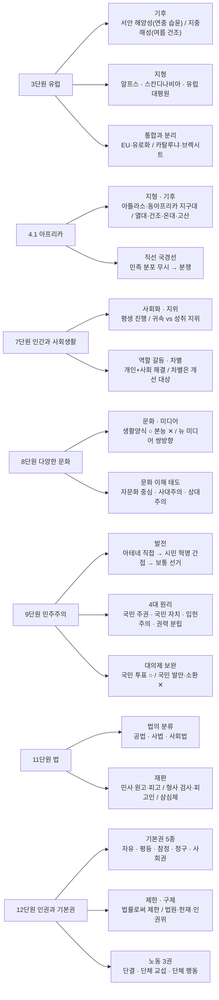
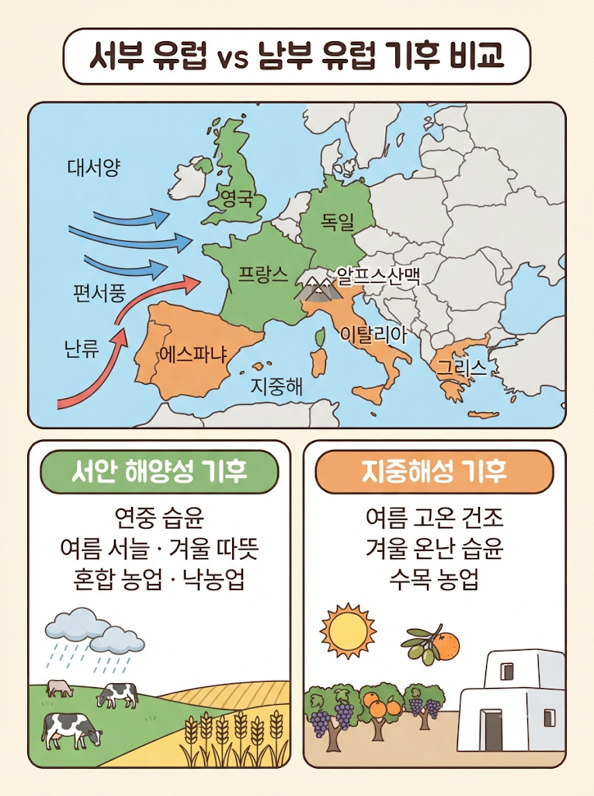
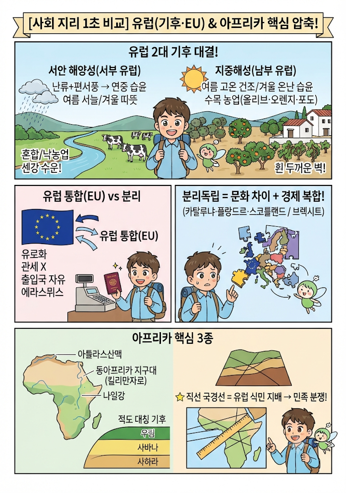
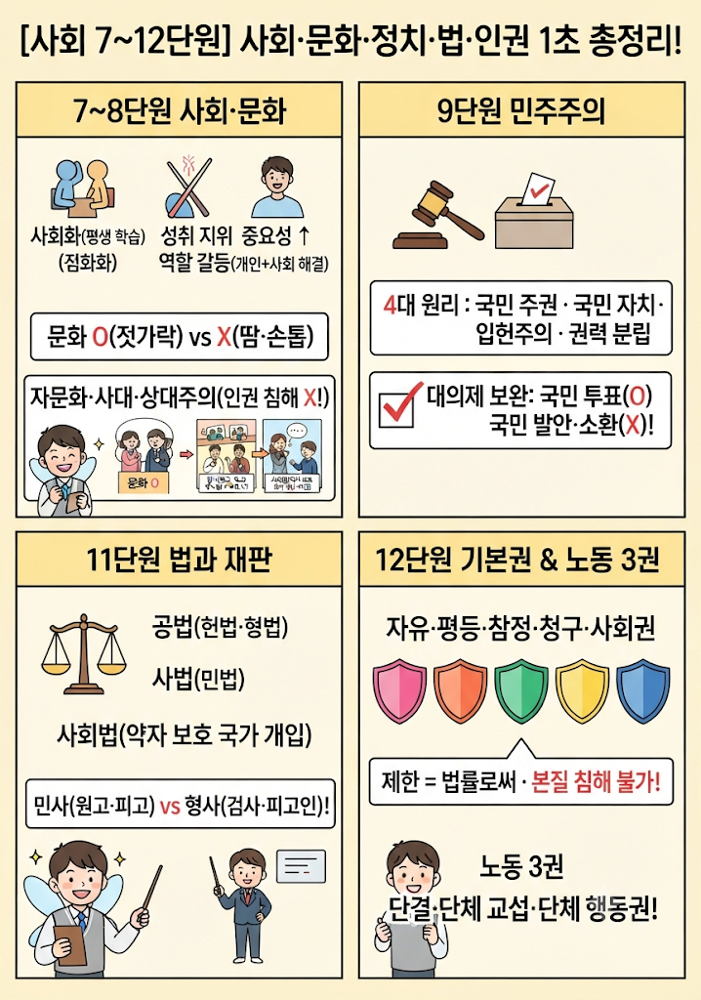
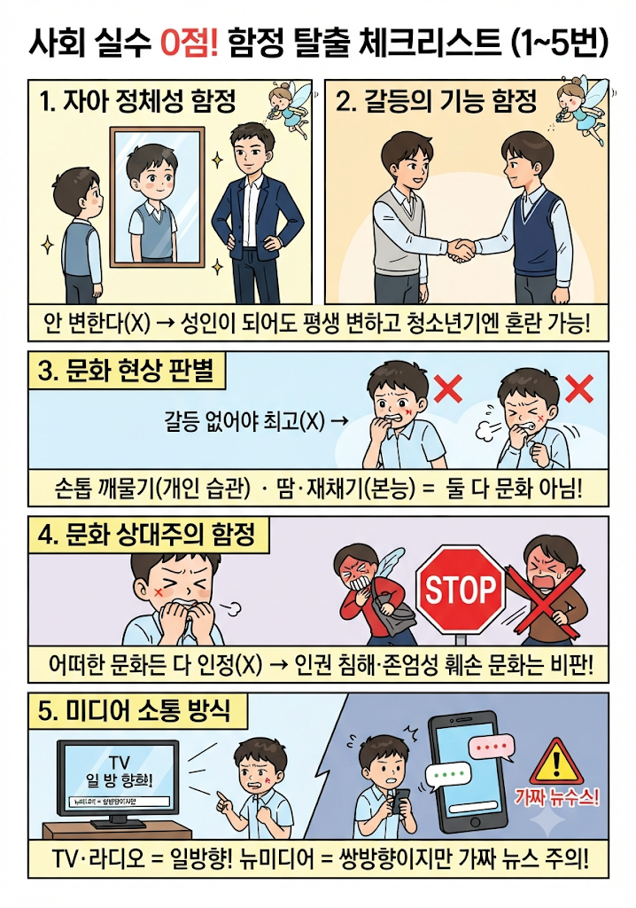
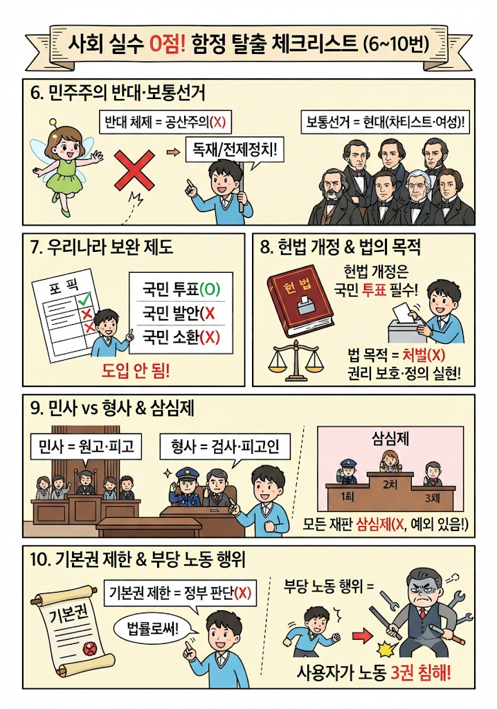

# ⚡ 시험 직전 10분 최종 치트시트 — 2026 7학년 2학기 2회고사 사회

> **시험 전날 밤 & 시험 직전 쉬는 시간용 1장 압축본**  
> **범위**: 3단원 유럽 · 4.1 아프리카 · 7단원 인간과 사회생활 · 8단원 다양한 문화 · 9단원 민주주의와 시민 · 11단원 일상생활과 법 · 12단원 인권과 기본권

---

## 🧠 마인드맵 정리

---

## 1️⃣ 지리 1초 비교표 (3단원 유럽 · 4.1 아프리카)

### [유럽] 서안 해양성 기후 vs 지중해성 기후 ⭐ 최빈출!
| 구분 | 서안 해양성 기후 (서부 유럽) | 지중해성 기후 (남부 유럽) |
| :--- | :--- | :--- |
| **대표 지역** | 영국(런던), 프랑스(파리), 독일 등 대서양 연안 | 그리스, 이탈리아, 에스파냐 등 지중해 연안 |
| **원인** | **난류**가 흐르는 바다 + 연중 **편서풍** | 여름(아열대 고압대) / 겨울(편서풍) |
| **기후 특징** | **연중 습윤(강수 고름)**, 여름 **서늘** · 겨울 **따뜻** | **여름 고온 건조** · **겨울 온난 습윤** |
| **대표 농업** | **혼합 농업**(작물+가축), 대도시 근교 **낙농업** | 여름 **수목 농업**(올리브·오렌지·포도), 겨울 **밀** |
| **생활·음식** | **수운 교통** 발달(센강), 고기파이(영국) | **밝은색·두꺼운 벽** 가옥(그리스), 피자(이탈리아) |

- **유럽 3대 지형**: 남부 높고 험준한 **알프스산맥** / 북부 상대적으로 낮은 **스칸디나비아산맥** / 중앙 넓고 평평한 **유럽 대평원**(라인강)
- **유럽 통합(EU) vs 분리**:
  - **EU(1993 출범, 27개국)**: 단일 화폐 **유로화**, **관세 없음**, 출입국 자유, **에라스뮈스** 교환학생 / 가입 희망(**튀르키예** — 이슬람교·난민 우려가 걸림돌)
  - **분리·독립**: **문화 차이 + 경제적 상황** 복합 원인! (에스파냐 **카탈루냐**, 벨기에 **플랑드르**, 영국 **스코틀랜드**) / **브렉시트(2020 영국 탈퇴)**: 분담금·이주민 갈등 → 탈퇴 후 노동력 부족·무역 위축

### [아프리카] 지형 · 기후 · 직선 국경선
- **지형**: 대부분 오래되어 안정 / 북서부 **아틀라스산맥**(판 경계, 높고 험준) / 동부 **동아프리카 지구대**(판이 갈라져 내려앉음 → **킬리만자로산[최고봉]**·케냐산·빅토리아호) / **나일강**(세계 최장, 사하라 사막 통과)
- **기후 (적도 기준 남북 대칭)**:
  - **열대 기후**(적도 주변): 연중 다우 울창한 숲(**열대 우림**) ↔ 우기·건기 뚜렷한 초원(**사바나** → 탄자니아 **사파리 관광**)
  - **건조 기후**(연 강수량 500 mm 미만, 증발량 > 강수량): 북부 **사하라 사막**(세계 최대)
  - **온대 기후**: 북부 지중해 연안·남동부 / **고산 기후**: **아비시니아고원**
- **직선 국경선**: 과거 유럽 식민 지배 시 **민족·부족 분포를 무시**하고 그음 → 오늘날 **민족·부족 분쟁**의 원인!

### 🧑‍🏫 선생님 PPT ⭐ 강조 포인트 (사회B 시험범위 PPT)
- **유럽은 우리나라보다 북쪽인데 더 온화**하다. 서부·남부 = 온대, 동부·북부 = 냉대.
- **알프스 = 신기 습곡 산맥** / **아이슬란드** = 지열 등 재생 에너지로 전력 80% 이상 / **우크라이나** = '유럽의 빵 바구니'.
- **온대** = 가장 추운 달 **-3~18℃**, 중위도, 인구 밀집 / **편서풍** = 중위도에서 일 년 내내 서쪽에서 부는 바람 / **연교차** = 가장 더운 달 − 가장 추운 달.
- 지중해성 여름이 건조한 까닭 = **아열대 고압대**. 지중해성 다른 지역 = **캘리포니아·칠레 중부·오스트레일리아 남서부**. 서안 해양성 다른 지역 = **뉴질랜드·오스트레일리아 남동부·북아메리카 북서 해안·칠레 남부**.
- 서울과 비교한 기후 그래프: 둘 다 **연교차 작고 겨울이 따뜻**하다. **여름 비가 매우 적으면 지중해성**, **7월이 서늘하고 비가 고르면 서안 해양성**.
- 친환경 도시: **암스테르담 = 경기장 지붕 태양광** / **프라이부르크 = 트램·자전거** / **말뫼 = 환경친화 지구·터닝 토르소** / **코펜하겐 = 광역 자전거 고속 도로** / 빌바오 = 구겐하임 미술관.
- 정의 상자: **산업 클러스터**(기업·연구소·대학·정부 기관이 모여 협력) / **도시 재생**(쇠퇴한 곳에 활력) / **재생 에너지**(고갈되지 않는 에너지).
- EU: **유로화는 20개국**(27개국 전부 아님) / **스트라스부르** = EU 의회·유럽 인권 재판소 / 분담금은 **경제 규모에 비례**.
- 아프리카 정의: **고원**(높고 평탄, 아디스아바바) / **판의 경계**(지진·화산 잦음) / **지구대**(갈라져 내려앉음).
- 아프리카 기후 그래프: **카이로 = 건조 / 아디스아바바 = 열대 고산 / 라고스 = 열대 우림 / 케이프타운 = 온대**.
- **열대 = 커피·카카오·사탕수수 플랜테이션**(곡물이 줄어 식량 부족 → 공정 무역) / **건조 = 지하수가 드러난 곳에서 오아시스 농업**. 수단 집 = 지붕 평평·창문 작고 벽 두꺼움·흙집.

---

## 2️⃣ 사회·문화·정치 1초 비교표 (7~9단원)

### [7단원] 사회화 · 지위 · 역할 갈등 · 갈등과 차별
- **사회화**: 사회의 언어·규범·가치관·행동 양식을 배우는 과정 (**유전 X, 평생 진행, 사회마다 다름**).
- **자아 정체성**: 자신의 고유성 인식. **성인이 되어도 변함!** 청소년기엔 혼란 가능. **쿨리의 거울 자아**(타인의 반응 통해 형성).
- **지위**: 한 사람이 **여러 개** 보유. **귀속 지위**(타고남: 아들·여성·노인) vs **성취 지위**(노력·선택: 학급회장·교사·부모 → **현대 사회에서 중요성 증가!**).
- **역할 갈등**: 여러 지위의 역할이 동시 충돌 → **개인적 차원**(우선순위 결정) + **사회적 차원**(가족 돌봄 휴가, 학생 선수 온라인 학습 지원) 모두 필요!
- **갈등 vs 차별**: 갈등은 자연스러운 현상(원만한 해결 → **사회 통합·발전**) / **차별**은 편견으로 부당 대우하는 것(**적극 개선 대상!**).

### [8단원] 문화 · 미디어 · 문화 이해 태도 3종 ⭐ 최빈출!
- **문화 O vs X**: 사회 구성원 공유 생활양식(젓가락, 인사) = **O** / 생리적 본능(땀·재채기·피로)·개인 버릇(손톱 깨물기) = **X**!
- **보편성 vs 특수성**: 모든 사회에 공통 존재(**보편성**: 결혼·인사·점심) vs 환경·역사별 세부 모습 다름(**특수성**: 프랑스 볼 키스·한국 급식 vs 캐나다 도시락).
- **미디어**: **인쇄·영상 매체(TV·라디오)** = 일방향 / **뉴 미디어(SNS·인터넷)** = 실시간 **쌍방향** 소통(단, 가짜 뉴스 주의 → **미디어 리터러시** 필수!).

| 태도 | 핵심 관점 | 장점 | 단점 / 한계 | 대표 사례 |
| :--- | :--- | :--- | :--- | :--- |
| **자문화 중심주의** | 내 문화 **우월** / 남 **열등** | 공동체 결속력 강화 | 자기 문화 강요 → **문화 갈등** | 자기 나라 피자만 진짜라 주장 |
| **문화 사대주의** | 남 문화 **우월** / 내 문화 **열등** | **외래 문물 적극 수용** | 자기 문화 **정체성·독창성 상실** | 조선의 명나라 숭배, 영문 표기 맹신 |
| **문화 상대주의** | 우열 X, **그 사회 입장** 이해 | 깊은 이해·문화 공존 | **인권 침해 문화까지 정당화 불가!** | 백화점 무슬림 기도실, 곤충 식용 |

### [9단원] 민주주의 발전 · 4대 원리 · 대의제 보완
- **정치**: 갈등·이해관계 조정 및 문제 해결 (**학급·주민 회의도 정치!** 원만한 정치 → **사회 통합**).
- **민주주의 의미**: ① **정치 형태**(주권 = 국민, 반대 체제는 **독재/전제 정치**) + ② **일상 생활양식**(대화·토론·타협·소수 존중).
- **발전 과정**: **고대 아테네**(민회, **직접** 민주주의) → **근대 시민 혁명**(영국 권리장전·미국 보스턴 차 사건·프랑스 혁명, **간접** 민주주의 시작, 재산 있는 성인 남성 한정) → **현대**(노동자 **차티스트 운동**·**여성 참정권 운동** → **보통 선거** 확립!).
- **이념**: **인간의 존엄성**(최고 가치) + **자유** + **평등**.
- **4대 기본 원리**: **국민 주권**(주권은 국민에게) · **국민 자치**(스스로 다스림) · **입헌주의**(헌법에 따른 통치) · **권력 분립**(입법·행정·사법 견제와 균형).
- **현대 민주주의**: **간접 민주주의(대의제)** 기본 + 직접 민주주의 요소 보완(**국민 투표** [우리나라 O], **국민 발안** [X], **국민 소환** [X]), **전자 민주주의**, **민주적 공론장**(하버마스).

---

## 3️⃣ 법과 인권 1초 비교표 (11~12단원)

### [11단원] 법의 특징 · 분류 · 재판
- **법의 특징**: **강제성**(위반 시 국가의 공식 제재) + **구체성·명확성**. 궁극적 목적 = **정의 실현**(각자의 정당한 몫, 권리 보호·분쟁 해결·다툼 예방).
- **법의 분류 (공법 · 사법 · 사회법)**:

| 분류 | 대표 법 | 규율 대상 및 핵심 내용 |
| :--- | :--- | :--- |
| **공법** *(국가↔개인)* | **헌법** / **형법** | **헌법**: 최고법, 기본권·국가기관 구성(개정 시 **국민 투표** 필수!) **형법**: 범죄와 형벌 규정(공공질서 유지 + 처벌 범위 제한) |
| **사법** *(개인↔개인)* | **민법** | **재산 관계**(계약·손해배상) + **가족 관계**(혼인·이혼·상속) |
| **사회법** *(국가 개입)* | **노동법 · 경제법 · 사회 보장법** | 자본주의 사회문제 해결·**사회적 약자 보호** 위해 사적 영역에 **국가 적극 개입** (`근로기준법`, `공정거래법`, `국민기초생활보장법` 등) |

- **민사 재판 vs 형사 재판**:
  - **민사 재판**(개인 분쟁): **원고**(소장 제출) vs **피고**(답변서) + 소송 대리인(변호사) *(검사 X!)*
  - **형사 재판**(범죄 처벌): **검사**(기소) vs **피고인** + **변호인**(국선 변호인 가능)
- **공정한 재판 요건**: **사법권의 독립**(법관 신분 보장) · **공개 재판주의** · **증거 재판주의** · **심급 제도**(기본 **삼심제**: 1심→**항소**→2심→**상고**→3심 대법원 / ※ 예외 있어 "모든 재판 삼심제"는 X!) · **국민 참여 재판**(형사 재판 배심원).

### [12단원] 기본권 5종 · 제한 · 구제 기관 · 노동 3권 ⭐ 최빈출!
- **인권 침해 주체**: 개인, 단체, **국가기관** 모두 가능! (물리적·정신적 침해 모두 포함).

| 기본권 5종 | 핵심 개념 | 대표 사례 |
| :--- | :--- | :--- |
| **① 자유권** | 국가의 간섭을 받지 않을 권리 | 신체의 자유, 표현의 자유, 직업 선택의 자유 |
| **② 평등권** | 불합리한 차별을 받지 않을 권리 | 성별·종교·사회적 신분 차별 금지 (헌법 제11조) |
| **③ 참정권** | 국가 의사 결정에 참여할 권리 | **선거권**, **공무 담임권**, 국민 투표권 |
| **④ 청구권** | 국가에 일정 행위를 요구할 권리 | **재판 청구권**, **청원권**, **국가 배상 청구권** |
| **⑤ 사회권** | 인간다운 생활 보장을 국가에 요구 | **교육을 받을 권리**, **근로의 권리**, **사회 보장권** |

- **기본권 제한 (헌법 제37조 2항)**: ① 목적(**국가 안전 보장 · 질서 유지 · 공공복리**) ② 수단(**법률로써** — 정부 판단 X!) ③ 한계(**본질적 내용 침해 불가!**).
- **기본권 침해 구제 기관 4종**: **법원**(재판) · **헌법재판소**(헌법 소원 심판 → 공권력 취소/법령 효력 상실) · **국가 인권 위원회**(진정·직권 조사 → **개선 권고**) · **국민 권익 위원회**(고충 민원 처리, 저비용·간단).
- **노동 3권 (헌법 제33조)**: **단결권**(노조 결성) · **단체 교섭권**(사용자와 협상) · **단체 행동권**(파업 등 쟁의 행위).
  - **부당 해고**(정당한 이유·30일 전 서면 통보 없음) / **부당 노동 행위**(**사용자**가 노동 3권 침해) → **노동 위원회**(3개월 내 구제 신청) 또는 **법원** 구제!

---

## 4️⃣ ⚠️ 작년 KIS 기출 기반 「실수 0점」 함정 탈출 10선

1. **[사회화 & 정체성]** 자아 정체성은 한 번 형성되면 안 변한다? → **X!** 평생 변하며, 청소년기엔 명확하지 않을 수 있다!
2. **[갈등의 기능]** 사회적 갈등은 아예 발생하지 않는 것이 가장 바람직하다? → **X!** 원만히 해결하면 **사회 통합과 발전**의 계기가 된다!
3. **[문화 현상 판별]** "긴장하면 손톱 깨물기"(개인 습관) · "땀/재채기"(자연 본능) → **둘 다 문화가 아니다!**
4. **[문화 상대주의 함정]** "어떠한 문화든지 문화 상대주의로 이해해야 한다"? → **X!** **인권 침해·인간 존엄성 훼손 문화**는 비판해야 한다!
5. **[미디어 소통 방식]** TV·라디오는 쌍방향, 뉴미디어는 진실성을 높인다? → **둘 다 X!** TV·라디오·인쇄매체는 **일방향**, 뉴미디어는 쌍방향이지만 **가짜 뉴스 위험**이 커진다!
6. **[민주주의 반대·발전]** 민주주의 반대 체제는 공산주의? → **X!(독재/전제정치)** / 근대 시민 혁명으로 보통 선거가 확립됐다? → **X!** 노동자(차티스트)·여성 참정권 운동 이후 현대에 확립!
7. **[우리나라 제도 함정]** 우리나라에 **국민 소환 제도**가 도입되어 있다? → **X!** (국민 투표만 O, 국민 발안·국민 소환은 X!)
8. **[헌법 개정 & 법의 목적]** 헌법은 국회 의결만으로 개정된다? → **X!(국민 투표 필수)** / 법은 국민을 처벌·규제하기 위해 존재한다? → **X!(권리 보호·정의 실현)**
9. **[민사 vs 형사 & 삼심제]** 민사 재판의 상대방은 '피고인'이다? → **X!(민사=원고·피고 / 형사=검사·피고인)** / 모든 재판은 삼심제다? → **X!(기본적으로 삼심제, 예외 존재)**
10. **[기본권 제한 & 부당 노동 행위]** 기본권 제한은 '정부의 판단'에 따른다? → **X!(반드시 '법률'로써!)** / 부당 노동 행위는 '노동자'의 불법 행위다? → **X!('사용자'가 노동 3권을 침해하는 행위!)**

