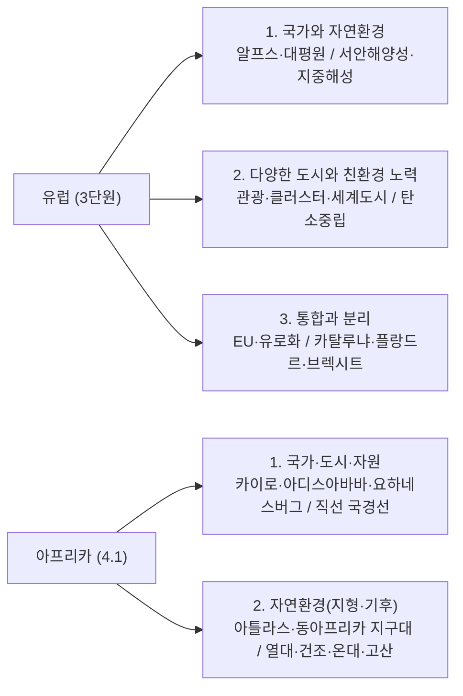
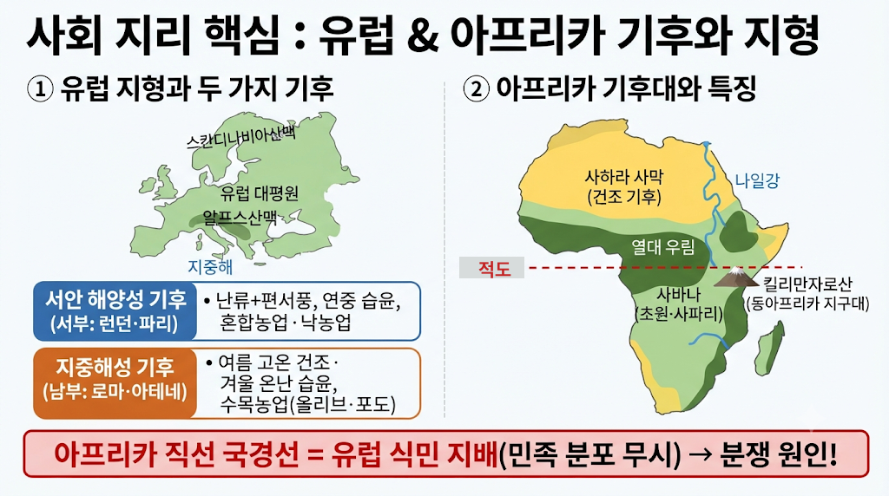
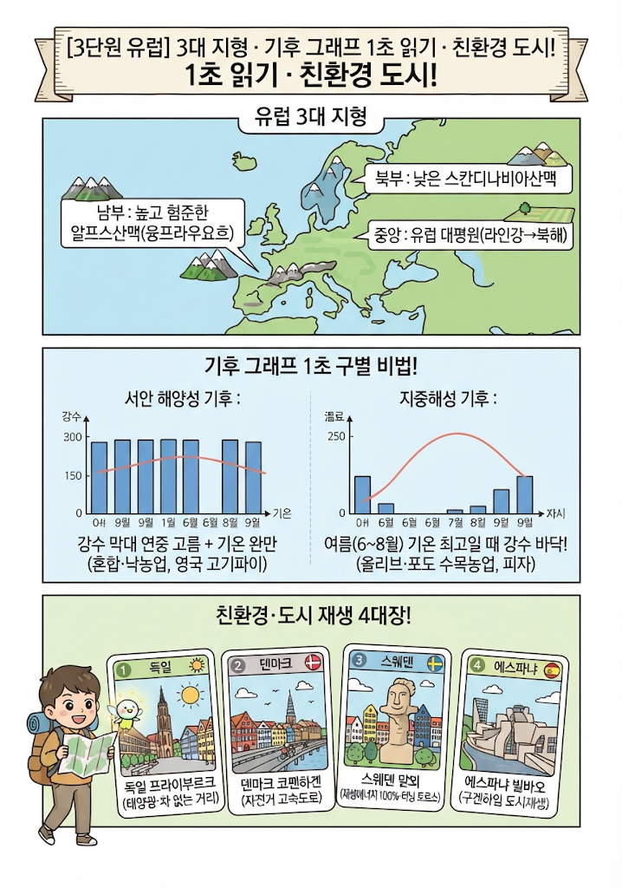
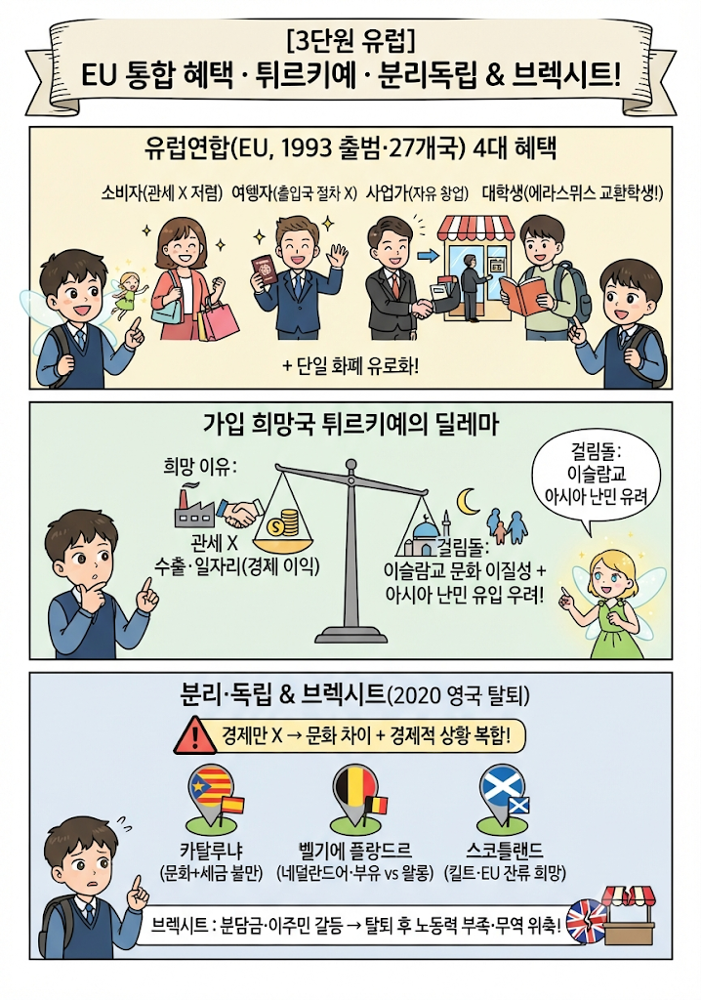
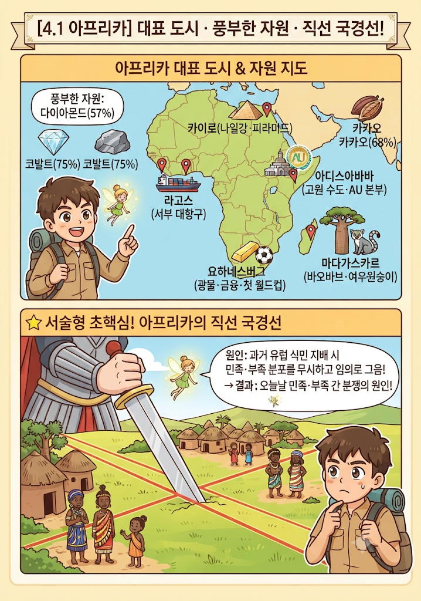
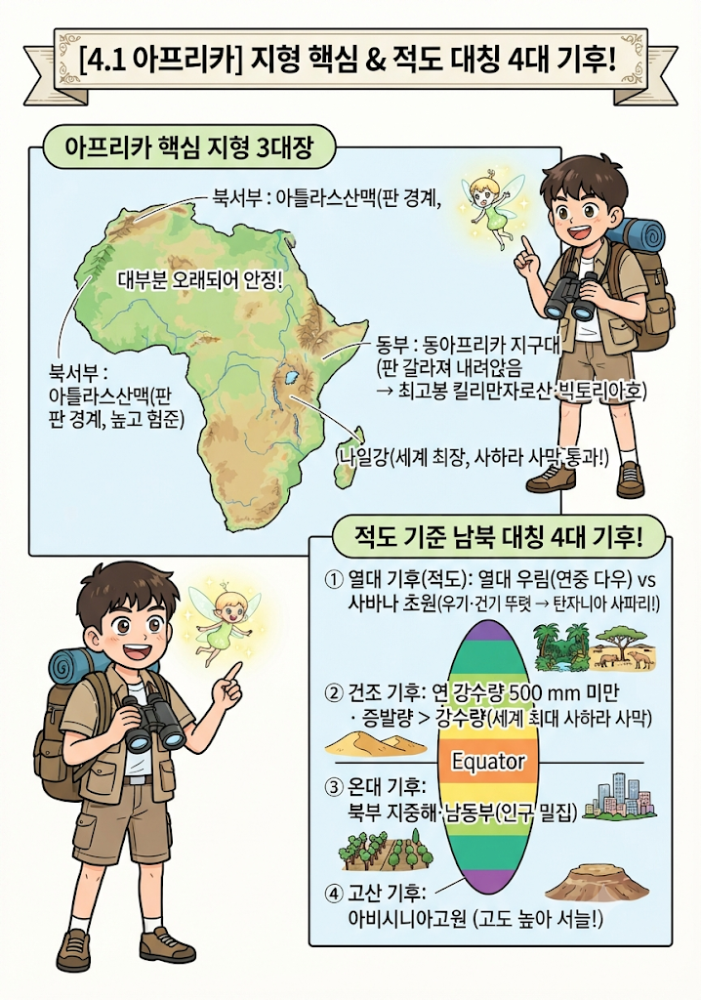

# 🌍 [지리] 3단원 유럽 · 4.1 아프리카 — 시험 완벽 정리

> **교과서 범위**: 3단원 유럽 (p.52 ~ 69) · 4.1 아프리카의 여러 국가와 자연환경 (p.70 ~ 75)  
> **학습 목표**: 유럽의 자연환경·도시 다양성·지속가능한 도시·EU 통합과 분리 움직임 이해하기 / 아프리카의 국가·도시·직선 국경선·지형·기후 특징 파악하기

---

## 🎯 한눈에 보는 지리 단원 지도

---

---

## 01. 유럽의 여러 국가와 자연환경 (교과서 p.52~57)

> 🎬 **개념 몽타주 영상 (2분 34초)** — 위치 · 나라와 도시 · 지형 · 서안 해양성 vs 지중해성 기후를 한 번에 정리해요.

<video controls preload="metadata" playsinline poster="exam/%EC%82%AC%ED%9A%8C_%EC%8B%9C%ED%97%98%EA%B3%B5%EB%B6%80/videos/soc_01_europe_nature_poster.jpg" src="exam/%EC%82%AC%ED%9A%8C_%EC%8B%9C%ED%97%98%EA%B3%B5%EB%B6%80/videos/soc_01_europe_nature.mp4" style="width:100%;max-width:960px;border-radius:12px;display:block;margin:0 auto 1em;background:#000"></video>

### 1) 유럽의 위치, 국가, 대표 도시와 랜드마크
- **위치**: 유라시아 대륙의 서부. 북쪽 **북극해**, 서쪽 **대서양**, 남쪽 **지중해**, 동쪽 **우랄산맥**(아시아와의 경계).
- **위도와 기후대**: 대부분 북반구 **중위도와 고위도**에 위치 → **온대 기후**와 **냉대 기후**가 널리 나타남.
- **다양한 언어**: 영어(영국), 프랑스어(프랑스), 독일어(독일), 에스파냐어(에스파냐), 이탈리아어(이탈리아), 네덜란드어(네덜란드) 등 국가별 언어 다양.

| 국가 | 대표 도시 | 핵심 특징 및 랜드마크 (교과서 p.52~55) |
| :--- | :--- | :--- |
| **아이슬란드** | **레이캬비크** | 북극해 연안 화산섬, **지열** 전기 난방 친환경 도시, **할그림스키르캬 교회**(화산 지형 본뜸) |
| **영국** | **런던** | 유럽 서부 섬 국가, **세계 경제·금융의 중심지**(세계 도시) |
| **프랑스** | **파리** | 세계 경제·패션·문화 중심지, **에펠 탑**(약 320 m)·루브르 박물관, 센강 수운 |
| **에스파냐** | **바르셀로나** | 지중해 항구 도시, 예술 발달, 가우디 설계 **사그라다 파밀리아 성당** |
| **이탈리아** | **로마** | **장화 모양** 국토, 고대 역사 유적(콜로세움), 패션·고급 의류 산업 발달 |
| **그리스** | **아테네** | 다양한 고대 역사 유적이 분포하는 관광 도시 |
| **스위스 · 벨기에** | **제네바 · 브뤼셀** | **국제기구 본부**가 밀집한 도시 |
| **오스트리아** | **빈** | 예술(음악·미술)이 발달한 도시 |
| **우크라이나** | — | 넓은 농경지(**『유럽의 빵 바구니』**), 옥수수·밀 세계 최상위권 수출국 |
| **노르웨이** | — | 스칸디나비아반도 위치, 독특한 자연환경(피오르·오로라 등) 관광 자원 |

### 2) 유럽의 지형 (교과서 p.55~56)
- **남부 — 알프스산맥**: 해발 고도가 **높고 험준한** 산맥. *(스위스 산악 열차, 유럽 최고 고도 기차역 **융프라우요흐역**)*
- **북부 — 스칸디나비아산맥**: 알프스산맥에 비해 **상대적으로 해발 고도가 낮음**.
- **중앙 — 유럽 대평원 & 라인강**: 알프스산맥 북쪽에 넓고 평평한 평원 펼쳐짐. **라인강**은 알프스산맥에서 발원해 여러 국가를 거쳐 **북해**로 유입.
- **남부 3대 반도**: 서쪽부터 **이베리아반도**(에스파냐·포르투갈) — **이탈리아반도** — **발칸반도**(그리스 등).

### 3) 유럽의 기후와 주민 생활 ⭐ 시험 최빈출! (교과서 p.56~57)

| 구분 | 서안 해양성 기후 | 지중해성 기후 |
| :--- | :--- | :--- |
| **분포 지역** | 대서양 연안의 **서부 유럽** *(영국·프랑스 파리 등)* | 지중해 연안의 **남부 유럽** *(그리스·이탈리아·에스파냐)* |
| **형성 원인** | **난류**(따뜻한 바닷물)가 흐르는 바다에서 불어오는 **편서풍**(위도 30°~60° 서→동 바람) 영향 | 지중해 연안 중위도 서안 특유의 계절별 기압대 이동 |
| **기온 특징** | 우리나라에 비해 **여름 서늘 · 겨울 따뜻** (연교차 작음) | **여름 고온** · **겨울 온난** |
| **강수 특징** | **일 년 내내 습윤** (연중 강수량이 고른 편) | **여름 건조** · **겨울 습윤** *(※ 여름에 비가 적다!)* |
| **대표 농업** | • **혼합 농업**: 밀 등 식량·사료 작물 재배 + 소·돼지 가축 사육 함께 • **낙농업**: 대도시 근교·교통 편리 지역 중심 젖소 사육(우유·유제품) | • **수목 농업**(여름): 가뭄에 잘 견디는 **올리브나무, 오렌지나무, 포도나무** 재배 • **곡물 재배**(겨울): 온난·습윤한 겨울에 **밀** 재배 |
| **교통·가옥** | 연중 강수가 고르고 하천 유량이 안정적 → **수운 교통 발달** (프랑스 센강, 라인강) | 그리스 전통 가옥: **벽을 밝은색(흰색)**으로 칠해 뜨거운 햇볕 반사 + **두꺼운 벽**으로 열기 차단 |
| **전통 음식** | 영국 **고기파이**(밀가루+고기) / *(참고: 스위스 알프스 **퐁뒤** — 추운 겨울 굳은 빵을 녹인 치즈에 찍어 먹음)* | 이탈리아 **피자**(일조량 풍부 → 토마토소스·올리브 활용) |

> ⚠️ **실수 방지 체크 — 지중해성 기후 그래프 읽기!**  
> 기후 그래프에서 **기온 곡선이 가장 높은 여름(6~8월)에 강수량 막대가 바닥(아주 낮음)**이면 **100% 지중해성 기후**! 반대로 **강수량 막대가 1~12월 내내 고르게** 나타나고 기온 변화가 완만하면 **서안 해양성 기후**이다.

---

## 02. 도시의 다양성과 지속가능한 도시를 위한 노력 (교과서 p.58~61)

> 🎬 **개념 몽타주 영상 (2분 19초)** — 도시 유형 5가지 · 친환경 도시 4가지 전략 · 대표 친환경 도시를 한 번에 정리해요.

<video controls preload="metadata" playsinline poster="exam/%EC%82%AC%ED%9A%8C_%EC%8B%9C%ED%97%98%EA%B3%B5%EB%B6%80/videos/soc_02_europe_cities_poster.jpg" src="exam/%EC%82%AC%ED%9A%8C_%EC%8B%9C%ED%97%98%EA%B3%B5%EB%B6%80/videos/soc_02_europe_cities.mp4" style="width:100%;max-width:960px;border-radius:12px;display:block;margin:0 auto 1em;background:#000"></video>

### 1) 유럽의 다양한 유형의 도시 (교과서 p.58~59)

| 도시 유형 | 특징 | 교과서 대표 도시 사례 |
| :--- | :--- | :--- |
| **휴양 도시** | 특색 있는 자연환경(따뜻한 해변·여름 맑은 날씨·산지) | 프랑스 **니스**(지중해 해변), 크로아티아 **두브로브니크**, 스위스 알프스 산지 |
| **문화·역사 도시** | 긴 역사와 문화유산, 축제, 예술 발달 | 이탈리아 **로마**(콜로세움)·**피렌체**(우피치 미술관), 그리스 **아테네**, 체코 **프라하**(유네스코 세계유산), 에스파냐 **부뇰**(토마토 축제) |
| **산업 구조 변화 도시** | 과거 전통 **제조업 쇠퇴** → 오늘날 **서비스업·문화·금융** 도시로 변모 | 독일 **에센**, 에스파냐 **빌바오**(구겐하임 미술관 → 문화 도시), 영국 **맨체스터**(18세기 산업 혁명 면직 공업 → 상업·금융 도시) |
| **첨단 산업 도시 (산업 클러스터)** | 관련 **기업·연구소·대학·정부 기관**이 가까이 모여 긴밀히 협력 | 프랑스 **소피아 앙티폴리스**, 핀란드 **오울루 테크노폴리스**, 스웨덴 **시스타 사이언스 시티**(정보 통신 기술) |
| **세계 도시** | 기업 본사, 금융 기관, 국제기구 본부, 문화·예술 집중 | 영국 **런던**, 프랑스 **파리** |

### 2) 지속가능한 친환경 도시를 만들기 위한 노력 (교과서 p.60~61)
- **등장 배경**: 제조업 쇠퇴로 노후한 공장·산업 시설 문제 + 스모그·산성비 등 환경 오염 + 폭염·홍수 등 기후위기 심화.
- **핵심 전략**:
  1. **도시 재생 사업**: 낡은 공업·산업 시설을 문화·주거 공간으로 재정비 (예: 에스파냐 **빌바오** 구겐하임 미술관).
  2. **탄소 중립**: 배출한 이산화 탄소만큼 다시 흡수해 실질 배출량을 **'0'**으로 만듦.
  3. **재생 에너지**: 고갈되지 않는 **태양광 발전, 풍력 발전** 확대.
  4. **녹지 확충 & 자전거 이용 장려**: 자동차 대신 친환경 교통수단 활성화.

| 대표 친환경 도시 | 교과서 핵심 실천 사례 |
| :--- | :--- |
| **독일 프라이부르크** | **자동차 진입이 금지된 거리**에서 **트램과 자전거**가 오감, 높은 녹지 비율 |
| **덴마크 코펜하겐** | 차도·인도와 완전히 분리된 안전한 **자전거 전용 도로**, 주변 소도시 연결 **광역 자전거 고속 도로** 운영 |
| **스웨덴 말뫼** | 1986년 조선소 폐쇄 위기 → 대학 설립·첨단 산업 육성·**재생 에너지** 100% 친환경 지구 조성(**터닝 토르소** 랜드마크) |
| **네덜란드 암스테르담** | ⭐ 축구 경기장 지붕에 **태양광 패널** 설치 (교과서 p.59 사진), 자전거 전용 도로 확충으로 자전거 출퇴근 장려 |

---

## 03. 유럽의 통합과 분리 움직임 (교과서 p.62~65)

> 🎬 **개념 몽타주 영상 (2분 21초)** — EU 출범과 혜택 · 튀르키예의 딜레마 · 분리·독립 움직임 · 브렉시트를 한 번에 정리해요.

<video controls preload="metadata" playsinline poster="exam/%EC%82%AC%ED%9A%8C_%EC%8B%9C%ED%97%98%EA%B3%B5%EB%B6%80/videos/soc_03_eu_integration_poster.jpg" src="exam/%EC%82%AC%ED%9A%8C_%EC%8B%9C%ED%97%98%EA%B3%B5%EB%B6%80/videos/soc_03_eu_integration.mp4" style="width:100%;max-width:960px;border-radius:12px;display:block;margin:0 auto 1em;background:#000"></video>

### 1) 유럽의 통합 — 유럽연합(EU)
- **출범과 확장**: **1993년** 12개국 출범 → 2023년 기준 **27개국** *(2020년 영국 탈퇴)*.
- **기구 및 화폐**: **유럽 의회**, **유럽연합 집행 위원회** 구성 + 많은 회원국이 단일 화폐 **유로화** 사용 → **정치·경제적 통합** 추구.
- **EU 가입이 주민 생활에 미치는 영향 (교과서 p.63)**:
  - **소비자**: 이웃 국가 물건을 **관세 없이** 수입 → 저렴한 가격에 다양한 물건 구입.
  - **여행자**: 회원국 간 **출입국 절차 없음** → 국경을 넘어 자유롭게 이동·여행.
  - **사업가**: 이웃 국가에 회사를 세우고 자유로운 사업 활동 가능.
  - **대학생**: **에라스뮈스(Erasmus) 프로그램**(EU 대학 간 교환 학생)으로 학문 교류·견문 확대.
- **EU 가입 희망국 — 튀르키예의 딜레마 (교과서 p.63)**:
  - **현황**: 국토의 약 97%는 아시아, 약 3%는 유럽에 속하지만 인구의 12% 이상이 유럽 영토에 거주.
  - **가입 희망 이유**: 관세 없는 수출, 일자리 찾아 자유로운 이동 등 **경제적 이익**.
  - **걸림돌(우려)**: 유럽 대부분이 크리스트교인 반면 튀르키예는 **이슬람교(문화 이질성)** + 아시아와 유럽의 징검다리 위치로 **아시아 난민의 유럽 대거 유입 우려**.

### 2) 유럽 내 분리·독립 움직임과 브렉시트 ⭐ 시험 단골! (교과서 p.64~65)
> ⚠️ **잠깐 퀴즈 함정**: *"유럽의 분리·독립 움직임은 경제적 상황으로만 발생한다?"* → **틀림(X)!** **문화(언어·민족·역사)의 차이**와 **경제적 상황**이 복합적으로 작용한다!

| 지역 (소속국) | 분리·독립 요구의 핵심 배경 |
| :--- | :--- |
| **에스파냐 카탈루냐** | 중앙 정부(카스티야)와 **문화 차이**·역사적 탄압 + **경제적 부유**(세금은 많이 내지만 정부 혜택은 적다는 불만) |
| **벨기에 플랑드르** | **플랑드르**(네덜란드어, 경제 수준 **높음**) vs **왈롱**(프랑스어, 경제 수준 **낮음**) → **언어와 경제 수준 차이** |
| **영국 스코틀랜드** | 잉글랜드와 **민족·문화 차이**(남성 체크무늬 치마 전통 의상 **킬트**) + EU 탈퇴(브렉시트)에 반대표가 많아 독립 요구 격화 |
| *(지도 참고)* | 에스파냐 **바스크**, 이탈리아 **파다니아**, 영국 **북아일랜드** |

- **브렉시트(Brexit = Britain + Exit)**:
  - **경과**: 2016년 6월 국민 투표 결정 → **2020년 1월 영국 EU 탈퇴**.
  - **원인**: ① 독일에 이어 두 번째로 많은 **EU 분담금** 부담, ② **이주민 대거 유입**에 따른 문화 갈등 및 노동 시장 경쟁 심화.
  - **탈퇴 이후 영향**: 외국인 노동자가 빠져나가 **노동력 부족** 발생, 유럽 국가들과의 **자유로운 무역 어려움**.

---

## 04. 아프리카의 여러 국가와 자연환경 (교과서 p.70~75)

> 🎬 **개념 몽타주 영상 (2분 39초)** — 위치 · 자원 · 주요 도시 · 직선 국경선 · 지형 · 적도 기준 기후를 한 번에 정리해요.

<video controls preload="metadata" playsinline poster="exam/%EC%82%AC%ED%9A%8C_%EC%8B%9C%ED%97%98%EA%B3%B5%EB%B6%80/videos/soc_04_africa_nature_poster.jpg" src="exam/%EC%82%AC%ED%9A%8C_%EC%8B%9C%ED%97%98%EA%B3%B5%EB%B6%80/videos/soc_04_africa_nature.mp4" style="width:100%;max-width:960px;border-radius:12px;display:block;margin:0 auto 1em;background:#000"></video>

### 1) 아프리카의 위치, 주요 국가·도시, 풍부한 자원
- **위치**: 북쪽 지중해 건너 유럽, 서쪽 대서양, 동쪽 인도양, 북동쪽 **홍해** 건너 아라비아반도, 남동쪽 **마다가스카르섬**. **적도**를 기준으로 북반구와 남반구에 걸쳐 있음.
- **풍부한 자원**: 지하자원(**다이아몬드** 전 세계 약 57%, **코발트** 약 75%, 금, 구리) + 농산물(**카카오** 전 세계 약 68%, 커피).

| 지역 / 국가 | 대표 도시 | 핵심 특징 (교과서 p.70~73) |
| :--- | :--- | :--- |
| **북부 이집트** | **카이로** | **나일강 하구** 넓은 평야 발달, 고대 이집트 문명 유적(**피라미드·스핑크스**, 기자 지구) |
| **북서부 모로코·튀니지** | 카사블랑카·튀니스 | 온화한 **지중해성 기후**로 인구 밀집, 모로코 **아틀라스산맥** 겨울 눈(스키장) |
| **서부 나이지리아·세네갈** | **라고스**(나이지리아) | 수출입에 유리한 **항구 도시**, 아프리카에서 인구가 가장 많은 도시 중 하나 / 세네갈 대서양 무역 |
| **동부 에티오피아** | **아디스아바바** | **고원**에 발달한 수도, 아프리카 항공 교통 중심지, **아프리카 연합(AU) 본부** 위치 |
| **동부 케냐·탄자니아** | 다르에스살람 등 | 초원 지대 국립 공원 → 야생 동물 **사파리 관광** 유명 |
| **남부 남아프리카 공화국** | **요하네스버그** | **아프리카 최초 월드컵 개최국**, 풍부한 **광물 자원**(광산 개발로 성장) → 금융 중심지 |
| **남동부 마다가스카르** | — | 섬 국가, **여우원숭이 · 바오바브나무** 등 독특한 동식물 서식지 |

### 2) 아프리카의 직선 국경선 ⭐ 서술형·객관식 초핵심! (교과서 p.71~72)
- **특징**: 아프리카 지도에는 자로 그은 듯한 **직선 모양의 국경선**이 매우 많다.
- **원인**: 과거 아프리카를 식민 지배했던 **유럽 열강이 아프리카 지역의 민족·부족 분포를 고려하지 않고 임의로 국경선을 그었기 때문**이다.
- **결과(문제점)**: 같은 민족이 갈라지거나 서로 다른 부족이 한 나라에 묶이게 되어 오늘날 아프리카 여러 지역에서 **민족·부족 간 분쟁**이 발생하는 원인이 되고 있다.

### 3) 아프리카의 지형 (교과서 p.74)
- **전반적 특징**: 대부분의 땅은 아주 오래전에 형성되어 **비교적 안정**함.
- **북서부 — 아틀라스산맥**: **판의 경계**와 가까워 높고 험준함.
- **동부 — 동아프리카 지구대**: 양쪽에서 잡아당기는 힘으로 **판이 갈라지고 그 사이가 내려앉은 지형**.
  - 지구대를 따라 **킬리만자로산**(해발 약 5,895 m, 아프리카 최고봉), **케냐산** 등 높은 화산 발달.
  - **빅토리아호**(아프리카에서 가장 넓은 호수), **탕가니카호** 등 거대한 호수 발달.
- **주요 하천**: 강수량이 풍부한 **열대 기후 지역**에서 시작해 바다로 흐름 (**나일강**[사하라 사막 통과, 세계 최장 하천, 고대 문명], 나이저강, 콩고강, 잠베지강). 반면 강수량이 극히 적은 **사하라 사막 일대는 하천 발달 미약**.

### 4) 아프리카의 기후 분포 (교과서 p.75)

| 기후대 | 분포 지역 | 핵심 특징 및 주민 생활 |
| :--- | :--- | :--- |
| **열대 기후** | **적도 주변** | ① **열대 우림 지역**: 연중 비가 많이 내려 울창한 숲 형성 ② **초원(사바나) 지역**: **우기와 건기가 뚜렷**, 넓은 초원에 나무가 드문드문(탄자니아 다르에스살람) → 야생 동물 서식, **사파리 관광** |
| **건조 기후** | **북부 아프리카** 등 | 연 강수량 **500 mm 미만**, **증발량 > 강수량** → 세계 최대 사막 **사하라 사막** 발달(낙타 이동) |
| **온대 기후** | **북부 지중해 연안**, **남동부** | 온화한 기후 → 모로코·튀니지·남아공 등에 인구 밀집 및 도시 발달 |
| **고산 기후** | **아비시니아고원** 등 동부 산지 | 적도 인근이지만 **해발 고도가 높아** 서늘한 고산 기후가 부분적으로 나타남 |

---

## 🧑‍🏫 선생님 수업 PPT 핵심 (사회B)

> 출처: `사회자료/사회B 시험범위 PPT(학생공유용).pdf` (94쪽). 서브노트에 없거나 짧게만 다룬 내용을 모았습니다. ⭐ = 선생님이 정의 상자·빨간 글씨·정답 표시·활동으로 강조한 곳.

### 유럽의 위치와 기후 지도 (교과서 p.52)
- ⭐ 기후 지도 말풍선: "유럽은 우리나라보다 **북쪽에 있지만 더 온화한 편**이야." (PPT p.5~8)
- 기후 그래프 4개 도시: **리스본**(여름 덥고 비 거의 없음) / **런던**(일 년 내내 비가 자주 옴) / **모스크바**(겨울 춥고 눈 많음, 냉대) / **함메르페스트**(북부 일부는 한대). (PPT p.5~8)
- 유럽은 **서부·남부 = 주로 온대, 동부·북부 = 주로 냉대**. (PPT p.2)

### 유럽의 국가와 지역별 특징 (교과서 p.53)
- **노르웨이**: 빙하가 깎은 계곡에 바닷물이 들어와 생긴 **피오르**가 관광 자원. **영국**: 서부의 섬 국가, **금융 산업**. (PPT p.10)
- **우크라이나**: '유럽의 빵 바구니', 2021년 **옥수수 수출 세계 3위·밀 수출 세계 5위**. **이탈리아**: 장화 모양, 패션 산업. (PPT p.11)
- 지역별: **북부** 빙하의 흔적 / **서부** 제조업 독일·금융업 영국 / **동부** 농업(우크라이나·폴란드) / **남부** 지중해 관광(에스파냐·이탈리아). (PPT p.12)

### 유럽의 지형 더 보기 (교과서 p.55)
- ⭐ 알프스산맥 = **신기 습곡 산맥**(유럽 남부의 높은 산맥, 스위스·프랑스·이탈리아·오스트리아). (PPT p.19~20)
- **아이슬란드**: 북극해 연안 화산섬, 지열 발전 등 **재생 에너지로 전력의 80% 이상**(2020). (PPT p.20)
- **송네 피오르(노르웨이)** / **바덴해 갯벌**(네덜란드·독일·덴마크, 철새) / **유럽 대평원**(프랑스~우랄산맥) / **다뉴브강**(독일 → 흑해, 유럽에서 두 번째로 긴 강). (PPT p.20)
- ⭐ **지도 붙임 딱지 활동**(교과서 p.55): 화산(아이슬란드), 스칸디나비아·우랄·알프스산맥, 유럽 대평원, 이베리아·이탈리아·발칸반도, 핀 2개 = **영국 스코틀랜드**(브렉시트 이후)·**프랑스 니스**(휴양). (PPT p.21)

### 온대 기후 개념 정리 (선생님 보충)
- ⭐ 온대 기후 = **가장 추운 달 평균 기온 -3~18℃**, **중위도** 중심 분포, 농업·상공업·도시 발달 → **인구 밀집 지역**. (PPT p.24)
- 온대 3가지: **서안 해양성**(따뜻한 겨울, 연중 고른 비) / **지중해성**(덥고 건조한 여름, 과수 재배) / **온대 계절풍**(여름 장마, 건조한 겨울 = 우리나라). (PPT p.25, 32)
- ⭐ **편서풍** = 중위도에서 일 년 내내 서쪽에서 부는 바람. 서안 해양성은 편서풍 + **북대서양 해류(난류)**. (PPT p.26)
- ⭐ **연교차** = 가장 더운 달과 가장 추운 달의 기온 차. 서안 해양성은 연교차가 **작다**. (PPT p.26)
- 서안 해양성 다른 지역: **오스트레일리아 남동부, 뉴질랜드, 북아메리카 북서 해안, 칠레 남부**. (PPT p.26)
- 지중해성 원인: 여름 **아열대 고압대** → 덥고 건조 / 겨울 온대 해양성 기단·전선대 → 비. 다른 지역: **캘리포니아, 칠레 중부, 오스트레일리아 남서부**. (PPT p.29)
- 영국: 여름이 서늘해 곡물엔 불리, **풀·사료 작물·감자**는 잘 자람 → 빵·감자·육류, 고기를 많이 먹어 **포크와 나이프**, 낙농업(우유·버터·치즈). (PPT p.27)
- 가옥 비교: **영국 벽난로** / **그리스 가옥**(벽 두껍고 창문 작고 하얗게 칠함) / **우리나라**(온돌 + 대청마루). (PPT p.32)
- **라인강**: 알프스 → 스위스·독일·네덜란드 → 북해, 지금도 화물선 교통로. (PPT p.32)
- 말풍선: 런던 "늘 우산이나 비옷" / 니스 "여름에 구름 한 점 없이 맑아 일광욕" / 부산 "여름 장마·태풍·소나기". (PPT p.33)

### ⭐ 기후 그래프 비교 문제 (선생님 정답 표시, PPT p.36~37)
- 서울과 비교: (가)·(나) 모두 **연교차가 작고**, **가장 추운 달 기온이 높다**. (가)는 **여름 강수량이 매우 적다** → **지중해성**. (나)는 **7월 기온이 훨씬 낮고 강수의 월별 차이가 작다** → **서안 해양성**.
- Check up: 온대는 북반구 고위도에 나타난다 (**X**, 중위도) / 우리나라는 계절풍으로 여름 덥고 습하며 겨울 춥고 건조 (**O**) / 지중해성은 편서풍으로 연중 강수가 고르다 (**X**, 서안 해양성).

### 도시와 친환경 도시 보충 (교과서 p.58~61)
- 관광 도시: **스위스 체르마트**(알프스), 유럽에서 가장 높은 기차역 **융프라우요흐역**. (PPT p.39)
- ⭐ 정의: **산업 클러스터** = 관련 기업·연구소·대학·정부 기관이 한 지역에 모여 협력하는 곳 / **도시 재생** = 쇠퇴한 곳을 정비해 활력을 되살림 / **재생 에너지** = 고갈되지 않고 계속 쓸 수 있는 에너지. (PPT p.40~42)
- ⭐ **네덜란드 암스테르담** = 축구 경기장 지붕 **태양광 패널** / **독일 프라이부르크** = 자동차 진입 금지 거리에서 **트램·자전거** / **에스파냐 빌바오** = 구겐하임 미술관. (PPT p.43, 교과서 p.59)
- **말뫼**: 스웨덴 최초 **환경친화 지구**, '터닝 토르소'는 풍력 전기·태양열 난방 등 재생 에너지만 사용. (PPT p.44)
- ⭐ 정리 활동 정답 — 말뫼: 대학 설립·첨단 산업 육성, 재생 에너지 정책, 환경친화 지구 지정 / 코펜하겐: 자전거 이용 장려, 자전거 도로 안전 보장, **광역 자전거 고속 도로**. → "기후 위기에 대응하는 **친환경** 도시". (PPT p.46)

### EU와 주민 생활 보충 (교과서 p.62~65)
- **유로화**: 2023년 기준 **20개국** 사용 — EU 27개국 모두가 쓰는 것은 아님. (PPT p.51)
- 국경: 네덜란드–벨기에 **바를러**(바닥 선이 국경), 체코–오스트리아(간판 하나). **스트라스부르(프랑스)** = EU 의회·유럽 인권 재판소 → 유럽 정치 중심지. 프라하 공항은 **EU 회원국 줄 / 그 외 줄**이 따로. (PPT p.51)
- ⭐ 주민 생활: 소비자 = 다양한 물건을 싸게 / 여행객 = 출입국 절차 없이 / 대학생 = 학문 교류 / 사업가 = 유리한 나라에서 사업. (PPT p.54)
- 분리·독립 움직임은 **EU의 결속력을 약하게** 만들기도 함. EU 분담금은 **경제 규모에 비례**, 영국은 독일 다음으로 많이 냈음. (PPT p.55~56)

### 아프리카 보충 (교과서 p.70~75)
- 크기: 아프리카 안에 **미국·인도·중국**이 함께 들어갈 만큼 큼. (PPT p.61)
- **모로코** = 아틀라스산맥 눈 → **스키장** / **나미비아** = 바닷가 사막 위 **스카이다이빙** / **짐바브웨** = **빅토리아 폭포**(약 108m, 아프리카에서 가장 높은 폭포). (PPT p.64~66)
- ⭐ 정의: **고원** = 해발 고도가 높고 기복이 작은 평탄한 땅(아디스아바바). **판의 경계** = 판이 부딪치거나 벌어지는 곳, **지진·화산 활동이 잦음**. **지구대** = 판이 갈라지고 그 사이가 내려앉은 지형. (PPT p.67, 74)
- 지도: 사하라 = 세계에서 가장 넓은 사막 / 빅토리아호 = 아프리카에서 가장 넓은 호수 / **킬리만자로산**(약 5,895m, 최고봉) / **나일강** = 세계에서 가장 긴 하천 / 동부 **아비시니아고원**. (PPT p.72~78)
- 기후 그래프 4도시: **카이로 = 건조**, **아디스아바바 = 열대 고산**(적도 근처지만 연중 서늘), **라고스 = 열대 우림**, **케이프타운 = 온대**. (PPT p.80~83)
- (보충) **열대 우림**: 가장 추운 달 18℃ 이상, 한낮의 소나기 **스콜**, 밀림 = '지구의 허파'. 생활 = 얇은 옷, **기름·향신료**, 창문 크고 벽 얇은 개방적 집, **고상 가옥**. (PPT p.84~86)
- (보충) **플랜테이션**: 선진국 기술·자본 + 원주민 노동력 → 카카오·고무·바나나 대규모 재배, 곡물이 줄어 **식량 부족**, 해결책 **공정 무역**. (PPT p.87)
- (보충) **건조 기후**: 바다에서 먼 **대륙 내부**, **회귀선 부근**. 증발량이 강수량보다 많고 **일교차가 매우 큼**. 오아시스 농업(대추야자·밀·보리), 평평한 흙집. 사막 주변 초원 = **스텝 기후**. (PPT p.88~90)
- (보충) 수단의 집과 옷: 비가 적어 **지붕이 평평** / 일교차가 커 **창문 작고 벽 두꺼움** / 나무가 귀해 **흙집** / 햇볕이 강해 **몸 전체를 감싸는 옷**. (PPT p.91)
- ⭐ 빨간 글씨: 열대 기후 지역 = **커피·카카오·사탕수수 플랜테이션** / 건조 기후 지역 = **지하수가 드러난 곳에서 오아시스 농업**, 사람들이 오아시스 주변에 모여 삶. 다르에스살람(사바나)은 **우기와 건기가 번갈아** 나타남. (PPT p.92~94)

---

## ✅ 지리 핵심 서술형 암기 체크

1. **서부 유럽(서안 해양성 기후)과 남부 유럽(지중해성 기후)의 여름 날씨와 농업 차이는?**
   > 서부 유럽은 난류와 편서풍의 영향으로 연중 습윤하고 여름이 서늘하여 **혼합 농업과 낙농업**이 발달했다. 반면 남부 유럽은 여름이 고온 건조하고 겨울이 온난 습윤하여 여름철 가뭄에 강한 올리브·포도·오렌지 등을 기르는 **수목 농업**이 발달했다.
2. **아프리카에 직선 국경선이 많은 까닭과 그로 인한 문제는?**
   > 과거 아프리카를 식민 지배했던 **유럽 국가들이 현지의 민족·부족 분포를 고려하지 않고 임의로 국경선을 그었기 때문**이며, 이로 인해 오늘날 여러 지역에서 **민족·부족 간 분쟁**이 발생하고 있다.
3. **튀르키예가 EU 가입을 희망하는 이유와 가입의 걸림돌은?**
   > 관세 없는 수출과 자유로운 일자리 이동 등 **경제적 이익** 때문에 가입을 희망하지만, 유럽(크리스트교)과 다른 **이슬람교 문화의 이질성**과 아시아 **난민 유입에 대한 우려**가 걸림돌로 작용하고 있다.
