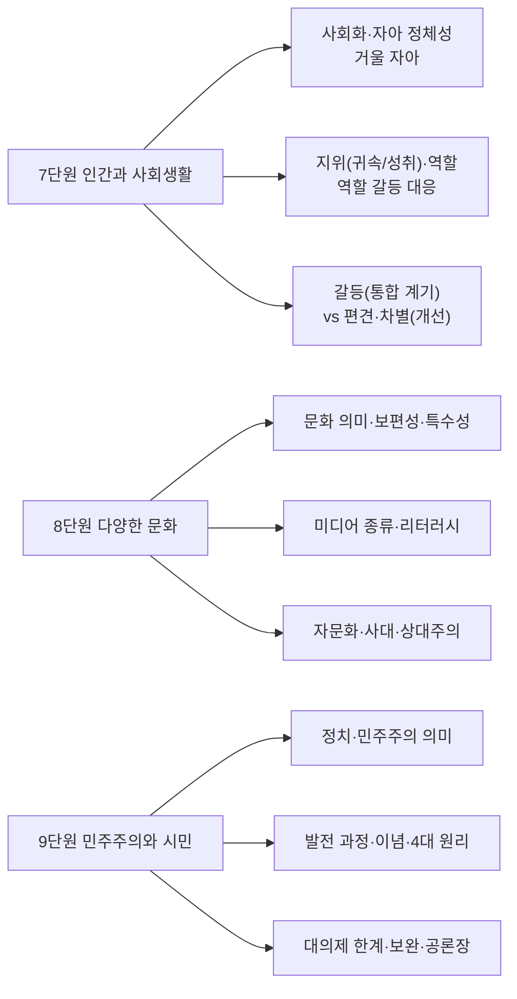
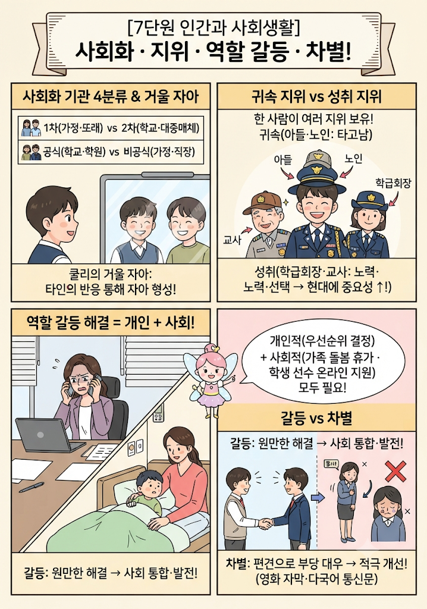
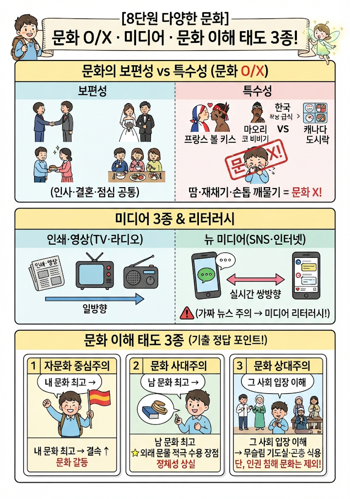
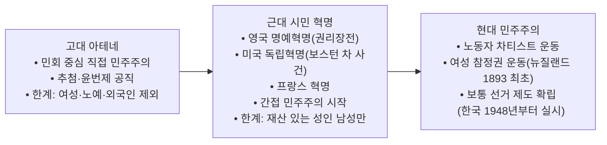
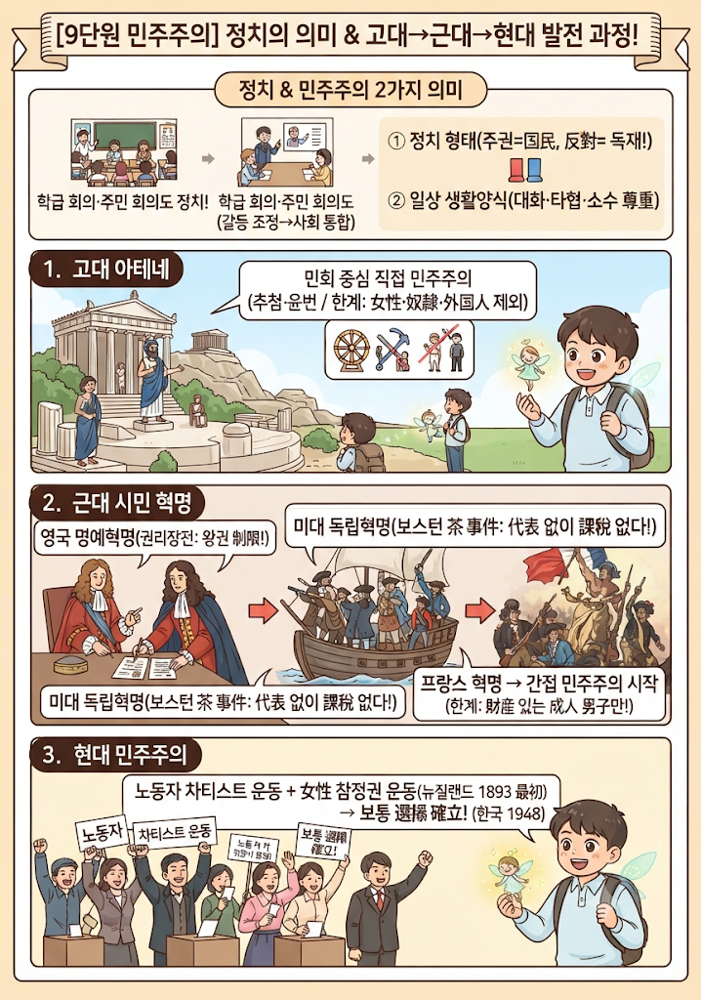
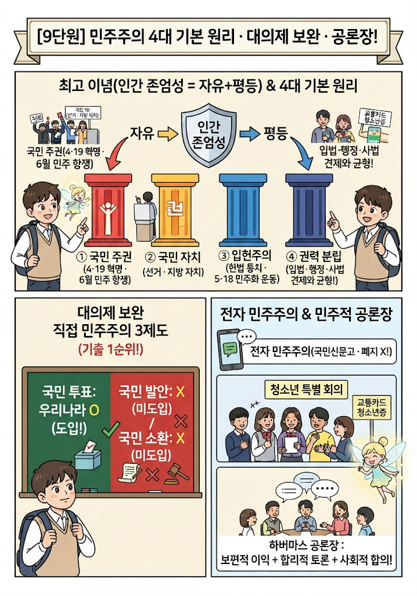

# 🏛️ [사회·문화·정치] 7~9단원 — 시험 완벽 정리

> **교과서 범위**: 7단원 인간과 사회생활 (p.121~135) · 8단원 다양한 문화의 이해 (p.136~151) · 9단원 민주주의와 시민 (p.152~165)  
> **연계 기출**: 2025학년도 KIS 7학년 2학기 2차 지필평가 **1~12번 출제!** (선지 함정 패턴 100% 반영)

---

## 🎯 한눈에 보는 7~9단원 지도

---

## 01. 7단원 — 인간과 사회생활 (교과서 p.121~135)

### 1) 사회화와 자아 정체성 ⭐ (2025 KIS 기출 1번 적중!)
- **사회화의 의미**: 개인이 자신이 속한 사회의 **언어, 규범, 가치관, 행동 양식** 등을 배워 나가는 과정.
- **사회화의 특징**:
  - 태어나기 전부터 유전적으로 결정되는 것이 **아니라**, 태어나서 **후천적으로 학습**하는 과정이다.
  - 어린 시절에 끝나는 것이 아니라 **평생에 걸쳐** 진행된다. *(※ 급격한 사회 변화에 맞추어 새로운 규범·기술을 다시 배우는 것을 **재사회화**라고 한다.)*
  - 사회마다 문화가 다르므로 사회화의 내용과 방식도 **사회마다 다르게** 나타난다.
- **사회화의 기능**:
  - **개인적 측면**: 사회에 적응하고 자신만의 개성과 **자아 정체성** 형성.
  - **사회적 측면**: 구성원들이 사회의 문화를 익히고 다음 세대에 전달하여 **사회를 유지·발전**.
- **사회화 기관 한눈에 정리** *(교과서 사례 + 핵심 구분)*:

| 구분 기준 | 유형 | 설명 및 대표 기관 |
| :--- | :--- | :--- |
| **형성 시기·내용** | **1차적 사회화 기관** | 기초적인 언어·생활 습관·규범 학습 (**가정**, 또래 집단) |
| | **2차적 사회화 기관** | 전문적 지식·기술·가치관 학습 (**학교**, 학원, 직장, **대중 매체/인터넷**) |
| **설립 목적** | **공식적 사회화 기관** | 사회화(교육) 자체를 목적으로 설립 (**학교**, 학원, 직업 훈련원) |
| | **비공식적 사회화 기관** | 다른 목적이 주이지만 사회화 역할도 수행 (**가정**, 또래 집단, 직장, 대중 매체) |

- **자아 정체성**: 다른 사람과 구별되는 자신의 고유성을 이해하고 **자신이 누구인지 명확하게 알고 있는 것**.
  - **변화 가능성**: 사회화가 평생 진행되므로 **성인이 되어서도 변화할 수 있다!**
  - **청소년기의 특징**: 사회화가 활발하고 변화가 커서 **자아 정체성이 명확하지 않거나 혼란을 겪을 수 있다.** → 충분한 탐색과 성찰 필요 *(미디어 성격 유형 검사 MBTI 등에 단정 짓지 말고 성찰!)*.
  - **쿨리(Cooley)의 '거울 자아'**: 사람들은 거울에 비친 모습처럼 **다른 사람의 눈에 비친 자신의 모습을 상상**하고, **타인의 반응에 영향을 받으며** 자아 정체성을 형성한다.

> ⚠️ **2025 KIS 기출 1번 오답 함정 완벽 정리!**  
> ❌ "자아 정체성 형성과 관련이 없다" / ❌ "유전적으로 결정된다" / ❌ "모든 사회에서 동일하다" / ❌ "한 번 형성된 자아 정체성은 변하지 않는다"  
> ✅ **정답**: **"청소년기에는 자아 정체성이 명확하지 않을 수 있다."**

### 2) 사회적 지위와 역할, 역할 갈등 ⭐ (2025 KIS 기출 2번 적중!)
- **사회적 지위**: 개인이 자신이 속한 사회에서 차지하는 다양한 위치. **한 사람은 동시에 여러 개의 지위**를 가진다! (예: 1학년 학생 + 동생 + 학급 회장 + 축구부원).

| 지위 유형 | 의미 | 교과서 대표 사례 | 시대적 변화 |
| :--- | :--- | :--- | :--- |
| **귀속 지위** *(타고난 지위)* | 개인의 노력이나 선택과 상관없이 **선천적·자연적**으로 얻는 지위 | 아들, 딸, 여성, 남성, 노인, 동생 | 과거 신분제 사회에서 중요 |
| **성취 지위** *(노력·선택 지위)* | 개인의 **노력, 능력, 선택**으로 후천적으로 얻는 지위 | 학급 회장, 선생님, 어머니·아버지, 축구부원, 의사 | **현대 사회에서 중요성이 점점 커지고 있음!** |

- **역할**: 사회적 지위에 따라 마땅히 해야 한다고 **기대되는 행동 양식**.
  - 역할을 훌륭히 수행하면 **사회적 인정이나 보상**을 받고, 제대로 수행하지 못하면 **비난이나 제재**를 받는다. *(교과서 사례: 영화 〈설리: 허드슨강의 기적〉 — 기장·승무원의 책임감 있는 역할 수행으로 155명 전원 구조)*
- **역할 갈등**: 한 개인이 가진 **여러 지위에 따른 역할들이 동시에 요구되어 충돌**하면서 어떤 역할을 우선해야 할지 겪는 갈등.
  - *교과서 사례*: ① 직장인(김 과장: 오후 회의 준비) vs 엄마(아픈 자녀 지윤이 병원 돌봄) / ② 밴드부원(청소년 축제 공연) vs 손자(다치신 할머니 간병).
- **역할 갈등의 대응 방안 (개인 + 사회 모두 필요!)**:
  - **개인적 차원**: 갈등 원인을 분석하고, 자신의 가치관·목표에 따라 **역할의 우선순위**를 합리적으로 결정.
  - **사회적 차원**: 개인이 감당하기 어렵거나 사회 제도·규범이 원인인 경우 → **사회적 지원과 제도 마련** *(예: **가족 돌봄 휴가**, **학생 선수 온라인 학습 지원 플랫폼**)*.

> ⚠️ **2025 KIS 기출 2번 함정 체크!**  
> ❌ "모든 사람은 하나의 지위만을 갖는다" / ❌ "역할 갈등은 사회적 차원에서만 해결할 수 있다" / ❌ "역할 갈등은 항상 외부 상황에만 영향을 받는다"  
> ✅ **정답**: **"현대 사회에서는 과거에 비해 개인의 성취로 얻는 지위의 중요성이 점점 커지고 있다."**

### 3) 사회적 갈등과 차별 ⭐ (2025 KIS 기출 3번 적중!)
- **사회적 갈등**: 개인 간 또는 집단 간에 가치관·생활 방식·이해관계가 달라 발생 (계층 갈등, 세대 갈등, 지역 갈등, 성별 갈등 등).
  - **핵심 관점**: 갈등은 다양한 사람이 사는 사회에서 자연스러운 현상이며 **나쁜 것만은 아니다!** 원만하게 해결될 때 **사회가 더욱 통합되고 발전**할 수 있다.
  - *(⚠️ 2025 기출 3번 오답: "갈등은 발생하지 않는 것이 가장 바람직하다" → **틀린 설명!**)*
- **차이 vs 편견 vs 차별**:
  - **차이**: 서로 다른 것 (인정하고 존중해야 할 대상).
  - **편견**: 공정하지 못하고 한쪽으로 치우친 생각.
  - **차별**: 자신과 다르다는 차이를 근거로 **편견을 갖고 부당하게 대우하는 것** → 타인의 인권 침해, 사회 갈등 유발, 사회 통합 저해 → **적극적으로 개선해야 할 문제!**
  - *교과서 사례*: 인종 차별(해외 축구 무릎 꿇기, 영어 강사 채용 차별), 장애인 차별(자막 없는 한국 영화), 성차별(남녀 시급 차별), 지역 편견, **온라인 철도 예매 보편화로 인한 노인 현장 구매 소외**.
- **갈등과 차별의 대처 방안**:
  - **갈등**: 대화와 토론을 통한 상대방 이해, 다양한 가치 존중, 서로의 이익을 조금씩 양보.
  - **차별 (개인)**: 평소 자신의 말·행동에 편견·차별이 없는지 되돌아보기, 관용과 평등 의식, 공감·배려, 차별에 반대하고 타인 권리 존중.
  - **차별 (사회)**: 차별적인 법과 제도 개선, 사회적 약자 보호 및 실질적 평등 실현 *(예: 청각 장애인을 위한 한국 영화 자막 서비스, 다문화 가정을 위한 다국어 가정 통신문, 현장 기차표 비율 배정)*.

---

## 02. 8단원 — 다양한 문화의 이해 (교과서 p.136~151)

### 1) 문화의 의미와 특징 ⭐ (2025 KIS 기출 4번 적중!)
- **문화의 의미**: 의식주, 인사 방식 등 **한 사회 구성원이 공유하는 생활양식** (인간이 환경에 적응하며 형성).
- **문화인 것 vs 문화가 아닌 것 (1초 판별!)**:

| 구분 | 판별 기준 | 대표 사례 (교과서 & 2025 기출) |
| :--- | :--- | :--- |
| **문화 현상 (O)** | 사회 구성원이 **공통으로 공유**하며 학습된 생활양식 | 식사 시 젓가락 사용, 어른께 고개 숙여 인사, 한복 입기, 교복 착용, 아파트 단지, 회식, 거리 공연 |
| **문화 아님 (X) ①** | 인간의 **생리적 본능·자연적 현상** | 더울 때 땀이 남, 활동 후 피로함, 물 많이 마시면 소변, **재채기**, 동물의 본능 |
| **문화 아님 (X) ②** | 한 사람만의 **개인적 버릇·습관** | 긴장할 때 엄지손톱 깨물기, 혼잣말하기 |

- **문화의 보편성과 특수성 (교과서 p.140~141 핵심!)**:
  - **보편성**: 대부분의 사회에서 공통적인 문화 현상이 나타남 (결혼, 장례, 인사, 학교 점심 식사).
  - **특수성**: 각 사회가 처한 환경·역사에 따라 세부적인 모습이 다르게 나타남 → **문화의 다양성**!
    - *인사*: 프랑스(볼 맞대고 '쪽') / 뉴질랜드 마오리족(손잡고 코 비비기) / 인도(합장하고 고개 숙이기).
    - *결혼*: 브라질(결혼 전 교육·시험) / 독일(3일 결혼식·전야제 '접시 깨기').
    - *학교 점심*: 우리나라(정해진 급식, 김치 등) / 캐나다(다양한 식습관·채식·알레르기 존중 → 개인 도시락).
- *(보충 정리 — 문화의 5대 속성)*: ① **공유성**(구성원 공통), ② **학습성**(후천적 배움), ③ **축적성**(세대를 거쳐 쌓임), ④ **변동성**(시간에 따라 변함), ⑤ **전체성/총체성**(문화 요소들이 서로 밀접하게 연결).

### 2) 미디어를 통해 경험하는 문화 ⭐ (2025 KIS 기출 5번 적중!)

| 미디어 종류 | 대표 매체 | 전달 방식 및 핵심 특징 |
| :--- | :--- | :--- |
| **인쇄 매체** | 책, 신문, 잡지 | 문자로 정보 전달, **일방향적** 전달 방식 |
| **영상 매체** | **텔레비전 방송, 영화** *(+ 라디오)* | 영상·소리로 정보 전달, **일방향적** 전달 방식 *(쌍방향 X!)* |
| **뉴 미디어** | 인터넷 기반 **SNS, 동영상 공유 플랫폼, 웹 게시판, 포털** | 정보 생산자와 소비자의 **실시간 쌍방향 소통** 가능! ⚠️ 누구나 생산·공유 → **가짜 뉴스·왜곡 정보 확산 위험 증가!** |

- **미디어 리터러시(Media Literacy)**: 미디어에 담긴 지식과 정보를 **분석·이해·평가**하고, 적절히 활용해 창조적으로 재생산하는 능력.
- **올바른 미디어 활용 태도**:
  - 하나의 매체만 보지 않고 **여러 매체 비교**, 의심 없이 믿지 않기!
  - 사실 여부, 타당한 근거, 정치적·상업적 의도, 편향된 시각, 선정성·혐오 표현 여부를 **비판적으로 검토**.
  - 건강한 미디어 환경을 위해 적극적으로 문제점 지적 및 개선 참여.
  - *교과서 사례*: 1938년 미국 라디오 '화성인 침공' 드라마 속보 오해 소동, 1923년 간토 대지진 조선인 가짜 뉴스.

### 3) 다양한 문화를 이해하는 태도 3종 ⭐ 초핵심! (2025 KIS 기출 6번 적중!)

| 구분 | 의미 | 장점 | 단점 및 주의점 | 교과서·기출 사례 |
| :--- | :--- | :--- | :--- | :--- |
| **자문화 중심주의** | **자기 문화 우월** / 다른 문화 열등 | 자신이 속한 공동체의 **결속력 강화** | 자기 문화를 강요 → **다른 문화와 갈등**, 문화적 고립 | 자기 나라 피자만 진짜라 주장, "신발 신고 침대에 눕다니 더러워" |
| **문화 사대주의** | **다른 문화 우월** / 자기 문화 열등 | **다른 사회의 문물을 적극적으로 수용**할 수 있음 *(2025 기출 정답!)* | 자기 문화를 소홀히 하여 **정체성과 독창성 상실** | 조선 지배층의 중국 명나라 숭배, '미숫가루'를 영어 'MSGR'로 쓰면 세련돼 보인다고 여김 |
| **문화 상대주의** | 문화의 우열을 평가하지 않고 **그 사회의 입장**에서 이해 | 문화를 다양한 관점에서 깊이 이해, 문화 다양성·공존 | ⚠️ **한계(극단적 문화 상대주의 경계!)**: **인권 침해·인간의 존엄성을 훼손하는 문화**까지 존중할 수는 없음 → 비판적 성찰 필요! | 우리나라 백화점 내 **무슬림 기도실**, 멕시코 원주민의 곤충 식용 문화 이해 *(vs 사망자 발생 위험 행사 등은 비판적 검토)* |

> ⚠️ **2025 KIS 기출 6번 함정 주의!**  
> - ❌ "어떠한 문화든지 문화 상대주의 관점에서 이해해야 한다" → **X!** (인권 침해 문화는 제외!)  
> - ❌ "K-POP 인기에 한국인으로서 자부심을 느끼는 것은 문화 사대주의다" → **X!** (자부심은 문화 사대주의가 아님!)  
> - ✅ **정답**: **"문화 사대주의는 어떤 사회의 문화를 적극적으로 받아들인다는 특징이 있다."**

---

## 03. 9단원 — 민주주의와 시민 (교과서 p.152~165)

### 1) 정치와 민주주의 ⭐ (2025 KIS 기출 7~8번 적중!)
- **정치의 의미**: 사회 구성원들의 다양한 의견과 이해관계를 조정하여 의사를 결정하고 공동체의 문제를 해결하는 과정.
  - **넓은 의미의 정치**: 직업 정치인(국회·정부)뿐 아니라 **주민 회의, 학급 회의** 등 일상 공동체의 의사 결정도 모두 정치!
  - **역할**: 갈등이 아예 안 생기게 하는 것이 아니라, 발생한 갈등을 **정당하고 원만하게 조정하여 사회 통합**을 이룸. 합의된 결정은 내 의견과 달라도 따름.
- **민주주의의 두 가지 의미**:
  1. **정치 형태로서의 민주주의**: 시민이 국가의 최고 권력(**주권**)을 가지고 스스로 권리를 행사하는 정치 형태.
     - *(⚠️ 2025 기출 8번 함정: 민주주의와 반대되는 정치 체제는 공산주의? → **X!** **독재 정치 / 전제 정치**이다!)*
  2. **생활양식으로서의 민주주의**: 일상에서 **대화와 토론·타협, 다수결과 소수 의견 존중, 공동체 의식·주인 의식, 관용과 배려**를 실천하는 태도.
- **민주주의의 필요성**: 한 사람이나 소수의 **권력 독점 제한**, 모든 시민의 **자유와 권리 보호**, 공동체 의식·주인 의식 함양.

### 2) 민주주의의 발전 과정 ⭐ (2025 KIS 기출 9번 적중!)

- **꼭 기억할 사건 키워드 (교과서 p.159)**:
  - **영국 명예혁명 — 〈권리 장전〉**: 의회 동의 없이 국왕이 법을 만들거나 세금을 부과하는 것은 위법임을 명시 *(왕의 통치를 끝낸 것 X, 왕권을 제한하고 입헌 군주제 확립!)*.
  - **미국 독립 혁명 — 〈보스턴 차 사건〉**: 구호 **"대표 없이 과세 없다"** *(남북 전쟁과 헷갈리지 말기! 2025 기출 9번 ④ 함정!)*.
  - **노동자 참정권 운동 — 차티스트 운동**: 노동자들이 인민헌장을 내걸고 참정권(보통 선거) 확보 운동 전개 *(2025 기출 9번 정답 ②!)*.
  - **여성 참정권 운동**: **뉴질랜드**(1893년 세계 최초 여성 참정권 부여, 케이트 셰퍼드).

### 3) 민주주의의 이념과 4대 기본 원리 ⭐ (2025 KIS 기출 10번 적중!)
- **민주주의의 이념**: **인간의 존엄성** *(궁극적 최고 이념)* ← 이를 실현하기 위해 **자유**와 **평등** 보장 필수!
- **민주주의의 4대 기본 원리**:

| 기본 원리 | 핵심 의미 | 우리나라 실현 사례 & 역사적 사건 (교과서 p.160~161) |
| :--- | :--- | :--- |
| **① 국민 주권의 원리** | 국가의 최고 권력(**주권**)은 국민에게 있고, 권력 행사 시 **국민의 동의와 지지** 필요 | 헌법 제1조 2항, **4·19 혁명(1960)**(부정 선거 규탄), **6월 민주 항쟁(1987)**(대통령 직선제 쟁취) |
| **② 국민 자치의 원리** | 주권자인 국민이 **스스로 국가를 다스림** | 선거(대표 선출), **국민 투표**, **지방 자치 제도**, 주민 투표 |
| **③ 입헌주의의 원리** | 국가의 최고법인 **헌법**에 따라 국가기관을 구성하고 권력을 행사(권력 남용 방지) | 제헌 헌법 제정, **5·18 민주화 운동(1980)**(계엄령 신군부 비판 → 헌법 근거 권력 행사 요구) |
| **④ 권력 분립의 원리** | 국가 권력을 **입법부**(법 제정)·**행정부**(법 집행)·**사법부**(법 해석·적용)로 나누어 **견제와 균형** | 삼권 분립, **5·18 민주화 운동**(행정권·사법권 독점 신군부 비판) |

### 4) 현대 민주주의의 특징, 한계, 발전을 위한 노력 ⭐ (2025 KIS 기출 10~12번 적중!)
- **현대 민주주의의 특징**: 영토·인구 확대 및 전문성 필요 → **간접 민주주의(대의제)**가 기본 형태! *(⚠️ 2025 기출 11번 함정: "직접 민주주의 형태를 보인다" → X!)*
- **대의제의 한계**:
  1. 대표자의 결정이 국민의 의사와 완전히 일치하지 않을 수 있음.
  2. 모든 직업·지역·계층·세대의 의견을 고르게 대표하기 어려움.
  3. 시민의 **정치적 무관심** 일상화 및 공공 이익 무시·자기 이익만 추구하는 참여 증가.
  4. **클릭티비즘(Clicktivism)**: 온라인 서명·청원 등 가볍고 즉흥적인 클릭 참여(장점: 참여 장벽 낮춤 / 단점: 진지한 고민·실천 부족 우려).
- **대의제 보완 제도 (직접 민주주의 요소) ⭐ 초주의!**:

| 제도 | 의미 | 우리나라 현행 헌법 도입 여부 |
| :--- | :--- | :---: |
| **국민 투표** | 국정의 중요한 사항을 국민이 직접 투표로 결정 | **O (도입!)** |
| **국민 발안** | 일정 수 이상의 국민이 헌법 개정안·법률안을 의회에 제출 | **X (미도입)** |
| **국민 소환** | 선출된 국민 대표를 임기 종료 전에 국민의 뜻으로 파면 | **X (미도입!)** *(※ 2025 기출 10번 ⑤ 함정!)* |

- **전자 민주주의 & 청소년 참여**:
  - **전자 민주주의**: 정보 매체(온라인 국민 참여 포털 **국민신문고** 등)를 통한 일상적 정치 참여와 권력 통제 *(편향 정보 때문에 폐지해야 한다? X! 2025 기출 12번 ⑤ 함정!)*.
  - **청소년 특별 회의**: 청소년과 전문가가 참여해 청소년 정책 제안 (성과: **청소년증에 교통카드·선불 결제 기능 추가**).
- **시민의 역할과 민주적 공론장**:
  - 시민 참여 방법: 투표, 진정, 청원, 정당·이익 집단·시민 단체 활동.
  - **공론화**: 특정 문제나 주제를 여럿이 의논하는 대상이 되게 하는 것 (예: **공청회**).
  - **민주적 공론장 (하버마스)**: 사회 구성원의 **① 보편적 이익** 고려 + **② 합리적 토론** + **③ 사회적 합의**를 끌어내기 위한 공간. *(신속한 결론만 중시하거나 다른 의견 숨기기 X!)*

