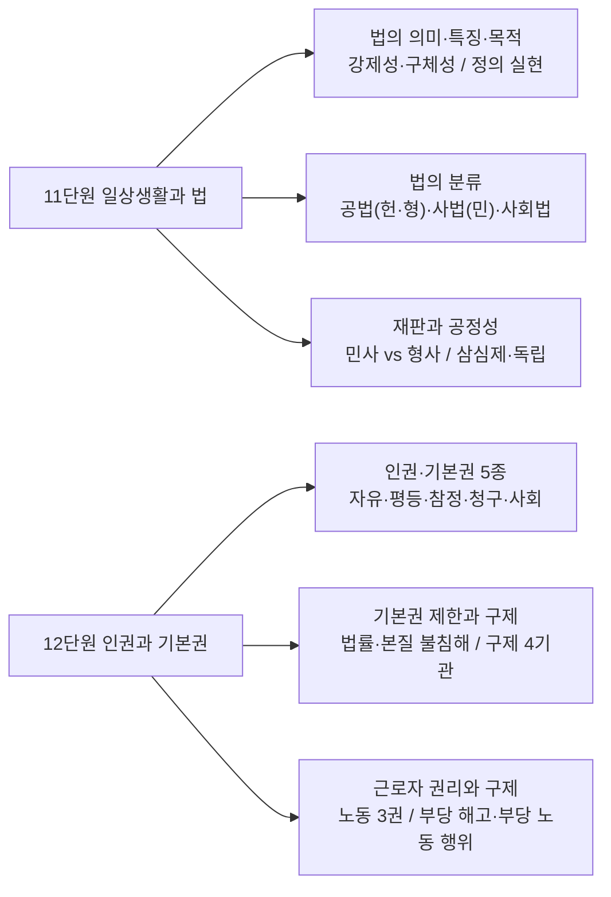
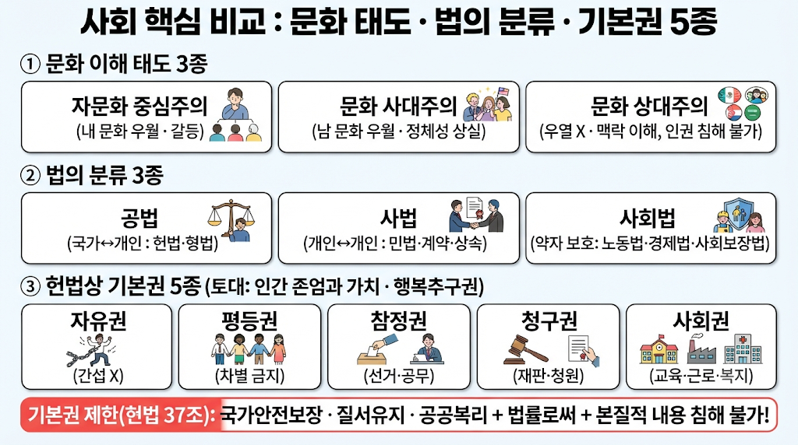
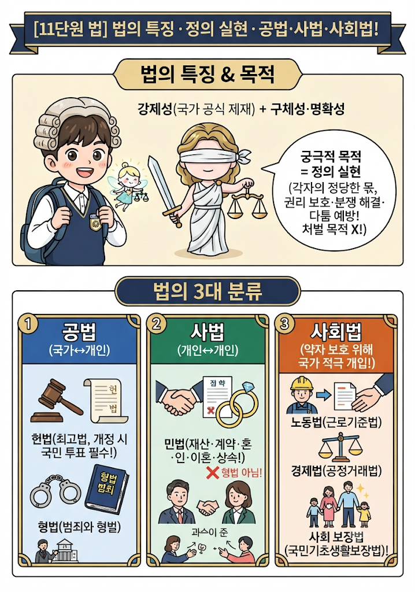
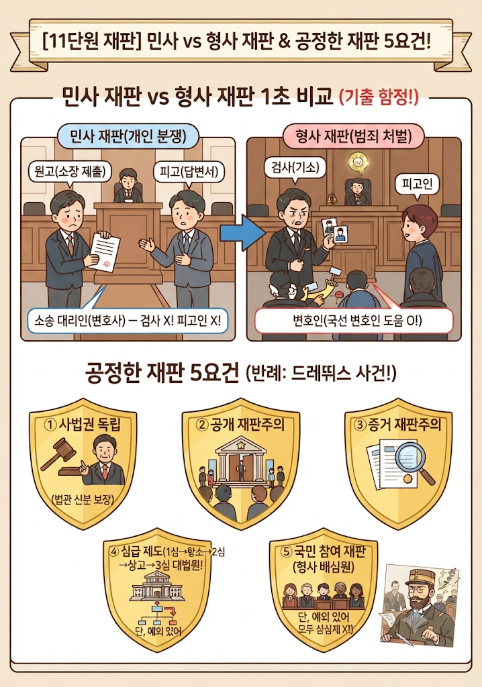
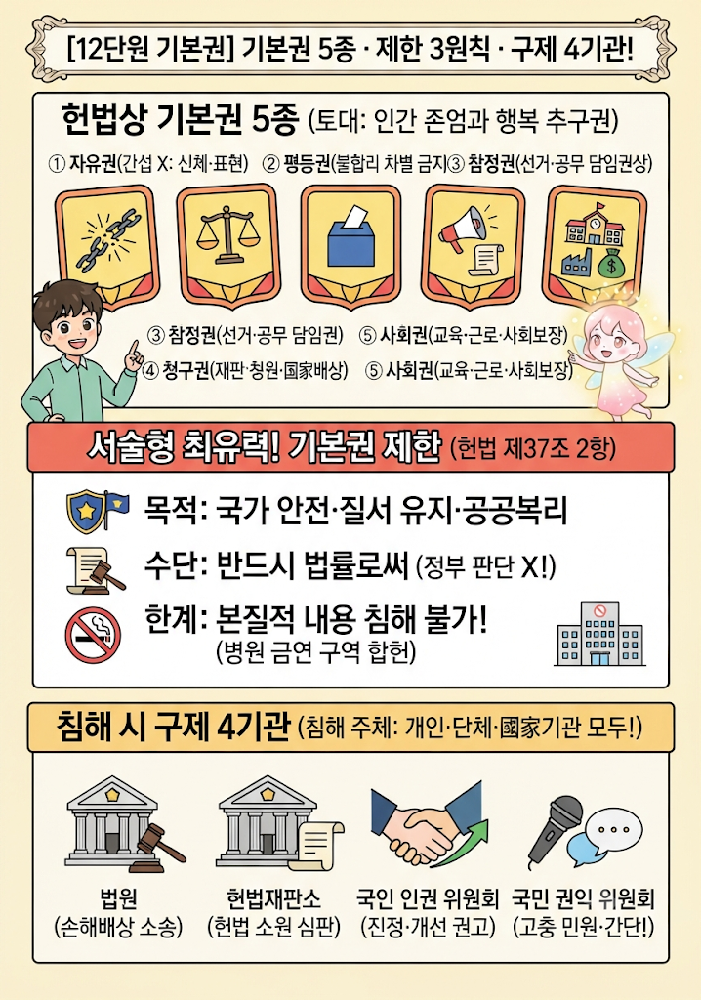
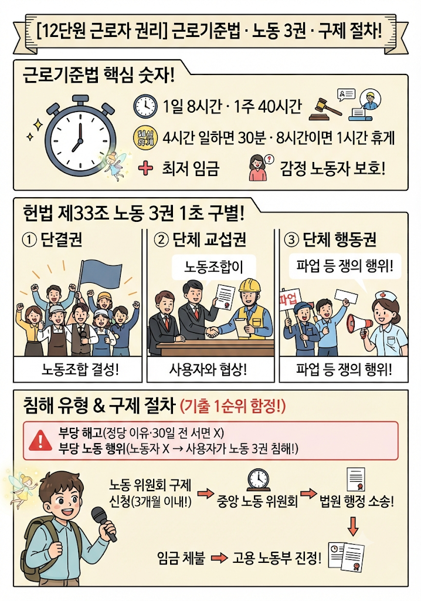

# ⚖️ [법과 인권] 11~12단원 — 시험 완벽 정리

> **교과서 범위**: 11단원 일상생활과 법 (p.185~199) · 12단원 인권과 기본권 (p.200~213)  
> **연계 기출**: 2025학년도 KIS 7학년 2학기 2차 지필평가 **18~25번 출제!** (선지 함정 패턴 100% 반영)

---

## 🎯 한눈에 보는 11~12단원 지도

---

---

## 01. 11단원 — 일상생활과 법 (교과서 p.185~199)

> 🎬 **개념 몽타주 영상 (2분 20초)** — 법의 특징과 목적 · 공법/사법/사회법 · 민사 vs 형사 재판 · 공정한 재판을 한 번에 정리해요.

<video controls preload="metadata" playsinline poster="exam/%EC%82%AC%ED%9A%8C_%EC%8B%9C%ED%97%98%EA%B3%B5%EB%B6%80/videos/soc_11_law_poster.jpg" src="exam/%EC%82%AC%ED%9A%8C_%EC%8B%9C%ED%97%98%EA%B3%B5%EB%B6%80/videos/soc_11_law.mp4" style="width:100%;max-width:960px;border-radius:12px;display:block;margin:0 auto 1em;background:#000"></video>

### 1) 법의 의미, 특징, 목적과 역할 ⭐ (2025 KIS 기출 18~19번 적중!)
- **법의 의미**: 사회 구성원들의 합의를 반영하여 **국가가 만든(입법부/국회)** 가장 대표적인 사회 규범.
  - 우리 일상생활과 밀접히 연결 *(도로교통법, 초·중등교육법, 학교급식법, 학원법, 제조물 책임법 등 — 선량한 사람도 법 속에서 생활!)*.
- **법 vs 다른 사회 규범 (관습 · 종교 규범 · 도덕)**:

| 사회 규범 | 의미 | 대표 사례 | 위반 시 대가 |
| :--- | :--- | :--- | :--- |
| **관습** | 오랫동안 지켜져 널리 인정된 질서·풍습 | 장례식, 명절 풍습 | 사회적 비난 |
| **종교 규범** | 특정 종교 신자들 사이의 교리·규율 | 불경, 성경 계율 | 종교적 제재 |
| **도덕** | 양심 등에 비추어 옳다고 여기는 기준 | 어른 공경, 지하철 자리 양보 | **양심의 가책, 비난** |
| **법** | 사회 합의로 **국가가 제정**한 규범 | 교통 신호 준수, 어린이 보호구역 주정차 금지 | **국가의 공식적 제재(처벌·과태료)** |

- **법의 핵심 특징 2가지**:
  1. **강제성**: 위반할 경우 **국가에 의해 공식적인 제재**가 가해진다. *(2025 기출 18번 정답 ④!)*
  2. **구체성·명확성**: 지켜야 할 규칙의 내용과 위반 시 처벌을 분명히 알 수 있도록 다른 사회 규범보다 **구체적이고 명확하게** 규정되어 있다. *(추상적 X!)*
- **법의 궁극적 목적과 역할**:
  - **궁극적 목적 = 정의 실현**: 정의란 옳고 그름을 판단해 **모든 사람에게 각자가 받아야 할 정당한 몫**을 주는 것 *(정의의 여신상: **평등의 저울**[공평 집행] + **양날 검**[엄격·공정 집행], 세계 법무부 영어 명칭 `Justice` 사용)*.
  - **법의 3대 역할**: ① 개인의 **권리 보호와 구제**, ② 공정·객관적 판단 기준을 제공해 **분쟁 해결**, ③ 행위·판단 기준을 제시해 **다툼 예방**.
  - *(⚠️ 2025 기출 19번 함정: "법은 국민을 처벌하거나 규제하기 위해 존재한다" → **틀림(X)!**)*

### 2) 우리 생활과 관련된 다양한 법 — 공법 · 사법 · 사회법 ⭐ (2025 KIS 기출 20번 적중!)

| 대분류 | 대표 법 | 규율 대상 | 핵심 내용 및 교과서 사례 |
| :--- | :--- | :--- | :--- |
| **공법** *(국가↔개인, 국가기관 간)* | **헌법** | 국가 운영 원칙 & 기본권 | • 국가 운영의 바탕이 되는 **최고법·근본법**, 모든 법 제정의 근거 • 국민의 기본권 + 국가기관 구성·운영 규정 ⚠️ **헌법 개정**: 국회 의결만으로 안 되고 **국민 투표** 필수! *(2025 기출 20번 ① 함정!)* |
| | **형법** | **범죄**와 **형벌** | • 어떤 행위가 범죄이고 어떤 처벌을 받는지 규정 → **공공질서 유지** • 형벌 범위 내에서만 처벌함으로써 국민의 자유·권리 보호 • 사례: 중고 거래 사기, 형법 제347조(사기죄 — 〈하늘은 맑건만〉) |
| **사법** *(개인↔개인)* | **민법** | 개인 간 권리관계 | • **재산 관계**: 재산권, 계약, 손해 배상 • **가족 관계**: 친족, **혼인, 이혼, 상속** *(형법 X! 2025 기출 20번 ③ 함정!)* • 사례: 민법 제103조 반사회질서 법률행위 무효(〈심청전〉) |
| **사회법** *(공법+사법 중간 영역)* | **노동법** **경제법** **사회 보장법** | 개인 간 법률관계에 **국가가 적극 개입** | • **등장 배경**: 산업 혁명 이후 자본주의 발달 → 빈부 격차·열악한 노동 조건(〈레 미제라블〉, 전태일)·불평등 계약 등 사회문제 심화 • **목적**: **사회적 약자 보호** & **모든 국민의 인간다운 생활 보장** *(2025 기출 20번 정답 ⑤!)* |

- **사회법 3종 세부 정리 (교과서 p.193)**:
  1. **노동법**: 근로자 권리·근로 조건 보호, 노사 이해관계 조정 *(노동자 처벌 법 X!)* — `근로기준법`(4시간당 30분·8시간당 1시간 휴게), `노동조합 및 노동관계 조정법`.
  2. **경제법**: 공정한 경제 질서 유지, 기업 간 자유 경쟁 보장, 소비자 권익 보호 — `독점 규제 및 공정 거래에 관한 법률(공정거래법)`(대기업 갑질 규제), `소비자기본법`.
  3. **사회 보장법**: 실업·빈곤·질병·고령 등 어려움 지원, 인간다운 생활 보장 — `국민 기초 생활 보장법`, `국민 건강 보험법`, `국민연금법`, `장애인 연금법`.

### 3) 민사 재판 vs 형사 재판 ⭐ 1초 비교! (2025 KIS 기출 21번 적중!)

| 비교 항목 | 민사 재판 | 형사 재판 |
| :--- | :--- | :--- |
| **대상 사건** | **개인 간 권리와 의무**에 관한 분쟁 (돈 빌려 안 갚음, 손해 배상 등) | **범죄** 발생 시 유무죄 판단 및 **형벌** 부과 |
| **재판 시작** | **원고**의 **소장 제출** (소송 제기) | **검사**의 **기소** (공소 제기) |
| **당사자 호칭** | **원고** *(재판 청구)* vs **피고** *(재판 받음)* | **검사** *(기소)* vs **피고인** *(범죄 혐의자)* |
| **법률 조력자** | **소송 대리인(변호사)** *(검사 참여 X!)* | **변호인** *(경제적 어려움 등 시 **국선 변호인** 도움 가능!)* |
| **진행 절차** | 원고 소장 제출 → 피고에게 소장 복사본 전달 → 피고 답변서 제출 → 원고·피고 변론 → 판결 선고 | 검사의 기소 → 검사의 신문·변호인의 변론 → 판결 선고 *(징역, 벌금, 집행 유예 등)* |

> ⚠️ **2025 KIS 기출 21번 함정 완벽 정리!**  
> - ❌ "모든 재판은 고소·고발 / 검사의 기소로 시작된다" → **X!** 민사 재판은 원고의 소장 제출로 시작!  
> - ❌ "민사 재판에서 재판을 받게 된 사람을 피고인이라고 한다" → **X!** 민사는 **피고**, 형사는 **피고인**!  
> - ❌ "형사 재판에서는 국선 변호인의 도움을 받을 수 없다" → **X!** 받을 수 있다!  
> - ✅ **정답**: **"민사 재판에서 재판을 청구한 사람을 원고라고 한다."**

### 4) 공정한 재판의 요건과 제도 ⭐ (2025 KIS 기출 22번 적중!)
*(교과서 p.196~197 대표 반례: 1894년 프랑스 **알프레드 드레퓌스 사건** — 비공개 재판, 군 지도부의 압력[사법권 독립 침해], 증거 없는 판결[증거 재판주의 위반]!)*

1. **사법권의 독립**: 재판이 외부 압력에 흔들리지 않도록 법원 조직·운영의 독립과 **법관의 신분 보장** → 헌법·법률·양심에 따라 심판.
2. **공개 재판주의**: 재판 과정을 당사자뿐 아니라 **일반인에게도 공개**.
3. **증거 재판주의**: 추측이나 편견이 아니라 오직 **구체적인 증거**를 바탕으로 재판.
4. **심급 제도 (기본 삼심제)**: 잘못된 판결 가능성 최소화 & 국민 기본권 보장.
   - **1심**(지방 법원 단독 판사 / 합의부) ──(**항소**)──▶ **2심**(지방 법원 본원 합의부 / 고등 법원) ──(**상고**)──▶ **3심**(**대법원**)
   - *(⚠️ 2025 기출 22번 ① 함정: **"모든 재판은 삼심제로 운영된다"** → **틀림(X)!** **기본적으로** 삼심제이지만, 대통령 선거 무효 소송 등은 단심제 등 예외가 있다!)*
5. **국민 참여 재판**: 국민이 **배심원**(또는 예비 배심원)으로 참여하는 **형사 재판** (영화 〈배심원들〉). 유무죄와 형량을 토의해 판사에게 의견 전달 → 민주적 정당성·투명성 향상.

---

## 02. 12단원 — 인권과 기본권 (교과서 p.200~213)

> 🎬 **개념 몽타주 영상 (2분 27초)** — 인권 · 기본권 5종 · 헌법 제37조 2항 · 구제 기관 · 노동 3권을 한 번에 정리해요.

<video controls preload="metadata" playsinline poster="exam/%EC%82%AC%ED%9A%8C_%EC%8B%9C%ED%97%98%EA%B3%B5%EB%B6%80/videos/soc_12_rights_poster.jpg" src="exam/%EC%82%AC%ED%9A%8C_%EC%8B%9C%ED%97%98%EA%B3%B5%EB%B6%80/videos/soc_12_rights.mp4" style="width:100%;max-width:960px;border-radius:12px;display:block;margin:0 auto 1em;background:#000"></video>

### 1) 인권의 의미와 인권 침해 (교과서 p.202~203)
- **인권의 의미**: 인간이 인간답게 살아가기 위해 마땅히 누려야 할 기본적인 권리. **태어날 때부터 누구에게나 차별 없이 부여**(보편적 권리). *(1948년 UN **세계 인권 선언**)*
- **인권 감수성**: 인권 문제를 민감하게 받아들이고 느끼는 태도 *(예: 뉴욕시 장애인 마크를 수동적 모습에서 역동적으로 변경)*.
- **인권 침해**: 물리적 침해 + 정신적 침해 모두 포함.
  - **침해 주체**: 개인, 단체뿐만 아니라 **국가기관**도 될 수 있다! *(2025 기출 23번 정답 ④!)*
  - *교과서 사례*: 저상버스 미비, 시각장애인 안내견 식당 출입 거부, 여자 화장실 변기 수 부족 *(vs 놀이기구 키 140 cm 제한·중장비 자격증 요구는 안전을 위한 합리적 제한!)*.

### 2) 헌법상 기본권 5종 ⭐ 초핵심! (2025 KIS 기출 23번 적중!)
- **기본권**: 인권 중 **헌법 조항**으로 명문화하여 보장하는 권리 *(법률에만 명시? X!)*
- **궁극적 토대**: **인간의 존엄과 가치 및 행복 추구권** *(모든 기본권의 토대이자 궁극적 가치)*

| 기본권 5종 | 핵심 정의 (1초 암기 키워드) | 교과서 대표 사례 |
| :--- | :--- | :--- |
| **① 자유권** | 개인의 자유로운 생활에 대해 **국가의 간섭을 받지 않을 권리** | 신체의 자유, 표현의 자유, 직업 선택의 자유, 사생활의 자유 |
| **② 평등권** | 성별·종교·사회적 신분 등에 의해 **불합리한 차별을 받지 않고 동등하게 대우받을 권리** | 헌법 제11조 법 앞의 평등, 운동회 남녀 경기 제한 금지 |
| **③ 참정권** | **국가의 의사 결정에 참여**할 수 있는 권리 | **선거권**, **공무 담임권**(공직을 맡을 권리), 국민 투표권 |
| **④ 청구권** | 국가에 대해 **일정한 행위를 요구**할 수 있는 권리 *(수단적 권리)* | **재판 청구권**, **청원권**, **국가 배상 청구권** |
| **⑤ 사회권** | **인간다운 생활의 보장**을 국가에 요구할 수 있는 권리 | **교육을 받을 권리**, **근로의 권리**, **사회 보장을 받을 권리** |

*(※ 참고 p.209: **생명권**처럼 헌법에 직접 명시되어 있지 않아도 인정되는 기본권도 있다!)*

### 3) 기본권 제한의 요건과 한계 ⭐ 서술형 최유력! (2025 KIS 기출 24번 적중!)
> 📜 **대한민국 헌법 제37조 제2항**  
> *"국민의 모든 자유와 권리는 **국가 안전 보장 · 질서 유지 또는 공공복리**를 위하여 필요한 경우에 한하여 **법률로써** 제한할 수 있으며, 제한하는 경우에도 **자유와 권리의 본질적인 내용을 침해할 수 없다.**"*

- **① 제한 목적 (사유 3가지)**: **국가 안전 보장**, **질서 유지**(안전벨트 착용 의무, 전동 킥보드 속도 제한), **공공복리**(감염병 확산 방지 영업 제한, 병원 전체 금연 구역).
- **② 제한 형식 (수단)**: 반드시 국회가 제정한 **법률로써** 제한! *(⚠️ 2025 기출 24번 ③ 함정: "정부의 판단에 따른다" → **틀림(X)!**)*
- **③ 제한의 한계**: 제한하더라도 **자유와 권리의 본질적인 내용은 침해할 수 없다!** (예: 집회·시위의 시간·장소는 제한할 수 있으나, 집회·시위 자체를 전면 금지할 수는 없음).
- *교과서 판례 (2003헌마457 병원 전체 금연 구역)*: 흡연자의 **사생활의 자유·행복 추구권** vs 비흡연자의 **건강권·생명권** 충돌 → 헌법재판소는 비흡연자 생명·건강 보호를 중시해 합헌 결정!

### 4) 기본권 침해 시 구제 기관 4종 ⭐ 1초 비교! (교과서 p.208)

| 구제 기관 | 역할 및 특징 | 교과서 대표 사례 & 절차 |
| :--- | :--- | :--- |
| **법원** | 국가기관·개인·단체에 의한 권리 침해를 **재판(소송)**으로 구제 | 공항 확장 소음·먼지 피해 **손해 배상 소송** |
| **헌법재판소** | 헌법 질서 수호, 다른 절차로 해결 안 될 때 **헌법 소원 심판** 청구 → 공권력 행사 취소 또는 위헌 법령 효력 상실 | 군 훈련소 종교 행사 강제 참석에 대해 **헌법 소원 심판** 청구 |
| **국가 인권 위원회** | 인권 침해·차별 행위를 **진정** 접수 또는 직권 조사 → 구제 및 법·제도 **개선 권고** | 군 훈련소 원치 않는 종교 행사 참석에 대해 **진정서 제출** → 군부대에 개선 권고 |
| **국민 권익 위원회** | 국민의 **고충 민원** 처리 및 불합리한 행정 제도 개선 (**비용 거의 없고 절차 간단!**) | 공항 확장 소음·먼지 불편에 대해 **고충 민원 신청** |

### 5) 근로자의 권리와 노동권 침해 대응 ⭐ (2025 KIS 기출 25번 적중!)
- **근로자 vs 사용자**: 근로자(노동을 제공하고 임금을 받는 사람) / 사용자(근로자를 채용·해고하고 지휘·감독하는 사람).
- **근로 기준법**: 근로 조건의 최저 기준 규정 — 원칙적 근로 시간 **1일 8시간 · 1주 40시간**, 휴식 시간 **4시간이면 30분 이상 · 8시간이면 1시간 이상**, 최저 임금 보장.
- **노동 3권 (헌법 제33조)** — 근로자가 사용자와 대등한 위치에서 근로 조건을 협의·결정하도록 보장!

| 노동 3권 | 핵심 정의 (1초 구분!) |
| :--- | :--- |
| **① 단결권** | 근로 조건 향상을 위해 **노동조합**과 같은 단체를 만들 수 있는 권리 *(2025 기출 25번 정답 ③!)* |
| **② 단체 교섭권** | 노동조합을 통해 사용자와 근로 조건에 관하여 **협상**할 수 있는 권리 |
| **③ 단체 행동권** | 단체 교섭이 원만하지 않을 때 파업 등 **쟁의 행위**를 할 수 있는 권리 |

- **노동권 침해 유형 및 구제 절차**:
  - **부당 해고**: 정당한 이유 없이 해고하거나, 30일 전 서면 통보 등 절차를 어긴 해고. *(모든 해고가 회사의 합법적 권리? X!)*
  - **부당 노동 행위**: **사용자가** 근로자의 노동 3권(노조 가입·파업 등)을 이유로 불이익을 주거나 방해하는 행위! *(⚠️ 2025 기출 25번 ② 함정: "노동자의 불법 행위" → **틀림(X)!**)*
  - **구제 방법**:
    - 부당 해고·부당 노동 행위 → **노동 위원회**에 구제 신청(**부당 해고일로부터 3개월 이내** 지방 노동 위원회 신청 → 불복 시 중앙 노동 위원회 재심 → 불복 시 법원 **행정 소송**) 또는 **법원** 소송.
    - 임금 체불 → **고용 노동부**에 진정서 제출.
  - **감정 노동자 보호**: `<산업 안전 보건법>` 개정 → 고객 응대 근로자 보호 의무, 건강 장해 우려 시 업무 중단·전환 가능.

