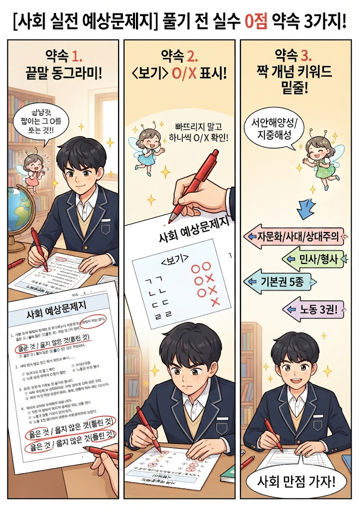

# 📝 2026학년도 7학년 2학기 2차 지필평가 대비 — 사회 실전 예상 문제지

> **시험 범위**: 3단원 유럽 · 4.1 아프리카 · 7단원 인간과 사회생활 · 8단원 다양한 문화 · 9단원 민주주의와 시민 · 11단원 일상생활과 법 · 12단원 인권과 기본권  
> **구성**: 선택형 22문항 (82.0점) + 서술형 3문항 (18.0점) = **총 100.0점** | **제한 시간**: 45분  
> **참고**: 호치민시한국국제학교(KIS) 2025학년도 7학년 2학기 2차 지필평가 기출 유형 완벽 반영

> 📌 **사이트 실전 문제지 변경(2026-11-25)**: 선생님 수업 PPT 보충 8문항(23~30번)을 더해 **선택형 30문항(82.0점) + 서술형 3문항(18.0점)**입니다. 사이트에서는 선택형 배점이 2.5~3.0점으로 조정되어 있습니다(아래 [ ]점 표시는 처음 22문항 기준).

### ✅ 풀기 전 「실수 0점」 약속 3가지
- [ ] 문제 끝의 **"옳은 것 / 옳지 않은 것(틀린 것)"**에 반드시 동그라미 치기
- [ ] `<보기>` 문제는 ㄱ·ㄴ·ㄷ·ㄹ 옆에 하나씩 **O / X** 표시한 뒤 답 고르기
- [ ] 헷갈리는 짝 개념(**서안해양성/지중해성**, **자문화/사대/상대주의**, **민사/형사**, **기본권 5종**, **노동 3권**)은 키워드 밑줄 긋고 확인하기

---

## [선택형 1~30번]

### Ⅰ. 지리 — 유럽과 아프리카 (1~7번)

**1.** 유럽의 위치, 지형 및 주요 도시에 대한 설명으로 옳지 **않은** 것은? [3.0점]
① 유럽은 유라시아 대륙의 서부에 위치하며 동쪽의 우랄산맥이 아시아와의 경계를 이룬다.  
② 유럽 남부에는 해발 고도가 높고 험준한 알프스산맥이, 북부에는 상대적으로 해발 고도가 낮은 스칸디나비아산맥이 있다.  
③ 유럽 중앙에는 넓고 평평한 유럽 대평원이 펼쳐져 있으며, 라인강이 여러 국가를 거쳐 북해로 흘러든다.  
④ 아이슬란드의 수도 레이캬비크는 지열을 활용해 난방을 하는 친환경 도시이다.  
⑤ 영국의 런던과 프랑스의 파리는 국제기구의 본부만 모여 있을 뿐 세계 경제의 중심지 역할은 하지 못한다.

---

**2.** 다음은 유럽의 두 기후 지역 (가), (나)의 특징을 비교한 표이다. 이에 대한 설명으로 옳은 것만을 `<보기>`에서 있는 대로 고른 것은? [4.0점]

| 구분 | (가) 서부 유럽 (대서양 연안) | (나) 남부 유럽 (지중해 연안) |
| :--- | :--- | :--- |
| **기후명** | 서안 해양성 기후 | 지중해성 기후 |
| **기후 특징** | 난류와 편서풍 영향, 연중 습윤, 여름 서늘·겨울 따뜻 | 여름 고온 건조, 겨울 온난 습윤 |
| **대표 사례** | 영국(런던), 프랑스(파리) | 그리스, 이탈리아, 에스파냐 |

> **<보기>**  
> ㄱ. (가) 지역은 연중 강수가 고른 편이어서 센강 등 하천의 수운 교통이 발달하기에 유리하다.  
> ㄴ. (가) 지역에서는 작물 재배와 가축 사육을 함께 하는 혼합 농업과 대도시 근교의 낙농업이 발달하였다.  
> ㄷ. (나) 지역에서는 여름철 강수량이 많아 벼농사가 주로 이루어지며, 겨울에는 올리브와 포도를 재배한다.  
> ㄹ. (나) 지역의 그리스 전통 가옥은 벽을 밝은색으로 칠해 뜨거운 여름 햇볕을 반사하고 벽을 두껍게 만들어 열기를 차단한다.

① ㄱ, ㄴ  
② ㄴ, ㄷ  
③ ㄱ, ㄴ, ㄹ  
④ ㄱ, ㄷ, ㄹ  
⑤ ㄴ, ㄷ, ㄹ

---

**3.** 유럽의 다양한 도시와 지속가능한 친환경 도시를 만들기 위한 노력에 대한 설명으로 옳은 것은? [3.5점]
① 영국의 맨체스터는 과거 쇠퇴한 농업 도시였으나 최근 제조업 중심으로 변모하였다.  
② 에스파냐의 빌바오는 구겐하임 미술관 건립과 도시 재생 사업을 통해 문화 도시로 변모하였다.  
③ 스웨덴의 시스타 사이언스 시티는 전통 목축업이 발달한 대표적인 휴양 도시이다.  
④ 덴마크의 코펜하겐은 탄소 중립을 위해 자전거 이용을 금지하고 자동차 전용 도로를 확충하였다.  
⑤ 독일의 프라이부르크는 재생 에너지 사용을 줄이고 화석 연료 중심의 공업 지대를 확대하고 있다.

---

**4.** 유럽의 통합과 분리·독립 움직임에 대한 설명으로 옳지 **않은** 것은? [4.0점]
① 유럽연합(EU)은 1993년 출범하여 많은 회원국이 단일 화폐인 유로화를 사용하며 정치·경제적 통합을 추구하고 있다.  
② 유럽연합 회원국 간에는 관세 없이 물건을 거래할 수 있고 출입국 절차가 없어 인구와 물자의 이동이 자유롭다.  
③ 튀르키예는 경제적 이익을 위해 유럽연합 가입을 희망하고 있으나, 문화의 이질성과 난민 유입 우려 등이 걸림돌이 되고 있다.  
④ 에스파냐의 카탈루냐, 벨기에의 플랑드르, 영국의 스코틀랜드 등에서는 문화의 차이나 경제적 상황으로 인해 분리·독립 움직임이 나타난다.  
⑤ 영국의 유럽연합 탈퇴(브렉시트) 이후 영국에서는 외국인 노동자가 급증하고 유럽 국가들과의 자유로운 무역이 더욱 쉬워졌다.

---

**5.** 아프리카의 국가, 도시 및 국경선에 대한 설명으로 옳은 것만을 `<보기>`에서 있는 대로 고른 것은? [3.5점]

> **<보기>**  
> ㄱ. 이집트의 카이로는 나일강 하구의 넓은 평야에 발달하였으며, 인근에 피라미드와 스핑크스 등 고대 유적이 있다.  
> ㄴ. 에티오피아의 아디스아바바는 고원에 발달한 도시로, 아프리카 연합(AU)의 본부가 위치한다.  
> ㄷ. 남아프리카 공화국의 요하네스버그는 풍부한 광물 자원을 바탕으로 성장한 금융 중심지이다.  
> ㄹ. 아프리카의 국경선에 직선이 많은 까닭은 과거 아프리카를 식민 지배했던 유럽이 지역의 민족·부족 분포를 고려하지 않고 국경선을 그었기 때문이다.

① ㄱ, ㄴ  
② ㄴ, ㄹ  
③ ㄱ, ㄷ, ㄹ  
④ ㄴ, ㄷ, ㄹ  
⑤ ㄱ, ㄴ, ㄷ, ㄹ

---

**6.** 아프리카의 지형 특징에 대한 설명으로 옳은 것은? [3.5점]
① 아프리카의 땅은 대부분 최근에 형성되어 대륙 전역이 매우 불안정하다.  
② 북서부의 아틀라스산맥은 판의 경계에서 멀리 떨어져 있어 해발 고도가 낮고 완만하다.  
③ 동아프리카 지구대는 양쪽에서 잡아당기는 힘으로 판이 갈라지고 그 사이가 내려앉은 지형으로, 킬리만자로산과 빅토리아호 등이 발달해 있다.  
④ 사하라 사막 일대는 연중 강수량이 매우 풍부하여 대형 하천이 촘촘하게 발달해 있다.  
⑤ 나일강은 사하라 사막에서 발원하여 적도 쪽으로 흐르는 세계에서 가장 짧은 하천이다.

---

**7.** 아프리카의 기후 분포와 주민 생활에 대한 설명으로 옳지 **않은** 것은? [4.0점]
① 아프리카는 적도를 기준으로 북반구와 남반구에 걸쳐 다양한 기후가 나타난다.  
② 적도 주변의 열대 기후 지역에는 연중 비가 많이 내려 울창한 숲을 이루는 곳과 우기·건기가 뚜렷한 초원 지역이 나타난다.  
③ 탄자니아 등 열대 초원 지역에서는 다양한 야생 동물을 관찰하는 사파리 관광이 발달하였다.  
④ 건조 기후 지역은 대체로 연 강수량이 $500\text{ mm}$ 미만이며 증발량이 강수량보다 많아 북부에 사하라 사막이 발달해 있다.  
⑤ 아프리카에는 열대 기후와 건조 기후만 나타나며, 온대 기후와 고산 기후는 전혀 나타나지 않는다.

---

### Ⅱ. 사회·문화·정치 — 7~9단원 (8~15번)

**8.** 사회화와 자아 정체성에 대한 설명으로 옳은 것은? [3.5점]
① 사회화는 태어나기 전부터 유전적으로 결정되는 과정이다.  
② 사회화의 내용과 방식은 전 세계 모든 사회에서 동일하게 나타난다.  
③ 한 번 형성된 자아 정체성은 성인이 된 이후에는 절대로 변하지 않는다.  
④ 청소년기에는 사회화가 활발하고 변화가 커서 자아 정체성이 명확하지 않을 수 있다.  
⑤ 쿨리의 '거울 자아' 이론에 따르면 자아 정체성은 타인의 반응과 무관하게 오직 혼자서만 형성된다.

---

**9.** 사회적 지위와 역할, 역할 갈등에 대한 설명으로 옳은 것만을 `<보기>`에서 있는 대로 고른 것은? [4.0점]

> **<보기>**  
> ㄱ. 한 개인은 자신이 속한 다양한 사회적 관계 속에서 여러 개의 지위를 동시에 가질 수 있다.  
> ㄴ. 현대 사회에서는 과거에 비해 개인의 노력이나 능력, 선택으로 얻는 성취 지위의 중요성이 점점 커지고 있다.  
> ㄷ. 지위에 따른 역할을 훌륭하게 수행하면 사회적 인정이나 보상을 받지만, 제대로 수행하지 못하면 비난이나 제재를 받는다.  
> ㄹ. 역할 갈등은 오직 개인적인 문제이므로 가족 돌봄 휴가와 같은 사회적 차원의 지원이나 제도는 도움이 되지 않는다.

① ㄱ, ㄴ  
② ㄴ, ㄹ  
③ ㄱ, ㄴ, ㄷ  
④ ㄱ, ㄷ, ㄹ  
⑤ ㄱ, ㄴ, ㄷ, ㄹ

---

**10.** 사회적 갈등과 차별에 대한 설명으로 옳지 **않은** 것은? [3.0점]
① 갈등은 개인 간뿐만 아니라 집단 간에도 가치관이나 이해관계의 차이로 발생할 수 있다.  
② 사회적 갈등은 발생하지 않는 것이 가장 바람직하며, 사회에 부정적인 영향만 미친다.  
③ 자신과 다르다는 이유로 편견을 갖고 부당하게 대우하는 것을 차별이라고 한다.  
④ 차별은 타인의 인권을 침해하고 갈등을 일으켜 사회 통합을 어렵게 하므로 적극적으로 개선해야 한다.  
⑤ 평소 자신의 말과 행동에 편견이나 차별적 요소가 있는지 되돌아보는 자세와 차별적인 법·제도 개선이 함께 필요하다.

---

**11.** 다음 중 **문화 현상**과 **문화의 특징**에 대한 설명으로 옳은 것은? [4.0점]
① 더울 때 땀이 많이 나고 재채기를 하는 것은 대표적인 문화 현상이다.  
② 민수가 시험을 앞두고 긴장할 때마다 엄지손톱을 깨무는 개인적 버릇은 문화 현상에 속한다.  
③ 우리나라에서 식사할 때 젓가락을 사용하고 어른께 고개를 숙여 인사하는 것은 문화 현상에 속한다.  
④ 대부분의 사회에서 결혼이나 장례, 인사 같은 공통적인 문화 현상이 나타나는 것을 문화의 특수성이라고 한다.  
⑤ 각 사회의 환경과 역사에 따라 학교 점심 식사나 인사 방식이 다르게 나타나는 것을 문화의 보편성이라고 한다.

---

**12.** 미디어의 종류와 올바른 미디어 활용(미디어 리터러시)에 대한 설명으로 옳은 것은? [4.0점]
① 책이나 신문 같은 인쇄 매체는 정보의 일방향적 전달 방식을 보여 준다.  
② 라디오와 텔레비전 방송은 정보 생산자와 소비자의 실시간 쌍방향 소통을 특징으로 한다.  
③ 인터넷 기반 뉴미디어는 누구나 정보를 생산·공유할 수 있으므로 항상 정보의 진실성을 높인다.  
④ 수업 발표 자료를 조사할 때는 혼란을 줄이기 위해 하나의 매체만 살펴보는 것이 좋다.  
⑤ 미디어가 전달하는 뉴스와 정보는 전문가가 만든 것이므로 의심 없이 그대로 믿어야 한다.

---

**13.** 문화를 이해하는 태도에 대한 설명으로 옳은 것은? [4.0점]
① 어떠한 문화든지 인권 침해 여부와 관계없이 무조건 문화 상대주의 관점에서 존중해야 한다.  
② 자문화 중심주의는 세계화 시대에 문화 다양성을 지키는 데 가장 바람직한 태도이다.  
③ 문화 사대주의는 다른 사회의 문화를 적극적으로 받아들일 수 있다는 특징(장점)이 있지만 자기 문화의 정체성을 잃기 쉽다.  
④ 조선 시대 일부 지배층이 중국 명나라의 문화를 우월하다고 여기며 따르려 한 것은 자문화 중심주의의 사례이다.  
⑤ 백화점 안에 무슬림 관광객을 위한 기도실을 마련한 것은 문화 사대주의의 사례이다.

---

**14.** 정치와 민주주의의 발전 과정 및 기본 원리에 대한 설명으로 옳은 것만을 `<보기>`에서 있는 대로 고른 것은? [4.0점]

> **<보기>**  
> ㄱ. 정치는 직업 정치인만 하는 것이 아니라 학급 회의나 주민 회의 등 공동체 문제 해결 과정에서도 이루어진다.  
> ㄴ. 고대 그리스 아테네에서는 모든 시민이 민회에 참여해 직접 의사를 결정하는 직접 민주주의가 나타났다.  
> ㄷ. 근대 시민 혁명 직후에는 재산 있는 성인 남성에게만 선거권이 주어졌으나, 이후 노동자의 차티스트 운동과 여성 참정권 운동 등을 거쳐 보통 선거 제도가 확립되었다.  
> ㄹ. 국가 권력을 입법부, 행정부, 사법부로 나누어 견제와 균형을 이루도록 하는 것은 권력 분립의 원리이다.

① ㄱ, ㄴ  
② ㄴ, ㄷ  
③ ㄱ, ㄷ, ㄹ  
④ ㄴ, ㄷ, ㄹ  
⑤ ㄱ, ㄴ, ㄷ, ㄹ

---

**15.** 현대 민주주의의 특징과 발전을 위한 노력에 대한 설명으로 옳지 **않은** 것은? [4.0점]
① 현대 민주 국가는 영토와 인구가 크고 정책에 전문성이 필요하므로 기본적으로 간접 민주주의(대의제)를 실시한다.  
② 대의제는 대표자의 결정이 국민의 의사와 완전히 일치하지 않거나 모든 계층·세대의 의견을 고르게 대표하기 어렵다는 한계가 있다.  
③ 국민 투표, 국민 발안, 국민 소환 제도는 대의제의 한계를 보완하기 위한 직접 민주주의 요소이다.  
④ 우리나라는 현행 헌법에 국민 투표 제도와 국민 소환 제도를 모두 도입하여 임기 중인 국회 의원을 국민이 직접 파면할 수 있다.  
⑤ 성숙한 민주주의를 위해서는 공청회와 같은 민주적 공론장에서 보편적 이익을 고려한 합리적 토론과 사회적 합의가 이루어져야 한다.

---

### Ⅲ. 법과 인권 — 11~12단원 (16~22번)

**16.** 법의 의미, 특징 및 목적에 대한 설명으로 옳은 것은? [3.0점]
① 법은 여러 사회 규범 중 가장 추상적으로 규정되어 있어 위반 여부를 알기 어렵다.  
② 법을 위반할 경우 도덕과 마찬가지로 양심의 가책만 느낄 뿐 국가의 제재는 받지 않는다.  
③ 선량한 시민들은 일상생활에서 법과 아무런 관련 없이 살아간다.  
④ 법은 국민을 처벌하고 통제하기 위해서만 존재한다.  
⑤ 법은 위반 시 국가의 공식적인 제재가 가해지는 강제성을 띠며, 궁극적으로 정의 실현을 목적으로 한다.

---

**17.** 우리나라의 여러 법(헌법, 민법, 형법, 사회법)에 대한 설명으로 옳은 것은? [4.0점]
① 헌법은 국가의 최고법이며, 국회의 의결만 거치면 국민 투표 없이 곧바로 개정할 수 있다.  
② 민법은 어떤 행위가 범죄이고 어떤 형벌을 받는지 규정하는 공법이다.  
③ 혼인, 이혼, 상속 등 가족생활에 관한 분쟁은 형법에 규정되어 있다.  
④ 사회법은 빈부 격차와 노동 문제 등 사회문제를 해결하고 사회적 약자를 보호하기 위해 개인 간의 법률관계에 국가가 적극적으로 개입하는 법이다.  
⑤ 노동법은 근로자의 위법 사항을 엄격히 처벌하기 위해 만들어진 법이며, 경제법과 사회 보장법은 사법에 속한다.

---

**18.** 우리나라의 **민사 재판**과 **형사 재판**에 대한 설명으로 옳은 것은? [4.0점]
① 모든 재판은 검사의 기소(공소 제기)가 있어야만 시작된다.  
② 민사 재판은 범죄가 발생했을 때 유무죄를 판단하고 형벌을 부과하기 위한 재판이다.  
③ 민사 재판에서 재판을 청구한 사람을 원고, 원고의 주장에 의해 재판을 받게 된 사람을 피고라고 한다.  
④ 형사 재판에서는 피고인이 경제적으로 어렵더라도 국선 변호인의 도움을 받을 수 없다.  
⑤ 민사 재판에는 반드시 검사와 변호인이 함께 참여하여 변론을 진행한다.

---

**19.** 공정한 재판을 위한 원칙과 제도에 대한 설명으로 옳지 **않은** 것은? [3.5점]
① 재판 과정이 외부의 압력이나 다른 국가기관의 간섭에 흔들리지 않도록 사법권의 독립과 법관의 신분을 보장한다.  
② 재판은 당사자뿐만 아니라 일반인에게도 공개되는 공개 재판주의와 구체적 증거에 기반하는 증거 재판주의에 따라 이루어진다.  
③ 1심 법원의 판결에 불복해 2심 재판을 청구하는 것을 항소, 2심 법원의 판결에 불복해 대법원에 3심 재판을 청구하는 것을 상고라고 한다.  
④ 우리나라는 예외 없이 모든 재판을 반드시 삼심제로만 운영하고 있다.  
⑤ 국민 참여 재판은 국민이 배심원으로 참여하는 형사 재판으로, 재판의 민주적 정당성과 투명성을 높이는 데 기여한다.

---

**20.** 인권과 우리 헌법이 보장하는 기본권 5종에 대한 설명으로 옳은 것은? [4.0점]
① 인권은 성별, 종교, 사회적 신분에 따라 차별적으로 부여되는 권리이다.  
② 인권 침해의 주체는 개인이나 단체뿐만 아니라 국가기관이 될 수도 있다.  
③ 자유권은 선거권이나 공무 담임권처럼 국가의 의사 결정에 참여할 수 있는 권리이다.  
④ 청구권은 교육을 받을 권리나 근로의 권리처럼 인간다운 생활의 보장을 국가에 요구할 수 있는 권리이다.  
⑤ 사회권은 국가의 간섭을 받지 않고 자유롭게 표현하거나 직업을 선택할 수 있는 권리이다.

---

**21.** 기본권의 제한과 기본권 침해 시 구제 기관에 대한 설명으로 옳지 **않은** 것은? [4.0점]
① 우리 헌법 제37조 제2항은 국가 안전 보장, 질서 유지, 공공복리를 위하여 필요한 경우에 한하여 법률로써 기본권을 제한할 수 있다고 규정한다.  
② 기본권을 제한할 필요가 있을 때는 국회에서 만든 법률 없이도 정부의 자체적인 판단만으로 자유롭게 제한할 수 있다.  
③ 기본권을 제한하는 경우에도 자유와 권리의 본질적인 내용은 침해할 수 없다.  
④ 국민 권익 위원회는 국민의 고충 민원을 처리하고 불합리한 행정 제도를 개선하는 기관으로, 비용이 거의 들지 않고 절차가 간단하다.  
⑤ 국가 인권 위원회는 인권 침해나 차별 행위를 조사하여 구제 및 법·제도의 개선을 권고하며, 헌법재판소는 헌법 소원 심판 등을 통해 기본권을 보장한다.

---

**22.** 우리나라 근로자의 권리(노동 3권)와 노동권 침해 대응에 대한 설명으로 옳은 것은? [3.5점]
① 모든 해고는 사용자의 합법적인 권리이므로 근로자는 이의를 제기할 수 없다.  
② 부당 노동 행위란 근로자가 직장에서 저지르는 불법 행위를 말한다.  
③ 근로자가 근로 조건의 향상을 위해 노동조합과 같은 단체를 만들 수 있는 권리를 단결권이라고 한다.  
④ 노동조합을 통해 사용자와 근로 조건에 관하여 협상할 수 있는 권리를 단체 행동권이라고 한다.  
⑤ 단체 교섭이 원만하게 이루어지지 않을 경우 파업 등 쟁의 행위를 할 수 있는 권리를 단체 교섭권이라고 한다.

---

### Ⅳ. 선생님 수업 PPT 보충 — 지리 (23~30번)

> 선생님 수업 PPT(`사회B 시험범위 PPT`)에서 나온 문제입니다. 사이트 실전·연습 풀기에도 들어 있습니다.

**23.** 다음 설명에 해당하는 기후로 옳은 것은?

> • 가장 추운 달의 평균 기온이 -3~18℃이다.
> • 주로 중위도 지역에 분포한다.
> • 기온이 적당하고 강수량이 비교적 풍부해 인구가 밀집한다. [2.5점]

① 건조 기후  
② 온대 기후  
③ 한대 기후  
④ 열대 기후  
⑤ 냉대 기후

**24.** 서울과 비교한 (가) 지중해성 기후, (나) 서안 해양성 기후에 대한 설명으로 옳지 **않은** 것은? [2.5점]

① (가), (나)는 모두 서울보다 가장 추운 달 평균 기온이 높다.  
② (가), (나)는 모두 서울보다 연교차가 작다.  
③ (가)는 서울보다 여름철 강수량이 매우 적다.  
④ (나)는 서울보다 7월 기온이 훨씬 높다.  
⑤ (나)는 서울보다 강수량의 월별 차이가 작다.

**25.** 지중해성 기후가 나타나는 지역으로 옳지 **않은** 것은? [2.5점]

① 뉴질랜드  
② 미국 서부 캘리포니아  
③ 칠레 중부  
④ 이탈리아·그리스  
⑤ 오스트레일리아 남서부

**26.** 친환경 도시와 사례를 바르게 연결한 것은? [2.5점]

① 스웨덴 말뫼 — 자동차 진입 금지 거리의 트램  
② 독일 프라이부르크 — 구겐하임 미술관으로 문화 도시  
③ 덴마크 코펜하겐 — 터닝 토르소  
④ 에스파냐 빌바오 — 광역 자전거 고속 도로  
⑤ 네덜란드 암스테르담 — 축구 경기장 지붕에 태양광 패널 설치

**27.** 다음 정의에 해당하는 말은?

> 서로 관련 있는 기업·연구소·대학·정부 기관 등이 한 지역에 모여 긴밀하게 협력하는 곳 [2.5점]

① 세계 도시  
② 도시 재생  
③ 산업 클러스터  
④ 재생 에너지  
⑤ 환경친화 지구

**28.** 유럽 연합(EU)에 대한 설명으로 옳은 것을 〈보기〉에서 고른 것은?

> **〈보기〉**
> ㄱ. 2023년 기준 회원국 27개국이 모두 유로화를 사용한다.
> ㄴ. 프랑스 스트라스부르에는 EU 의회가 있다.
> ㄷ. 회원국 사이에서는 출입국 절차 없이 자유롭게 여행할 수 있다.
> ㄹ. EU 분담금은 모든 회원국이 똑같이 낸다. [2.5점]

① ㄱ, ㄴ  
② ㄱ, ㄷ  
③ ㄴ, ㄷ  
④ ㄴ, ㄹ  
⑤ ㄷ, ㄹ

**29.** 다음 정의에 해당하는 지형은?

> 지구 표면을 구성하는 판들이 부딪치거나 벌어지는 곳으로, 지진이나 화산 활동이 잦다. [3.0점]

① 피오르  
② 대평원  
③ 지구대  
④ 판의 경계  
⑤ 고원

**30.** 아프리카 도시와 기후를 바르게 연결한 것은? [2.5점]

① 라고스 — 건조 기후  
② 카이로 — 열대 우림 기후  
③ 다르에스살람 — 건조 기후  
④ 케이프타운 — 열대 우림 기후  
⑤ 아디스아바바 — 열대 고산 기후

---

## [서술형 1~3번]

> ※ 서술형은 **제시된 핵심 단어**를 모두 포함하여 정확하고 완전한 문장으로 쓰세요!

**서술형 1.** [지리] 유럽의 **서안 해양성 기후(서부 유럽)**와 **지중해성 기후(남부 유럽)** 지역은 모두 온대 기후에 속하지만 여름철 날씨와 발달한 농업 형태가 뚜렷하게 다르다. 두 기후 지역의 **① 여름철 날씨(기온·강수) 특징**과 **② 대표 농업 형태**를 **`혼합 농업`**, **`수목 농업`**이라는 단어를 포함하여 비교 서술하시오. [6.0점]

> 답안 작성란:  
> ________________________________________________________________________  
> ________________________________________________________________________  
> ________________________________________________________________________

---

**서술형 2.** [사회·문화] 세계화 시대에 다른 문화를 이해하는 바람직한 태도로 **문화 상대주의**가 강조된다. **① 문화 상대주의의 의미**를 쓰고, **② 문화 상대주의를 적용할 때 반드시 경계해야 할 한계(기준)**를 **`인권 침해(또는 인간의 존엄성)`**라는 단어를 포함하여 서술하시오. [6.0점]

> 답안 작성란:  
> ________________________________________________________________________  
> ________________________________________________________________________  
> ________________________________________________________________________

---

**서술형 3.** [법·인권] 대한민국 헌법 제37조 제2항에 근거하여 국가가 국민의 기본권을 제한할 때 반드시 지켜야 하는 **① 제한 목적 3가지**, **② 제한 형식(수단)**, **③ 제한의 한계**를 모두 포함하여 서술하시오. [6.0점]

> 답안 작성란:  
> ________________________________________________________________________  
> ________________________________________________________________________  
> ________________________________________________________________________
