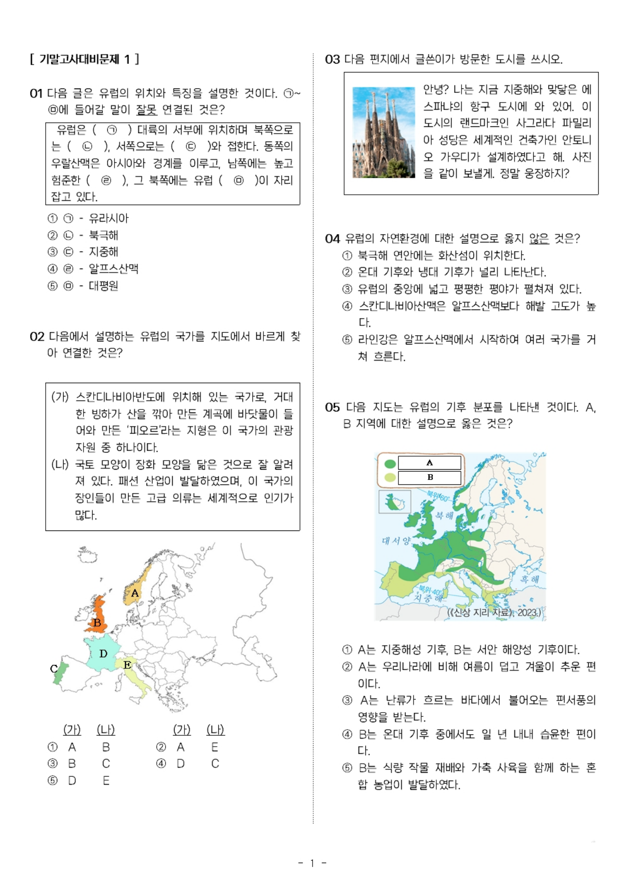
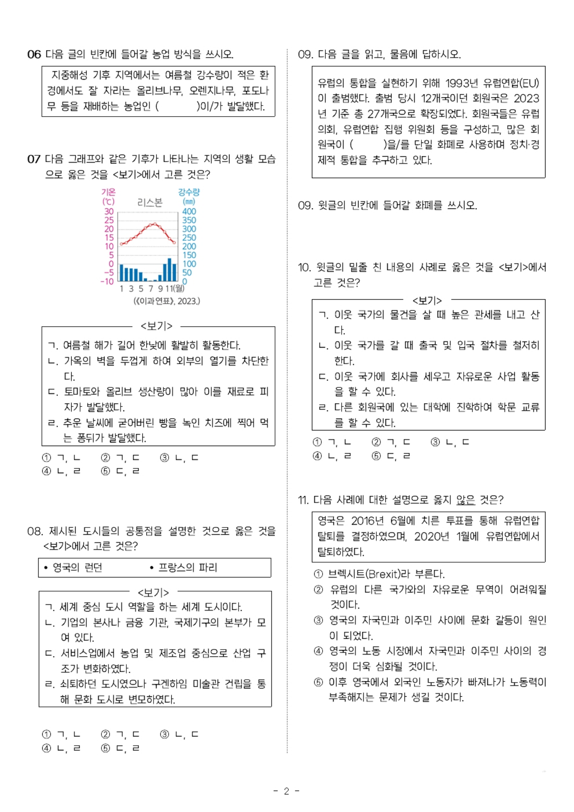
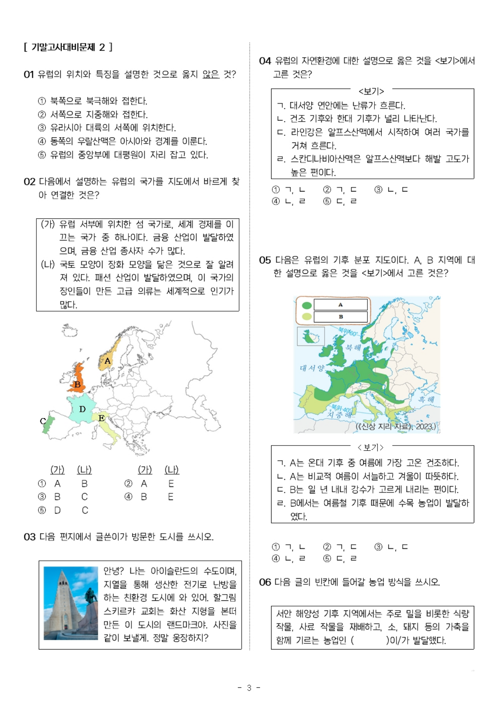
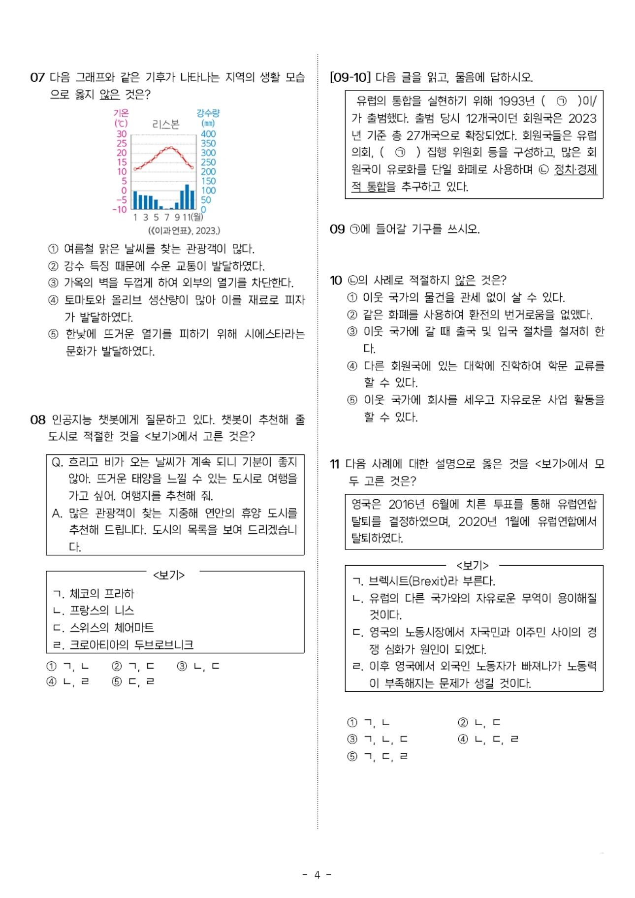
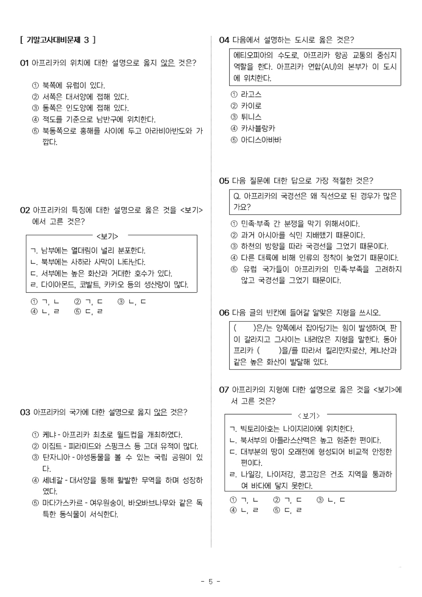
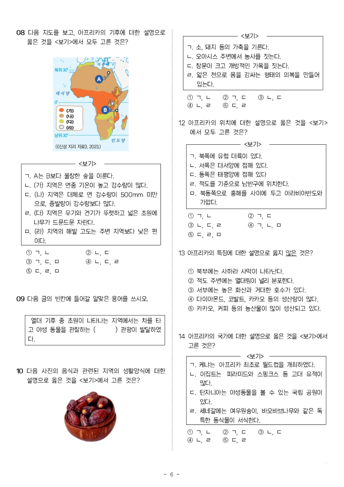
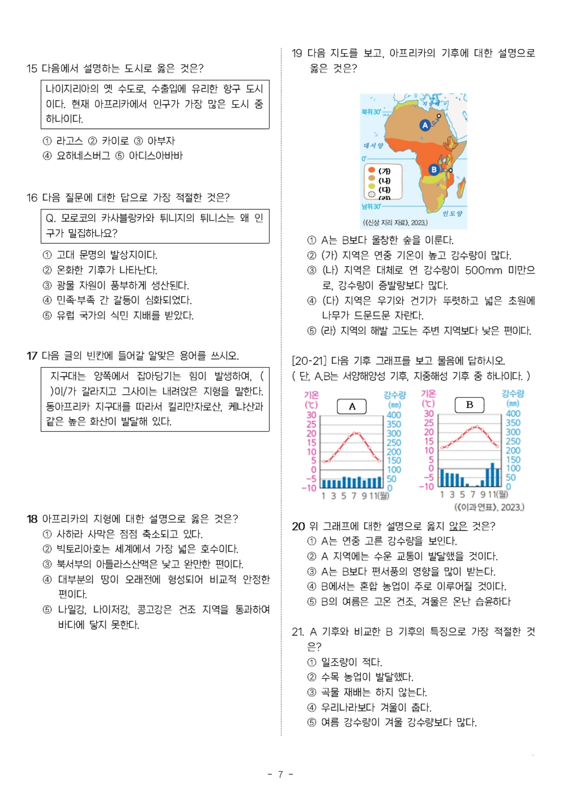

# 🧑‍🏫 선생님 배포 기말고사 대비문제 1~3 — 정답 및 해설 (지리: 유럽·아프리카)

> 원본: `사회자료/7학년 중간고사 대비문제(PDF).pdf` (7쪽, 선생님 배포 시험대비자료)
> 범위: **3단원 유럽**(대비문제 1·2) · **4.1 아프리카**(대비문제 3) — 교과서 p.52~75
> 원본에는 정답이 없어 교과서·서브노트 기준으로 풀었습니다. *(풀이 형식: 문제 → 답 → 이유)*
> 💡 사이트에서는 이 문서 **맨 끝 「단원 평가」에서 42문항을 직접 풀고 채점**할 수 있습니다(오답 노트·학습 현황에 기록). 정답표·해설은 풀고 나서 보세요.

---

## 📊 빠른 정답표

**대비문제 1 (유럽)**

| 번호 | 01 | 02 | 03 | 04 | 05 | 06 | 07 | 08 | 09 | 10 | 11 |
|:---:|:---:|:---:|:---:|:---:|:---:|:---:|:---:|:---:|:---:|:---:|:---:|
| 정답 | ③ | ② | 바르셀로나 | ④ | ③ | 수목 농업 | ③ | ① | 유로화 | ⑤ | ④ |

**대비문제 2 (유럽)**

| 번호 | 01 | 02 | 03 | 04 | 05 | 06 | 07 | 08 | 09 | 10 | 11 |
|:---:|:---:|:---:|:---:|:---:|:---:|:---:|:---:|:---:|:---:|:---:|:---:|
| 정답 | ② | ④ | 레이캬비크 | ② | ④ | 혼합 농업 | ② | ④ | 유럽 연합(EU) | ③ | ⑤ |

**대비문제 3 (아프리카)**

| 번호 | 01 | 02 | 03 | 04 | 05 | 06 | 07 | 08 | 09 | 10 |
|:---:|:---:|:---:|:---:|:---:|:---:|:---:|:---:|:---:|:---:|:---:|
| 정답 | ④ | ④ | ① | ⑤ | ⑤ | 지구대 | ③ | ② | 사파리 | ④ |

| 번호 | 12 | 13 | 14 | 15 | 16 | 17 | 18 | 19 | 20 | 21 |
|:---:|:---:|:---:|:---:|:---:|:---:|:---:|:---:|:---:|:---:|:---:|
| 정답 | ④ | ③ | ③ | ① | ② | 판 | ④ | ② | ④ | ② |

> 대비문제 3은 원본에 11번이 없습니다(10번 다음이 12번).

---

## [기말고사 대비문제 1] 유럽

### 01. ㉠~㉤에 들어갈 말이 **잘못** 연결된 것은?
> 유럽은 (㉠) 대륙의 서부, 북쪽은 (㉡), 서쪽은 (㉢)와 접한다. 동쪽 우랄산맥은 아시아와 경계, 남쪽에 높고 험준한 (㉣), 그 북쪽에 유럽 (㉤)
① ㉠-유라시아 ② ㉡-북극해 ③ ㉢-지중해 ④ ㉣-알프스산맥 ⑤ ㉤-대평원
- 답) **③**
- 이유) 유럽의 **서쪽은 대서양**, 지중해는 **남쪽**이다.

### 02. (가)·(나) 국가를 지도에서 바르게 찾은 것은?
(가) 스칸디나비아반도, 빙하가 깎은 계곡에 바닷물이 든 **피오르** (나) 국토가 **장화 모양**, 패션 산업
① A-B ② A-E ③ B-C ④ D-C ⑤ D-E
- 답) **②** (가) A 노르웨이, (나) E 이탈리아
- 이유) 지도 A=노르웨이, B=영국, C=포르투갈, D=프랑스, E=이탈리아.

### 03. 편지 속 도시를 쓰시오. (지중해와 맞닿은 스페인 항구 도시, 가우디의 **사그라다 파밀리아 성당**)
- 답) **바르셀로나**

### 04. 유럽 자연환경 설명으로 옳지 **않은** 것은?
① 북극해 연안에 화산섬이 있다. ② 온대·냉대 기후가 널리 나타난다. ③ 중앙에 넓고 평평한 평야 ④ 스칸디나비아산맥은 알프스산맥보다 해발 고도가 높다. ⑤ 라인강은 알프스에서 시작해 여러 나라를 거쳐 흐른다.
- 답) **④**
- 이유) 스칸디나비아산맥은 오래된 산맥이라 알프스산맥보다 **낮다**. ①은 아이슬란드.

### 05. 기후 지도의 A·B 설명으로 옳은 것은? (A=서·중부 진한 초록, B=지중해 연안 연두)
① A 지중해성, B 서안 해양성 ② A는 우리나라보다 여름 덥고 겨울 춥다 ③ A는 난류 위를 지나온 편서풍의 영향 ④ B는 일 년 내내 습윤 ⑤ B는 혼합 농업 발달
- 답) **③**
- 이유) A=**서안 해양성**(편서풍+북대서양 난류 → 여름 서늘, 겨울 온화). B=**지중해성**(여름 고온 건조, 수목 농업). ①은 반대, ②는 우리나라보다 여름 서늘·겨울 따뜻, ④⑤는 A의 특징.

### 06. 빈칸의 농업 방식 (지중해성 기후, 여름 건조에도 잘 자라는 올리브·오렌지·포도)
- 답) **수목 농업**

### 07. 리스본 기후 그래프(여름 비 거의 없음) 지역의 생활 모습 〈보기〉
ㄱ. 여름철 해가 길어 한낮에 활발히 활동 ㄴ. 가옥 벽을 두껍게 해 열기 차단 ㄷ. 토마토·올리브로 피자 발달 ㄹ. 굳은 빵을 녹인 치즈에 찍어 먹는 퐁뒤
① ㄱㄴ ② ㄱㄷ ③ ㄴㄷ ④ ㄴㄹ ⑤ ㄷㄹ
- 답) **③**
- 이유) 지중해성 기후는 한낮이 뜨거워 **시에스타**(낮잠)로 쉰다 → ㄱ ✕. 퐁뒤는 추운 **알프스(스위스)** 음식 → ㄹ ✕.

### 08. 런던·파리의 공통점 〈보기〉
ㄱ. 세계 도시 ㄴ. 기업 본사·금융 기관·국제기구 본부 ㄷ. 서비스업 → 농업·제조업으로 변화 ㄹ. 쇠퇴 도시가 구겐하임 미술관으로 문화 도시
① ㄱㄴ ② ㄱㄷ ③ ㄴㄷ ④ ㄴㄹ ⑤ ㄷㄹ
- 답) **①**
- 이유) ㄷ은 거꾸로(제조업 → 서비스업), ㄹ은 스페인 **빌바오**.

### 09. 빈칸의 화폐 (EU 회원국 다수가 단일 화폐로 사용)
- 답) **유로(유로화)**

### 10. 밑줄(정치·경제적 통합)의 사례 〈보기〉
ㄱ. 이웃 나라 물건에 높은 관세 ㄴ. 출입국 절차를 철저히 ㄷ. 이웃 나라에 회사를 세워 자유롭게 사업 ㄹ. 다른 회원국 대학 진학·학문 교류
① ㄱㄴ ② ㄱㄷ ③ ㄴㄷ ④ ㄴㄹ ⑤ ㄷㄹ
- 답) **⑤**
- 이유) 통합되면 **관세 없이** 무역하고 **국경을 자유롭게** 오간다 → ㄱ·ㄴ은 반대.

### 11. 영국의 EU 탈퇴(2016 투표, 2020년 1월 탈퇴) 설명으로 옳지 **않은** 것은?
① 브렉시트라 부른다 ② 다른 유럽 국가와 자유 무역이 어려워진다 ③ 자국민·이주민 문화 갈등이 원인 ④ 노동 시장에서 자국민·이주민 경쟁이 **더욱 심화될 것** ⑤ 외국인 노동자가 빠져나가 노동력 부족
- 답) **④**
- 이유) 이주민과의 일자리 경쟁은 탈퇴의 **원인**이다. 탈퇴 **뒤에는** 외국인 노동자가 줄어 경쟁이 심해지는 것이 아니라 노동력이 **부족**해진다(⑤).

---

## [기말고사 대비문제 2] 유럽

### 01. 유럽의 위치·특징으로 옳지 **않은** 것은?
① 북쪽 북극해 ② 서쪽 지중해 ③ 유라시아 대륙 서쪽 ④ 동쪽 우랄산맥이 아시아와 경계 ⑤ 중앙부 대평원
- 답) **②**
- 이유) 서쪽은 **대서양**, 지중해는 **남쪽**. (대비문제 1의 01번과 같은 함정)

### 02. (가)·(나) 국가 찾기
(가) 유럽 서부의 **섬나라**, 세계 경제를 이끄는 나라, **금융 산업** (나) **장화 모양**, 패션 산업
① A-B ② A-E ③ B-C ④ B-E ⑤ D-C
- 답) **④** (가) B 영국, (나) E 이탈리아

### 03. 편지 속 도시 (아이슬란드 수도, **지열** 전기 난방, 화산 지형을 본뜬 **할그림스키르캬 교회**)
- 답) **레이캬비크**

### 04. 유럽 자연환경으로 옳은 것 〈보기〉
ㄱ. 대서양 연안에 난류가 흐른다 ㄴ. 건조·한대 기후가 널리 ㄷ. 라인강은 알프스에서 시작해 여러 나라를 거쳐 흐른다 ㄹ. 스칸디나비아산맥이 알프스보다 높다
① ㄱㄴ ② ㄱㄷ ③ ㄴㄷ ④ ㄴㄹ ⑤ ㄷㄹ
- 답) **②**
- 이유) 유럽은 **온대·냉대**가 널리 나타남(ㄴ ✕). 스칸디나비아산맥은 알프스보다 **낮음**(ㄹ ✕).

### 05. 기후 지도 A·B 설명 〈보기〉 (A=서안 해양성, B=지중해성)
ㄱ. A는 온대 중 여름에 가장 고온 건조 ㄴ. A는 여름 서늘·겨울 따뜻 ㄷ. B는 일 년 내내 강수가 고르다 ㄹ. B는 여름 기후 때문에 수목 농업 발달
① ㄱㄴ ② ㄱㄷ ③ ㄴㄷ ④ ㄴㄹ ⑤ ㄷㄹ
- 답) **④**
- 이유) ㄱ은 B(지중해성), ㄷ은 A(서안 해양성)의 특징.

### 06. 빈칸의 농업 방식 (서안 해양성, 밀 등 식량 작물·사료 작물 + 소·돼지 가축을 **함께**)
- 답) **혼합 농업**
- 💡 대비문제 1의 06번(지중해성 → **수목 농업**)과 짝으로 외우기.

### 07. 리스본 기후 지역의 생활 모습으로 옳지 **않은** 것은?
① 여름 맑은 날씨로 관광객 많음 ② 강수 특징 때문에 수운 교통 발달 ③ 두꺼운 벽 ④ 토마토·올리브로 피자 ⑤ 시에스타
- 답) **②**
- 이유) 일 년 내내 비가 고르게 내려 강물이 많은 **서안 해양성 기후**에서 수운 교통이 발달한다. 리스본은 여름에 비가 거의 없다.

### 08. 챗봇이 추천할 지중해 연안 휴양 도시 〈보기〉
ㄱ. 체코 프라하 ㄴ. 프랑스 니스 ㄷ. 스위스 체어마트 ㄹ. 크로아티아 두브로브니크
① ㄱㄴ ② ㄱㄷ ③ ㄴㄷ ④ ㄴㄹ ⑤ ㄷㄹ
- 답) **④**
- 이유) 프라하는 내륙(체코), 체어마트는 알프스 산악 마을. 니스·두브로브니크는 지중해 연안.

### 09. ㉠에 들어갈 기구 (1993년 출범, 12개국 → 2023년 27개국)
- 답) **유럽 연합(EU)**

### 10. ㉡ 정치·경제적 통합의 사례로 적절하지 **않은** 것은?
① 관세 없이 물건 구입 ② 같은 화폐로 환전 번거로움 없앰 ③ 출입국 절차를 철저히 ④ 다른 회원국 대학 진학 ⑤ 이웃 나라에 회사 설립
- 답) **③**
- 이유) 통합되면 국경을 **자유롭게** 오간다.

### 11. 영국 EU 탈퇴 설명으로 옳은 것 **모두** 〈보기〉
ㄱ. 브렉시트 ㄴ. 다른 유럽 국가와 자유 무역이 **용이해질** 것 ㄷ. 노동 시장의 자국민·이주민 경쟁 심화가 원인 ㄹ. 이후 외국인 노동자가 빠져나가 노동력 부족
① ㄱㄴ ② ㄴㄷ ③ ㄱㄴㄷ ④ ㄴㄷㄹ ⑤ ㄱㄷㄹ
- 답) **⑤**
- 이유) 탈퇴하면 자유 무역은 **어려워진다**(ㄴ ✕).

---

## [기말고사 대비문제 3] 아프리카

### 01. 아프리카 위치로 옳지 **않은** 것은?
① 북쪽에 유럽 ② 서쪽 대서양 ③ 동쪽 인도양 ④ 적도 기준 **남반구**에 위치 ⑤ 북동쪽 홍해 건너 아라비아반도
- 답) **④**
- 이유) **적도가 대륙 가운데**를 지나 북반구와 남반구에 걸쳐 있다.

### 02. 아프리카 특징으로 옳은 것 〈보기〉
ㄱ. 남부에 열대림 ㄴ. 북부에 사하라 사막 ㄷ. 서부에 높은 화산·거대한 호수 ㄹ. 다이아몬드·코발트·카카오 생산 많음
① ㄱㄴ ② ㄱㄷ ③ ㄴㄷ ④ ㄴㄹ ⑤ ㄷㄹ
- 답) **④**
- 이유) 열대림은 **적도 주변**(ㄱ ✕), 높은 화산·호수는 **동부** 지구대(ㄷ ✕).

### 03. 아프리카 국가 설명으로 옳지 **않은** 것은?
① 케냐 - 아프리카 최초 월드컵 ② 이집트 - 피라미드·스핑크스 ③ 탄자니아 - 야생 동물 국립 공원 ④ 세네갈 - 대서양 무역으로 성장 ⑤ 마다가스카르 - 여우원숭이·바오바브나무
- 답) **①**
- 이유) 아프리카 최초 월드컵은 **남아프리카 공화국**.

### 04. 에티오피아 수도, 아프리카 항공 교통 중심, **아프리카 연합(AU) 본부**
- 답) **⑤ 아디스아바바**

### 05. 아프리카 국경선이 직선인 경우가 많은 까닭
- 답) **⑤** 유럽 국가들이 민족·부족을 고려하지 않고 국경선을 그었기 때문이다.

### 06. 빈칸의 지형 (양쪽에서 잡아당겨 판이 갈라지고 내려앉은 지형, 동아프리카 ○○○ → 킬리만자로산·케냐산)
- 답) **지구대**

### 07. 아프리카 지형으로 옳은 것 〈보기〉
ㄱ. 빅토리아호는 나이지리아에 ㄴ. 북서부 아틀라스산맥은 높고 험준 ㄷ. 대부분 땅이 오래전 형성돼 안정 ㄹ. 나일·나이저·콩고강은 바다에 닿지 못함
① ㄱㄴ ② ㄱㄷ ③ ㄴㄷ ④ ㄴㄹ ⑤ ㄷㄹ
- 답) **③**
- 이유) 빅토리아호는 **동아프리카**(케냐·우간다·탄자니아) (ㄱ ✕). 큰 강들은 **바다로 흘러간다**(ㄹ ✕).

### 08. 아프리카 기후 지도 〈보기〉에서 옳은 것 **모두**
지도: (가) 적도 주변 진한 주황 = **열대**, (나) 북부·남서부 황토색 = **건조**, (다) 북쪽 지중해 연안·남아공 연두 = **온대**, (라) 동부 점무늬 = **고산**. A는 사하라, B는 동아프리카 고원.
ㄱ. A가 B보다 울창한 숲 ㄴ. (가)는 연중 고온·강수 많음 ㄷ. (나)는 연 강수 500mm 미만, 증발량 > 강수량 ㄹ. (다)는 우기·건기 뚜렷한 초원 ㅁ. (라)는 주변보다 해발 고도 낮음
① ㄱㄴ ② ㄴㄷ ③ ㄱㄷㅁ ④ ㄴㄷㄹ ⑤ ㄷㄹㅁ
- 답) **②**
- 이유) A는 사막(ㄱ ✕). (다)는 **온대**라서 사바나 설명이 아니다(ㄹ ✕). 고산 기후는 해발 고도가 **높다**(ㅁ ✕).

### 09. 열대 초원에서 차를 타고 야생 동물을 관찰하는 (  ) 관광
- 답) **사파리**

### 10. 사진(**대추야자**) 음식과 관련된 지역의 생활 양식 〈보기〉
ㄱ. 소·돼지 사육 ㄴ. 오아시스 주변 농사 ㄷ. 창문이 크고 개방적인 가옥 ㄹ. 얇은 천으로 몸을 감싸는 옷
① ㄱㄴ ② ㄱㄷ ③ ㄴㄷ ④ ㄴㄹ ⑤ ㄷㄹ
- 답) **④**
- 이유) 대추야자 = **건조 기후**·오아시스. 가옥은 창문이 **작고** 벽이 두껍다(ㄷ ✕). 가축은 낙타·양·염소(ㄱ ✕).

### 12. 아프리카 위치로 옳은 것 **모두** 〈보기〉
ㄱ. 북쪽 유럽 ㄴ. 서쪽 대서양 ㄷ. 동쪽 **태평양** ㄹ. 남반구에 위치 ㅁ. 북동쪽 홍해 건너 아라비아반도
① ㄱㄴ ② ㄱㄷ ③ ㄴㄷㄹ ④ ㄱㄴㅁ ⑤ ㄷㄹㅁ
- 답) **④**
- 이유) 동쪽은 **인도양**(ㄷ ✕), 적도가 가운데를 지남(ㄹ ✕).

### 13. 아프리카 특징으로 옳지 **않은** 것은?
① 북부 사하라 ② 적도 주변 열대림 ③ **서부**에 높은 화산·거대한 호수 ④ 다이아몬드·코발트·카카오 ⑤ 카카오·커피 등 농산물
- 답) **③** (높은 화산·호수는 **동부**)

### 14. 아프리카 국가로 옳은 것 〈보기〉
ㄱ. 케냐 최초 월드컵 ㄴ. 이집트 피라미드·스핑크스 ㄷ. 탄자니아 국립 공원 ㄹ. **세네갈** 여우원숭이·바오바브나무
① ㄱㄴ ② ㄱㄷ ③ ㄴㄷ ④ ㄴㄹ ⑤ ㄷㄹ
- 답) **③**
- 이유) 월드컵은 **남아공**, 여우원숭이·바오바브나무는 **마다가스카르**.

### 15. 나이지리아의 옛 수도, 수출입에 유리한 항구 도시, 아프리카 최대 인구 도시 중 하나
① 라고스 ② 카이로 ③ 아부자 ④ 요하네스버그 ⑤ 아디스아바바
- 답) **①** (아부자는 **지금** 수도)

### 16. 모로코 카사블랑카·튀니지 튀니스에 인구가 밀집한 까닭
- 답) **②** 온화한 기후(지중해성)가 나타난다.

### 17. 지구대: 양쪽에서 잡아당겨 (  )이 갈라지고 그 사이가 내려앉은 지형
- 답) **판**

### 18. 아프리카 지형으로 옳은 것은?
① 사하라 사막은 점점 축소 ② 빅토리아호는 세계에서 가장 넓은 호수 ③ 아틀라스산맥은 낮고 완만 ④ 대부분 땅이 오래전 형성되어 비교적 안정 ⑤ 큰 강들이 바다에 닿지 못함
- 답) **④**
- 이유) 사하라는 **확대**(사막화), 빅토리아호는 **아프리카에서** 가장 넓은 호수, 아틀라스산맥은 **높고 험준**.

### 19. 기후 지도(08번과 같은 지도)의 설명으로 옳은 것은?
① A가 B보다 울창한 숲 ② (가)는 연중 고온·강수 많음 ③ (나)는 강수량 500mm 미만, **강수량이 증발량보다 많다** ④ (다)는 우기·건기 뚜렷한 초원 ⑤ (라)는 해발 고도 낮음
- 답) **②**
- 이유) ③은 거꾸로(증발량 > 강수량), ④ (다)는 온대, ⑤ 고산은 높다.

### 20~21. 기후 그래프 A·B (서안 해양성·지중해성 중 하나)
- A: 비가 **일 년 내내 고르게** 옴 → **서안 해양성** / B: **여름 비 거의 없음** → **지중해성**

**20.** 옳지 **않은** 것은? ① A 연중 고른 강수 ② A 수운 교통 발달 ③ A가 B보다 편서풍 영향 많이 받음 ④ **B는 혼합 농업** ⑤ B 여름 고온 건조, 겨울 온난 습윤
- 답) **④** (혼합 농업은 A. B는 **수목 농업**)

**21.** A와 비교한 B의 특징으로 가장 적절한 것은? ① 일조량이 적다 ② 수목 농업 발달 ③ 곡물 재배는 하지 않는다 ④ 우리나라보다 겨울이 춥다 ⑤ 여름 강수량이 겨울보다 많다
- 답) **②**
- 이유) 지중해성은 여름이 맑아 일조량이 **많고**, 겨울에 밀을 재배하며, 겨울이 우리나라보다 **따뜻하고**, 비는 **겨울**에 많다.

---

## ⭐ 선생님 대비문제에 되풀이된 함정 10가지

1. 유럽 **서쪽 = 대서양**, 남쪽 = 지중해 (두 번 출제)
2. **스칸디나비아산맥 < 알프스산맥** (높이, 두 번 출제)
3. **서안 해양성** = 편서풍+난류, 여름 서늘·겨울 온화, 연중 고른 비 → **혼합 농업·낙농업·수운 교통**
4. **지중해성** = 여름 고온 건조·겨울 온난 습윤 → **수목 농업**(올리브·포도·오렌지), **시에스타**, 두꺼운 벽, 피자
5. 퐁뒤 = 알프스, 빌바오 = 구겐하임 미술관, 니스·두브로브니크 = 지중해 휴양지
6. EU 통합 = 관세 없음·국경 자유·유로화 / 브렉시트 원인 = **이주민과 일자리 경쟁**, 결과 = 자유 무역 어려움·**노동력 부족**
7. 아프리카는 **적도가 가운데** → 북·남반구 모두, 동쪽은 **인도양**
8. **동부** = 지구대·킬리만자로·빅토리아호(아프리카 최대) / **북서부** = 아틀라스산맥(높고 험준)
9. 월드컵 = **남아공**, 여우원숭이·바오바브 = **마다가스카르**, AU 본부 = **아디스아바바**, 옛 수도 항구 = **라고스**
10. 건조 기후 = 증발량 **>** 강수량, 오아시스·대추야자·작은 창문 / 고산 기후 = 해발 고도 **높음**
