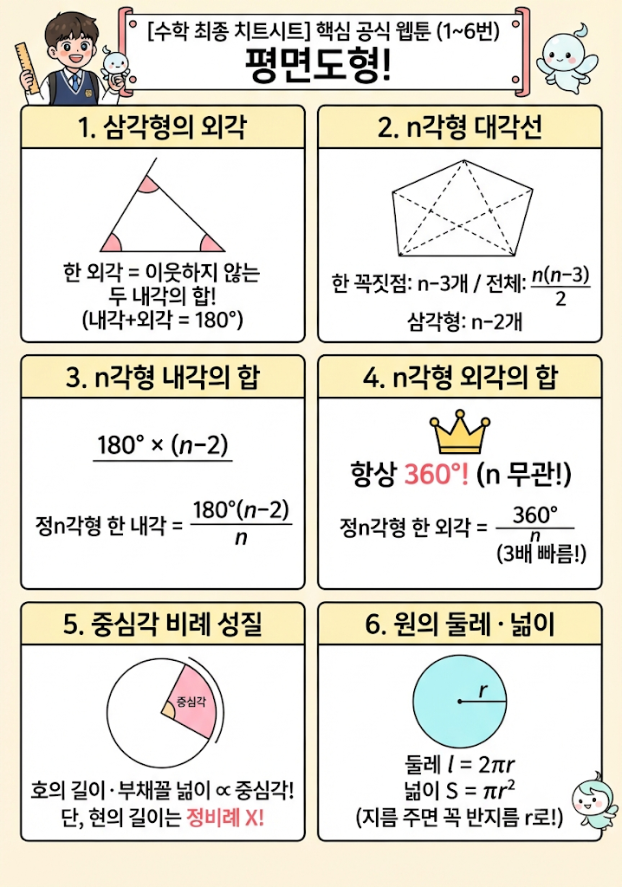
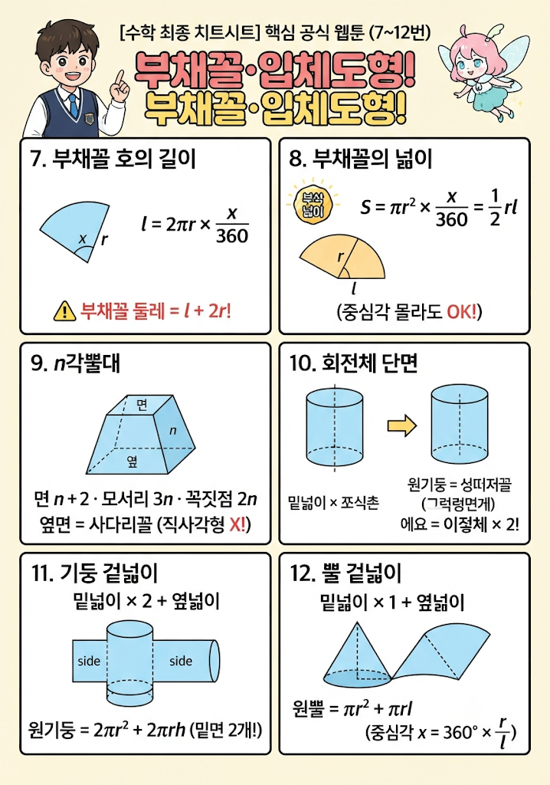
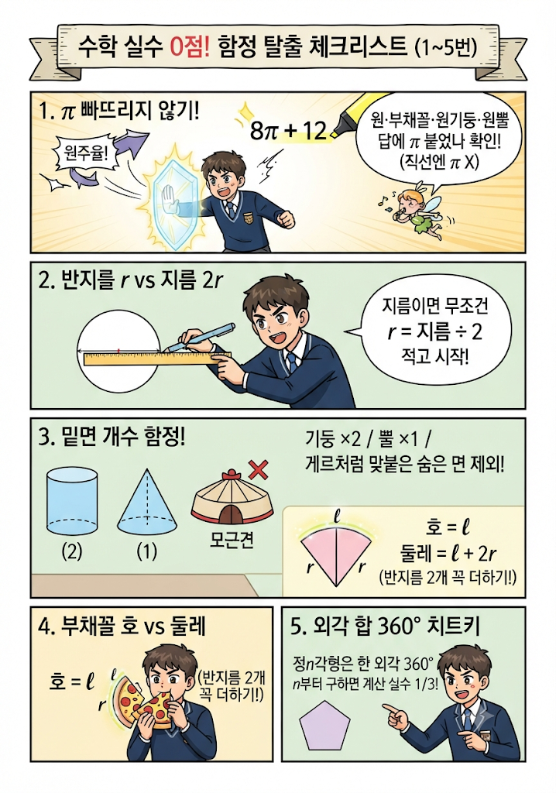
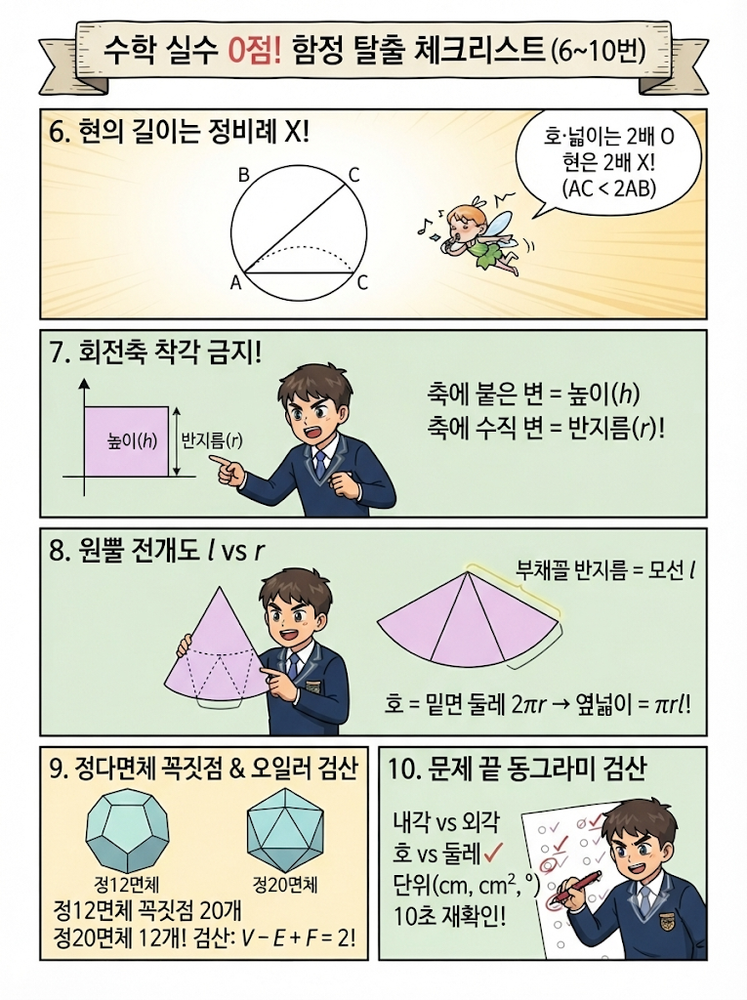

# ⚡ 시험 직전 10분 최종 치트시트 — 2026 7학년 2학기 2회고사 수학

> **시험 전날 밤 & 시험 직전 쉬는 시간용 1장 공식 압축본**  
> **시험 범위**: 교과서 p.183~223 — 6.2 삼각형의 내각과 외각 ~ 6.6 부채꼴의 호의 길이와 넓이 · 7.1 다면체 ~ 7.3 기둥과 뿔의 겉넓이  
> **※ 범위 주의**: **7.4 기둥과 뿔의 부피 · 7.5 구의 겉넓이와 부피 · 8단원 통계**는 이번 시험 범위 **밖**입니다!  
> **목표**: 어려운 문제는 이미 잘 푸니, **공식 대입·기호($\pi$)·계산 실수 0개**로 **95점+ 달성!**

---

## 🧠 마인드맵 정리

> 가지를 누르면 접고 펼 수 있어요. 먼저 큰 그림을 보고 아래 표로 내려가세요.

```mindmap
수학 2회고사
  다각형 (6.2~6.4)
    삼각형의 외각
      = 이웃하지 않는 두 내각의 합
    대각선
      한 꼭짓점: n − 3
      전체: n(n − 3) ÷ 2
    내각의 합
      180° × (n − 2)
    외각의 합
      항상 360°
      정n각형 한 외각 = 360° ÷ n
  원과 부채꼴 (6.5~6.6)
    중심각
      호·넓이는 정비례
      현은 정비례 ✕
    원
      둘레 2πr
      넓이 πr²
    부채꼴
      호 l = 2πr × x/360
      넓이 = πr² × x/360 = ½rl
      둘레 = l + 2r
  다면체 (7.1)
    n각뿔대
      면 n + 2 · 모서리 3n · 꼭짓점 2n
      옆면 = 사다리꼴
    정다면체 (면·꼭짓점·모서리)
      정사면체 4 · 4 · 6
      정육면체 6 · 8 · 12
      정팔면체 8 · 6 · 12
      정십이면체 12 · 20 · 30
      정이십면체 20 · 12 · 30
    검산
      V − E + F = 2
  회전체 (7.2)
    축에 수직인 단면
      항상 원
    축을 포함하는 단면
      원기둥: 직사각형
      원뿔: 이등변삼각형
      원뿔대: 등변사다리꼴
      구: 원
  겉넓이 (7.3)
    기둥
      밑넓이 × 2 + 옆넓이
      원기둥 2πr² + 2πrh
    뿔
      밑넓이 × 1 + 옆넓이
      원뿔 πr² + πrl
      전개도 중심각 = 360° × r/l
  실수 0점
    π 붙였는지 확인
    지름 → 반지름으로 바꾸기
    범위 밖
      부피 · 구 · 통계
```

---

## 1️⃣ 절대 잊지 말아야 할 핵심 공식 12개

| 번호 | 단원 | 개념 | 핵심 공식 / 성질 | 실수 주의 포인트 |
| :---: | :---: | :--- | :--- | :--- |
| **1** | 6.2 | **삼각형의 외각** | $\text{한 외각} = \text{이웃하지 않는 두 내각의 합}$ | 한 꼭짓점: $\text{내각} + \text{외각} = 180^\circ$ |
| **2** | 6.1·6.3 | **$n$각형 대각선** *(연계)* | 한 꼭짓점: $n-3$개 / 전체: $\dfrac{n(n-3)}{2}$개 | 나누어지는 삼각형 수 = **$n-2$**개 |
| **3** | 6.3 | **$n$각형 내각의 합** | $180^\circ \times (n-2)$ | 정$n$각형 한 내각: $\dfrac{180^\circ(n-2)}{n}$ |
| **4** | 6.4 | **$n$각형 외각의 합** | **항상 $360^\circ$** ($n$과 무관!) | 정$n$각형 한 외각: $\dfrac{360^\circ}{n}$ *(먼저 구하면 3배 빠름!)* |
| **5** | 6.5 | **중심각 비례 성질** | **호의 길이, 부채꼴 넓이** $\propto$ 중심각 | **현의 길이**는 중심각에 **정비례하지 않는다!** |
| **6** | 6.6 | **원의 둘레 · 넓이** | 둘레 $l = 2\pi r$ / 넓이 $S = \pi r^2$ | 문제에 **지름**을 주면 반드시 반지름 $r$로 바꾸기! |
| **7** | 6.6 | **부채꼴 호의 길이** | $l = 2\pi r \times \dfrac{x}{360}$ | 부채꼴 **둘레** = 호의 길이 $l$ **$+ 2r$**! |
| **8** | 6.6 | **부채꼴의 넓이** | $S = \pi r^2 \times \dfrac{x}{360} = \mathbf{\dfrac{1}{2}rl}$ | 중심각을 몰라도 $r, l$만 알면 $\frac{1}{2}rl$ 바로 사용! |
| **9** | 7.1 | **각기둥·각뿔·각뿔대** | $n$각뿔대: 면 $n+2$, 모서리 $3n$, 꼭짓점 $2n$ | 각뿔대 옆면 = **사다리꼴** (직사각형 X) |
| **10** | 7.2 | **회전체 단면** | 축에 **수직** = 항상 **원** / 축 **포함** = **선대칭도형(합동)** | 축 포함 단면 넓이 = 회전 전 도형 넓이 **$\times 2$** |
| **11** | 7.3 | **기둥의 겉넓이** | $(\text{밑넓이}) \times \mathbf{2} + (\text{옆넓이})$ | 원기둥: $2\pi r^2 + 2\pi r h$ *(밑면 **2개**!)* |
| **12** | 7.3 | **뿔의 겉넓이** | $(\text{밑넓이}) \times \mathbf{1} + (\text{옆넓이})$ | 원뿔: $\pi r^2 + \mathbf{\pi r l}$ *(전개도 중심각 $x = 360^\circ \times \dfrac{r}{l}$)* |





---

## 2️⃣ 시험장 1초 암기표 — 정다면체 5종 & 회전체 단면 ⭐ 최빈출!

### ① 정다면체 5종 완벽 비교표 *(2025 KIS 기출 6번!)*

| 정다면체 | 면의 모양 | 한 꼭짓점에 모인 면의 수 | 면 ($F$) | 꼭짓점 ($V$) | 모서리 ($E$) | 검산 ($V-E+F$) |
| :--- | :---: | :---: | :---: | :---: | :---: | :---: |
| **정사면체** | 정삼각형 | **3** | 4 | **4** | **6** | $4-6+4=2$ |
| **정육면체** | 정사각형 | **3** | 6 | **8** | **12** | $8-12+6=2$ |
| **정팔면체** | 정삼각형 | **4** | 8 | **6** | **12** | $6-12+8=2$ |
| **정십이면체** | 정오각형 | **3** | 12 | **20** | **30** | $20-30+12=2$ |
| **정이십면체** | 정삼각형 | **5** | 20 | **12** | **30** | $12-30+20=2$ |

> 💡 **1초 암기 꿀팁**:
> - **짝꿍(쌍대) 암기**: 정육면체(면6·꼭8·모12) ↔ 정팔면체(면8·꼭6·모12) / 정십이면체(면12·꼭20·모30) ↔ 정이십면체(면20·꼭12·모30) — **면과 꼭짓점 수가 서로 뒤바뀌고 모서리 수는 같다!**
> - **한 꼭짓점 면 수**: 정삼각형(**3, 4, 5**), 정사각형(**3**), 정오각형(**3**)
> - **정다면체가 5개뿐인 이유**: ① 한 꼭짓점에 **3개 이상**의 면이 모여야 입체가 되고, ② 모인 내각의 합이 **$360^\circ$보다 작아야** 한다! (정육각형 $120^\circ \times 3 = 360^\circ$ → 평면이 되어 불가!)

### ② 회전체 4종 단면 1초 비교표

| 회전체 | 회전시키는 평면도형 | 회전축에 **수직**인 단면 | 회전축을 **포함**하는 단면 | 전개도 옆면 |
| :--- | :---: | :---: | :---: | :---: |
| **원기둥** | 직사각형 | 원 *(크기 일정)* | **직사각형** | 직사각형 |
| **원뿔** | 직각삼각형 | 원 *(크기 변함)* | **이등변삼각형** | **부채꼴** |
| **원뿔대** | 직각사다리꼴 | 원 *(크기 변함)* | **등변사다리꼴** | 큰 부채꼴 − 작은 부채꼴 |
| **구** | 반원 | 원 *(어느 방향이든 항상 원!)* | **원** *(가장 큰 원)* | 전개도 없음 |

---

## 3️⃣ ⚠️ 아들을 위한 「실수 0점」 검산 루틴 & 함정 탈출 10선

지난 1회고사(85.7점)에서 **어려운 문제는 맞히고 쉬운 계산·공식·기호 실수로 깎인 점수**를 완벽히 되찾는 10가지 방패입니다!

1. **[$\pi$ 빠뜨리지 않기!]** 원·부채꼴·원기둥·원뿔 답을 쓸 때 **숫자 뒤에 $\pi$가 붙는지** 마지막에 형광펜처럼 눈으로 확인! *(단, "$\pi$를 포함한 식"에서 직선 길이는 $\pi$가 안 붙음: 예 $8\pi + 12$)*
2. **[반지름 $r$ vs 지름 $2r$]** 문제에 주어진 길이가 **지름**인지 **반지름**인지 밑줄 긋고, 공식 대입 전 반드시 $r = \dfrac{\text{지름}}{2}$로 적고 시작!
3. **[밑면 2개(기둥) vs 1개(뿔) vs 0개(안내판/붙인 면)]**
   - 기둥 겉넓이 = 밑넓이 **$\times 2$** + 옆넓이
   - 뿔 겉넓이 = 밑넓이 **$\times 1$** + 옆넓이
   - **게르(원기둥+원뿔)처럼 맞붙은 도형**: 안쪽으로 숨은 밑면은 **겉넓이에서 반드시 제외!**
4. **[부채꼴 '호의 길이' vs '둘레의 길이']**
   - **호의 길이** = $l$ (곡선만!)
   - **부채꼴의 둘레** = $l + \mathbf{2r}$ (곡선 + 양쪽 반지름 2개! 반지름 안 더하면 100% 감점!)
5. **[외각의 합은 항상 $360^\circ$!]** 십각형이든 백각형이든 외각의 합은 **무조건 $360^\circ$**! 정다각형 문제가 나오면 **한 외각 $\dfrac{360^\circ}{n}$부터 구하고** $180^\circ - \text{외각}$으로 내각을 구하면 계산 실수가 1/3로 줄어든다!
6. **[현의 길이는 정비례 X!]** 한 원에서 중심각이 2배가 되면 호의 길이와 부채꼴 넓이는 2배가 되지만, **현의 길이는 2배가 되지 않는다!** ($\overline{AC} < 2\overline{AB}$)
7. **[회전축 착각 금지!]** 가로 $a$, 세로 $b$인 직사각형을 회전할 때 **어느 변이 회전축인지** 확인!
   - 회전축에 붙은 변 = **높이($h$)**, 회전축에 수직인 변 = **반지름($r$)**!
8. **[원뿔 전개도 '모선 $l$' vs '밑면 반지름 $r$']**
   - 부채꼴의 **반지름 = 원뿔의 모선($l$)**, 부채꼴의 **호의 길이 = 밑면 원의 둘레($2\pi r$)**!
   - 따라서 원뿔 옆넓이 = $\frac{1}{2} \times l \times 2\pi r = \mathbf{\pi r l}$, 중심각 = $360^\circ \times \dfrac{r}{l}$!
9. **[정다면체 '꼭짓점 수' vs '한 꼭짓점 면 수']**
   - 정십이면체 꼭짓점은 **20개**(12개 X!), 정이십면체 꼭짓점은 **12개**(20개 X!)
   - **오일러 공식 검산**: $V - E + F = 2$가 안 나오면 100% 틀린 것!
10. **[문제 끝 동그라미 검산]** "내각" vs "**외각**", "호의 길이" vs "**둘레**", "옳은 것" vs "옳지 **않은** 것", "단위($\text{cm}$, $\text{cm}^2$, $\text{m}^2$, $^\circ$)"에 동그라미 치고 마킹 전 10초 재확인!




