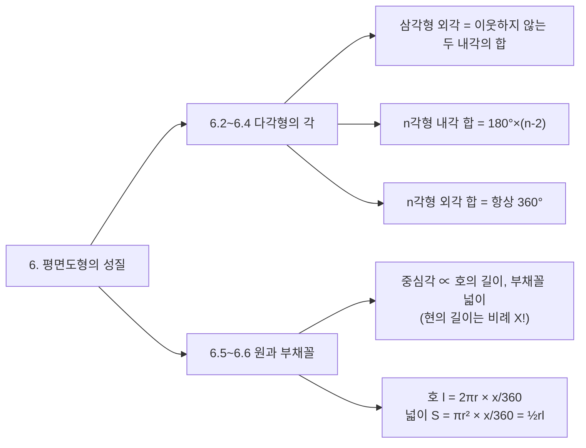
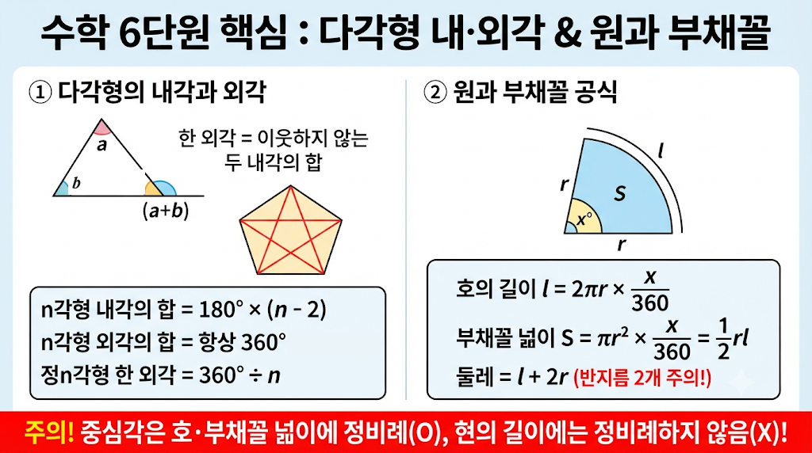
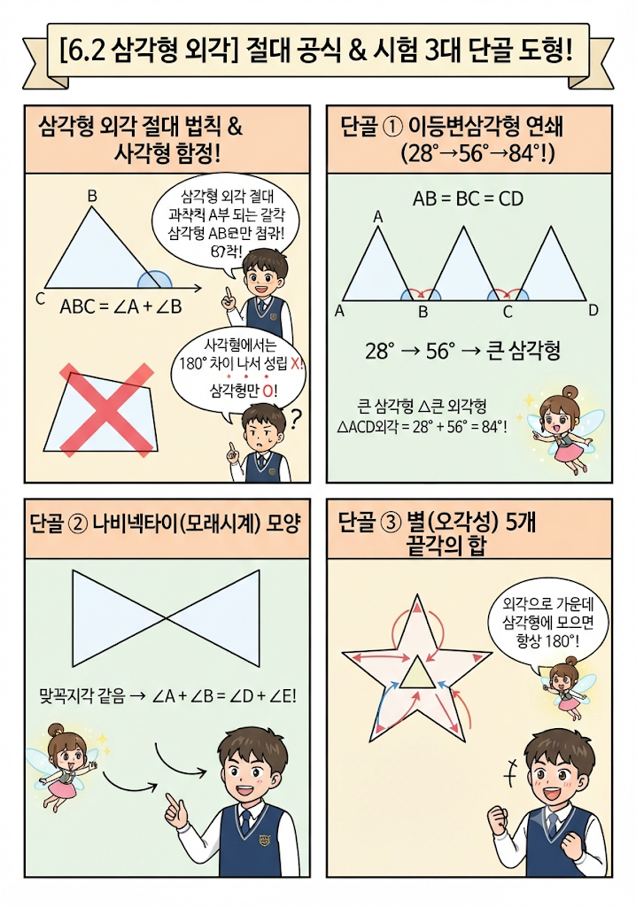
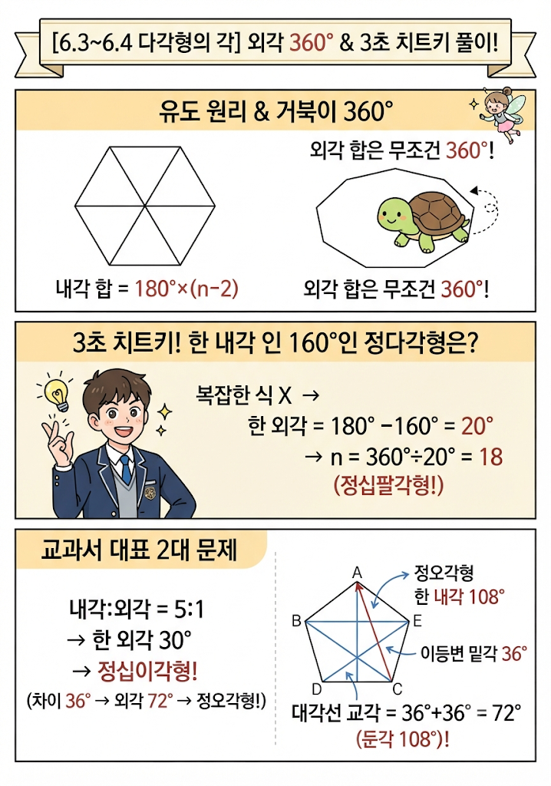
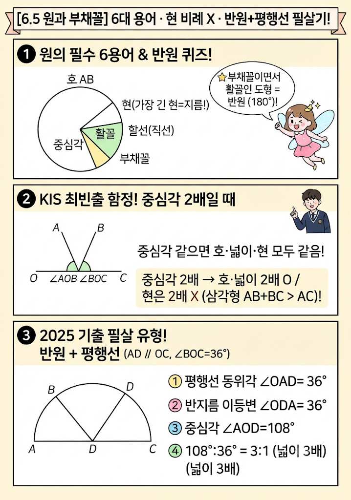
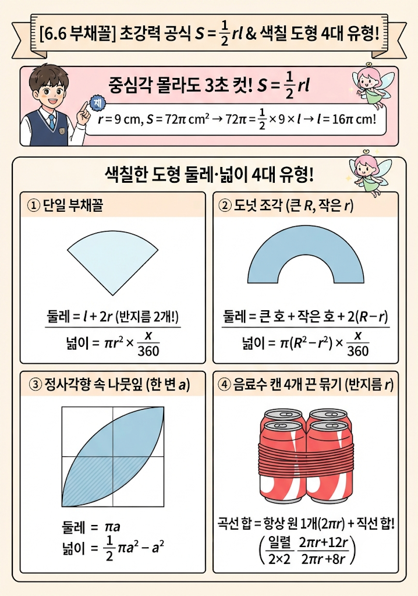

# 📘 6단원 평면도형의 성질 (6.2~6.6) — 다각형과 부채꼴 완벽 정리

> **교과서 범위**: p.183 ~ 203 (6.2 삼각형의 내각과 외각 · 6.3 다각형의 내각의 크기의 합 · 6.4 다각형의 외각의 크기의 합 · 6.5 원과 부채꼴 · 6.6 부채꼴의 호의 길이와 넓이)  
> **연계 기출**: 2025 KIS 7학년 2학기 2차 기출 8, 9, 16, 17, 18번 + 교과서 p.185~203 발전·서술형  
> **학습 목표**: 공식 유도 원리를 이해해 흔들리지 않고, 부채꼴 공식($S = \frac{1}{2}rl$)과 외각 성질로 계산 실수를 0%로 줄이기

---

## 🎯 한눈에 보는 6단원 개념 지도

---

## 01. 삼각형의 내각과 외각 (교과서 6.2, p.183~185)

> 🎬 **개념 몽타주 영상 (1분 46초)** — 외각의 성질 · 방정식 · 이등변삼각형 연쇄 · 별 모양을 한 번에 정리해요.

<video controls preload="metadata" playsinline poster="exam/%EC%88%98%ED%95%99_%EC%8B%9C%ED%97%98%EA%B3%B5%EB%B6%80/videos/mat_01_triangle_poster.jpg" src="exam/%EC%88%98%ED%95%99_%EC%8B%9C%ED%97%98%EA%B3%B5%EB%B6%80/videos/mat_01_triangle.mp4" style="width:100%;max-width:960px;border-radius:12px;display:block;margin:0 auto 1em;background:#000"></video>

### 1) 내각과 외각의 뜻
- **내각**: 다각형에서 이웃한 두 변이 이루는 **내부의 각**
- **외각**: 한 꼭짓점에서 한 변과 이웃한 다른 한 변의 **연장선**이 이루는 각
  - 한 내각의 외각은 2개이며 맞꼭지각으로 크기가 같으므로 **둘 중 하나만** 생각한다.
- **절대 공식**: 다각형의 한 꼭짓점에서
  $$(\text{내각의 크기}) + (\text{외각의 크기}) = 180^\circ$$

### 2) 삼각형의 내각과 외각 사이의 관계 ⭐ 최빈출!
$$\triangle ABC\text{에서 } \angle A + \angle B + \angle C = 180^\circ,\quad \angle ACD + \angle C = 180^\circ$$
$$\Longrightarrow \quad \mathbf{\angle ACD = \angle A + \angle B}$$

> 🔑 **핵심 법칙**: **삼각형의 한 외각의 크기는 그와 이웃하지 않는 두 내각의 크기의 합과 같다.**
> - ⚠️ **교과서 생각 넓히기 함정 (p.184)**: *"사각형 $ABCD$에서도 $\angle A + \angle B + \angle D = (\angle C\text{의 외각})$이 성립할까?"*  
>   → **틀림(X)!** 사각형 내각 합은 $360^\circ$이므로 $\angle A + \angle B + \angle D = 360^\circ - \angle C$, 반면 $\angle C$의 외각은 $180^\circ - \angle C$라서 **$180^\circ$만큼 차이**가 난다! (삼각형에서만 성립!)

### 3) 교과서 대표 유형 풀이 (p.185)
- **유형 ① 방정식 세우기**: $\triangle ABC$에서 $\angle A = (2x+10)^\circ$, $\angle B = (x+20)^\circ$이고 $\angle C$의 외각이 $120^\circ$이면
  $$(2x+10) + (x+20) = 120 \implies 3x = 90 \implies x = 30$$
- **유형 ② 이등변삼각형 연쇄 (p.185 5번 ⭐ 단골!)**:
  - 이등변삼각형은 **두 밑각의 크기가 같다** + **외각 = 이웃하지 않는 두 내각의 합**을 반복 적용!
  - 예: $\overline{AB}=\overline{BC}=\overline{CD}$이고 $\angle BAC = 28^\circ$일 때
    1. $\triangle ABC$ 이등변 → $\angle BCA = 28^\circ$
    2. $\triangle ABC$의 외각 $\angle CBD = 28^\circ + 28^\circ = 56^\circ$
    3. $\triangle BCD$ 이등변 → $\angle CDB = 56^\circ$
    4. $\triangle ACD$의 외각 $\angle DCE = \angle CAD + \angle CDA = 28^\circ + 56^\circ = \mathbf{84^\circ}$!
    *(⚠️ 실수 방지: 4단계에서 $\angle CBD + \angle CDB$가 아니라 **큰 삼각형 $\triangle ACD$의 두 내각 $\angle A + \angle D$**를 더해야 한다!)*
- **유형 ③ 나비넥타이(모래시계) · 부메랑 · 별 모양 (p.185 6번, p.202 09번)**:
  - **나비넥타이 모양**: 두 삼각형의 맞꼭지각이 같으므로, 양쪽 끝 두 각의 합이 서로 같다! ($\angle A + \angle B = \angle D + \angle E$)
  - **별(오각성) 모양 5개 끝각의 합**: 외각 성질로 가운데 작은 삼각형에 각을 모으면 **항상 $180^\circ$**!

---

## 02. 다각형의 내각과 외각의 크기의 합 (교과서 6.3~6.4, p.186~191)

> 🎬 **개념 몽타주 영상 (1분 46초)** — 대각선 · 내각의 합 · 외각의 합 360° · 3초 치트키을 한 번에 정리해요.

<video controls preload="metadata" playsinline poster="exam/%EC%88%98%ED%95%99_%EC%8B%9C%ED%97%98%EA%B3%B5%EB%B6%80/videos/mat_02_polygon_poster.jpg" src="exam/%EC%88%98%ED%95%99_%EC%8B%9C%ED%97%98%EA%B3%B5%EB%B6%80/videos/mat_02_polygon.mp4" style="width:100%;max-width:960px;border-radius:12px;display:block;margin:0 auto 1em;background:#000"></video>

### 1) 공식 유도 원리 (절대 안 까먹는 1줄 논리)
1. **$n$각형의 한 꼭짓점에서 그을 수 있는 대각선의 개수** *(6.1 연계 복습!)*:
   - 자기 자신과 양옆 이웃한 2개 꼭짓점(총 3개)을 제외한 나머지 꼭짓점에 그으므로 **$(n-3)$개**
   - 전체 대각선의 개수 = $\mathbf{\dfrac{n(n-3)}{2}}$ *(양쪽에서 2번씩 세어지므로 2로 나눔!)*
2. **나누어지는 삼각형의 개수**: 한 꼭짓점에서 대각선 $(n-3)$개를 그으면 삼각형은 **$(n-2)$개**로 나뉜다.
3. **$n$각형의 내각의 크기의 합**:
   $$\mathbf{180^\circ \times (n-2)}$$
   - *(교과서 p.187 생각 넓히기 — 내부 한 점에서 나누기)*: 육각형 내부의 한 점에서 각 꼭짓점을 이으면 삼각형 6개가 생기고, 가운데 점 둘레의 각 $360^\circ$를 빼면 $180^\circ \times 6 - 360^\circ = 720^\circ$! 일반화하면 $180^\circ \times n - 360^\circ = 180^\circ(n-2)$!
4. **$n$각형의 외각의 크기의 합**:
   - 모든 꼭짓점에서 $(\text{내각} + \text{외각}) = 180^\circ$이므로 총합은 $180^\circ \times n$.
   - 따라서 $(\text{외각의 합}) = 180^\circ \times n - 180^\circ(n-2) = \mathbf{360^\circ}$!
   - **결론**: 삼각형이든, 십각형이든, 백각형이든 **모든 볼록 다각형의 외각의 크기의 합은 항상 $360^\circ$!** *(교과서 p.191 거북이 회전 문제: 9번 회전해 제자리로 돌아오면 회전각의 합 = 구각형의 외각의 합 = **$360^\circ$**!)*

### 2) 정$n$각형의 한 내각과 한 외각 (표로 한 번에!)

| 구하는 것 | 공식 | 자주 나오는 정다각형 값 암기 |
| :--- | :---: | :--- |
| **정$n$각형의 한 내각** | $\dfrac{180^\circ \times (n-2)}{n}$ 또는 **$180^\circ - \dfrac{360^\circ}{n}$** | 정오각형 $108^\circ$, 정육각형 $120^\circ$, 정팔각형 $135^\circ$, 정십각형 $144^\circ$, 정십이각형 $150^\circ$ |
| **정$n$각형의 한 외각** | **$\dfrac{360^\circ}{n}$** | 정오각형 $72^\circ$, 정육각형 $60^\circ$, 정팔각형 $45^\circ$, 정십각형 $36^\circ$, 정십이각형 $30^\circ$ |

> 💡 **계산 실수 ZERO 치트키**:  
> *"한 내각의 크기가 $160^\circ$인 정다각형은?"* (교과서 p.188 서술형)  
> - ❌ 복잡한 식: $\dfrac{180(n-2)}{n} = 160 \dots$ *(계산 실수 잦음!)*  
> - ✅ **3초 풀이**: 한 외각 = $180^\circ - 160^\circ = \mathbf{20^\circ}$ $\implies n = \dfrac{360^\circ}{20^\circ} = \mathbf{18}$ (**정십팔각형**)!  
> - 이어서 내각의 합 = $180^\circ \times (18 - 2) = 180^\circ \times 16 = \mathbf{2880^\circ}$!

### 3) 교과서 대표·발전 문제 3선 (p.188, p.191, p.202~203)
1. **내각과 외각의 비 (p.191 6번 서술형)**: *"한 내각과 한 외각의 크기의 비가 $5 : 1$인 정다각형은?"*
   - 내각 + 외각 = $180^\circ$이므로 한 외각 = $180^\circ \times \dfrac{1}{5+1} = 30^\circ$ → $n = \dfrac{360}{30} = 12$ (**정십이각형**)
2. **내각과 외각의 차 (p.202 04번)**: *"한 내각이 한 외각보다 $36^\circ$ 더 큰 정다각형은?"*
   - 한 외각을 $x^\circ$라 하면 한 내각은 $(x+36)^\circ$. $x + (x+36) = 180 \Rightarrow 2x = 144 \Rightarrow x = 72^\circ$ → $n = \dfrac{360}{72} = 5$ (**정오각형**)
3. **정오각형 대각선 교각 (p.203 12번)**: 정오각형 $ABCDE$에서 대각선 $AD, BE$의 교점 $F$
   - 정오각형 한 내각 = $108^\circ$. $\triangle ABE$는 이등변삼각형($\overline{AB}=\overline{AE}$) → $\angle ABE = \angle AEB = \frac{180^\circ - 108^\circ}{2} = 36^\circ$.
   - 마찬가지로 $\triangle AED$에서 $\angle EAD = 36^\circ$.
   - 따라서 $\triangle AEF$에서 $\angle AFE = 180^\circ - (36^\circ + 36^\circ) = 108^\circ$이고, 그 맞꼭지각인 $\angle BFD = \mathbf{108^\circ}$! (⚠️ $36^\circ + 36^\circ = 72^\circ$가 되는 것은 $\triangle AEF$의 외각 $\angle AFB$($=\angle EFD$)이다. 헷갈리지 말 것!)

---

## 03. 원과 부채꼴의 성질 (교과서 6.5, p.192~196)

> 🎬 **개념 몽타주 영상 (1분 32초)** — 원의 용어 · 중심각과 호·넓이·현 · 반원+평행선을 한 번에 정리해요.

<video controls preload="metadata" playsinline poster="exam/%EC%88%98%ED%95%99_%EC%8B%9C%ED%97%98%EA%B3%B5%EB%B6%80/videos/mat_03_circle_poster.jpg" src="exam/%EC%88%98%ED%95%99_%EC%8B%9C%ED%97%98%EA%B3%B5%EB%B6%80/videos/mat_03_circle.mp4" style="width:100%;max-width:960px;border-radius:12px;display:block;margin:0 auto 1em;background:#000"></video>

### 1) 원의 필수 용어 6가지 (기호 주의!)

| 용어 | 뜻 | 기호 / 주의사항 |
| :--- | :--- | :--- |
| **호** | 원 위의 두 점 $A, B$로 나누어진 원의 일부분 | **$\overparen{AB}$** *(보통 길이가 짧은 쪽, 긴 쪽은 $\overparen{ACB}$)* |
| **현** | 원 위의 두 점을 이은 **선분** | $\overline{AB}$ *(가장 긴 현 = **지름**!)* |
| **할선** | 원과 두 점에서 만나는 **직선** | $\overleftrightarrow{CD}$ *(선분이 아니라 끝없이 뻗는 직선!)* |
| **부채꼴** | 두 반지름 $\overline{OA}, \overline{OB}$와 호 $\overparen{AB}$로 이루어진 도형 | 부채꼴 $AOB$ |
| **중심각** | 두 반지름 $\overline{OA}, \overline{OB}$가 이루는 $\angle AOB$ | 호 $\overparen{AB}$에 대한 중심각 |
| **활꼴** | **현** $\overline{CD}$와 **호** $\overparen{CD}$로 이루어진 도형 | ⭐ **부채꼴이면서 활꼴인 도형 = 반원!** *(중심각 $180^\circ$, 교과서 p.193 생각 넓히기!)* |

### 2) 중심각과 호·부채꼴·현의 관계 ⭐ KIS 최빈출 함정! (2025 KIS 9번)

한 원(또는 합동인 두 원)에서:
1. **중심각의 크기가 같으면**:
   - 호의 길이 **같다** ($\overparen{AB} = \overparen{CD}$)
   - 부채꼴의 넓이 **같다**
   - **현의 길이도 같다!** ($\overline{AB} = \overline{CD}$) *(두 부채꼴이 합동이므로!)*
2. **중심각의 크기가 2배, 3배, ...가 되면**:
   - **호의 길이** → 2배, 3배, ... (**정비례 O**)
   - **부채꼴의 넓이** → 2배, 3배, ... (**정비례 O**)
   - **현의 길이** → **정비례하지 않는다! (정비례 X!!)**
     - *이유 (삼각형의 결정 조건)*: $\angle AOB = \angle BOC$일 때 $\triangle ABC$에서 두 변의 합은 나머지 한 변보다 크므로 $\overline{AB} + \overline{BC} > \overline{AC}$, 즉 **$\overline{AC} < 2\overline{AB}$**!

> ⚠️ **2025 KIS 기출 16번 · 교과서 p.196 5번 필살 유형 (반원 + 평행선)**  
> 반원 $O$에서 지름 $\overline{AB}$에 대해 $\overline{AD} \parallel \overline{OC}$이고 $\angle BOC = 36^\circ$일 때, 부채꼴 $AOD$의 넓이 구하기:  
> 1. **평행선 동위각(또는 엇각)** 사용: $\angle OAD = \angle BOC = 36^\circ$  
> 2. **원의 반지름 = 이등변삼각형**: $\overline{OA} = \overline{OD}$이므로 $\triangle OAD$에서 $\angle ODA = 36^\circ$  
> 3. **중심각 구하기**: $\angle AOD = 180^\circ - (36^\circ + 36^\circ) = 108^\circ$  
> 4. **정비례 적용**: $\angle AOD : \angle BOC = 108^\circ : 36^\circ = 3 : 1 \implies (\text{부채꼴 } AOD\text{ 넓이}) = 3 \times (\text{부채꼴 } BOC\text{ 넓이})$!

---

## 04. 부채꼴의 호의 길이와 넓이 (교과서 6.6, p.197~200)

> 🎬 **개념 몽타주 영상 (1분 26초)** — 호의 길이 · 넓이 · S=½rl · 색칠한 도형을 한 번에 정리해요.

<video controls preload="metadata" playsinline poster="exam/%EC%88%98%ED%95%99_%EC%8B%9C%ED%97%98%EA%B3%B5%EB%B6%80/videos/mat_04_sector_poster.jpg" src="exam/%EC%88%98%ED%95%99_%EC%8B%9C%ED%97%98%EA%B3%B5%EB%B6%80/videos/mat_04_sector.mp4" style="width:100%;max-width:960px;border-radius:12px;display:block;margin:0 auto 1em;background:#000"></video>

### 1) 원주율 $\pi$와 원의 공식
- **원주율 $\pi$ (파이)**: $(\text{원주}) \div (\text{지름}) = 3.141592\dots$ (무한소수이므로 중학교부터는 3.14 대신 **$\pi$** 사용!)
- 반지름의 길이가 $r$인 원:
  - **둘레의 길이(원주)**: $l = 2\pi r$
  - **넓이**: $S = \pi r^2$

### 2) 부채꼴의 호의 길이와 넓이 공식 ⭐⭐⭐ (무조건 완벽 암기!)
반지름의 길이가 $r$, 중심각의 크기가 $x^\circ$인 부채꼴에서 호의 길이를 $l$, 넓이를 $S$라 하면:

$$l = 2\pi r \times \frac{x}{360}, \qquad S = \pi r^2 \times \frac{x}{360}$$

### 3) 초강력 공식 $S = \dfrac{1}{2}rl$ 유도 및 활용 (2025 KIS 기출 8번!)
$$S = \pi r^2 \times \frac{x}{360} = \frac{1}{2} \times r \times \underbrace{\left(2\pi r \times \frac{x}{360}\right)}_{l} = \mathbf{\frac{1}{2} r l}$$
- **언제 쓰나?**
  1. 중심각 $x^\circ$는 안 알려주고 **반지름 $r$과 호의 길이 $l$**만 주어졌을 때 → 바로 $S = \frac{1}{2}rl$!
  2. **반지름 $r$과 넓이 $S$**를 주고 호의 길이 $l$을 구할 때 → $S = \frac{1}{2}rl$에 대입하면 3초 컷!
     - *예 (2025 KIS 8번)*: $r = 9\text{ cm}$, $S = 72\pi\text{ cm}^2$ $\implies 72\pi = \dfrac{1}{2} \times 9 \times l \implies l = \mathbf{16\pi\text{ cm}}$!
  3. **7.3 단원 원뿔의 옆넓이** 구할 때도 그대로 사용! ($\frac{1}{2} \times (\text{모선 } l) \times (2\pi r) = \pi r l$)

### 4) 실수 단골! 색칠한 도형의 둘레와 넓이 공식 모음 (교과서 p.200, p.202~203)

| 도형 유형 | 둘레의 길이 (실수 주의!) | 넓이 |
| :--- | :--- | :--- |
| **단일 부채꼴** (반지름 $r$, 중심각 $x^\circ$) | $\mathbf{l + 2r}$ *(반지름 2개 꼭 더하기!)* | $\pi r^2 \times \dfrac{x}{360}$ |
| **부채꼴 고리(도넛 조각)** (큰 $R$, 작은 $r$, 각 $x^\circ$) | $(\text{큰 호}) + (\text{작은 호}) + \mathbf{2(R-r)}$ | $\pi(R^2 - r^2) \times \dfrac{x}{360}$ |
| **정사각형 속 나뭇잎(활꼴 2개)** (한 변 $a$) | 사분원 호 2개 = $\pi a$ | $2 \times \left(\dfrac{1}{4}\pi a^2 - \dfrac{1}{2}a^2\right) = \dfrac{1}{2}\pi a^2 - a^2$ |
| **음료수 캔 4개 끈 묶기** (반지름 $r$, p.203 13번) | **곡선 합 = 원 1개 둘레($2\pi r$)** + 직선 부분 합! | *(일렬 4개: $2\pi r + 12r$ / 정사각형 $2\times 2$: $2\pi r + 8r$)* |

> ✅ **6단원 검산 체크 3단계**:  
> ① 숫자를 대입하기 전에 **공식부터 한 줄 적기** → ② **지름인지 반지름인지, 호인지 둘레인지** 확인 → ③ 답 끝에 **$\pi$와 단위($\text{cm}, \text{cm}^2, ^\circ$)** 빠뜨리지 않았는지 확인!

