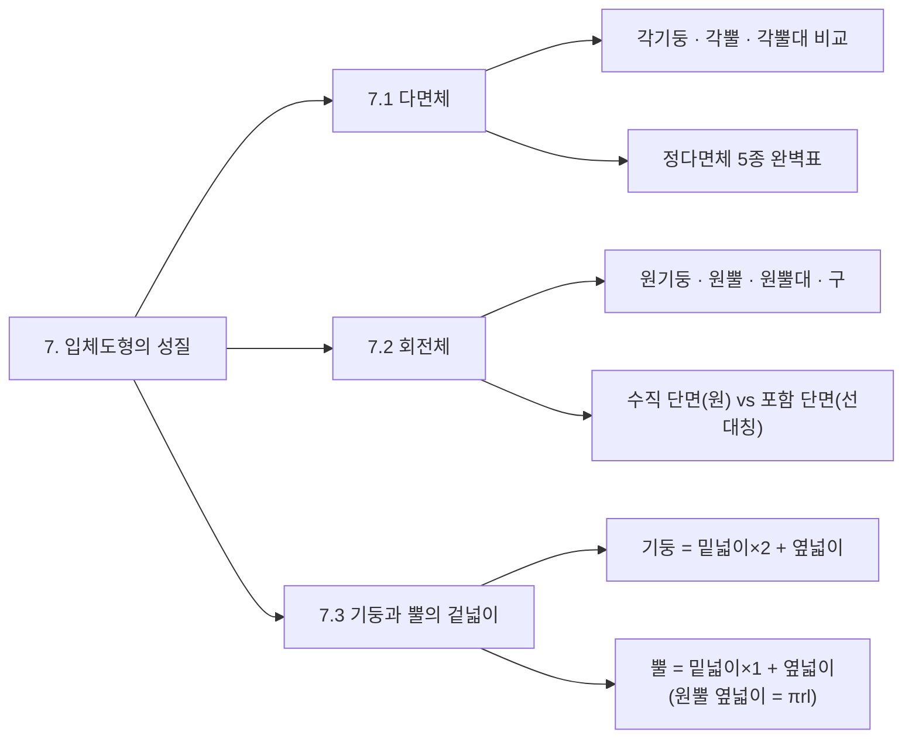
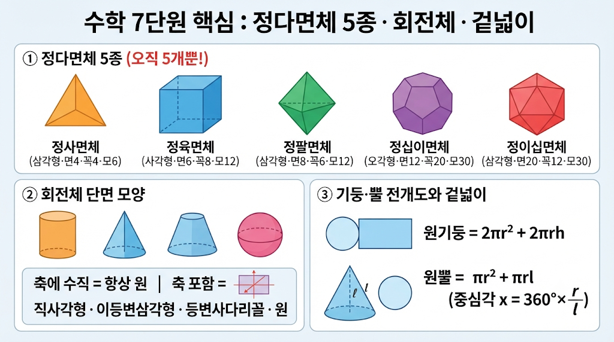
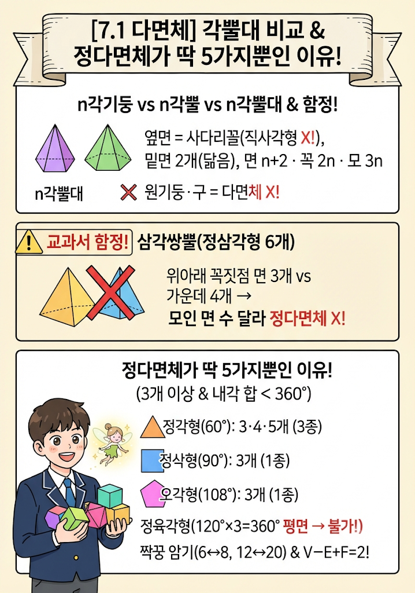
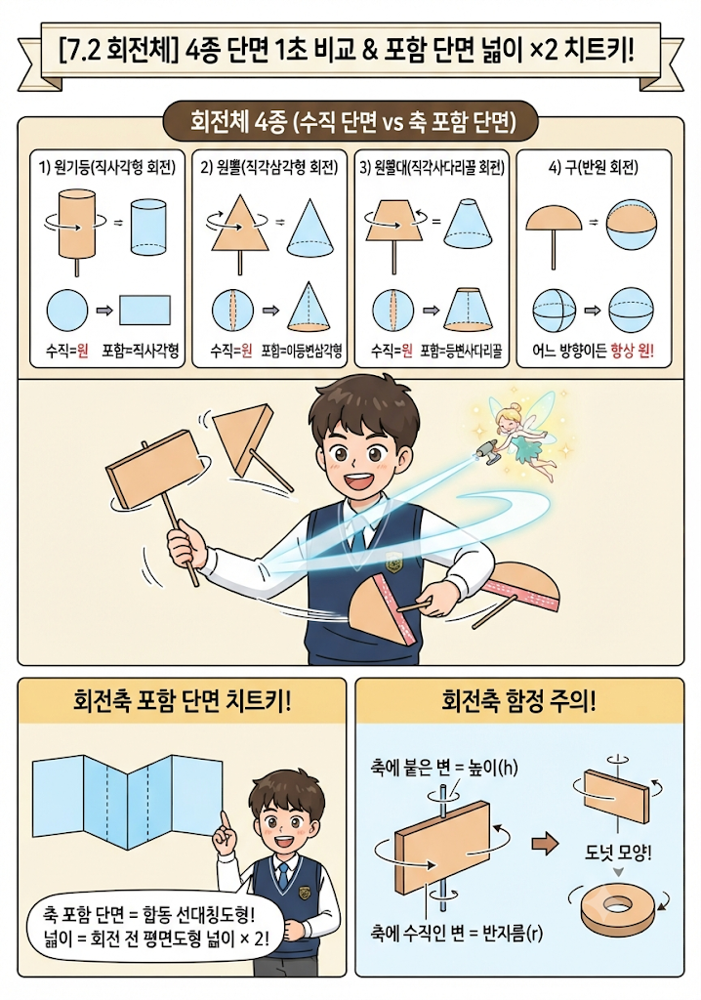
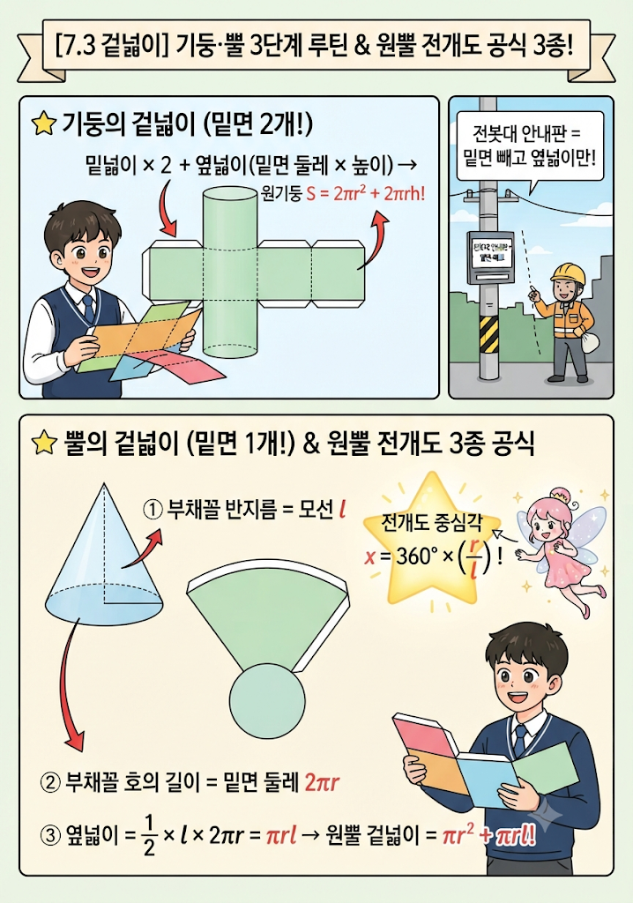
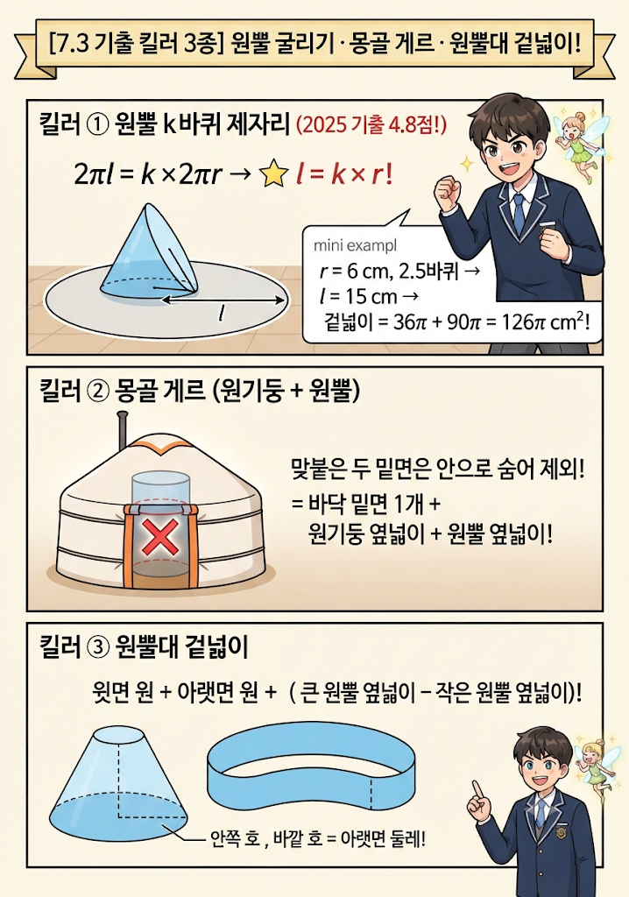

# 📘 7단원 입체도형의 성질 (7.1~7.3) — 다면체 · 회전체 · 겉넓이 완벽 정리

> **교과서 범위**: p.210 ~ 223 (7.1 다면체 · 7.2 회전체 · 7.3 기둥과 뿔의 겉넓이)  
> **※ 범위 주의**: **7.4 기둥과 뿔의 부피 · 7.5 구의 겉넓이와 부피**는 이번 2차 지필평가 시험 범위 **밖**입니다!  
> **연계 기출**: 2025 KIS 7학년 2학기 2차 기출 1, 2, 6, 10, 11, 13, 20번(고난도 4.8점!)  
> **학습 목표**: 정다면체 5종·회전체 단면을 1초 만에 판별하고, 전개도 기반 겉넓이 3단계 루틴으로 계산 실수 완벽 차단!

---

## 🎯 한눈에 보는 7단원 개념 지도

---

## 01. 다면체와 정다면체 5종 (교과서 7.1, p.210~214)

> 🎬 **개념 몽타주 영상 (1분 46초)** — 다면체 비교 · 정다면체 5종 · 5가지뿐인 이유을 한 번에 정리해요.

<video controls preload="metadata" playsinline poster="exam/%EC%88%98%ED%95%99_%EC%8B%9C%ED%97%98%EA%B3%B5%EB%B6%80/videos/mat_05_polyhedron_poster.jpg" src="exam/%EC%88%98%ED%95%99_%EC%8B%9C%ED%97%98%EA%B3%B5%EB%B6%80/videos/mat_05_polyhedron.mp4" style="width:100%;max-width:960px;border-radius:12px;display:block;margin:0 auto 1em;background:#000"></video>

### 1) 다면체의 뜻
- **다면체**: **다각형인 면으로만** 둘러싸인 입체도형 (면의 개수에 따라 사면체, 오면체, 육면체, ...).
- ⚠️ **함정 주의**: **원기둥, 원뿔, 원뿔대, 구**는 곡면이나 원(다각형이 아님!)을 포함하므로 **다면체가 아니다!**

### 2) $n$각기둥 · $n$각뿔 · $n$각뿔대 완벽 비교표 ⭐ (교과서 p.211, p.214 4번)

| 구분 | $n$각기둥 | $n$각뿔 | $n$각뿔대 *(각뿔을 밑면에 평행하게 자른 아랫부분)* |
| :--- | :---: | :---: | :---: |
| **밑면의 개수** | **2개** (서로 평행·합동) | **1개** | **2개** (서로 평행, **합동 X — 닮음!**) |
| **옆면의 모양** | **직사각형** | **삼각형** | **사다리꼴** *(직사각형 아님!)* |
| **면의 개수** | **$n + 2$** | **$n + 1$** | **$n + 2$** |
| **꼭짓점의 개수** | **$2n$** | **$n + 1$** | **$2n$** |
| **모서리의 개수** | **$3n$** | **$2n$** | **$3n$** |

> 🔑 **실전 적용 (교과서 p.213 수학 집짓기 & p.214 4번)**:
> - **같은 육면체라도 모양이 다르다!** 사각기둥(면 $4+2=6$), 오각뿔(면 $5+1=6$), 사각뿔대(면 $4+2=6$)는 모두 **육면체**!
> - *"모서리의 개수와 꼭짓점의 개수의 합이 35인 각뿔대의 밑면의 모양은?"*  
>   → $3n + 2n = 35 \implies 5n = 35 \implies n = 7$ → **칠각형** (칠각뿔대)!

### 3) 정다면체 5종 완벽 정리 ⭐⭐⭐ (2025 KIS 기출 6번!)

- **정다면체의 두 가지 조건 (둘 다 만족해야 함!)**:
  1. 모든 면이 **합동인 정다각형**이다.
  2. **각 꼭짓점에 모인 면의 개수**가 모두 같다.
- ⚠️ **교과서 p.213 생각 넓히기 함정 (삼각쌍뿔)**:  
  합동인 정삼각형 6개로 두 정사면체를 맞붙여 만든 육면체는 **조건 ①(모든 면이 합동인 정삼각형)은 만족하지만**, 위·아래 꼭짓점에는 면이 **3개**, 가운데 꼭짓점에는 면이 **4개** 모여 **조건 ②를 만족하지 않으므로 정다면체가 아니다!**

| 정다면체 | 면의 모양 | 한 꼭짓점에 모인 면의 수 | 면의 개수 ($F$) | 꼭짓점 개수 ($V$) | 모서리 개수 ($E$) |
| :--- | :---: | :---: | :---: | :---: | :---: |
| **정사면체** | 정삼각형 | **3** | 4 | **4** | **6** |
| **정육면체** | 정사각형 | **3** | 6 | **8** | **12** |
| **정팔면체** | 정삼각형 | **4** | 8 | **6** | **12** |
| **정십이면체** | 정오각형 | **3** | 12 | **20** | **30** |
| **정이십면체** | 정삼각형 | **5** | 20 | **12** | **30** |

> 🧠 **정다면체가 딱 5가지뿐인 이유 (서술형·`<보기>` 최단골!)**:
> - 입체도형의 꼭짓점이 만들어지려면 **① 한 꼭짓점에 3개 이상의 면**이 모여야 하고, **② 모인 내각의 크기의 합이 $360^\circ$보다 작아야** 한다.
>   - **정삼각형(한 내각 $60^\circ$)**: 3개($180^\circ$), 4개($240^\circ$), 5개($300^\circ$) → **3가지** 가능! *(6개면 $360^\circ$로 평면 → 불가)*
>   - **정사각형(한 내각 $90^\circ$)**: 3개($270^\circ$) → **1가지** 가능! *(4개면 $360^\circ$ → 불가)*
>   - **정오각형(한 내각 $108^\circ$)**: 3개($324^\circ$) → **1가지** 가능! *(4개면 $432^\circ$ → 불가)*
>   - **정육각형(한 내각 $120^\circ$)**: 3개만 모여도 $120^\circ \times 3 = 360^\circ$가 되어 평면이 되므로 **불가능!** (정칠각형 이상도 모두 불가!)
> - 따라서 정다면체는 **$3 + 1 + 1 = 5$가지**뿐이다!

---

## 02. 회전체와 단면의 성질 (교과서 7.2, p.215~218)

> 🎬 **개념 몽타주 영상 (1분 22초)** — 회전체 4종 · 수직/포함 단면 · 넓이 2배 치트키을 한 번에 정리해요.

<video controls preload="metadata" playsinline poster="exam/%EC%88%98%ED%95%99_%EC%8B%9C%ED%97%98%EA%B3%B5%EB%B6%80/videos/mat_06_revolution_poster.jpg" src="exam/%EC%88%98%ED%95%99_%EC%8B%9C%ED%97%98%EA%B3%B5%EB%B6%80/videos/mat_06_revolution.mp4" style="width:100%;max-width:960px;border-radius:12px;display:block;margin:0 auto 1em;background:#000"></video>

### 1) 회전체의 뜻과 종류
- **회전체**: 평면도형을 한 직선(**회전축**)을 축으로 하여 **1회전** 시킬 때 생기는 입체도형.
- **원뿔대**: 원뿔을 그 밑면에 평행한 평면으로 자를 때 생기는 두 입체도형 중 **원뿔이 아닌 쪽**.

| 회전체 | 회전 전 평면도형 | 회전축에 **수직**인 단면 | 회전축을 **포함**하는 단면 |
| :--- | :---: | :---: | :---: |
| **원기둥** | 직사각형 | 원 *(어디를 잘라도 합동)* | **직사각형** |
| **원뿔** | 직각삼각형 | 원 *(위쪽일수록 작아짐)* | **이등변삼각형** |
| **원뿔대** | 직각사다리꼴 | 원 *(위쪽일수록 작아짐)* | **등변사다리꼴** |
| **구** | 반원 | 원 *(어느 평면으로 잘라도 항상 원!)* | **원** *(중심을 지날 때 가장 큰 원)* |

### 2) 회전체의 2대 성질 ⭐ (2025 KIS 기출 1번 · 교과서 p.216, p.218)
1. **회전축에 수직인 평면으로 자른 단면**: 항상 **원**이다. *(단, 도형이 회전축에서 떨어져 있으면 도넛 모양의 동심원!)*
2. **회전축을 포함하는 평면으로 자른 단면**: 모두 **합동**이고, 회전축을 대칭축으로 하는 **선대칭도형**이다.
   - ⭐ **단면 넓이 치트키 (2025 KIS 1번)**: 회전축을 포함하는 평면으로 자른 단면은 원래 평면도형과 좌우 대칭인 도형이 합쳐진 모양이므로
     $$(\text{회전축을 포함하는 단면의 넓이}) = (\text{회전시키기 전 평면도형의 넓이}) \times \mathbf{2}$$
   - *예 (교과서 p.218 5번)*: 가로(반지름) $2\text{ cm}$, 세로(높이) $h\text{ cm}$인 직사각형을 1회전 시킨 원기둥에서, 수직 단면(반지름 2인 원: $4\pi$)과 포함 단면(가로 4, 세로 $h$인 직사각형: $4h$)의 넓이가 같으면 $4h = 4\pi \implies h = \mathbf{\pi\text{ cm}}$!

---

## 03. 기둥과 뿔의 겉넓이 (교과서 7.3, p.219~223)

> 🎬 **개념 몽타주 영상 (1분 44초)** — 기둥·원뿔 겉넓이 · 원뿔 굴리기 · 붙인 도형을 한 번에 정리해요.

<video controls preload="metadata" playsinline poster="exam/%EC%88%98%ED%95%99_%EC%8B%9C%ED%97%98%EA%B3%B5%EB%B6%80/videos/mat_07_surface_poster.jpg" src="exam/%EC%88%98%ED%95%99_%EC%8B%9C%ED%97%98%EA%B3%B5%EB%B6%80/videos/mat_07_surface.mp4" style="width:100%;max-width:960px;border-radius:12px;display:block;margin:0 auto 1em;background:#000"></video>

> **핵심 원칙**: 모든 겉넓이는 **전개도를 머릿속에 펼치고**  
> **1단계: 밑넓이 구하기 → 2단계: 옆넓이 구하기 → 3단계: 밑면 개수(기둥 2개 / 뿔 1개) 확인해 더하기!**

### 1) 기둥의 겉넓이 (각기둥 · 원기둥)
$$(\text{기둥의 겉넓이}) = (\text{밑넓이}) \times \mathbf{2} + (\text{옆넓이})$$
- **옆넓이 만능 공식**: 기둥의 옆면을 펼치면 항상 **큰 직사각형 1개**!
  $$(\text{기둥의 옆넓이}) = (\text{밑면의 둘레의 길이}) \times (\text{기둥의 높이})$$
- **원기둥 (밑면 반지름 $r$, 높이 $h$)**:
  - 밑넓이 = $\pi r^2$ (2개이므로 $2\pi r^2$)
  - 옆넓이 = $(\text{밑면 둘레 } 2\pi r) \times h = 2\pi r h$
  - **총 겉넓이**: $\mathbf{S = 2\pi r^2 + 2\pi r h}$
- ⚠️ **2025 KIS 13번 & 교과서 p.220 2번 실수 함정**:
  - **회전축 주의**: 직사각형을 회전할 때 **축에 붙은 변 = 높이 $h$**, **축에 수직인 변 = 반지름 $r$**!
  - **전봇대 안내판(교과서 p.220 2번)**: 전봇대를 감싸는 직사각형 안내판의 넓이는 **원기둥의 옆넓이만** 구한다! (밑면 2개는 포함 X!)

### 2) 뿔의 겉넓이 (각뿔 · 원뿔) ⭐⭐⭐ (2025 KIS 기출 11번, 20번!)
$$(\text{뿔의 겉넓이}) = (\text{밑넓이}) \times \mathbf{1} + (\text{옆넓이})$$

- **각뿔**: 밑면 1개 + 삼각형 모양 옆면들의 합
  - *예 (정사각뿔, 밑면 한 변 $a$, 옆면 삼각형 높이 $h$)*: $S = a^2 + \left(\dfrac{1}{2}ah\right) \times 4$
- **원뿔 (밑면 반지름 $r$, 모선의 길이 $l$)** — **전개도 핵심 관계 3종**:
  1. 옆면 부채꼴의 **반지름 = 원뿔의 모선($l$)**
  2. 옆면 부채꼴의 **호의 길이 = 밑면 원의 둘레($2\pi r$)**
  3. **원뿔의 옆넓이** ($S = \frac{1}{2}RL$ 공식 적용!):
     $$(\text{원뿔의 옆넓이}) = \frac{1}{2} \times l \times (2\pi r) = \mathbf{\pi r l}$$
  4. **원뿔의 겉넓이**:
     $$\mathbf{S = \pi r^2 + \pi r l}$$
  5. **원뿔 전개도 옆면 부채꼴의 중심각 $x^\circ$** *(2025 KIS 11번!)*:
     $$2\pi l \times \frac{x}{360} = 2\pi r \quad \Longrightarrow \quad \mathbf{x = 360^\circ \times \frac{r}{l}}$$

### 3) 고난도 KIS 킬러 & 교과서 응용 3종 세트 🔥

1. **원뿔을 바닥에 굴려 $k$바퀴 만에 제자리로 돌아올 때 (2025 KIS 기출 20번, 4.8점!)**
   - 원뿔이 1바퀴 굴러갈 때 이동하는 거리 = 밑면 원의 둘레($2\pi r$).
   - $k$바퀴 굴러 제자리로 오면 **반지름이 모선 $l$인 큰 원**을 한 바퀴 도는 것과 같다!
   $$2\pi l = k \times (2\pi r) \quad \Longrightarrow \quad \mathbf{l = k \times r}$$
   - *예*: 밑면 반지름 $r = 6\text{ cm}$인 원뿔이 $2.5$바퀴 만에 제자리로 돌아오면 모선 $l = 6 \times 2.5 = 15\text{ cm}$ → 겉넓이 = $36\pi + \pi(6)(15) = 36\pi + 90\pi = \mathbf{126\pi\text{ cm}^2}$!

2. **복합 입체도형 — 몽골 게르 (원기둥 + 원뿔, 교과서 p.223 6번)**
   - 원기둥 위에 원뿔을 딱 맞게 올리면 **서로 맞닿은 두 밑면은 안쪽으로 숨어 겉넓이에서 사라진다!**
   - 따라서 $(\text{게르 겉넓이}) = (\text{원기둥 바닥 밑면 1개}) + (\text{원기둥 옆넓이}) + (\text{원뿔 옆넓이})$!

3. **원뿔대의 겉넓이 (교과서 p.222 생각 넓히기 & 2025 KIS 2번)**
   - $(\text{원뿔대 겉넓이}) = (\text{윗면 원 넓이}) + (\text{아랫면 원 넓이}) + (\text{큰 원뿔 옆넓이} - \text{작은 원뿔 옆넓이})$
   - 원뿔대 전개도에서 **윗면 원의 둘레 = 안쪽 짧은 호의 길이**, **아랫면 원의 둘레 = 바깥쪽 긴 호의 길이**!

> ✅ **7단원 검산 체크 3단계**:  
> ① **기둥(밑면 2개) vs 뿔(밑면 1개) vs 붙인 도형(숨은 면 제외)** 확인 → ② 원기둥/원뿔은 **항상 $\pi$가 붙는지** 확인 → ③ 정다면체 문제는 **$V - E + F = 2$** 오일러 공식으로 3초 검산!

