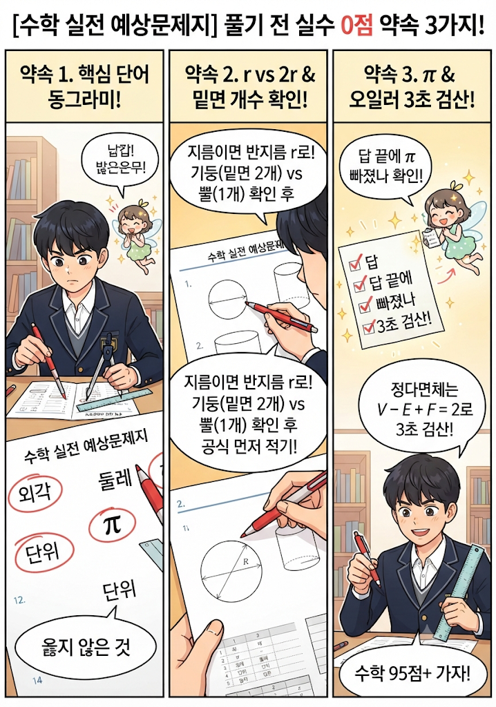

# 📝 2026학년도 7학년 2학기 2차 지필평가 대비 — 수학 실전 예상 문제지

> **시험 범위**: 교과서 p.183~223 (6.2 삼각형의 내각과 외각 ~ 7.3 기둥과 뿔의 겉넓이)  
> **구성**: 선택형 20문항 (82.0점) + 서술형 3문항 (18.0점) = **총 100.0점** | **제한 시간**: 45분  
> **참고**: 호치민시한국국제학교(KIS) 2025 2학기 2차 기출 유형 · 교과서 발전/서술형 완벽 반영 (그림 없이 텍스트 조건만으로 정확히 풀리도록 구성)

### ✅ 풀기 전 「실수 0점」 약속 3가지
- [ ] 문제 끝의 **"옳은 것 / 옳지 않은 것 / 외각 / 둘레 / $\pi$ / 단위"**에 동그라미 치기
- [ ] 원·부채꼴·기둥·뿔 문제는 **반지름 $r$ vs 지름 $2r$**, **밑면 개수(2개 vs 1개)** 확인 후 공식 먼저 쓰기
- [ ] 계산을 마친 뒤 **$\pi$ 빠뜨리지 않았는지**, 정다면체는 **$V - E + F = 2$**로 3초 검산하기

---

## [선택형 1~20번]

### 6.2~6.4 다각형의 내각과 외각 (1~6번)

**1.** 삼각형 $ABC$에서 $\angle A = (3x + 10)^\circ$, $\angle B = (2x - 5)^\circ$이고, 꼭짓점 $C$에서의 외각의 크기가 $130^\circ$일 때, $x$의 값은? [3.5점]
① $20$  
② $23$  
③ $25$  
④ $27$  
⑤ $30$  

---

**2.** $\angle BAC = 28^\circ$인 삼각형 $ABC$에서 $\overline{AB} = \overline{BC}$이다. 변 $AB$의 연장선 위에 점 $D$를 잡아 $\overline{BC} = \overline{CD}$가 되도록 하고, 변 $AC$의 연장선 위에 점 $E$를 잡을 때, $\angle DCE$의 크기는? (단, 점 $D$는 선분 $AB$의 점 $B$ 쪽 연장선 위에, 점 $E$는 선분 $AC$의 점 $C$ 쪽 연장선 위에 있다.) [4.0점]
① $56^\circ$  
② $68^\circ$  
③ $72^\circ$  
④ $84^\circ$  
⑤ $96^\circ$  

---

**3.** 한 꼭짓점에서 그을 수 있는 대각선의 개수가 $7$인 다각형의 내각의 크기의 합은? [3.5점]
① $900^\circ$  
② $1080^\circ$  
③ $1260^\circ$  
④ $1440^\circ$  
⑤ $1620^\circ$  

---

**4.** 다각형에 대한 설명으로 옳은 것만을 `<보기>`에서 있는 대로 고른 것은? [4.0점]

> **<보기>**  
> ㄱ. 칠각형의 한 꼭짓점에서 대각선을 모두 그으면 $5$개의 삼각형으로 나누어진다.  
> ㄴ. 다각형의 외각의 크기의 합은 변의 개수가 많아질수록 커진다.  
> ㄷ. 정팔각형의 한 외각의 크기는 $45^\circ$이다.  
> ㄹ. 모든 변의 길이가 같은 사각형은 항상 정사각형이다.

① ㄱ, ㄷ  
② ㄱ, ㄹ  
③ ㄴ, ㄷ  
④ ㄱ, ㄷ, ㄹ  
⑤ ㄴ, ㄷ, ㄹ  

---

**5.** 한 내각의 크기와 한 외각의 크기의 비가 $7 : 2$인 정다각형의 대각선의 총 개수는? [4.5점]
① $14$  
② $20$  
③ $27$  
④ $35$  
⑤ $44$  

---

**6.** 육각형 $ABCDEF$의 다섯 내각의 크기가 각각 $\angle A = 115^\circ$, $\angle B = 130^\circ$, $\angle C = 105^\circ$, $\angle D = 125^\circ$, $\angle E = 135^\circ$일 때, 꼭짓점 $F$에서의 **외각**의 크기는? [4.5점]
① $60^\circ$  
② $70^\circ$  
③ $80^\circ$  
④ $100^\circ$  
⑤ $110^\circ$  

---

### 6.5~6.6 원과 부채꼴 (7~12번)

**7.** 한 원 $O$에 대한 설명 중 옳지 **않은** 것은? [3.5점]
① 원 위의 두 점을 이은 선분 중 가장 긴 현은 지름이다.  
② 부채꼴이면서 동시에 활꼴인 도형은 반원이다.  
③ 한 원에서 중심각의 크기가 같은 두 현의 길이는 같다.  
④ 한 원에서 부채꼴의 넓이는 중심각의 크기에 정비례한다.  
⑤ 한 원에서 중심각의 크기가 $2$배가 되면 현의 길이도 $2$배가 된다.  

---

**8.** 원 $O$의 두 지름 $\overline{AC}$와 $\overline{BD}$가 만날 때, $\angle AOB = (2x + 12)^\circ$, $\angle BOC = (3x + 18)^\circ$이다. 호 $\overparen{AB}$의 길이가 $10\text{ cm}$일 때, 호 $\overparen{BC}$의 길이는? [4.0점]
① $12\text{ cm}$  
② $14\text{ cm}$  
③ $15\text{ cm}$  
④ $16\text{ cm}$  
⑤ $18\text{ cm}$  

---

**9.** 반지름의 길이가 $12\text{ cm}$이고 중심각의 크기가 $150^\circ$인 부채꼴의 **둘레의 길이**와 **넓이**를 차례대로 옳게 짝 지은 것은? [4.0점]
① $10\pi\text{ cm}$, $60\pi\text{ cm}^2$  
② $(10\pi + 12)\text{ cm}$, $60\pi\text{ cm}^2$  
③ $(10\pi + 24)\text{ cm}$, $60\pi\text{ cm}^2$  
④ $(10\pi + 24)\text{ cm}$, $120\pi\text{ cm}^2$  
⑤ $(20\pi + 24)\text{ cm}$, $60\pi\text{ cm}^2$  

---

**10.** 반지름의 길이가 $10\text{ cm}$이고 넓이가 $40\pi\text{ cm}^2$인 부채꼴의 **호의 길이**와 **중심각의 크기**를 옳게 짝 지은 것은? [4.0점]
① $4\pi\text{ cm}$, $72^\circ$  
② $6\pi\text{ cm}$, $108^\circ$  
③ $8\pi\text{ cm}$, $120^\circ$  
④ $8\pi\text{ cm}$, $144^\circ$  
⑤ $10\pi\text{ cm}$, $180^\circ$  

---

**11.** 지름이 $\overline{AB}$인 반원 $O$에서 호 $\overparen{AB}$ 위에 두 점 $C, D$가 있고, $\overline{AD} \parallel \overline{OC}$이다. $\angle BOC = 36^\circ$이고 부채꼴 $BOC$의 넓이가 $12\text{ cm}^2$일 때, 부채꼴 $AOD$의 넓이는? (단, 점 $C, D$는 지름 $\overline{AB}$에 대하여 같은 쪽 반원 위에 있고, 점 $A$에서 반원을 따라 $D, C, B$의 순서로 놓여 있다.) [4.5점]
① $24\text{ cm}^2$  
② $30\text{ cm}^2$  
③ $36\text{ cm}^2$  
④ $42\text{ cm}^2$  
⑤ $48\text{ cm}^2$  

---

**12.** 중심이 같고 중심각의 크기가 모두 $120^\circ$인 두 부채꼴에서, 큰 부채꼴의 반지름의 길이가 $9\text{ cm}$이고 작은 부채꼴의 반지름의 길이가 $3\text{ cm}$이다. 큰 부채꼴에서 작은 부채꼴을 제외한 나머지 부분의 **둘레의 길이**는? [4.5점]
① $8\pi\text{ cm}$  
② $(8\pi + 6)\text{ cm}$  
③ $(8\pi + 12)\text{ cm}$  
④ $(12\pi + 12)\text{ cm}$  
⑤ $(16\pi + 12)\text{ cm}$  

---

### 7.1 다면체 & 7.2 회전체 (13~16번)

**13.** 모서리의 개수와 꼭짓점의 개수의 합이 $35$인 각뿔대에 대한 설명으로 옳은 것은? [3.5점]
① 밑면의 모양은 육각형이다.  
② 옆면의 모양은 직사각형이다.  
③ 면의 개수는 $8$개이다.  
④ 두 밑면은 서로 합동이다.  
⑤ 모서리의 개수는 $21$개이다.  

---

**14.** 다음 표는 정다면체에 대한 내용이다. 면의 모양, 꼭짓점의 개수, 모서리의 개수, 한 꼭짓점에 모인 면의 개수가 **모두** 옳게 짝 지어진 것은? [4.0점]

| 보기 | 정다면체 | 면의 모양 | 꼭짓점의 개수 | 모서리의 개수 | 한 꼭짓점에 모인 면의 개수 |
| :---: | :---: | :---: | :---: | :---: | :---: |
| ① | 정사면체 | 정삼각형 | $4$ | $6$ | $4$ |
| ② | 정육면체 | 정사각형 | $8$ | $12$ | $4$ |
| ③ | 정팔면체 | 정삼각형 | $6$ | $12$ | $4$ |
| ④ | 정십이면체 | 정오각형 | $12$ | $30$ | $3$ |
| ⑤ | 정이십면체 | 정삼각형 | $20$ | $30$ | $5$ |

---

**15.** 정다면체에 대한 설명으로 옳은 것만을 `<보기>`에서 있는 대로 고른 것은? [4.0점]

> **<보기>**  
> ㄱ. 정다면체의 한 꼭짓점에는 $3$개 이상의 면이 모여야 하며, 모인 내각의 크기의 합은 $360^\circ$보다 작아야 한다.  
> ㄴ. 면의 모양이 정육각형인 정다면체가 없는 이유는 한 꼭짓점에 $3$개가 모이면 내각의 합이 $360^\circ$가 되어 평면이 되기 때문이다.  
> ㄷ. 합동인 정삼각형 $6$개로 두 정사면체를 맞붙여 만든 육면체는 모든 면이 합동인 정다각형이므로 정다면체이다.

① ㄱ  
② ㄷ  
③ ㄱ, ㄴ  
④ ㄴ, ㄷ  
⑤ ㄱ, ㄴ, ㄷ  

---

**16.** 윗변의 길이가 $4\text{ cm}$, 아랫변의 길이가 $7\text{ cm}$, 높이가 $6\text{ cm}$인 직각사다리꼴을 **높이에 해당하는 변을 회전축**으로 하여 $1$회전 시킬 때 생기는 회전체의 이름과, 이 회전체를 **회전축을 포함하는 평면으로 자른 단면의 넓이**를 옳게 짝 지은 것은? [4.0점]
① 원뿔대, $33\text{ cm}^2$  
② 원뿔대, $66\text{ cm}^2$  
③ 원뿔대, $84\text{ cm}^2$  
④ 원기둥, $66\text{ cm}^2$  
⑤ 원뿔, $66\text{ cm}^2$  

---

### 7.3 기둥과 뿔의 겉넓이 (17~20번)

**17.** 밑면이 세 변의 길이가 각각 $6\text{ cm}$, $8\text{ cm}$, $10\text{ cm}$인 직각삼각형이고 높이가 $12\text{ cm}$인 삼각기둥의 겉넓이는? [4.0점]
① $288\text{ cm}^2$  
② $312\text{ cm}^2$  
③ $336\text{ cm}^2$  
④ $360\text{ cm}^2$  
⑤ $384\text{ cm}^2$  

---

**18.** 가로의 길이가 $4\text{ cm}$, 세로의 길이가 $7\text{ cm}$인 직사각형을 **세로($7\text{ cm}$)를 회전축**으로 하여 $1$회전 시킬 때 생기는 입체도형의 겉넓이는? [4.5점]
① $56\pi\text{ cm}^2$  
② $72\pi\text{ cm}^2$  
③ $88\pi\text{ cm}^2$  
④ $112\pi\text{ cm}^2$  
⑤ $154\pi\text{ cm}^2$  

---

**19.** 밑면의 반지름의 길이가 $5\text{ cm}$이고 모선의 길이가 $15\text{ cm}$인 원뿔의 전개도에서, 옆면인 부채꼴의 **중심각의 크기**와 이 원뿔의 **겉넓이**를 차례대로 옳게 짝 지은 것은? [4.5점]
① $120^\circ$, $75\pi\text{ cm}^2$  
② $120^\circ$, $100\pi\text{ cm}^2$  
③ $120^\circ$, $125\pi\text{ cm}^2$  
④ $150^\circ$, $100\pi\text{ cm}^2$  
⑤ $150^\circ$, $125\pi\text{ cm}^2$  

---

**20.** 밑면의 반지름의 길이가 $6\text{ cm}$인 원뿔을 평평한 바닥 위에 눕혀 꼭짓점 $O$를 중심으로 미끄러지지 않게 굴렸더니 정확히 **$2.5$바퀴** 만에 처음 위치로 돌아왔다. 이 원뿔의 겉넓이는? [5.0점]
① $90\pi\text{ cm}^2$  
② $108\pi\text{ cm}^2$  
③ $120\pi\text{ cm}^2$  
④ $126\pi\text{ cm}^2$  
⑤ $144\pi\text{ cm}^2$  

---

## [서술형 1~3번]

> ※ 서술형은 **공식과 풀이 과정**을 단계별로 빠짐없이 쓰고, 답에 **$\pi$와 단위**를 정확히 표시하세요!

**서술형 1.** 한 내각의 크기가 한 외각의 크기보다 $108^\circ$ 더 큰 정다각형의 이름을 구하고, 이 정다각형의 내각의 크기의 합을 구하는 풀이 과정을 쓰시오. [6.0점]

> 답안 작성란:  
> ________________________________________________________________________  
> ________________________________________________________________________  

---

**서술형 2.** 한 변의 길이가 $15\text{ cm}$인 정육각형의 한 꼭짓점을 중심으로 하고, 그 꼭짓점에 이웃한 두 변을 반지름으로 하는 부채꼴의 **호의 길이**와 **넓이**를 각각 구하고, 그 풀이 과정을 쓰시오. [6.0점]

> 답안 작성란:  
> ________________________________________________________________________  
> ________________________________________________________________________  

---

**서술형 3.** 몽골의 이동식 가옥인 게르 모양의 입체도형은 밑면의 반지름의 길이가 $3\text{ m}$, 높이가 $2\text{ m}$인 원기둥 위에 밑면의 반지름의 길이가 $3\text{ m}$, 모선의 길이가 $5\text{ m}$인 원뿔을 밑면이 딱 맞게 올려놓은 모양이다. 이 입체도형의 **겉넓이**를 구하고, 그 풀이 과정을 쓰시오. [6.0점]

> 답안 작성란:  
> ________________________________________________________________________  
> ________________________________________________________________________  
