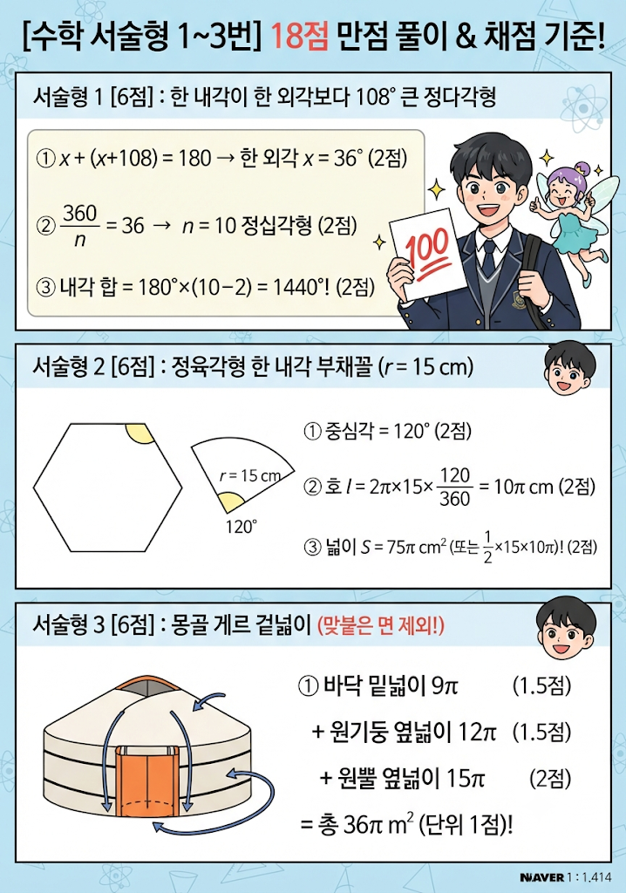

# ✅ 2026학년도 7학년 2학기 2차 지필평가 대비 — 수학 예상 문제지 정답 및 해설

> **채점 기준**: 선택형 20문항(82.0점) + 서술형 3문항(18.0점) = **총 100.0점**  
> *(풀이 형식: 문제 + 선지 전체 → 답 → 이유 및 풀이 식)*

---

## 📊 빠른 정답표 (채점용)

| 번호 | 1 | 2 | 3 | 4 | 5 | 6 | 7 | 8 | 9 | 10 |
| :---: | :---: | :---: | :---: | :---: | :---: | :---: | :---: | :---: | :---: | :---: |
| **정답** | ③ | ④ | ④ | ① | ③ | ② | ⑤ | ③ | ③ | ④ |

| 번호 | 11 | 12 | 13 | 14 | 15 | 16 | 17 | 18 | 19 | 20 |
| :---: | :---: | :---: | :---: | :---: | :---: | :---: | :---: | :---: | :---: | :---: |
| **정답** | ③ | ③ | ⑤ | ③ | ③ | ② | ③ | ③ | ② | ④ |

---

## 📖 문항별 상세 풀이

### 1번 [3.5점]
삼각형 $ABC$에서 $\angle A = (3x + 10)^\circ$, $\angle B = (2x - 5)^\circ$이고, 꼭짓점 $C$에서의 외각의 크기가 $130^\circ$일 때, $x$의 값은?  
① $20$ / ② $23$ / ③ $25$ / ④ $27$ / ⑤ $30$

- **답)** ③
- **이유)** 삼각형의 한 외각의 크기는 그와 이웃하지 않는 두 내각의 크기의 합과 같다.  
  $$(3x + 10) + (2x - 5) = 130 \implies 5x + 5 = 130 \implies 5x = 125 \implies x = \mathbf{25}$$

---

### 2번 [4.0점]
$\angle BAC = 28^\circ$인 삼각형 $ABC$에서 $\overline{AB} = \overline{BC}$이다. 변 $AB$의 연장선 위에 점 $D$를 잡아 $\overline{BC} = \overline{CD}$가 되도록 하고, 변 $AC$의 연장선 위에 점 $E$를 잡을 때, $\angle DCE$의 크기는?  
① $56^\circ$ / ② $68^\circ$ / ③ $72^\circ$ / ④ $84^\circ$ / ⑤ $96^\circ$

- **답)** ④
- **이유)** ① $\triangle ABC$에서 $\overline{AB}=\overline{BC}$이므로 $\angle BCA = \angle BAC = 28^\circ$.  
  ② $\angle CBD$는 $\triangle ABC$의 외각이므로 $\angle CBD = 28^\circ + 28^\circ = 56^\circ$.  
  ③ $\triangle BCD$에서 $\overline{BC}=\overline{CD}$이므로 $\angle CDB = \angle CBD = 56^\circ$.  
  ④ $\angle DCE$는 $\triangle ACD$의 외각이므로 $\angle DCE = \angle CAD + \angle CDA = 28^\circ + 56^\circ = \mathbf{84^\circ}$이다.

---

### 3번 [3.5점]
한 꼭짓점에서 그을 수 있는 대각선의 개수가 $7$인 다각형의 내각의 크기의 합은?  
① $900^\circ$ / ② $1080^\circ$ / ③ $1260^\circ$ / ④ $1440^\circ$ / ⑤ $1620^\circ$

- **답)** ④
- **이유)** $n - 3 = 7 \implies n = 10$(십각형)이므로 내각의 크기의 합은 $180^\circ \times (10 - 2) = 180^\circ \times 8 = \mathbf{1440^\circ}$이다.

---

### 4번 [4.0점]
다각형에 대한 설명으로 옳은 것만을 `<보기>`에서 있는 대로 고른 것은?  
`<보기>` ㄱ. 칠각형의 한 꼭짓점에서 대각선을 모두 그으면 $5$개의 삼각형으로 나누어진다. / ㄴ. 다각형의 외각의 크기의 합은 변의 개수가 많아질수록 커진다. / ㄷ. 정팔각형의 한 외각의 크기는 $45^\circ$이다. / ㄹ. 모든 변의 길이가 같은 사각형은 항상 정사각형이다.  
① ㄱ, ㄷ / ② ㄱ, ㄹ / ③ ㄴ, ㄷ / ④ ㄱ, ㄷ, ㄹ / ⑤ ㄴ, ㄷ, ㄹ

- **답)** ①
- **이유)** ㄱ. $7 - 2 = 5$개 (O) / ㄴ. 모든 다각형의 외각의 합은 **항상 $360^\circ$**로 일정하다 (X) / ㄷ. $\dfrac{360^\circ}{8} = 45^\circ$ (O) / ㄹ. 마름모처럼 모든 변의 길이가 같아도 내각의 크기가 다르면 정사각형이 아니다 (X).

---

### 5번 [4.5점]
한 내각의 크기와 한 외각의 크기의 비가 $7 : 2$인 정다각형의 대각선의 총 개수는?  
① $14$ / ② $20$ / ③ $27$ / ④ $35$ / ⑤ $44$

- **답)** ③
- **이유)** 한 내각 + 한 외각 = $180^\circ$이므로 한 외각의 크기는 $180^\circ \times \dfrac{2}{7+2} = 40^\circ$이다.  
  따라서 $n = \dfrac{360^\circ}{40^\circ} = 9$(정구각형)이고, 대각선의 총 개수는 $\dfrac{9 \times (9 - 3)}{2} = \dfrac{9 \times 6}{2} = \mathbf{27}$개이다.

---

### 6번 [4.5점]
육각형 $ABCDEF$의 다섯 내각의 크기가 각각 $\angle A = 115^\circ$, $\angle B = 130^\circ$, $\angle C = 105^\circ$, $\angle D = 125^\circ$, $\angle E = 135^\circ$일 때, 꼭짓점 $F$에서의 외각의 크기는?  
① $60^\circ$ / ② $70^\circ$ / ③ $80^\circ$ / ④ $100^\circ$ / ⑤ $110^\circ$

- **답)** ②
- **이유)** 육각형의 내각의 합은 $180^\circ \times (6-2) = 720^\circ$이다.  
  다섯 내각의 합 = $115 + 130 + 105 + 125 + 135 = 610^\circ$이므로 내각 $\angle F = 720^\circ - 610^\circ = 110^\circ$.  
  문제에서 구하는 것은 **외각**이므로 $180^\circ - 110^\circ = \mathbf{70^\circ}$이다. *(⚠️ ⑤ $110^\circ$는 내각 함정!)*

---

### 7번 [3.5점]
한 원 $O$에 대한 설명 중 옳지 않은 것은?  
① 원 위의 두 점을 이은 선분 중 가장 긴 현은 지름이다. / ② 부채꼴이면서 동시에 활꼴인 도형은 반원이다. / ③ 한 원에서 중심각의 크기가 같은 두 현의 길이는 같다. / ④ 한 원에서 부채꼴의 넓이는 중심각의 크기에 정비례한다. / ⑤ 한 원에서 중심각의 크기가 $2$배가 되면 현의 길이도 $2$배가 된다.

- **답)** ⑤
- **이유)** 한 원에서 호의 길이와 부채꼴의 넓이는 중심각의 크기에 정비례하지만, **현의 길이는 중심각의 크기에 정비례하지 않는다** (중심각이 $2$배가 되어도 현의 길이는 $2$배보다 작다).

---

### 8번 [4.0점]
원 $O$의 두 지름 $\overline{AC}$와 $\overline{BD}$가 만날 때, $\angle AOB = (2x + 12)^\circ$, $\angle BOC = (3x + 18)^\circ$이다. 호 $\overparen{AB}$의 길이가 $10\text{ cm}$일 때, 호 $\overparen{BC}$의 길이는?  
① $12\text{ cm}$ / ② $14\text{ cm}$ / ③ $15\text{ cm}$ / ④ $16\text{ cm}$ / ⑤ $18\text{ cm}$

- **답)** ③
- **이유)** $\overline{AC}$는 지름이므로 $\angle AOB + \angle BOC = 180^\circ$.  
  $$(2x + 12) + (3x + 18) = 180 \implies 5x + 30 = 180 \implies 5x = 150 \implies x = 30$$
  따라서 $\angle AOB = 72^\circ$, $\angle BOC = 108^\circ$이다. 호의 길이는 중심각에 정비례하므로  
  $$72 : 108 = 10 : \overparen{BC} \implies 2 : 3 = 10 : \overparen{BC} \implies \overparen{BC} = \mathbf{15\text{ cm}}$$

---

### 9번 [4.0점]
반지름의 길이가 $12\text{ cm}$이고 중심각의 크기가 $150^\circ$인 부채꼴의 둘레의 길이와 넓이를 차례대로 옳게 짝 지은 것은?  
① $10\pi\text{ cm}$, $60\pi\text{ cm}^2$ / ② $(10\pi + 12)\text{ cm}$, $60\pi\text{ cm}^2$ / ③ $(10\pi + 24)\text{ cm}$, $60\pi\text{ cm}^2$ / ④ $(10\pi + 24)\text{ cm}$, $120\pi\text{ cm}^2$ / ⑤ $(20\pi + 24)\text{ cm}$, $60\pi\text{ cm}^2$

- **답)** ③
- **이유)** 호의 길이 $l = 2\pi \times 12 \times \dfrac{150}{360} = 24\pi \times \dfrac{5}{12} = 10\pi\text{ cm}$.  
  - **둘레의 길이** = 호의 길이 + 반지름 $\times 2$ = $\mathbf{(10\pi + 24)\text{ cm}}$  
  - **넓이** $S = \dfrac{1}{2}rl = \dfrac{1}{2} \times 12 \times 10\pi = \mathbf{60\pi\text{ cm}^2}$

---

### 10번 [4.0점]
반지름의 길이가 $10\text{ cm}$이고 넓이가 $40\pi\text{ cm}^2$인 부채꼴의 호의 길이와 중심각의 크기를 옳게 짝 지은 것은?  
① $4\pi\text{ cm}$, $72^\circ$ / ② $6\pi\text{ cm}$, $108^\circ$ / ③ $8\pi\text{ cm}$, $120^\circ$ / ④ $8\pi\text{ cm}$, $144^\circ$ / ⑤ $10\pi\text{ cm}$, $180^\circ$

- **답)** ④
- **이유)** 부채꼴 넓이 공식 $S = \dfrac{1}{2}rl$에 대입하면  
  $$40\pi = \frac{1}{2} \times 10 \times l \implies 5l = 40\pi \implies l = \mathbf{8\pi\text{ cm}}$$
  중심각을 $x^\circ$라 하면 $2\pi \times 10 \times \dfrac{x}{360} = 8\pi \implies \dfrac{x}{18} = 8 \implies x = \mathbf{144^\circ}$이다.

---

### 11번 [4.5점]
지름이 $\overline{AB}$인 반원 $O$에서 호 $\overparen{AB}$ 위에 두 점 $C, D$가 있고, $\overline{AD} \parallel \overline{OC}$이다. $\angle BOC = 36^\circ$이고 부채꼴 $BOC$의 넓이가 $12\text{ cm}^2$일 때, 부채꼴 $AOD$의 넓이는?  
① $24\text{ cm}^2$ / ② $30\text{ cm}^2$ / ③ $36\text{ cm}^2$ / ④ $42\text{ cm}^2$ / ⑤ $48\text{ cm}^2$

- **답)** ③
- **이유)** $\overline{AD} \parallel \overline{OC}$이므로 동위각의 성질에 의해 $\angle OAD = \angle BOC = 36^\circ$이다.  
  $\overline{OA} = \overline{OD}$(반지름)이므로 $\triangle OAD$는 이등변삼각형 → $\angle ODA = 36^\circ$.  
  따라서 $\angle AOD = 180^\circ - (36^\circ + 36^\circ) = 108^\circ$이다.  
  중심각의 비가 $\angle BOC : \angle AOD = 36^\circ : 108^\circ = 1 : 3$이므로, 부채꼴 $AOD$의 넓이는 $12 \times 3 = \mathbf{36\text{ cm}^2}$이다.

---

### 12번 [4.5점]
중심이 같고 중심각의 크기가 모두 $120^\circ$인 두 부채꼴에서, 큰 부채꼴의 반지름의 길이가 $9\text{ cm}$이고 작은 부채꼴의 반지름의 길이가 $3\text{ cm}$이다. 큰 부채꼴에서 작은 부채꼴을 제외한 나머지 부분의 둘레의 길이는?  
① $8\pi\text{ cm}$ / ② $(8\pi + 6)\text{ cm}$ / ③ $(8\pi + 12)\text{ cm}$ / ④ $(12\pi + 12)\text{ cm}$ / ⑤ $(16\pi + 12)\text{ cm}$

- **답)** ③
- **이유)** 큰 호의 길이 $= 2\pi \times 9 \times \dfrac{120}{360} = 6\pi\text{ cm}$, 작은 호의 길이 $= 2\pi \times 3 \times \dfrac{120}{360} = 2\pi\text{ cm}$.  
  양쪽 직선 부분의 길이 합 $= 2 \times (9 - 3) = 12\text{ cm}$.  
  따라서 전체 둘레의 길이는 $6\pi + 2\pi + 12 = \mathbf{(8\pi + 12)\text{ cm}}$이다.

---

### 13번 [3.5점]
모서리의 개수와 꼭짓점의 개수의 합이 $35$인 각뿔대에 대한 설명으로 옳은 것은?  
① 밑면의 모양은 육각형이다. / ② 옆면의 모양은 직사각형이다. / ③ 면의 개수는 $8$개이다. / ④ 두 밑면은 서로 합동이다. / ⑤ 모서리의 개수는 $21$개이다.

- **답)** ⑤
- **이유)** $n$각뿔대의 모서리 수는 $3n$, 꼭짓점 수는 $2n$이므로 $3n + 2n = 35 \implies 5n = 35 \implies n = 7$(칠각뿔대).  
  ① 밑면은 칠각형(X) / ② 옆면은 사다리꼴(X) / ③ 면의 개수는 $7 + 2 = 9$개(X) / ④ 두 밑면은 크기가 달라 합동이 아님(X) / ⑤ 모서리 개수는 $3 \times 7 = \mathbf{21}$개(O).

---

### 14번 [4.0점]
정다면체의 면의 모양, 꼭짓점의 개수, 모서리의 개수, 한 꼭짓점에 모인 면의 개수가 모두 옳게 짝 지어진 것은?  
① 정사면체(정삼각형, 4, 6, 4) / ② 정육면체(정사각형, 8, 12, 4) / ③ 정팔면체(정삼각형, 6, 12, 4) / ④ 정십이면체(정오각형, 12, 30, 3) / ⑤ 정이십면체(정삼각형, 20, 30, 5)

- **답)** ③
- **이유)** 정팔면체는 정삼각형, 꼭짓점 $6$개, 모서리 $12$개, 한 꼭짓점에 모인 면 $4$개 ($V-E+F = 6-12+8=2$)로 모두 옳다.  
  *(오답 수정: ① 한 꼭짓점 면 **3**개 / ② 한 꼭짓점 면 **3**개 / ④ 꼭짓점 **20**개 / ⑤ 꼭짓점 **12**개)*

---

### 15번 [4.0점]
정다면체에 대한 설명으로 옳은 것만을 `<보기>`에서 있는 대로 고른 것은?  
`<보기>` ㄱ. 한 꼭짓점에 3개 이상의 면, 내각의 합 $< 360^\circ$ / ㄴ. 정육각형은 3개 모이면 $360^\circ$로 평면이라 불가 / ㄷ. 합동인 정삼각형 6개로 만든 삼각쌍뿔 육면체는 정다면체이다.  
① ㄱ / ② ㄷ / ③ ㄱ, ㄴ / ④ ㄴ, ㄷ / ⑤ ㄱ, ㄴ, ㄷ

- **답)** ③
- **이유)** ㄱ(O), ㄴ(O). ㄷ의 삼각쌍뿔은 모든 면이 합동인 정삼각형이지만, 한 꼭짓점에 모인 면의 개수가 **$3$개인 꼭짓점과 $4$개인 꼭짓점이 섞여 있으므로 정다면체가 아니다**(X).

---

### 16번 [4.0점]
윗변의 길이가 $4\text{ cm}$, 아랫변의 길이가 $7\text{ cm}$, 높이가 $6\text{ cm}$인 직각사다리꼴을 높이에 해당하는 변을 회전축으로 하여 $1$회전 시킬 때 생기는 회전체의 이름과, 회전축을 포함하는 평면으로 자른 단면의 넓이는?  
① 원뿔대, $33\text{ cm}^2$ / ② 원뿔대, $66\text{ cm}^2$ / ③ 원뿔대, $84\text{ cm}^2$ / ④ 원기둥, $66\text{ cm}^2$ / ⑤ 원뿔, $66\text{ cm}^2$

- **답)** ②
- **이유)** 직각사다리꼴을 높이를 축으로 $1$회전 시키면 **원뿔대**가 생긴다.  
  회전축을 포함하는 단면은 원래 직각사다리꼴 $2$개를 붙인 등변사다리꼴이므로  
  $$(\text{단면의 넓이}) = 2 \times \left\{\frac{1}{2} \times (4 + 7) \times 6\right\} = 11 \times 6 = \mathbf{66\text{ cm}^2}$$

---

### 17번 [4.0점]
밑면이 세 변의 길이가 각각 $6\text{ cm}$, $8\text{ cm}$, $10\text{ cm}$인 직각삼각형이고 높이가 $12\text{ cm}$인 삼각기둥의 겉넓이는?  
① $288\text{ cm}^2$ / ② $312\text{ cm}^2$ / ③ $336\text{ cm}^2$ / ④ $360\text{ cm}^2$ / ⑤ $384\text{ cm}^2$

- **답)** ③
- **이유)** 직각삼각형에서 가장 긴 변($10\text{ cm}$)이 빗변이므로 한 밑면의 넓이는 $\dfrac{1}{2} \times 6 \times 8 = 24\text{ cm}^2$이다.  
  - 두 밑면의 넓이 합 $= 24 \times 2 = 48\text{ cm}^2$  
  - 옆넓이 $= (6 + 8 + 10) \times 12 = 24 \times 12 = 288\text{ cm}^2$  
  - **겉넓이** $= 48 + 288 = \mathbf{336\text{ cm}^2}$

---

### 18번 [4.5점]
가로의 길이가 $4\text{ cm}$, 세로의 길이가 $7\text{ cm}$인 직사각형을 세로($7\text{ cm}$)를 회전축으로 하여 $1$회전 시킬 때 생기는 입체도형의 겉넓이는?  
① $56\pi\text{ cm}^2$ / ② $72\pi\text{ cm}^2$ / ③ $88\pi\text{ cm}^2$ / ④ $112\pi\text{ cm}^2$ / ⑤ $154\pi\text{ cm}^2$

- **답)** ③
- **이유)** 세로($7\text{ cm}$)가 회전축이므로 **밑면의 반지름 $r = 4\text{ cm}$, 높이 $h = 7\text{ cm}$인 원기둥**이 생긴다.  
  - 두 밑넓이 $= 2 \times (\pi \times 4^2) = 32\pi\text{ cm}^2$  
  - 옆넓이 $= (2\pi \times 4) \times 7 = 56\pi\text{ cm}^2$  
  - **겉넓이** $= 32\pi + 56\pi = \mathbf{88\pi\text{ cm}^2}$ *(⚠️ ② $72\pi$는 밑면 1개만 더한 함정, ⑤ $154\pi$는 $r$과 $h$를 바꾼 함정!)*

---

### 19번 [4.5점]
밑면의 반지름의 길이가 $5\text{ cm}$이고 모선의 길이가 $15\text{ cm}$인 원뿔의 전개도에서, 옆면인 부채꼴의 중심각의 크기와 이 원뿔의 겉넓이를 차례대로 옳게 짝 지은 것은?  
① $120^\circ$, $75\pi\text{ cm}^2$ / ② $120^\circ$, $100\pi\text{ cm}^2$ / ③ $120^\circ$, $125\pi\text{ cm}^2$ / ④ $150^\circ$, $100\pi\text{ cm}^2$ / ⑤ $150^\circ$, $125\pi\text{ cm}^2$

- **답)** ②
- **이유)** - **중심각**: $x = 360^\circ \times \dfrac{r}{l} = 360^\circ \times \dfrac{5}{15} = \mathbf{120^\circ}$  
  - **겉넓이**: $(\text{밑넓이}) + (\text{옆넓이}) = \pi r^2 + \pi r l = \pi \times 5^2 + \pi \times 5 \times 15 = 25\pi + 75\pi = \mathbf{100\pi\text{ cm}^2}$

---

### 20번 [5.0점]
밑면의 반지름의 길이가 $6\text{ cm}$인 원뿔을 평평한 바닥 위에 눕혀 꼭짓점 $O$를 중심으로 미끄러지지 않게 굴렸더니 정확히 $2.5$바퀴 만에 처음 위치로 돌아왔다. 이 원뿔의 겉넓이는?  
① $90\pi\text{ cm}^2$ / ② $108\pi\text{ cm}^2$ / ③ $120\pi\text{ cm}^2$ / ④ $126\pi\text{ cm}^2$ / ⑤ $144\pi\text{ cm}^2$

- **답)** ④
- **이유)** 원뿔의 모선의 길이를 $l\text{ cm}$라 하면, 바닥에 그려지는 큰 원의 둘레($2\pi l$)가 밑면 원의 둘레($2\pi \times 6 = 12\pi$)의 $2.5$배이다.  
  $$2\pi l = 12\pi \times 2.5 = 30\pi \implies l = \mathbf{15\text{ cm}}$$
  따라서 이 원뿔의 겉넓이는  
  $$(\text{밑넓이}) + (\text{옆넓이}) = \pi \times 6^2 + \pi \times 6 \times 15 = 36\pi + 90\pi = \mathbf{126\pi\text{ cm}^2}$$

---

## ✍️ 서술형 모범 답안 및 채점 기준

### 서술형 1 [6.0점]
- **모범 답안**:  
  구하는 정다각형을 정$n$각형이라 하고, 한 외각의 크기를 $x^\circ$라 하면 한 내각의 크기는 $(x + 108)^\circ$이다.  
  한 꼭짓점에서 내각과 외각의 크기의 합은 $180^\circ$이므로  
  $$x + (x + 108) = 180 \implies 2x = 72 \implies x = 36$$
  정$n$각형의 한 외각의 크기는 $\dfrac{360^\circ}{n}$이므로 $\dfrac{360}{n} = 36 \implies n = 10$이다.  
  따라서 이 정다각형은 **정십각형**이고, 내각의 크기의 합은 $180^\circ \times (10 - 2) = \mathbf{1440^\circ}$이다.
- **채점 기준**:  
  ① 내각 + 외각 = $180^\circ$를 이용해 한 외각 $36^\circ$ 구하기 (**2.0점**)  
  ② $\dfrac{360^\circ}{n} = 36^\circ$에서 **정십각형** 구하기 (**2.0점**)  
  ③ 내각의 크기의 합 $180^\circ \times (10 - 2) = \mathbf{1440^\circ}$ 구하기 (**2.0점**)

---

### 서술형 2 [6.0점]
- **모범 답안**:  
  정육각형의 한 내각의 크기는 $\dfrac{180^\circ \times (6 - 2)}{6} = 120^\circ$이므로, 구하는 부채꼴은 반지름의 길이가 $15\text{ cm}$이고 중심각의 크기가 $120^\circ$인 부채꼴이다.  
  - **호의 길이**: $l = 2\pi \times 15 \times \dfrac{120}{360} = 30\pi \times \dfrac{1}{3} = \mathbf{10\pi\text{ cm}}$  
  - **넓이**: $S = \pi \times 15^2 \times \dfrac{120}{360} = 225\pi \times \dfrac{1}{3} = \mathbf{75\pi\text{ cm}^2}$ *(또는 $S = \dfrac{1}{2} \times 15 \times 10\pi = 75\pi\text{ cm}^2$)*
- **채점 기준**:  
  ① 정육각형의 한 내각(부채꼴 중심각) = $120^\circ$ 구하기 (**2.0점**)  
  ② 호의 길이 $\mathbf{10\pi\text{ cm}}$ 구하기 (**2.0점**, $\pi$ 또는 단위 누락 시 각 $-0.5$점)  
  ③ 넓이 $\mathbf{75\pi\text{ cm}^2}$ 구하기 (**2.0점**, $\pi$ 또는 단위 누락 시 각 $-0.5$점)

---

### 서술형 3 [6.0점]
- **모범 답안**:  
  원기둥과 원뿔이 서로 맞붙어 있는 면은 겉넓이에 포함되지 않으므로, 이 입체도형의 겉넓이는 **(원기둥의 바닥 밑면 1개의 넓이) + (원기둥의 옆넓이) + (원뿔의 옆넓이)**이다.  
  - 원기둥 바닥 밑면 1개의 넓이: $\pi \times 3^2 = 9\pi\text{ (m}^2\text{)}$  
  - 원기둥의 옆넓이: $(2\pi \times 3) \times 2 = 12\pi\text{ (m}^2\text{)}$  
  - 원뿔의 옆넓이: $\pi \times 3 \times 5 = 15\pi\text{ (m}^2\text{)}$ *(또는 $\dfrac{1}{2} \times 5 \times 6\pi = 15\pi$)*  
  따라서 이 입체도형의 겉넓이는 $9\pi + 12\pi + 15\pi = \mathbf{36\pi\text{ m}^2}$이다.
- **채점 기준**:  
  ① 맞붙은 면을 제외하고 바닥 밑넓이 $9\pi\text{ m}^2$ 구하기 (**1.5점**)  
  ② 원기둥의 옆넓이 $12\pi\text{ m}^2$ 구하기 (**1.5점**)  
  ③ 원뿔의 옆넓이 $15\pi\text{ m}^2$ 구하기 (**2.0점**)  
  ④ 최종 합 $\mathbf{36\pi\text{ m}^2}$ 및 단위 정확히 표기 (**1.0점**)

