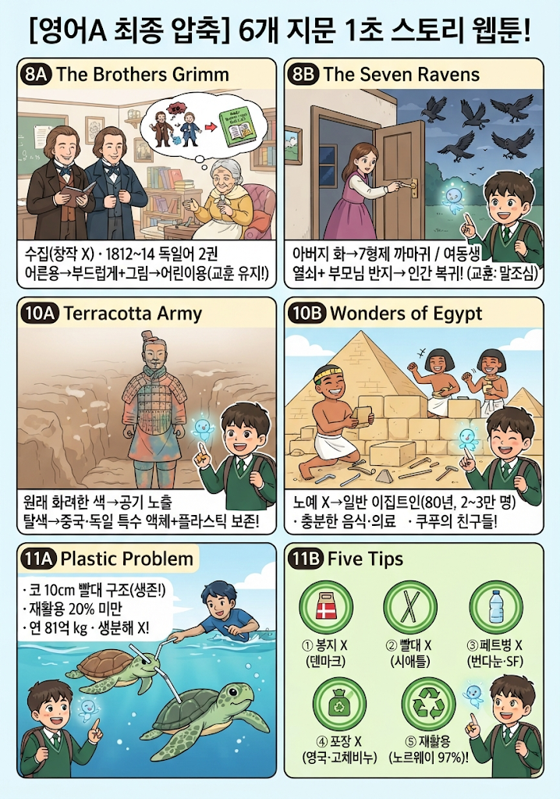
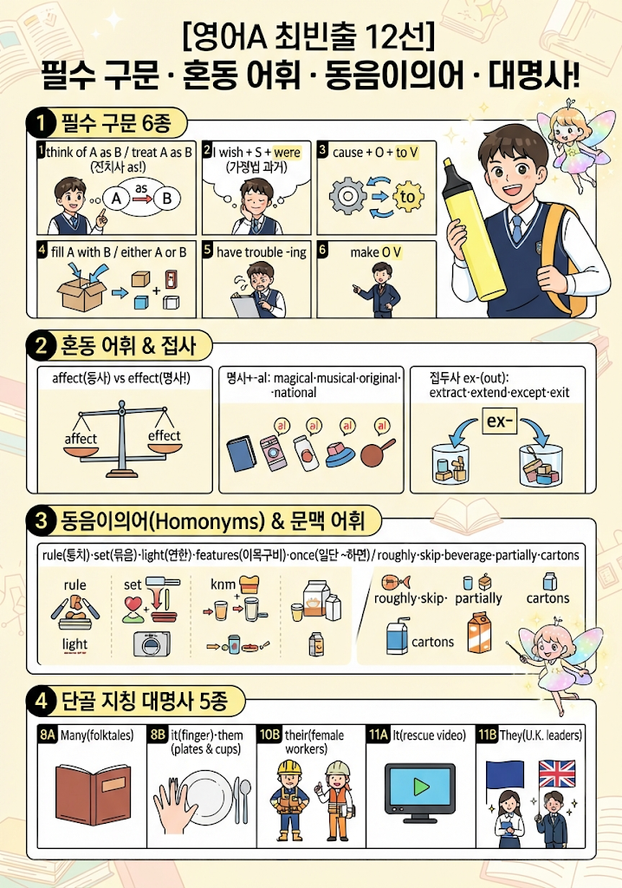
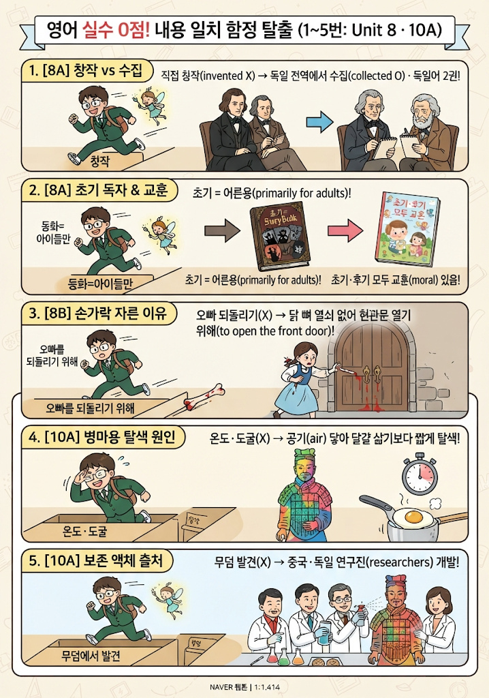
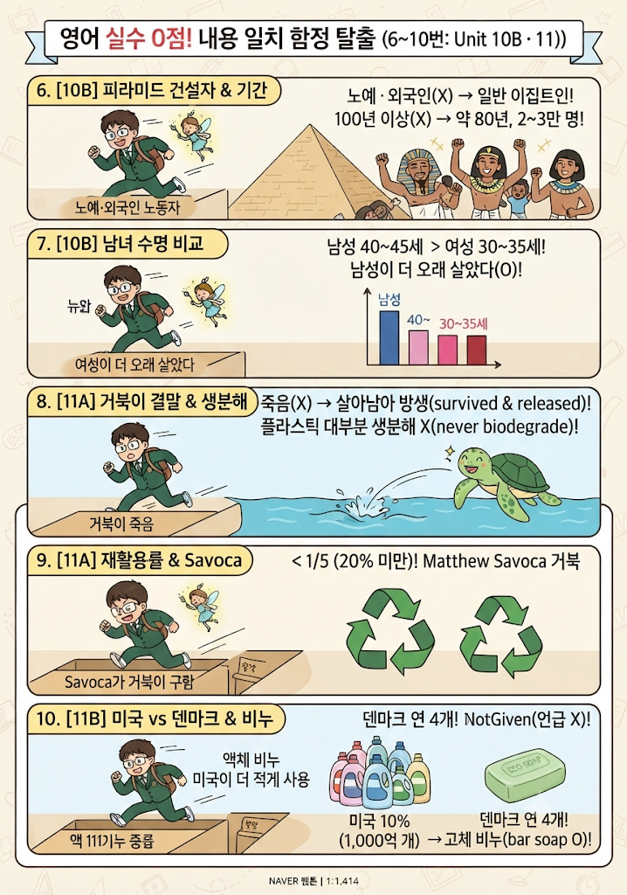

# ⚡ 시험 직전 10분 최종 치트시트 — 2026 7학년 2학기 2회고사 영어(영어A)

> **시험 전날 밤 & 시험 직전 쉬는 시간용 1장 압축본**  
> **범위**: Reading Explorer **Unit 8A · 8B** (p.105~114), **Unit 10A · 10B · 11A · 11B** (p.131~156) — 총 6개 지문

---

## 1️⃣ 6개 지문 3줄 초압축 한글 요약

### 📖 Unit 8A. The Brothers Grimm (그림 형제, p.106~109)
1. 독일의 대학생이었던 야코프와 빌헬름 그림 형제는 독일 전역의 이야기꾼들로부터 전해 내려오던 **민담(folktales)**을 수집하여 1812~1814년 독일어로 두 권의 책(*Grimms' Fairy Tales*)을 출판했다.
2. 이들의 이야기는 숲을 위험한 곳(사악한 마녀·말하는 동물·마법 존재의 집)으로 여겼던 **옛 독일인의 전통적 삶과 믿음**을 잘 보여 준다.
3. 원래는 **어른들을 주 대상(primarily for adults)**으로 어둡고 무섭게 썼으나, 나중에 내용을 **부드럽게 고치고(softened) 그림을 추가(added drawings)**해 어린이에게 적합하게 바꿨으며, 초기·후기 버전 **모두 교훈(moral)**을 담고 있다.

### 🐦‍⬛ Unit 8B. The Seven Ravens (일곱 마리 까마귀, p.110~114)
1. 일곱 아들과 막내딸을 둔 아버지가 딸에게 줄 물을 뜨러 숲속 우물에 보낸 아들들이 싸우다 물병을 빠뜨리고 늦게 돌아오지 않자, 화가 나서 **"다 까마귀로 변해 버려라!"**고 외쳐 진짜 까마귀가 되고 만다.
2. 성장한 여동생은 오빠들의 불운을 알고 수년간 찾아 헤맨 끝에 오빠들의 집을 발견하고, 닭 뼈 열쇠가 없자 **자기 손가락을 잘라 문을 열고 들어가** 일곱 접시와 컵에서 조금씩 먹고 마시다가 마지막 컵에 **부모님의 반지**를 실수로 떨어뜨린다.
3. 돌아온 일곱 번째 까마귀가 반지를 알아보고 **"여동생이 여기 있다면 자유로워질 텐데"**라고 말하자 여동생이 달려 나와 오빠들이 다시 사람으로 돌아왔으며, 이 이야기의 교훈은 **"말하기 전에 신중히 생각하라(Think carefully about what you say)"**이다.

### 🏺 Unit 10A. The Army's True Colors (병마용 군대의 본래 색깔, p.132~137)
1. 중국 최초의 황제 **진시황(Qin Shihuang)**은 기원전 221~210년 통치 기간에 만리장성·도로망·문자·화폐·도량형을 정비했고, 사후 무덤을 지키기 위해 실제 크기의 **테라코타 병사(병마용)**를 만들게 했다.
2. 오늘날 시안 박물관의 병사들은 연갈색(light brown)이지만 원래는 빨강·파랑·노랑·초록·하양·보라 등 화려한 색이었으며, 발굴되어 **공기에 노출되자 달걀 하나 삶는 시간보다 짧게** 페인트 아래 코팅이 벗겨져 색이 사라졌다.
3. 최근 중국·독일 연구진이 **특수 액체(special liquid)를 뿌리고 플라스틱으로 덮는 보존 신기술**을 개발했고, 흙 속에서도 안료를 찾아내어 앞으로 **원래 색을 다시 입혀 복원**하는 것이 다음 과제이다.

### 🏜️ Unit 10B. Wonders of Egypt (이집트의 경이, p.138~142)
1. 기자(Giza) 피라미드 근처에서 고대 도시와 묘지가 발굴되면서, 피라미드는 **노예나 외국인(또는 외계인)이 아니라 일반 이집트인(Ordinary Egyptians)**들이 지었다는 사실이 확인되었다.
2. 약 **80년** 동안 **2만~3만 명**이 돌 캐기·운반·블록 다듬기 등 역할과 팀을 나누어 경쟁하며 일했고, 무거운 짐을 날라 남녀 모두 뼈에 **관절염(arthritis)** 흔적이 있으며 수명은 **남성 40~45세, 여성 30~35세**로 힘들었지만 충분한 음식과 **의료 혜택(medical care)**을 받았다.
3. 노동자들은 쿠푸 대피라미드 벽에 **"쿠푸의 친구들(Friends of Khufu)"**이라고 적을 만큼 자신들의 일을 **국가적 프로젝트(national project)**로 여기며 큰 자부심(proud)을 가졌다.

### 🐢 Unit 11A. The Problem with Plastic (플라스틱의 문제점, p.146~151)
1. 코스타리카 바다에서 해양 생물학자들이 8분 만에 바다거북 코에서 **10cm 플라스틱 빨대**를 빼낸 유튜브 영상이 수백만 번 조회되며 해양 플라스틱 오염의 심각성을 알렸다(거북이는 **살아남아 바다로 방생됨!**).
2. 2000년 이후 전 세계 플라스틱 생산량이 급증했으나 **재활용률은 1/5(20%) 미만**이며, 매년 해안에서 약 **81억 kg(8.1 billion kg)**이 바다로 유입되어 대부분 **영원히 생분해되지 않는다(never biodegrade)**.
3. 바닷속 플라스틱은 해조류로 덮여 먹이 냄새가 나기 때문에 매년 **수백만 마리의 해양 동물**이 먹고 **지속적인 배고픔(constant hunger)**이나 부상·죽음을 겪으며, 특히 **일회용 플라스틱(single-use plastics)**이 최악이다(약 700종 피해).

### ♻️ Unit 11B. Five Tips for Using Less Plastic (플라스틱 줄이기 5가지 팁, p.152~156)
1. **① 비닐봉지 끊기**(재사용 가방 사용 — 전 세계 연간 1조 개, 미국 10%=1,000억 개 vs 덴마크인 연 4개, 1993년 덴마크 세계 최초 과세), **② 빨대 거절하기**(연 83억 개 해변 오염, 2018년 미국 시애틀 최초 금지).
2. **③ 페트병 쓰지 않기**(재사용 물병 사용 — 호주 번다눈·미국 샌프란시스코 전면/부분 금지, 그러나 전 세계는 여전히 **매분 약 100만 개** 구매), **④ 플라스틱 포장 피하기**(액체 비누 대신 **고체 비누(bar soap)**, 영국 슈퍼마켓 플라스틱 없는 구역 & 테이크아웃 용기 과세 추진).
3. **⑤ 재활용하기**(병·우유/주스 팩 등 — **노르웨이**는 슈퍼마켓 기계가 병당 최대 2.5크로네(32센트)를 **환불(refund)**해 주어 플라스틱 병의 **97%**를 재활용함).

---

## 2️⃣ 시험 최빈출 핵심 영단어·숙어 총정리표 (60 Target Words + 필수 구문)

### A. 단원별 교과서 Target Vocabulary 60개 (1초 뜻 테스트!)

| Unit | 핵심 영단어 10개 (영한 뜻 & 시험 포인트) |
| :---: | :--- |
| **8A** | **collect** 수집하다 · **publish** 출판하다 · **belief** 믿음, 신념 · **magical** 마법의 · **although** 비록 ~일지라도 · **primarily** 주로(=mainly) · **scary** 무서운 · **text** 본문, 글 · **add** 추가하다 · **suitable** 적합한 |
| **8B** | **afraid** 두려워하는 · **angry** 화난 · **forget** 잊다(과거 forgot) · **shocked** 충격받은 · **affect** *(동사!)* 영향을 미치다 · **determined** 단호한, 결심한 · **moment** 순간 · **recognize** 알아보다 · **immediately** 즉시 · **suddenly** 갑자기 |
| **10A** | **construction** 건설 · **network** 망, 연결망 · **currency** 화폐, 통화 · **army** 군대 · **protect** 보호하다 · **last** *(동사!)* 지속되다 · **technique** 기술, 기법 · **reveal** 드러내다, 밝히다 · **liquid** 액체 · **apply** 바르다, 적용하다 |
| **10B** | **icon** 상징 · **confirm** 확인하다, 입증하다 · **ordinary** 평범한, 일반의 · **involved** 관련된, 참여한 · **role** 역할 · **block** 블록, 덩어리 · **compete** 경쟁하다 · **according to** ~에 따르면 · **task** 과업, 일 · **proud** 자랑스러워하는 |
| **11A** | **extract** 추출하다, 빼내다 · **rescue** 구조, 구조하다 · **huge** 거대한 · **recycle** 재활용하다 · **typically** 보통, 일반적으로 · **constant** 끊임없는, 지속적인 · **weak** 약한 · **confusing** 혼란스러운 · **common** 흔한, 공통의 · **long term** 장기(간)의 |
| **11B** | **reduce** 줄이다 · **quit** 그만두다(=stop) · **tax** 세금, 세금을 부과하다 · **customer** 손님, 고객 · **ban** 금지하다 · **pollute** 오염시키다 · **globally** 전 세계적으로 · **avoid** 피하다 · **container** 용기, 그릇 · **refund** 환불(금) |

### B. 수업 필기 & 교과서 Reading Skill 최빈출 구문·어휘 12선 ⭐

| 구분 | 표현 / 규칙 | 뜻 & 시험 출제 포인트 |
| :---: | :--- | :--- |
| **필수 구문** | **think of A as B** (8A) / **treat A as B** (10A) | A를 B로 여기다 / A를 B로 취급하다 *(전치사 `as` 빈칸!)* |
| **필수 구문** | **I wish + 주어 + were ~** (8B) | ~라면 좋을 텐데 *(가정법 과거: 현재 사실 반대!)* |
| **필수 구문** | **cause + 목적어 + to 동사원형** (10A) | 목적어가 ~하도록 유발하다 (`caused the coating to fall off`) |
| **필수 구문** | **fill A with B** (11B) / **either A or B** (11B) | A를 B로 채우다 / A 또는 B 둘 중 하나 |
| **필수 구문** | **have trouble + -ing** (11A) / **make + O + V** (11B) | ~하는 데 어려움을 겪다 / 목적어가 ~하게 만들다 |
| **혼동 어휘** | **affect (동사)** vs **effect (명사)** (8B) | `affect` = ~에 영향을 미치다 / `have an effect on` = 영향(명사) |
| **어형 변화** | **명사 + `-al` → 형용사** (8A) | `magic`→`magical`, `music`→`musical`, `origin`→`original`, `nation`→`national` |
| **접두사** | **`ex-` = out / out of** (11A) | `extract`(빼내다), `extend`(뻗다), `except`(~제외하고), `exit`(출구) |
| **동음이의어** | **Homonyms 5종** (10A) | `rule`(통치 기간), `set`(한 묶음), `light`(연한), `features`(이목구비), `once`(일단 ~하면) |
| **문맥 어휘** | **Using Context 5종** (11B) | `roughly`(=approximately), `skip`(=stop using), `beverage`(=drink), `partially`(=in part), `cartons`(=containers) |
| **연어 표현** | **reveal / task / global** (10A·10B·11B) | `reveal a secret/the truth/the cause` · `impossible/complete/give a task` · `global warming/problem/awareness` |
| **지칭 대상** | **단골 대명사 5종** | 8A `Many`(=folktales) · 8B `it`(=finger), `them`(=plates & cups) · 10B `their`(=female workers) · 11A `It`(=rescue video) · 11B `They`(=U.K. leaders) |

---

## 3️⃣ ⚠️ 지문별 내용 일치/불일치 단골 함정 10선 (실수 0점 체크!)

시험장에서 **"옳은 것 / 옳지 않은 것"** 고를 때 1초 만에 함정을 걸러내는 체크리스트입니다!

1. **[8A 창작 vs 수집]** 그림 형제는 동화를 **직접 창작(invented)한 것이 아니라** 독일 전역의 이야기꾼들에게서 **수집(collected)**했다! (그리고 독일어로 2권을 출판함 — 여러 언어로 직접 쓴 게 아님!)
2. **[8A 초기 독자 & 교훈]** 그림 형제의 초기 이야기는 어린이용이 아니라 **주로 어른용(primarily for adults)**이었으며, **초기 버전과 후기 버전 모두 교훈(moral)**이 들어 있다!
3. **[8B 손가락 자른 이유]** 여동생이 손가락을 자른 이유는 오빠들을 사람으로 되돌리기 위해서가 아니라, **닭 뼈 열쇠가 없어서 오빠들 집의 현관문을 열기 위해서(to open the front door)**이다!
4. **[10A 병마용 색 소실 원인]** 병마용의 색이 사라진 이유는 높은 온도나 도굴 때문이 아니라, 발굴 후 **공기(air)**에 닿아 페인트 아래 코팅이 벗겨졌기 때문이며 **달걀 삶는 시간보다 짧은 시간**에 사라졌다!
5. **[10A 보존 액체 출처]** 병마용의 색을 보존하는 특수 액체는 무덤 안에서 발견된 것이 아니라 **중국과 독일 연구진(Chinese and German researchers)**이 새롭게 개발한 것이다!
6. **[10B 피라미드 건설자 & 기간]** 기자 피라미드는 **노예나 외국인이 아니라 일반 이집트인**이 지었으며, 100년 이상이 아니라 **약 80년** 동안 **2만~3만 명**이 참여했다!
7. **[10B 남녀 노동자 수명]** 여성도 피라미드 건설에 참여했고 뼈 손상은 남성과 비슷했지만, 평균 수명은 **남성 40~45세, 여성 30~35세**로 **남성이 여성보다 더 오래 살았다!**
8. **[11A 거북이의 결말 & 생분해]** 코에 10cm 빨대가 꽂혔던 바다거북은 죽은 것이 아니라 **살아남아 바다로 돌아갔다(survived and was released)**! 그리고 바다 플라스틱 대부분은 생분해되지 **않는다(never biodegrade)**!
9. **[11A 재활용률 & 매튜 사보카]** 전 세계 플라스틱 재활용률은 **1/5(20%) 미만**이다! 또한 해양 생물학자 **Matthew Savoca**는 인터뷰 전문가일 뿐, 코스타리카에서 거북이를 구조한 팀원인지 여부는 **지문에 나와 있지 않다(Not Given)**!
10. **[11B 미국 vs 덴마크 & 비누]** 미국인은 전 세계 비닐봉지(1조 개)의 약 **10%(=약 1,000억 개, 1인당 하루 거의 1개)**를 쓰지만, 평균 덴마크인은 **1년에 4개**만 쓴다! 또한 플라스틱 포장을 피하려면 **액체 비누(liquid soap)가 아니라 고체 비누(bar soap)**를 사야 한다!

