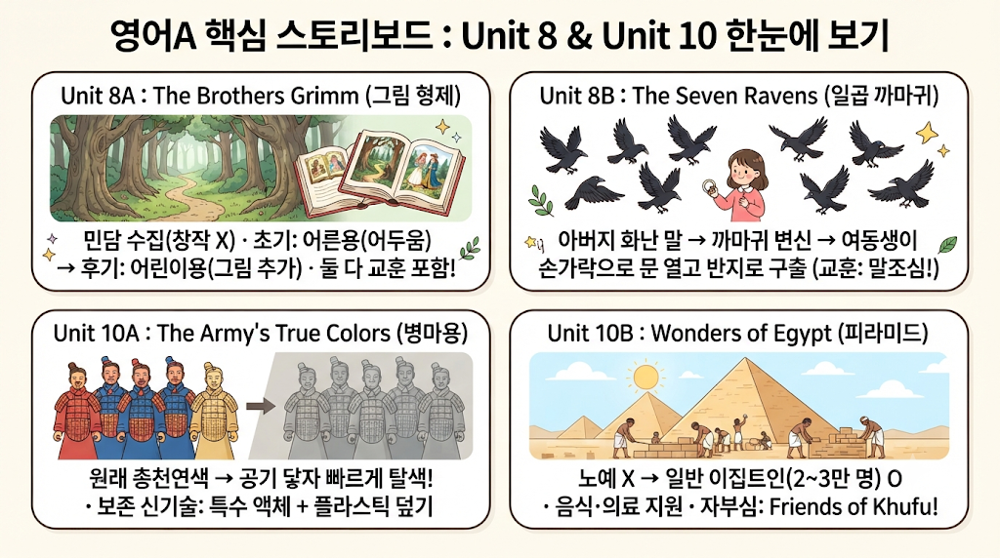
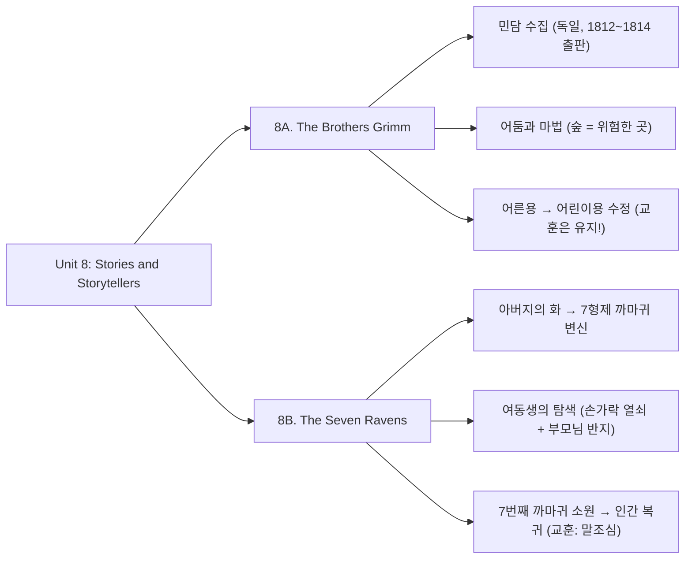
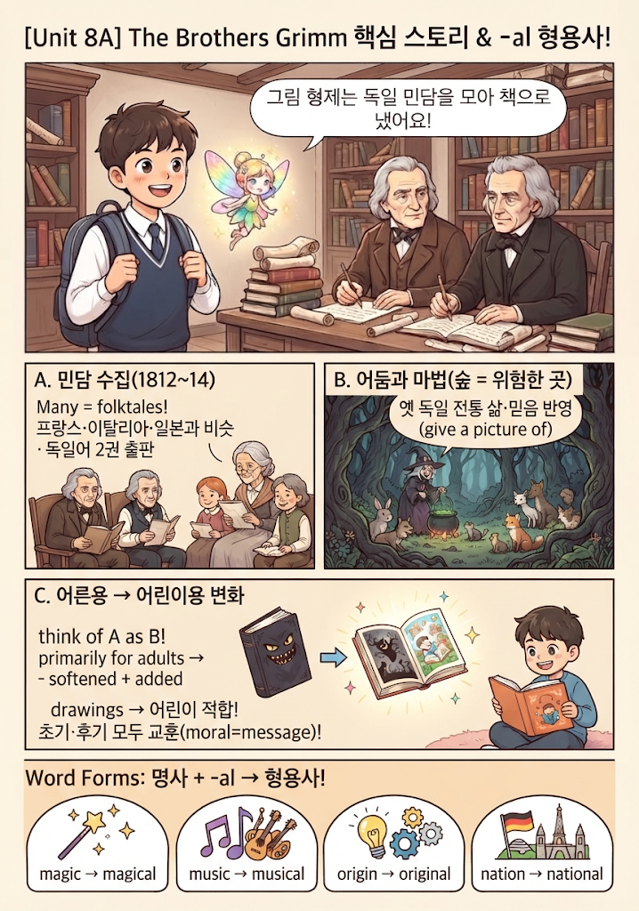
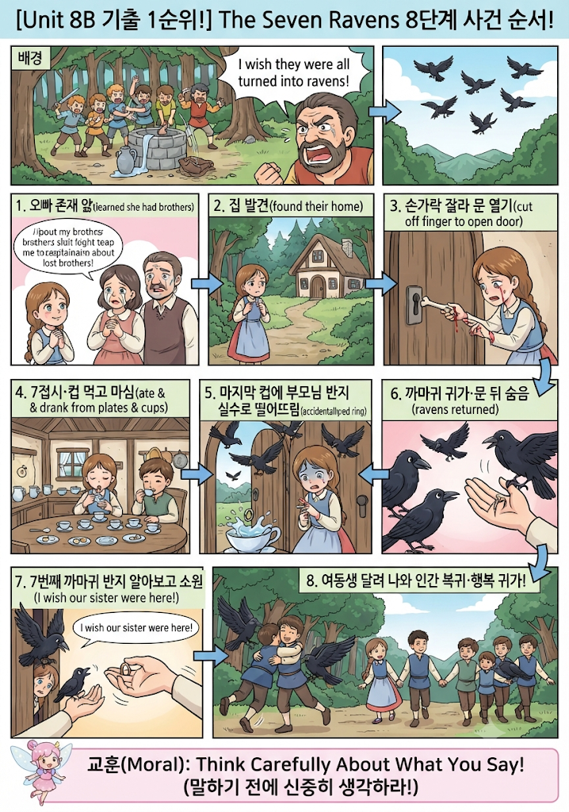
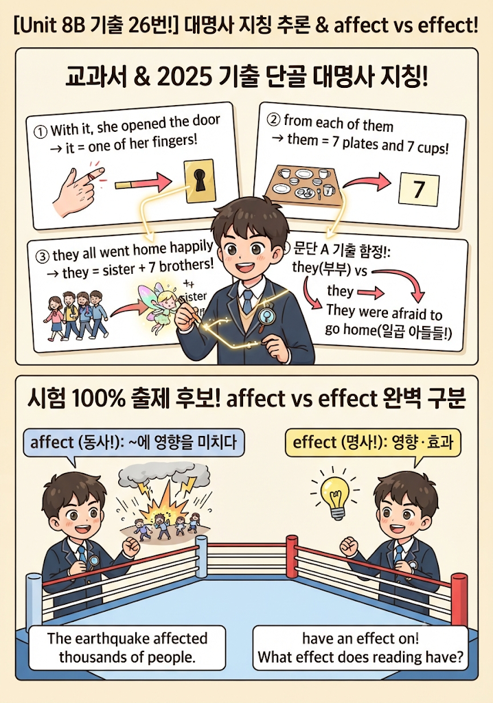

# 📘 Unit 8. Stories and Storytellers — 완벽 정리 (8A & 8B)

> **교과서 범위**: Reading Explorer p.105 ~ 114 (**Unit 8A** The Brothers Grimm · **Unit 8B** The Seven Ravens)  
> **연계 기출**: 2025학년도 KIS 7학년 2학기 2차 지필평가 **25~26번 직접 출제** (`The Seven Ravens` 순서 배열 + 지칭 대상 추론!)  
> **학습 목표**: 그림 형제와 민담의 변화 이해 · `The Seven Ravens` 사건 순서 완벽 암기 · 대명사 지칭 추론 · `-al` 형용사 & `affect / effect` 구분

---

---

## 🎯 Unit 8 한눈에 보는 핵심 구조

---

# 📖 Part 1. Unit 8A — The Brothers Grimm (p.106~109)

> 🎬 **개념 몽타주 영상 (2분 0초)** — 그림 형제 이야기 · 민담 수집 · -al 형용사를 한 번에 정리해요. (한국어 설명 + 영어 핵심 문장 자막)

<video controls preload="metadata" playsinline poster="exam/%EC%98%81%EC%96%B4_%EC%8B%9C%ED%97%98%EA%B3%B5%EB%B6%80/videos/eng_01_8a_grimm_poster.jpg" src="exam/%EC%98%81%EC%96%B4_%EC%8B%9C%ED%97%98%EA%B3%B5%EB%B6%80/videos/eng_01_8a_grimm.mp4" style="width:100%;max-width:960px;border-radius:12px;display:block;margin:0 auto 1em;background:#000"></video>

## 1) 지문 핵심 스토리 요약
- **문단 A (민담 수집과 출판)**: 독일의 대학생 야코프·빌헬름 그림 형제는 여러 세대에 걸쳐 구전되던 **민담(folktales)**에 관심을 갖고 독일 전역의 이야기꾼들에게서 이야기를 **수집**했다. 많은 민담이 프랑스·이탈리아·일본 등 다른 나라 이야기와 비슷했고, 1812~1814년 독일어로 2권을 출판하여 영어권에 *Grimms' Fairy Tales*로 알려졌다.
- **문단 B (어둠과 마법)**: 그림 형제의 이야기는 옛 독일의 전통적 삶과 믿음을 보여 준다. 과거 독일인들은 숲을 위험한 곳으로 믿었기에 이야기 속 숲은 사악한 마녀(*헨젤과 그레텔*), 말하는 동물, 마법 존재들의 집으로 자주 등장한다.
- **문단 C (어린이 이야기?)**: 오늘날 대부분 어린이 동화로 여기지만, 그림 형제는 처음에 **주로 어른들을 위해(primarily for adults)** 어둡고 무섭게 썼다. 나중에 일부 원문을 고쳐 내용을 **부드럽게("softened")** 만들고 **그림을 추가(added drawings)**해 어린이에게 적합하게 바꿨다. 하지만 초기와 후기 모두 공통적으로 **교훈(moral)**을 담고 있다("열심히 일하고, 착하게 행동하며, 부모님 말씀을 잘 들어라").

---

## 2) 단락별 핵심 문장 정밀 해석 (영어 + 직독직해 & 수업 필기 포인트 ⭐)

### [Paragraph A]
1. **Jacob and Wilhelm Grimm were two young men from Germany who loved reading stories.**  
   → 야코프와 빌헬름 그림은 독일 출신의 두 젊은이였는데 / 이야기 읽기를 매우 좋아했다. *(주격 관계대명사 `who`)*
2. **As university students, they became interested in folktales—traditional stories or legends that people told again and again, often for generations.**  
   → 대학생 시절에(= `As they were university students`) / 그들은 민담에 관심을 갖게 되었다 / 즉, 사람들이 여러 세대에 걸쳐 반복해서 들려주던 전통 이야기나 전설에.
3. **The brothers began to collect folktales from storytellers all over Germany. Many were similar to stories told in France, Italy, Japan, and other countries.**  
   → 형제는 독일 전역의 이야기꾼들에게서 민담을 수집하기 시작했다. / **많은 것들(= folktales!)**은 프랑스, 이탈리아, 일본 및 다른 나라에서 전해지는(`told`, 과거분사 후치수식) 이야기들과 비슷했다.
4. **Between 1812 and 1814, the brothers published two books in German. These included stories like "Cinderella," "Snow White," and "Little Red Riding Hood." The collections became known in English as *Grimms' Fairy Tales*.**  
   → 1812년에서 1814년 사이에 / 형제는 독일어로 두 권의 책을 출판했다. / 이 책들은 <신데렐라>, <백설공주>, <빨간 모자> 같은 이야기를 포함했다. / 그 모음집은 영어로 *Grimms' Fairy Tales*로 알려지게 되었다.

### [Paragraph B — Darkness and Magic]
5. **The Grimm brothers' tales give a picture of traditional life and beliefs.**  
   → 그림 형제의 이야기는 전통적인 삶과 믿음의 모습을 **보여 준다(`give a picture of`)**.
6. **For example, in the past, many people in Germany believed that forests were dangerous places. In the Grimms' stories, a forest is often the home of evil witches (as in "Hansel and Gretel"), talking animals, and other magical beings.**  
   → 예를 들어, 과거에 독일의 많은 사람들은 숲이 위험한 곳이라고 믿었다. / 그림 형제의 이야기에서 숲은 종종 사악한 마녀(<헨젤과 그레텔>에서처럼), 말하는 동물, 그리고 다른 마법 존재들의 거처이다.

### [Paragraph C — Children's Stories?]
7. **Although most people today think of these stories as fairy tales for children, the Grimm brothers first wrote them primarily for adults.**  
   → 비록 오늘날 대부분의 사람들이 이 이야기들을 어린이를 위한 동화로 **여기지만(`think of A as B` ⭐)**, / 그림 형제는 처음에 그것들을 **주로 어른들을 위해** 썼다.
8. **Many of their early tales were dark and scary. Later, the brothers changed the text of some of the original stories. They "softened" many of the tales and added drawings. This made them more suitable for children.**  
   → 그들의 초기 이야기 중 많은 것은 어둡고 무서웠다. / 나중에 형제는 일부 원작 이야기의 본문을 바꿨다. / 그들은 많은 이야기를 '부드럽게' 다듬고 그림을 추가했다. / 이것은 이야기들을 어린이에게 더 적합하게 만들었다. *(5형식 `make + 목적어 + 형용사`)*
9. **Like the early tales, though, each story still has a moral: Work hard, be good, and listen to your parents.**  
   → 하지만 초기 이야기들과 마찬가지로 / 각 이야기는 여전히 **교훈(`moral` = message)**을 담고 있다: 열심히 일하고, 착하게 행동하며, 부모님 말씀을 들어라.

---

## 3) Unit 8A Target Vocabulary (영영 · 영한 완벽 정리)

| 번호 | 단어 | 품사 | 한글 뜻 | 교과서 영영 풀이 (p.109) & 유의어 |
| :---: | :--- | :---: | :--- | :--- |
| 1 | **collect** | v. | 수집하다, 모으다 | to bring together things from different places (명사형: **collection** 모음집) |
| 2 | **publish** | v. | 출판하다, 발행하다 | to print (as a book for sale) |
| 3 | **belief** | n. | 믿음, 신념 | an idea a person accepts as being true or real |
| 4 | **magical** | adj. | 마법의, 신비로운 | having special powers |
| 5 | **although** | conj. | 비록 ~일지라도 | even though; despite the fact that *(양보 접속사)* |
| 6 | **primarily** | adv. | 주로, 본래 | for the most part; **mainly** |
| 7 | **scary** | adj. | 무서운, 겁나는 | frightening; causing fear |
| 8 | **text** | n. | 본문, 글 | the words in a written work |
| 9 | **add** | v. | 추가하다, 덧붙이다 | to put in; include (명사형: **addition** 추가) |
| 10 | **suitable** | adj. | 적합한, 알맞은 | right or acceptable for a particular person or situation |

> 🔑 **Word Forms (p.109 C) — 명사 + `-al` → 형용사** ⭐ 어법/빈칸 단골!
> - `magic` (마법) → **magical** (마법의): *beans he believes are **magical***
> - `music` (음악) → **musical** (음악의): *played **musical** instruments*
> - `origin` (기원) → **original** (원래의, 최초의): *The **original** story of "Little Red Riding Hood"*
> - `nation` (국가) → **national** (국가의, 전국적인)

---

## 4) Unit 8A Reading Skill & 예상 출제 포인트
- **Reading Skill — Annotating Text (텍스트 주석 달기, p.108)**:
  - 핵심 내용에 형광펜 표시 / 모르는 단어 밑줄 긋고 여백에 뜻 적기 / 중요한 숫자·통계·연도(`1812`, `1814`)에 동그라미 / 이해 안 되는 부분에 물음표(`?`) 표시.
- **교과서 Concept Map 정답 (p.108 B)**:
  1. collected tales from German **storytellers**
  2. stories are **similar** to tales in other countries
  3. the forest a common image → believed to be a **dangerous** place
  4. wrote first for **adults**, and later for **children**
- **출제 1순위 함정 포인트**:
  - `Many` (문단 A) = **folktales** (storytellers나 books가 아님!)
  - 그림 형제는 동화를 **창작(invented)한 게 아니라 수집(collected)**했고, **독일어(German)**로만 책을 썼다!
  - `moral`의 뜻 = **message** (교훈) — 초기 버전과 후기 버전 **둘 다** 교훈이 있음!

---
---

# 🐦‍⬛ Part 2. Unit 8B — The Seven Ravens (p.110~114)

> 🎬 **개념 몽타주 영상 (1분 54초)** — 일곱 까마귀 사건 순서 · 대명사 · affect/effect를 한 번에 정리해요. (한국어 설명 + 영어 핵심 문장 자막)

<video controls preload="metadata" playsinline poster="exam/%EC%98%81%EC%96%B4_%EC%8B%9C%ED%97%98%EA%B3%B5%EB%B6%80/videos/eng_02_8b_ravens_poster.jpg" src="exam/%EC%98%81%EC%96%B4_%EC%8B%9C%ED%97%98%EA%B3%B5%EB%B6%80/videos/eng_02_8b_ravens.mp4" style="width:100%;max-width:960px;border-radius:12px;display:block;margin:0 auto 1em;background:#000"></video>

## 1) 지문 핵심 스토리 & 사건 순서 (8단계 완벽 암기 ⭐)
> ⚠️ **2025 KIS 기출 25번(순서 배열) & 교과서 p.112 Sequencing 직접 출제!**

| 순서 | 영어 핵심 사건 (교과서 p.112 B) | 한글 스토리 흐름 |
| :---: | :--- | :--- |
| **(배경)** | Seven sons fight at a well; jug falls in → Angry father wishes them turned into ravens. | 일곱 아들이 숲속 우물에서 싸우다 물병을 빠뜨려 귀가를 두려워함 → 화난 아버지가 "까마귀가 되어라!" 외쳐 진짜 까마귀로 변함 |
| **1** | **The girl learned that she had brothers.** | 자란 여동생이 자신에게 오빠들이 있었다는 사실을 알게 됨 |
| **2** | **The girl found the boys' home.** | 오빠들의 불운을 듣고 결심해 수년간 찾아다닌 끝에 집을 발견함 |
| **3** | **The girl cut off one of her fingers.** | 닭 뼈로 만든 특수 열쇠가 없어 자신의 손가락 하나를 잘라 문을 염 |
| **4** | **The girl ate and drank from the plates and cups.** | 식탁 위 일곱 접시와 일곱 컵에서 조금씩 먹고 마심 |
| **5** | **The girl dropped a ring into a cup.** | 마지막 컵에 부모님이 주신 반지를 실수로(accidentally) 떨어뜨림 |
| **6** | **The ravens came home to eat.** | 마침내 까마귀들이 식사하러 돌아오고 여동생은 문 뒤에 숨어 지켜봄 |
| **7** | **One raven made a wish.** | 일곱 번째 까마귀가 반지를 알아보고 "여동생이 여기 있다면 자유로워질 텐데"라고 소원함 |
| **8** | **The girl ran to her brothers.** | 여동생이 달려 나가자 까마귀들이 즉시 사람으로 변하고 모두 행복하게 집으로 돌아감 |

---

## 2) 단락별 핵심 문장 정밀 해석 (영어 + 직독직해 & 수업 필기 포인트 ⭐)

### [Paragraph A]
1. **Once upon a time, there lived a man and a woman who had seven sons. The couple wanted a daughter, and, eventually, they had a girl who they loved very much.**  
   → 옛날 옛적에, 일곱 아들을 둔 한 남자와 여자가 살았다. / 그 부부는 딸을 원했고, 마침내 그들이 매우 사랑하는 여자아이를 낳았다.
2. **One day, the father needed water for the child, so he sent the seven brothers to a well in the forest to get it. Once there, though, the boys began to fight, and the water jug fell into the well.**  
   → 어느 날 아버지가 아이를 위해 물이 필요해서 / 일곱 형제를 숲속 우물로 물을 길어 오게 보냈다. / 하지만 거기에 도착하자마자 소년들은 싸우기 시작했고 / 물병이 우물 속으로 떨어졌다.
3. **The boys did not know what to do. They were afraid to go home.**  
   → 소년들은 무엇을 해야 할지 몰랐다(`what to do`). / 그들은 집에 가기가 두려웠다.

### [Paragraph B]
4. **Hours passed. "Where are those boys?" shouted the angry father. "They are probably playing a game and forgot about the water. I wish they were all turned into ravens!"**  
   → 몇 시간이 흘렀다. "저 녀석들은 어디 있는 거야?" 화난 아버지가 소리쳤다. / "아마 놀이를 하느라 물을 잊어버렸겠지. **저 녀석들이 다 까마귀로 변해 버렸으면 좋겠어!**" *(가정법 과거 `I wish + 주어 + were` ⭐ / `turn into` = change to ~로 변하다)*
5. **When he looked up, he saw seven black birds flying away. The father was shocked. "What have I done?" he thought. But it was too late. He could not take back his words.**  
   → 그가 고개를 들었을 때 / 그는 일곱 마리의 검은 새가 날아가는 것을 보았다(`see + 목적어 + ~ing` ⭐). / 아버지는 충격을 받았다. "내가 무슨 짓을 한 거지?"라고 생각했다. / 하지만 너무 늦었다. **그는 자신이 한 말을 주워 담을 수 없었다.** *(Paraphrase: He had already said the words, so it was too late.)*

### [Paragraph C]
6. **In time, the girl grew up and discovered she had brothers. The story of their misfortune affected her greatly, and she was determined to find them. For years, she searched and did not stop.**  
   → 시간이 흘러, 소녀는 자라서 오빠들이 있다는 것을 알게 되었다. / 그들의 **불운(`misfortune` = bad luck)**에 관한 이야기가 그녀에게 큰 영향을 미쳤고, / 그녀는 오빠들을 찾겠다고 굳게 결심했다(`be determined to V`). / 수년 동안 그녀는 멈추지 않고 찾아다녔다.
7. **Finally, she found their home. To enter, she needed a special key made from a chicken bone, which she did not have.**  
   → 마침내 그녀는 그들의 집을 찾았다. / 들어가기 위해 그녀는 닭 뼈로 만들어진 특수 열쇠가 필요했는데, 그것을 가지고 있지 않았다. *(과거분사 `made from` + 계속적 관계대명사 `, which`)*
8. **The girl thought for a moment, and then took a knife and cut off one of her fingers. With *it*, she opened the front door and went inside.**  
   → 소녀는 잠시 생각하더니, 칼을 집어 자기 손가락 하나를 잘랐다. / **그것(`it` = one of her fingers ⭐)**으로 그녀는 현관문을 열고 안으로 들어갔다.
9. **On a table, there were seven plates and seven cups. She ate and drank a little from each of *them*. In the last cup, she accidentally dropped a ring that her parents had given her.**  
   → 식탁 위에는 일곱 개의 접시와 일곱 개의 컵이 있었다. / 그녀는 **그것들(`them` = seven plates and seven cups ⭐)** 각각에서 조금씩 먹고 마셨다. / 마지막 컵에 그녀는 부모님이 주신 반지를 **실수로(`accidentally` = without planning it)** 떨어뜨렸다.

### [Paragraph D]
10. **Eventually, the ravens returned for their meal. The girl hid behind a door and watched. When the seventh raven drank from his cup, something hit his mouth. The raven recognized it immediately—it was his parents' ring.**  
    → 마침내 까마귀들이 식사를 하러 돌아왔다. / 소녀는 문 뒤에 숨어 지켜보았다. / 일곱 번째 까마귀가 자기 컵에서 마셨을 때 무언가가 입에 부딪혔다. / 그 까마귀는 그것을 즉시 알아보았다—그것은 부모님의 반지였다.
11. **"I wish our sister were here," he said, "and then we could be free." Their sister quickly ran to them, and suddenly the ravens were human again. The brothers kissed their sister, and *they* all went home together happily.**  
    → "**우리 여동생이 여기 있다면 좋을 텐데**, 그러면 우리가 자유로워질 수 있을 텐데"라고 그가 말했다. *(가정법 과거 `I wish + 주어 + were` ⭐)* / 그들의 여동생이 재빨리 그들에게 달려갔고, 갑자기 까마귀들은 다시 사람이 되었다. / 오빠들은 여동생에게 입을 맞췄고, **그들 모두(`they` = the sister and her seven brothers ⭐)** 함께 행복하게 집으로 돌아갔다.

---

## 3) Unit 8B Target Vocabulary (영영 · 영한 완벽 정리)

| 번호 | 단어 | 품사 | 한글 뜻 | 교과서 영영 풀이 (p.114) & 포인트 |
| :---: | :--- | :---: | :--- | :--- |
| 1 | **afraid** | adj. | 두려워하는 | scared of what might happen (`be afraid to V`) |
| 2 | **angry** | adj. | 화가 난 | feeling upset when someone has behaved badly |
| 3 | **forget** | v. | 잊다 | to fail to remember (과거형: **forgot**) |
| 4 | **shocked** | adj. | 충격받은 | surprised, usually in a **bad** way |
| 5 | **affect** | v. | 영향을 미치다 | to cause a change in someone or something *(동사!)* |
| 6 | **determined** | adj. | 단호한, 굳게 결심한 | wanting to do something very much and not giving up |
| 7 | **moment** | n. | 순간, 잠시 | a very **short** period of time |
| 8 | **recognize** | v. | 알아보다 | to know a person or thing because you have seen them before |
| 9 | **immediately** | adv. | 즉시, 곧바로 | happening very quickly, right away |
| 10 | **suddenly** | adv. | 갑자기 | happening quickly and unexpectedly |

> ⚠️ **Word Usage (p.114 C) — `affect` vs `effect` 완벽 구분!** ⭐ 시험 100% 출제 후보!
> - **affect (동사)**: ~에 영향을 미치다 → 주어 뒤 **동사 자리**에 사용!  
>   - *The earthquake **affected** thousands of people.*  
>   - *The movie did not **affect** me as much as I thought.*
> - **effect (명사)**: 영향, 효과 → 관사/형용사 뒤 **명사 자리** (`have an effect on`)에 사용!  
>   - *What **effect** does reading stories to children have on their development?*

---

## 4) Unit 8B Reading Skill & 2025 KIS 기출 적중 포인트
- **Reading Skill — Understanding Pronoun Reference (대명사 지칭 추론, p.113)**:
  - 대명사는 앞 문장의 명사(성별·단복수 일치!)를 대신한다.
  - **교과서 p.113 B 정답 필수 암기**:
    1. `With it, she opened the front door` → `it` = **one of her fingers** (her finger)
    2. `She ate and drank a little from each of them.` → `them` = **the seven plates and seven cups**
    3. `and they all went home together happily.` → `they` = **the brothers and their sister** (the seven brothers and the girl)
  - **2025 KIS 기출 26번 유형 확인**: 문단 A에서 `a man and a woman` / `The couple` / `they`(=부부) / `They`(=일곱 아들들: *They were afraid to go home.*) 중 가리키는 대상이 **다른 하나**를 고르는 문제!
- **내용 추론 핵심**:
  - 여동생이 손가락을 자른 이유 = **to open the front door of the boys' house** (닭 뼈 열쇠 대신!).
  - 이 이야기의 교훈(moral) = **Think carefully about what you say.** (말하기 전에 신중히 생각하라!)

