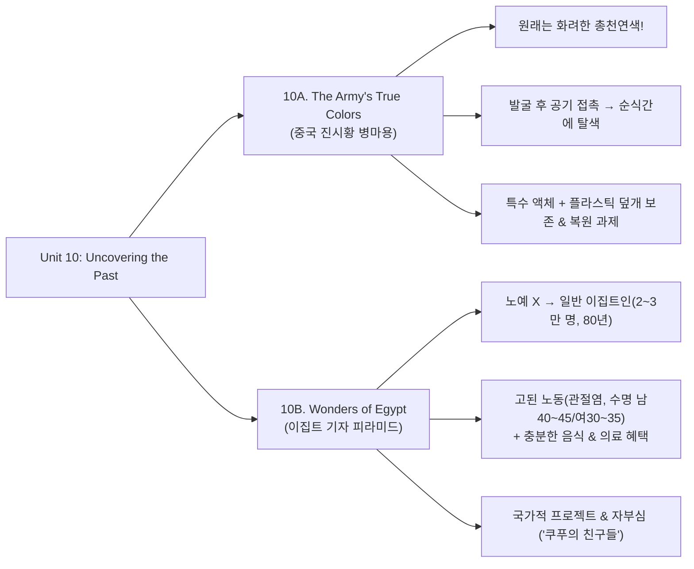
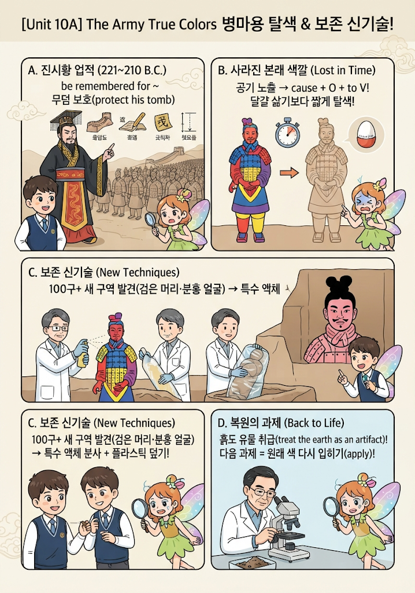
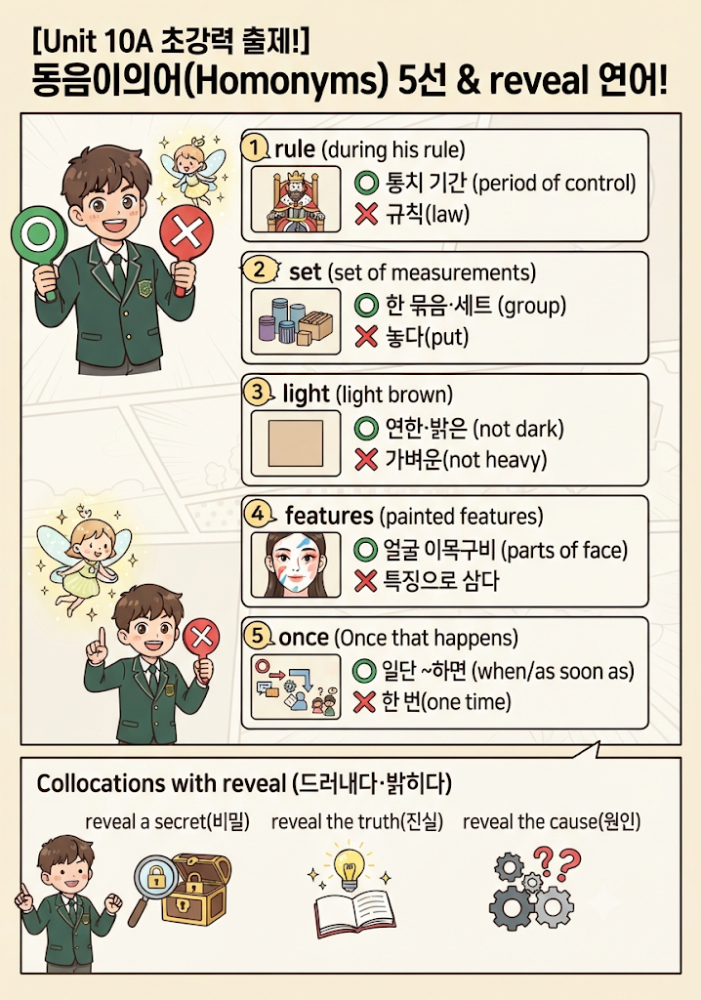
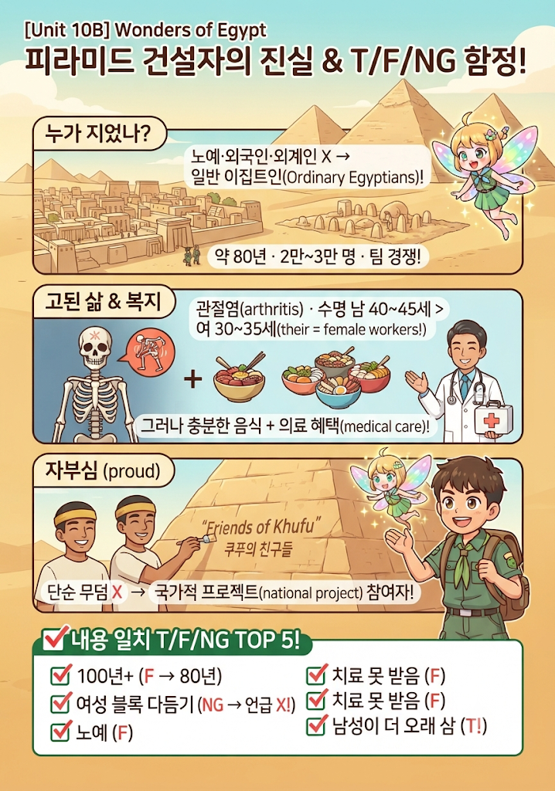

# 📙 Unit 10. Uncovering the Past — 완벽 정리 (10A & 10B)

> **교과서 범위**: Reading Explorer p.131 ~ 142 (**Unit 10A** The Army's True Colors · **Unit 10B** Wonders of Egypt)  
> **학습 목표**: 진시황 병마용의 본래 색깔과 보존 신기술 이해 · 동음이의어(Homonyms) 문맥 파악 · 기자 피라미드 건설자들의 실체와 삶 파악 · 개요 요약(Outline Summary) 작성

---

## 🎯 Unit 10 한눈에 보는 핵심 구조



---

# 🏺 Part 1. Unit 10A — The Army's True Colors (p.132~137)

## 1) 지문 핵심 내용 요약
- **도입 캡션 (p.132)**: 1974년 중국 시안(Xi'an)에서 우물을 파던 농부들이 2,000년 넘게 숨겨져 있던 점토 병사들을 발견했고, 이후 고고학자들이 약 **8,000구**의 실제 크기(life-sized) 병마용과 유물을 추가로 발굴했다.
- **문단 A (진시황의 업적과 병마용 제작)**: 중국 최초의 황제 **진시황(Qin Shihuang)**은 기원전 221~210년 통치 기간에 만리장성 건설, 대규모 도로망, 새로운 문자·화폐·도량형 도입을 이루었으며, 사후 무덤을 지키기 위해 거대한 테라코타 병사 군대를 만들게 했다.
- **문단 B (Lost in Time — 사라진 색깔)**: 오늘날 박물관의 병사들은 연갈색(light brown)이지만 원래는 빨강·파랑·노랑·초록·하양·보라의 화려한 색이었다. 땅속에서는 보호되었으나 **발굴(unearthed)되자 공기가 페인트 아래 코팅을 떨어지게 만들어** 달걀 하나 삶는 시간보다도 짧은 순간에 색이 사라져 버렸다.
- **문단 C (New Techniques — 보존 신기술)**: 최근 고고학자들이 100구 이상의 병사가 있는 구역을 새로 발견했는데, 검은 머리·분홍 얼굴·검은/갈색 눈 등 색칠된 이목구비가 남아 있었다. **중국과 독일 연구진**이 개발한 **특수 액체(special liquid)**를 뿌린 뒤 **플라스틱으로 덮어** 색을 보존한다.
- **문단 D (Back to Life — 복원의 과제)**: 고고학자들은 병마용 주변 **흙(dirt)에서도 색소**를 찾고 있으며, 흙조차 유물처럼 취급한다(`treat the earth as an artifact`). 박물관 수석 화학자이자 고고학자인 **Rong Bo**는 다음 과제가 **그 색들을 병마용에 다시 입히는(apply) 방법을 찾는 것**이며, 일단 그렇게 되면 진시황의 군대를 본래 색깔로 되살릴 수 있다고 말한다.



---

## 2) 단락별 핵심 문장 정밀 해석 (영어 + 직독직해 & 수업 필기 포인트 ⭐)

### [Paragraph A]
1. **The first emperor of China, Qin Shihuang, is remembered for the many things he did during his rule.**  
   → 중국 최초의 황제인 진시황은 / 그의 **통치 기간(`rule`)** 동안 그가 한 많은 일들로 **기억된다(`be remembered for` ⭐)**. *(목적격 관계대명사 `that` 생략: `the many things (that) he did`)*
2. **Between 221 and 210 B.C., he started the construction of the Great Wall of China. He built a large network of roads. He introduced a new writing system, currency, and set of measurements.**  
   → 기원전 221년과 210년 사이에, 그는 중국 만리장성의 건설을 시작했다. / 그는 거대한 도로망을 건설했다. / 그는 새로운 문자 체계, **화폐(`currency`)**, 그리고 **도량형/단위 묶음(`set of measurements`)**을 도입했다.
3. **The emperor also ordered the construction of a huge army of life-sized terracotta soldiers. These, he hoped, would protect his tomb after his death.**  
   → 황제는 또한 실제 크기의 테라코타 병사들로 이루어진 거대한 군대의 제작을 명령했다. / 그는 이것들이 자신이 죽은 후 자신의 무덤을 보호해 주기를 바랐다.

### [Paragraph B — Lost in Time]
4. **Today, the soldiers in Xi'an's terracotta museum are light brown, but they weren't always this color. They began as an army of red, blue, yellow, green, white, and purple.**  
   → 오늘날 시안의 병마용 박물관에 있는 병사들은 **연한(`light`)** 갈색이지만, 항상 이 색이었던 것은 아니다. / 그들은 빨강, 파랑, 노랑, 초록, 하양, 보라색의 군대로 시작되었다.
5. **Sadly, most of the colors did not last to the present day. Before their discovery, the clay soldiers were protected by being underground.**  
   → 슬프게도, 대부분의 색깔은 오늘날까지 **지속되지 못했다(`last`)**. / 발견되기 전에는 점토 병사들이 땅속에 있음으로써(`by being underground`) 보호되고 있었다.
6. **When they were unearthed, however, the air caused the coating under the paint to fall off. The paint disappeared in less time than it takes to boil an egg, taking with it important pieces of history.**  
   → 그러나 그들이 **발굴되었을 때(`unearthed` = dug up)**, / **공기가 페인트 아래의 코팅이 떨어져 나가게 만들었다(`cause + 목적어 + to부정사` ⭐)**. / 페인트는 **달걀 하나를 삶는 데 걸리는 시간보다도 더 짧은 시간 안에** 사라졌고, 역사의 중요한 조각들을 함께 가져가 버렸다.

### [Paragraph C — New Techniques]
7. **New techniques are now starting to reveal the army's true colors. Archeologists have recently discovered an area with more than a hundred soldiers. Many of these still have their painted features, including black hair, pink faces, and black or brown eyes.**  
   → 새로운 기술들이 이제 군대의 본래 색깔을 **드러내기(`reveal`)** 시작하고 있다. / 고고학자들은 최근 100구 이상의 병사가 있는 구역을 발견했다. / 이들 중 다수는 검은 머리카락, 분홍 얼굴, 검은색 또는 갈색 눈을 포함해 색칠된 **이목구비(`features`)**를 여전히 간직하고 있다.
8. **Chinese and German researchers have developed a special liquid to help preserve the soldiers' colors. After they find a soldier or other artifact, archeologists spray it with the liquid. They then cover it in plastic.**  
   → 중국과 독일의 연구진들이 병사들의 색을 **보존하는(`preserve`)** 것을 돕기 위해 특수 **액체(`liquid`)**를 개발했다. / 병사나 다른 유물을 발견한 뒤, 고고학자들은 그것에 그 액체를 뿌린다. / 그런 다음 그것을 플라스틱으로 덮는다.

### [Paragraph D — Back to Life]
9. **Archeologists are also finding colors in the dirt around Xi'an's terracotta warriors. It's important not to disturb the dirt, so the colors won't be lost. "We are treating the earth as an artifact," says archeologist Rong Bo, the museum's leading chemist.**  
   → 고고학자들은 시안의 테라코타 전사들 주변의 **흙(`dirt` = soil)**에서도 색깔을 찾고 있다. / 색이 사라지지 않도록 흙을 건드리지 않는 것이 중요하다. / "우리는 **흙을 유물로 취급하고 있습니다(`treat A as B` ⭐)**"라고 박물관의 수석 화학자인 고고학자 롱보가 말한다.
10. **The next challenge, says Rong, is to find a way to apply the colors to the army again. Once that happens, artists can bring Emperor Qin's army back to life in full color.**  
    → 다음 **과제(`challenge`)**는 그 색들을 군대에 다시 **입히는(`apply`)** 방법을 찾는 것이라고 롱은 말한다. / **일단 그렇게 되면(`Once` = when; as soon as)**, 예술가들은 진시황의 군대를 완전한 색채로 되살려 낼 수 있다.

---

## 3) Unit 10A Target Vocabulary & Reading Skill (Homonyms 동음이의어 ⭐)

### A. Target Vocabulary 10개
| 번호 | 단어 | 품사 | 한글 뜻 | 핵심 의미 & 시험 포인트 (p.137) |
| :---: | :--- | :---: | :--- | :--- |
| 1 | **construction** | n. | 건설, 건축 | the process of building something (동사: **construct**) |
| 2 | **network** | n. | 망, 연결망 | a system of connected roads, rivers, or parts |
| 3 | **currency** | n. | 화폐, 통화 | a country's **money** |
| 4 | **army** | n. | 군대 | a large organized group of soldiers |
| 5 | **protect** | v. | 보호하다 | to keep someone or something safe from harm |
| 6 | **last** | v. | 지속되다, 유지되다 | to **continue to exist** for a particular length of time |
| 7 | **technique** | n. | 기술, 기법 | a special way of doing something |
| 8 | **reveal** | v. | 드러내다, 밝히다 | to make something known or visible |
| 9 | **liquid** | n. | 액체 | a substance like water or mercury that flows freely |
| 10 | **apply** | v. | 바르다, 적용하다 | to **put (paint/liquid) on** a surface |

> 🔑 **Collocations with `reveal` (p.137 C)**:
> - `reveal a secret` (비밀을 누설하다) · `reveal the truth` (진실을 밝히다) · `reveal the cause (of death)` (원인을 밝히다)

### B. Reading Skill — Identifying Homonyms (동음이의어 5선, p.136) ⭐ 초강력 출제!
철자와 발음은 같지만 **품사와 문맥에 따라 뜻이 다른 단어**입니다. 지문 속 뜻을 정확히 외우세요!

| 단어 | 지문 속 예문 | 지문에서의 올바른 뜻 (O) | 함정 뜻 (X) |
| :---: | :--- | :--- | :--- |
| **rule** | during his **rule** | **(n.) 통치 기간** (`a period of control`) | (n.) 규칙, 법 (`a law`) |
| **set** | **set** of measurements | **(n.) 한 묶음, 세트** (`a group of similar things`) | (v.) 놓다 (`to put in place`) |
| **light** | **light** brown | **(adj.) 연한, 밝은** (`not dark`) | (adj.) 가벼운 (`not heavy`) |
| **features** | painted **features** | **(pl. n.) 얼굴 이목구비** (`parts of someone's face`) | (v.) 특징으로 삼다 (`includes`) |
| **once** | **Once** that happens | **(conj.) 일단 ~하면** (`when; as soon as`) | (adv.) 한 번 (`one time only`) |



---
---

# 🏜️ Part 2. Unit 10B — Wonders of Egypt (p.138~142)

## 1) 지문 핵심 내용 요약 & 팩트 체크
> 📌 **Before You Read 퀴즈 3가지 (p.138 & p.144 정답 — 모두 True!)**
> 1. 기자 피라미드(약 기원전 2550년 시작, 4,000년 이상 됨)는 멕시코 마야의 치첸이트사 피라미드(A.D. 750~1200)보다 **더 오래되었다 (T)**.
> 2. 기자 피라미드는 처음 지어졌을 때 **하얀색(white)**이었다 (T).
> 3. 쿠푸 대피라미드는 **3,000년 넘게(정확히 3,800년 동안, 서기 1300년경 영국 링컨 대성당 완공 전까지)** 세계에서 가장 높은 건축물이었다 (T).

- **문단 A (건설자의 정체 확인)**: 기자 피라미드 근처에서 고대 도시와 건설자들의 묘지(cemetery)가 발굴되었다. 이를 연구한 고고학자들은 피라미드가 **노예나 외국인(또는 외계인)이 아니라 일반 이집트인(Ordinary Egyptians)**들이 지었다는 사실을 확인(confirm)했다.
- **문단 B (건설 기간·인원·팀 작업)**: 건설에는 약 **80년**이 걸렸고, **20,000~30,000명**이 참여했다. 돌을 캐고, 옮기고, 블록으로 다듬는 등 **역할(roles)**이 달랐으며, 각자 이름이 붙은 **팀(teams)**을 이루어 누가 더 빨리 끝내는지 **경쟁(competed)**하기도 했다.
- **문단 C (노동자들의 삶 — 힘듦과 복지)**: 묘지에서 발견된 뼈(skeletons)를 연구한 과학자 Azza Mohamed Sarry El-Din에 따르면, 무거운 것을 오래 날라 생긴 **관절염(arthritis)** 흔적이 있다. **여성 유골**도 많이 발견되었으며 뼈 손상 정도가 남성과 비슷했고 삶은 더 힘들었을 수도 있다(**남성 수명 40~45세 vs 여성 수명 30~35세**). 그러나 노동자들은 보통 **충분한 음식(enough food)**을 먹었고 아프거나 다치면 **의료 혜택(medical care)**도 받았다.
- **문단 D (자부심과 국가적 프로젝트)**: 과업은 힘들었지만 노동자들은 자신의 일을 **자랑스러워했다(proud)**. 예컨대 쿠푸 대피라미드 벽에 한 노동자 무리가 **"Friends of Khufu(쿠푸의 친구들)"**라고 적었다. 이집트 고고학자 Zahi Hawass는 그들이 단순히 왕의 무덤만 짓는 것이 아니라 **이집트를 건설하는 국가적 프로젝트(national project)**의 **참여자(participant)**라고 여겼기 때문이라고 설명한다.

---

## 2) 단락별 핵심 문장 정밀 해석 (영어 + 직독직해)

### [Paragraph A]
1. **Many people today think of the pyramids of Giza as the defining icon of ancient Egyptian culture. But who actually built them?**  
   → 오늘날 많은 사람들은 기자의 피라미드를 고대 이집트 문화의 대표적인 **상징(`icon`)**으로 여긴다(`think of A as B`). / 하지만 실제로 누가 그것들을 지었을까?
2. **Now, however, archeologists have discovered an ancient city near the pyramids. Close by, there is a cemetery where the pyramid builders were buried.**  
   → 그러나 이제 고고학자들이 피라미드 근처에서 고대 도시를 발견했다. / 바로 가까이에는 피라미드 건설자들이 묻힌 묘지가 있다. *(관계부사 `where`)*
3. **From studying these places, archeologists can now confirm that the pyramids were not built by slaves or foreigners (or space aliens!). Ordinary Egyptians built them.**  
   → 이 장소들을 연구함으로써 고고학자들은 이제 피라미드가 노예나 외국인(또는 외계인!)에 의해 지어지지 않았다는 것을 **확인할(`confirm`)** 수 있다. / **평범한 일반 이집트인들**이 그것들을 지었다.

### [Paragraph B]
4. **It took about 80 years to build the pyramids. Archeologists believe that about 20,000–30,000 people were involved in the construction.**  
   → 피라미드를 짓는 데 약 **80년**이 걸렸다(`It takes + 시간 + to V`). / 고고학자들은 약 **2만~3만 명**이 그 건설에 **참여했다(`be involved in`)**고 믿는다.
5. **The workers had different roles. Some dug up the rock, some moved it, and some shaped it into blocks. People also worked on different teams, each with its own name. Workers often competed to see whose team could do a job faster.**  
   → 노동자들은 서로 다른 역할을 맡았다. / 어떤 이들은 바위를 캐냈고, 어떤 이들은 옮겼고, 어떤 이들은 그것을 블록 모양으로 다듬었다. / 사람들은 또한 각자 고유한 이름이 있는 서로 다른 팀에서 일했다. / 노동자들은 종종 어느 팀이 일을 더 빨리 할 수 있는지 보려고 **경쟁했다(`competed`)**.

### [Paragraph C]
6. **Life for these workers was hard. "We can see that in their skeletons," says Azza Mohamed Sarry El-Din, a scientist studying bones found in the cemetery. According to her research, the bones show signs of arthritis. This probably developed from carrying heavy things for a long time.**  
   → 이 노동자들의 삶은 고되었다. / "우리는 그들의 해골에서 그것을 볼 수 있습니다"라고 묘지에서 발견된 뼈를 연구하는 과학자 아자 모하메드 사리 엘딘이 말한다. / 그녀의 연구에 **따르면(`According to`)**, 뼈들은 **관절염(`arthritis`)**의 징후를 보인다. / 이것은 아마 오랜 시간 무거운 물건을 나른 것에서 비롯되었을 것이다.
7. **Archeologists have also found many female skeletons in the ancient city and cemetery. The damage to their bones is similar to that of the men. In fact, *their* lives may have been even tougher: Male workers generally lived to age 40–45, but women to only 30–35.**  
   → 고고학자들은 또한 고대 도시와 묘지에서 많은 여성 유골을 발견했다. / 그들의 뼈에 생긴 손상은 남성들의 것(`that` = the damage)과 비슷하다. / 사실, **그들(`their` = female workers ⭐)**의 삶은 훨씬 더 고되었을지도 모른다: / 남성 노동자들은 대체로 40~45세까지 살았지만, 여성들은 겨우 30~35세까지만 살았다.
8. **However, workers usually had enough food, and they also received medical care if they got sick or hurt.**  
   → 그러나 노동자들은 보통 충분한 음식을 먹었고, / 아프거나 다치면 **의료 혜택(`medical care`)**도 받았다.

### [Paragraph D]
9. **The task was challenging, but laborers were proud of their work. On a wall in Khufu's Great Pyramid, for example, a group of workers wrote *Friends of Khufu*.**  
   → 그 **과업(`task`)**은 힘들었지만, **노동자들(`laborers` = workers)**은 자신의 일을 **자랑스러워했다(`be proud of`)**. / 예를 들어 쿠푸 대피라미드의 한 벽에 한 무리의 노동자들이 *쿠푸의 친구들*이라고 적어 놓았다.
10. **"It's because they were not just building the tomb of their king," says Egyptian archeologist Zahi Hawass. "They were building Egypt. It was a national project, and everyone was a participant."**  
    → "그것은 그들이 단지 왕의 무덤만 짓고 있었던 게 아니기 때문입니다"라고 이집트 고고학자 자히 하와스가 말한다. / "그들은 이집트를 짓고 있었습니다. 그것은 **국가적 프로젝트**였고, 모두가 **참여자(`participant`)**였습니다."

---

## 3) Unit 10B Target Vocabulary & Reading Skill (Outline Summary)

### A. Target Vocabulary 10개
| 번호 | 단어 | 품사 | 한글 뜻 | 교과서 영영 풀이 (p.142) & 포인트 |
| :---: | :--- | :---: | :--- | :--- |
| 1 | **icon** | n. | 상징, 아이콘 | a famous person or thing that represents a culture/idea |
| 2 | **confirm** | v. | 확인하다, 입증하다 | to show to be true |
| 3 | **ordinary** | adj. | 평범한, 보통의 | common or usual |
| 4 | **involved** | adj. | 관련된, 참여한 | taking part in or connected with an activity (`be involved in`) |
| 5 | **role** | n. | 역할 | the job or function someone has in a situation (`play a role`) |
| 6 | **block** | n. | 블록, 큰 덩어리 | a large solid piece of hard material (rock, stone) with flat sides |
| 7 | **compete** | v. | 경쟁하다 | to try to be more successful or faster than others |
| 8 | **according to** | prep. | ~에 따르면 | as stated or reported by someone/something |
| 9 | **task** | n. | 과업, 일 | an activity or piece of work that you have to do |
| 10 | **proud** | adj. | 자랑스러워하는 | feeling pleased and satisfied with one's work (`be proud of`) |

> 🔑 **Collocations with `task` (p.142 C)**:
> - `an impossible task` (불가능한 과업) · `complete the task` (과업을 완수하다) · `give (someone) a new task` (새 과업을 주다)

### B. Reading Skill — Creating an Outline Summary (p.141 정답 완벽 정리!)
```text
OUTLINE: Wonders of Egypt
1. Construction of the pyramids
   a. Built by: ordinary Egyptians
   b. Time, extent, and jobs
      • took about 80 years
      • 20,000–30,000 people involved
      • people worked in different teams and roles
2. Builders' lives and attitudes
   a. Hard life
      • bones show signs of arthritis
      • men lived to 40–45 years, women 30–35 years
   b. Food and health
      • had enough food
      • had access to medical care
   c. Attitude of laborers
      • felt proud
      • saw it as a national project
```

### C. 내용 일치/불일치 단골 함정 TOP 5 (교과서 p.140 B 포함!)
1. *"피라미드 건설은 **100년 이상** 걸렸다."* → **F (거짓!)** 약 **80년** 걸림!
2. *"바위를 블록으로 다듬는 일은 **주로 여성**이 했다."* → **NG (언급 없음!)** 여성 유골이 발견되었지만 구체적으로 어떤 역할을 맡았는지는 지문에 없음!
3. *"피라미드는 **노예나 외국인**이 지었다."* → **F (거짓!)** **일반 이집트인(Ordinary Egyptians)**이 지음!
4. *"노동자들은 **충분한 음식을 못 먹거나 치료를 못 받았다**."* → **F (거짓!)** 충분한 음식과 의료 혜택을 받음!
5. *"남성 노동자가 여성 노동자보다 **대체로 더 오래 살았다**."* → **T (참!)** 남성 40~45세 vs 여성 30~35세!


