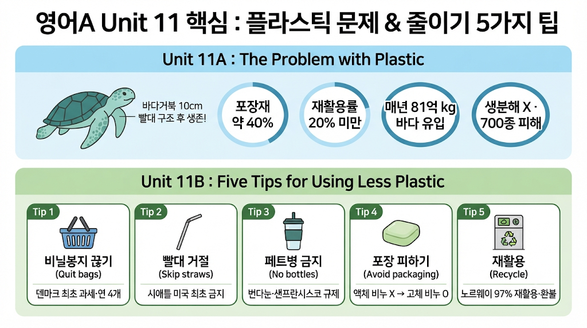
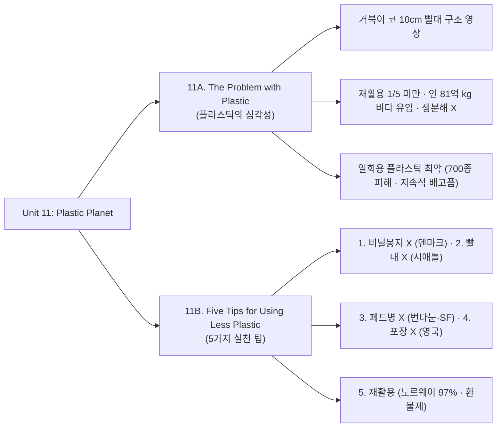
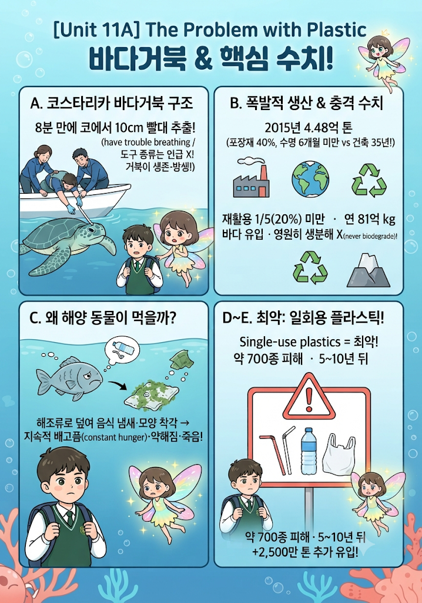
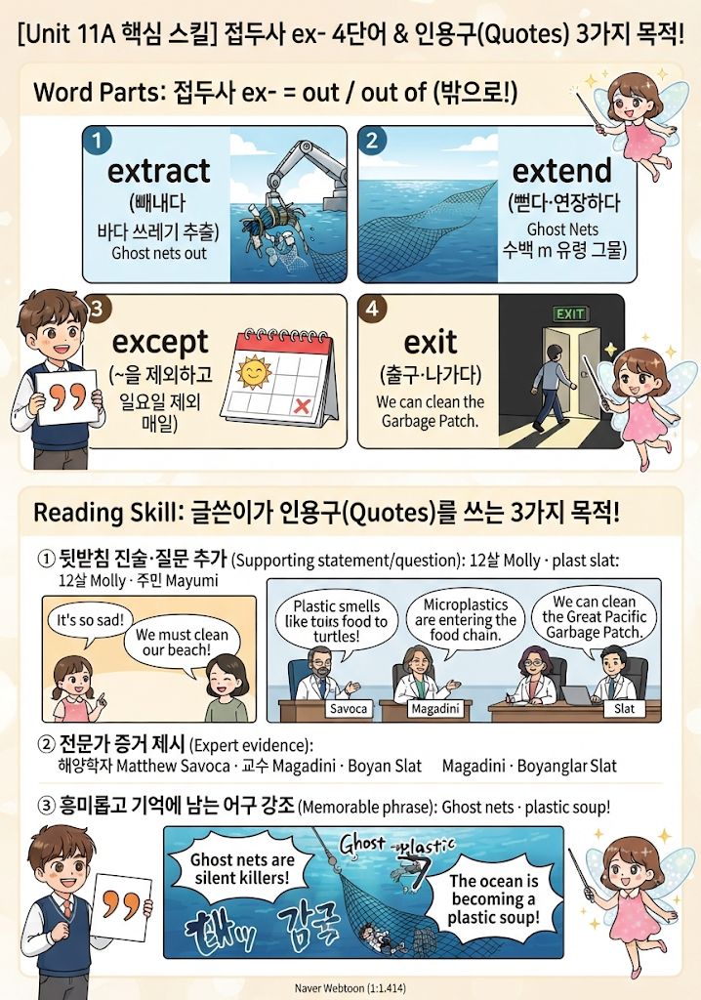
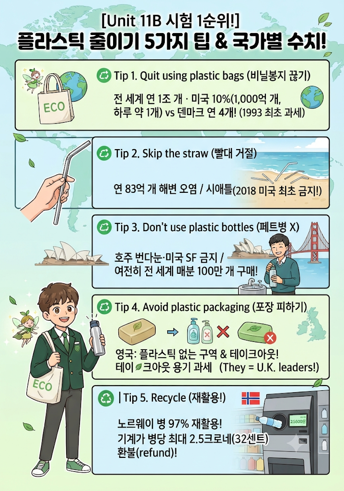
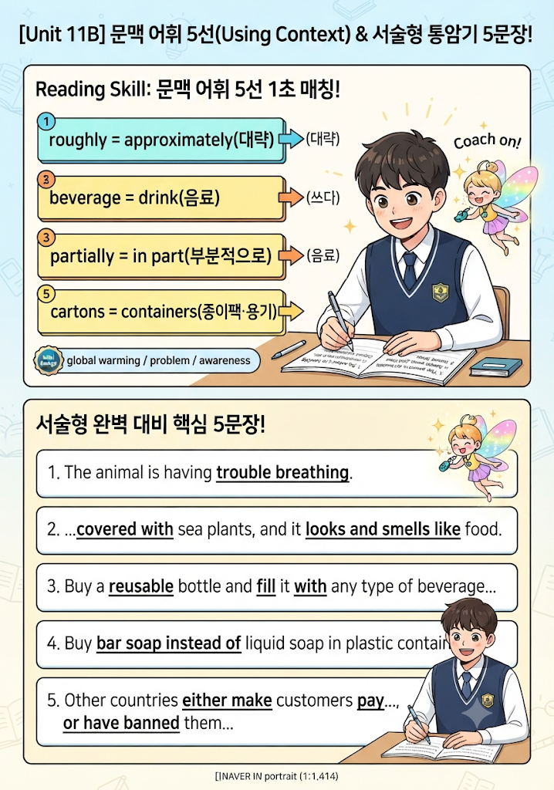

# 📗 Unit 11. Plastic Planet — 완벽 정리 (11A & 11B)

> **교과서 범위**: Reading Explorer p.145 ~ 156 (**Unit 11A** The Problem with Plastic · **Unit 11B** Five Tips for Using Less Plastic)  
> **학습 목표**: 해양 플라스틱 오염의 원인과 피해 이해 · 인용구(Quotes)의 목적 파악 · 플라스틱 줄이기 5가지 실천법 및 국가/도시별 정책 정리 · 문맥으로 어휘 추론하기

---

---

## 🎯 Unit 11 한눈에 보는 핵심 구조

---

# 🐢 Part 1. Unit 11A — The Problem with Plastic (p.146~151)

## 1) 인포그래픽 필수 수치 (p.146~147) ⭐ 내용 일치 주의!
- 2015년 전 세계 플라스틱 총생산량: **4억 4,800만 톤(448 million tons)** *(1950년 이후 폭발적 증가!)*
- 가장 큰 비중을 차지하는 용도: **포장재(Packaging) — 1억 6,100만 톤(거의 40%!)**
- 버려지기 전 평균 사용 기간 비교:
  - **건축·건설(Building and construction)**: 평균 **35년** (가장 길다!)
  - **포장재(Packaging)**: 평균 **6개월 미만(Less than 6 months)** (가장 짧고 대부분 한 번 쓰고 버려짐!)

---

## 2) 지문 단락별 핵심 문장 정밀 해석 (영어 + 직독직해 & 수업 필기 포인트 ⭐)

### [Paragraph A — 코스타리카 바다거북 구조]
1. **On a boat near Costa Rica, a team of marine biologists is helping a turtle. The animal is having trouble breathing, and the team discovers why—there is something inside its nose.**  
   → 코스타리카 근처의 배 위에서, 한 팀의 **해양 생물학자(`marine biologists`)**들이 거북이 한 마리를 돕고 있다. / 그 동물은 **숨 쉬는 데 어려움을 겪고 있으며(`have trouble + -ing` ⭐)**, 연구팀은 그 이유를 발견한다—코 안에 무언가가 들어 있는 것이다.
2. **A scientist tries to extract the object, but the turtle cries in pain. Finally, after eight long minutes, a long object is pulled out: It is a 10-centimeter plastic straw.**  
   → 한 과학자가 그 물체를 **빼내려고(`extract`)** 애쓰지만, 거북이는 고통 속에 울부짖는다. / 마침내 긴 8분이 지난 후, 길쭉한 물체가 뽑혀 나온다: 그것은 **10센티미터 길이의 플라스틱 빨대**였다.
   - *⚠️ 주의(교과서 p.149 2번):* 과학자들이 빨대를 빼낼 때 **무슨 도구(tools)를 사용했는지는 문단 A에 나와 있지 않다!**

### [Paragraph B — 해양 플라스틱 유입량과 낮은 재활용률]
3. **The video of the turtle's rescue has been viewed millions of times on YouTube. *It* has helped raise awareness of a growing problem: The world's seas are full of plastic.**  
   → 그 거북이의 **구조(`rescue`)** 영상은 유튜브에서 수백만 번 조회되었다. / **그것(`It` = the video of the turtle's rescue ⭐)**은 커져 가는 문제에 대한 인식을 높이는 데 도움을 주었다: 전 세계의 바다가 플라스틱으로 가득 차 있다는 것이다.
4. **Since 2000, there has been a huge increase in worldwide plastic production, but we recycle less than one-fifth of it.**  
   → 2000년 이후로 전 세계 플라스틱 생산량에 **거대한(`huge`)** 증가가 있었지만, / 우리는 그것의 **5분의 1(=20%) 미만**만을 **재활용(`recycle`)**한다.
5. **A lot of this plastic waste ends up in the ocean. Today, scientists think about 8.1 billion kilograms goes into the sea every year from coastal regions. Most of this plastic will never biodegrade.**  
   → 이 플라스틱 쓰레기 중 많은 양이 결국 바다로 들어간다(`end up in`). / 오늘날 과학자들은 매년 해안 지역에서 약 **81억 킬로그램(8.1 billion kg)**이 바다로 유입된다고 생각한다. / 이 플라스틱 대부분은 **결코 생분해되지 않을 것이다(`never biodegrade`)**.

### [Paragraph C — 해양 동물에게 미치는 피해]
6. **This ocean plastic hurts millions of sea animals every year. Some fish eat plastic because it is covered with sea plants, and it looks and smells like food.**  
   → 이 해양 플라스틱은 매년 **수백만 마리(`millions of`)**의 해양 동물을 다치게 한다. / 어떤 물고기들은 플라스틱이 바다 식물(해조류)로 덮여 있고 음식처럼 보이고 냄새가 나기 때문에 그것을 먹는다.
7. **Typically, eating plastic leads to constant hunger. "Imagine you ate lunch and then just felt weak ... and hungry all day," says marine biologist Matthew Savoca. "That would be very confusing."**  
   → **보통(`Typically`)**, 플라스틱을 먹는 것은 **끊임없는 배고픔(`constant hunger`)**으로 이어진다(`lead to`). / "점심을 먹었는데도 하루 종일 **기운이 없고(`weak`)** 배가 고프다고 상상해 보세요"라고 해양 생물학자 매튜 사보카가 말한다. / "그건 정말 **혼란스러울(`confusing`)** 겁니다."
8. **In some cases, eating sharp pieces of plastic can seriously hurt sea animals and even result in death.**  
   → 어떤 경우에는 날카로운 플라스틱 조각을 먹는 것이 해양 동물을 심각하게 다치게 하고 심지어 **죽음으로 이어질(`result in death`)** 수도 있다.

### [Paragraph D — 최악의 주범: 일회용 플라스틱]
9. **Plastic is useful to people because it is strong and lasts a long time. But this is bad news for sea creatures who eat or get stuck in it.**  
   → 플라스틱은 튼튼하고 오래 지속되기 때문에 사람들에게는 유용하다. / 하지만 그것은 플라스틱을 먹거나 거기에 끼이게 되는(`get stuck in`) 해양 생물들에게는 나쁜 소식이다.
10. **According to Savoca, "Single-use plastics are the worst." These are items that are used only once before we throw them away. Some common examples include straws, water bottles, and plastic bags. About 700 sea species (including the turtle from the video) have been caught in or have eaten this kind of plastic. Luckily, the turtle survived and was released back into the ocean.**  
    → 사보카에 따르면, "**일회용 플라스틱(`Single-use plastics`)**이 최악이다." / 이것들은 우리가 버리기 전에 딱 한 번만 사용하는 물건들이다. / 흔한 예로는 빨대, 물병, 비닐봉지가 있다. / (영상 속 거북이를 포함해) 약 **700종의 해양 생물**이 이런 종류의 플라스틱에 걸리거나 그것을 먹었다. / **다행히 그 거북이는 살아남아 바다로 다시 풀어졌다(방생되었다).** *(⚠️ 함정: 죽지 않았다!)*

### [Paragraph E — 장기적 영향과 경고]
11. **How will plastic affect sea animals in the long term? "I think we'll know the answers in 5 to 10 years' time," says Debra Lee Magadini from Columbia University. But by then, another 25 million tons of plastic will already be in the ocean.**  
    → 플라스틱이 **장기적으로(`in the long term`)** 해양 동물에게 어떤 영향을 미칠까? / "5년에서 10년 뒤면 답을 알게 될 거라고 생각합니다"라고 컬럼비아 대학의 데브라 리 마가디니가 말한다. / 하지만 그때쯤이면 **또 다른 2,500만 톤(25 million tons)**의 플라스틱이 이미 바다에 들어가 있을 것이다.

---

## 3) Unit 11A Target Vocabulary & Reading Skill (Quotes 인용구 ⭐)

### A. Target Vocabulary 10개
| 번호 | 단어 | 품사 | 한글 뜻 | 교과서 영영 풀이 (p.151) & 포인트 |
| :---: | :--- | :---: | :--- | :--- |
| 1 | **extract** | v. | 빼내다, 추출하다 | to **take something out** (접두사 `ex-` = out) |
| 2 | **rescue** | n./v. | 구조, 구조하다 | the act of saving someone/something from danger |
| 3 | **huge** | adj. | 거대한, 엄청난 | very large in size or amount |
| 4 | **recycle** | v. | 재활용하다 | to process used materials so they can be used again |
| 5 | **typically** | adv. | 보통, 일반적으로 | what **usually** happens in a situation |
| 6 | **constant** | adj. | 끊임없는, 지속적인 | happening **all the time** |
| 7 | **weak** | adj. | 약한, 기운 없는 | not very **strong** |
| 8 | **confusing** | adj. | 혼란스러운 | **difficult** for people to understand |
| 9 | **common** | adj. | 흔한, 일반적인 | happening often; seen in many places |
| 10 | **long term** | n./adj. | 장기간(의) | continuing **far into the future** (`in the long term`) |

> 🔑 **Word Parts (p.151 C) — 접두사 `ex-` ("out" / "out of")** ⭐
> - **extract** (빼내다): *technologies that can **extract** plastic waste from our oceans*
> - **extend** (뻗다, 연장하다): *"Ghost nets" can **extend** for more than several hundred meters*
> - **except** (~을 제외하고): *open every day **except** Sunday*
> - **exit** (출구, 나가다)

### B. Reading Skill — Understanding a Writer's Use of Quotes (인용구의 목적 3가지, p.150) ⭐
1. **a. To add a supporting statement or question (뒷받침하는 진술·질문 추가)**: 일반 주민이나 학생의 경험·질문 *(예: 12살 Molly Peterson의 빨대 중단, 주민 Mayumi Fujikawa의 질문)*
2. **b. To provide expert evidence for an argument (주장에 대한 전문가 증거 제시)**: 과학자·기관장·교수의 발언 *(예: Ocean Cleanup CEO Boyan Slat, 캘리포니아 해안위원회 Eben Schwartz, 본문의 Matthew Savoca & Debra Lee Magadini)*
3. **c. To highlight an interesting or memorable phrase (흥미롭거나 기억에 남는 어구 강조)**: *"Ghost nets"*, *"plastic soup"* 등!

---
---

# ♻️ Part 2. Unit 11B — Five Tips for Using Less Plastic (p.152~156)

## 1) 플라스틱 줄이기 5가지 팁 & 국가·도시별 핵심 수치 총정리표 ⭐ 시험 1순위!

| 팁 번호 | 핵심 실천법 (영어 원문) | 구체적 실천 방법 | 지문에 등장하는 국가·도시 & 핵심 수치 |
| :---: | :--- | :--- | :--- |
| **Tip 1** | **Quit using plastic bags.** *(비닐봉지 사용 끊기)* | 가게에 **재사용 쇼핑백(reusable shopping bag)** 가져가기 | • 전 세계 연간 **1조 개(1 trillion)** 사용 • **미국**: 전 세계의 약 **10%(=약 1,000억 개)**, 1인당 하루 거의 1개 • **덴마크**: 평균 덴마크인은 **연 4개**만 사용! **1993년 세계 최초** 비닐봉지 과세(`tax`) • **칠레·케냐·인도네시아·독일·뉴질랜드**: 유료화 또는 전면 금지(`banned`) |
| **Tip 2** | **Skip the straw.** *(빨대 쓰지 않기)* | 음료 주문 시 거절하거나 **재사용 빨대(금속 등)** 챙기기 | • 오늘날 약 **83억 개(8.3 billion)**의 플라스틱 빨대가 전 세계 해변 오염 • **시애틀(Seattle)**: **2018년 미국 최초의 주요 도시**로 플라스틱 빨대 금지 |
| **Tip 3** | **Don't use plastic bottles.** *(플라스틱 병 쓰지 않기)* | **재사용 물병(reusable bottle)**을 사서 좋아하는 음료 채우기(`fill it with`) | • **번다눈(Bundanoon, 호주)** & **샌프란시스코(San Francisco, 미국)**: 생수(bottled water) **전면 또는 부분 금지** • 그러나 전 세계에서는 여전히 **매분 거의 100만 개(nearly a million every minute)** 구매! |
| **Tip 4** | **Avoid plastic packaging.** *(플라스틱 포장 피하기)* | 플라스틱 용기 액체 비누 대신 **고체 비누(bar soap)** 사기 · 포장된 과일/채소 안 사기 | • **영국(United Kingdom)**: 지도자들이 슈퍼마켓에 **플라스틱 없는 구역(plastic-free areas)** 설치를 촉구(`call for`)하고, **플라스틱 테이크아웃 용기 과세**도 원함 (`They` = U.K. leaders!) |
| **Tip 5** | **Recycle.** *(재활용하기)* | 모든 플라스틱은 어렵지만 대부분의 병·우유/주스 팩(`cartons`)은 재활용 가능 | • **노르웨이(Norway)**: 플라스틱 병의 **97%** 재활용! • 방법: 대부분 슈퍼마켓의 기계가 병을 받고 병당 최대 **2.5크로네(32센트) 환불(`refund`)**! |

---

## 2) 단락별 핵심 문장 정밀 해석 (영어 + 직독직해 & 수업 필기 포인트 ⭐)

### [Paragraph A — 도입]
1. **The world has a plastic problem—and it is increasing. Scientists are working to find a long-term solution by making plastic more biodegradable. But in the meantime, here are five things you can do to reduce plastic waste now.**  
   → 세계는 플라스틱 문제를 겪고 있으며 그것은 커지고 있다. / 과학자들은 플라스틱을 더 생분해 가능하게 만듦으로써 장기적 해결책을 찾으려 노력 중이다. / 하지만 **그동안에(`in the meantime`)**, 지금 당장 플라스틱 쓰레기를 **줄이기(`reduce`)** 위해 당신이 할 수 있는 다섯 가지가 여기 있다.

### [Paragraph B — Tip 1: Quit using plastic bags]
2. **Quit using plastic bags. Instead, take your own reusable shopping bag to the store. People use a trillion plastic bags worldwide every year. Roughly 10 percent are used in the United States alone. That's almost one bag per American per day.**  
   → 비닐봉지 사용을 **그만두라(`Quit + -ing`)**. / 대신에 가게에 자신의 재사용 쇼핑백을 가져가라. / 사람들은 매년 전 세계에서 1조 개의 비닐봉지를 사용한다. / **대략(`Roughly` = approximately)** 10%가 미국에서만 사용된다. / 그것은 미국인 1명당 하루 거의 1개꼴이다.
3. **In contrast, the average Dane uses four single-use bags per year. In 1993, Denmark was the first country to place a tax on plastic bags. Today, other countries (such as Chile, Kenya, Indonesia, Germany, and New Zealand) either make customers pay for plastic bags, or have banned them completely.**  
   → **대조적으로(`In contrast`)**, 평균적인 덴마크인은 1년에 일회용 봉지 4개를 사용한다. / 1993년에 덴마크는 비닐봉지에 **세금을 부과한(`place a tax on`)** 최초의 나라였다. / 오늘날 다른 나라들은 **고객들이 비닐봉지 값을 내게 하거나, 혹은 그것들을 완전히 금지했다(`either A or B` ⭐ / 사역동사 `make + 목적어 + 동사원형` ⭐)**.

### [Paragraph C — Tip 2: Skip the straw]
4. **Skip the straw. Today, around 8.3 billion plastic straws pollute the world's beaches. So when you order a drink, say no to the straw, or bring your own reusable one. In 2018, Seattle became the first major U.S. city to ban plastic straws, and many other cities are set to follow its example.**  
   → 빨대를 **쓰지 말라(`Skip` = stop using)**. / 오늘날 약 83억 개의 플라스틱 빨대가 세계의 해변을 **오염시킨다(`pollute`)**. / 그러니 음료를 주문할 때 빨대를 거절하거나 자신의 재사용 빨대를 가져가라. / 2018년 시애틀은 플라스틱 빨대를 금지한 미국 최초의 주요 도시가 되었고, 많은 다른 도시들이 그 본보기를 따를 **예정이다(`be set to V`)**.

### [Paragraph D — Tip 3: Don't use plastic bottles]
5. **Don't use plastic bottles. Buy a reusable bottle and fill it with any type of beverage you like. Some cities (like Bundanoon in Australia and San Francisco in the U.S.) have completely or partially banned bottled water. Globally, however, people still buy nearly a million plastic bottles every minute.**  
   → 플라스틱 병을 쓰지 말라. / 재사용 물병을 사서 당신이 좋아하는 어떤 종류의 **음료(`beverage` = drink)**로든 **그것을 채워라(`fill A with B` ⭐)**. / 몇몇 도시들은 생수를 완전히 혹은 **부분적으로(`partially` = in part)** 금지했다. / 하지만 **전 세계적으로(`Globally`)** 사람들은 여전히 매분 거의 100만 개의 플라스틱 병을 산다.

### [Paragraph E — Tip 4: Avoid plastic packaging]
6. **Avoid plastic packaging. Buy bar soap instead of liquid soap in plastic containers. Don't buy fruit or vegetables in plastic packaging. In the United Kingdom, leaders are calling for supermarkets to have plastic-free areas. *They* also want to tax plastic take-out containers.**  
   → 플라스틱 포장을 **피하라(`Avoid`)**. / 플라스틱 **용기(`containers`)**에 든 액체 비누 대신 **고체 비누(`bar soap`)**를 사라. / 플라스틱 포장된 과일이나 채소를 사지 말라. / 영국에서는 지도자들이 슈퍼마켓에 플라스틱 없는 구역을 두도록 **촉구하고 있다(`call for`)**. / **그들(`They` = U.K. leaders ⭐)**은 또한 플라스틱 테이크아웃 용기에 세금을 부과하기를 원한다.

### [Paragraph F — Tip 5: Recycle]
7. **Recycle. We can't recycle all plastic items, but it is possible to recycle most bottles and milk or juice cartons. Today, Norway recycles 97 percent of its plastic bottles. How? Machines at most supermarkets take the bottles and give a refund of up to 2.5 kroner (32 cents) per bottle.**  
   → 재활용하라. / 모든 플라스틱 제품을 재활용할 수는 없지만, 대부분의 병과 우유나 주스 **팩(`cartons` = containers)**을 재활용하는 것은 가능하다. / 오늘날 노르웨이는 자국 플라스틱 병의 **97%**를 재활용한다. / 어떻게? 대부분 슈퍼마켓의 기계들이 병을 받아 병당 최대 2.5크로네(32센트)의 **환불금(`refund`)**을 돌려준다.

---

## 3) Unit 11B Target Vocabulary, Reading Skill & 서술형 암기 문장

### A. Target Vocabulary 10개
| 번호 | 단어 | 품사 | 한글 뜻 | 교과서 영영 풀이 (p.156) & 포인트 |
| :---: | :--- | :---: | :--- | :--- |
| 1 | **reduce** | v. | 줄이다, 감소시키다 | to make smaller in amount or size |
| 2 | **quit** | v. | 그만두다 | to **stop doing** an activity (`quit + -ing`) |
| 3 | **tax** | n./v. | 세금 / 과세하다 | money paid to the government (`place a tax on`) |
| 4 | **customer** | n. | 고객, 손님 | a person who buys goods or services |
| 5 | **ban** | v. | 금지하다 | to officially say something **must not be shown or used** |
| 6 | **pollute** | v. | 오염시키다 | to make water, air, or land **dirty and dangerous** |
| 7 | **globally** | adv. | 전 세계적으로 | in a way that covers the whole world |
| 8 | **avoid** | v. | 피하다 | to **stay away from** a person or thing |
| 9 | **container** | n. | 용기, 그릇 | an object used to hold or store things |
| 10 | **refund** | n. | 환불(금) | a **sum of money that is returned** to you |

> 🔑 **Reading Skill — Using Context (문맥으로 뜻 추론하기 5선, p.155)** ⭐
> 1. **roughly** = **approximately** (대략)
> 2. **skip** = **stop using** (건너뛰다, 쓰지 않다)
> 3. **beverage** = **drink** (음료)
> 4. **partially** = **in part** (부분적으로)
> 5. **cartons** = **containers** (종이팩, 용기)
>
> 🔑 **Collocations with `global` (p.156 C)**:
> - `global warming` (지구 온난화) · `global problem` (세계적 문제) · `global awareness` (세계적 인식)

### B. ✅ Unit 11 서술형 대비 핵심 문장 5선 (통암기 추천!)
1. **거북이가 숨 쉬기 어려워하는 표현**: *The animal is **having trouble breathing**.*
2. **해양 동물이 플라스틱을 먹는 이유**: *Some fish eat plastic because it is **covered with sea plants**, and it **looks and smells like food**.*
3. **재사용 물병 활용 표현 (`fill A with B`)**: *Buy a reusable bottle and **fill it with** any type of beverage you like.*
4. **고체 비누 권장 표현 (`instead of`)**: *Buy **bar soap instead of liquid soap** in plastic containers.*
5. **각국 비닐봉지 정책 표현 (`either A or B` + `make O V`)**: *Other countries **either make customers pay** for plastic bags, **or have banned** them completely.*

