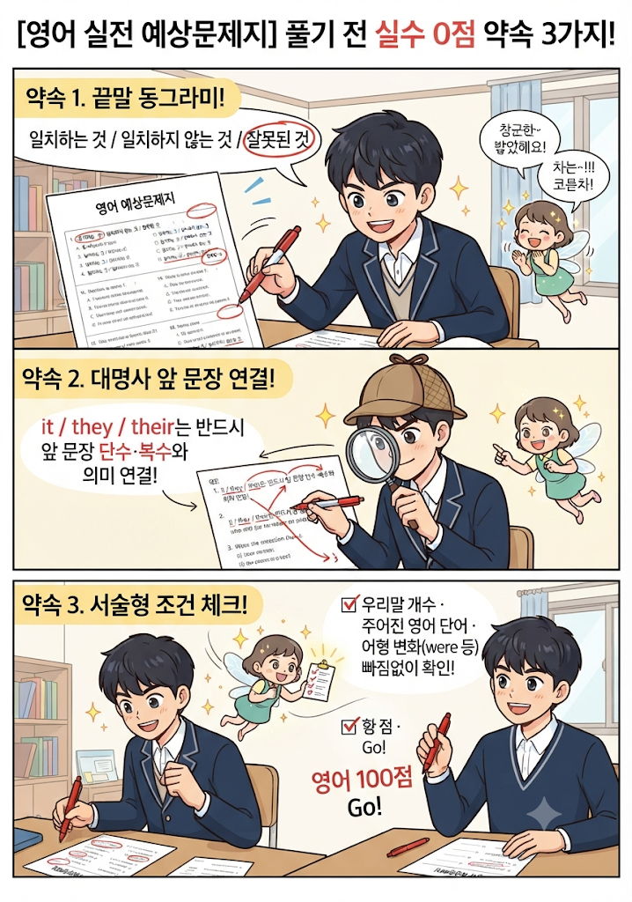

# 📝 2026학년도 7학년 2학기 2차 지필평가 대비 — 영어(영어A) 실전 예상 문제지

> **시험 범위**: Reading Explorer **Unit 8A · 8B** (p.105~114), **Unit 10A · 10B · 11A · 11B** (p.131~156)  
> **구성**: 선택형 22문항 (82.0점) + 서술형 3문항 (18.0점) = **총 100.0점** | **제한 시간**: 45분  
> **참고**: 호치민시한국국제학교(KIS) 2025 7학년 2학기 2차 기출 유형(어휘·내용 일치·순서 배열·문장 삽입·지칭 추론·영어 질문) 반영

### ✅ 풀기 전 「실수 0점」 약속 3가지
- [ ] 문제 끝의 **"일치하는 것 / 일치하지 않는 것 / 잘못된 것"**에 동그라미 치기
- [ ] **대명사 지칭 문제**는 반드시 앞 문장에서 단수·복수와 의미를 연결해 확인하기
- [ ] **서술형**은 요구한 조건(우리말 개수, 주어진 영어 단어·어형 변화)을 빠짐없이 확인하기

---

## [선택형 1~22번]

### [1~3] 다음 글을 읽고, 물음에 답하시오. (Unit 8A)

> **A** Jacob and Wilhelm Grimm were two young men from Germany who loved reading stories. As university students, they became interested in ⓐ **folktales**—traditional stories or legends that people told again and again, often for generations. The brothers began to collect folktales from storytellers all over Germany. <u>Many</u> were similar to stories told in France, Italy, Japan, and other countries. Between 1812 and 1814, the brothers ⓑ **published** two books in German. These included stories like "Cinderella," "Snow White," and "Little Red Riding Hood." The collections became known in English as *Grimms' Fairy Tales*.  
> **B** The Grimm brothers' tales give a picture of traditional life and ⓒ **beliefs**. For example, in the past, many people in Germany believed that forests were dangerous places. In the Grimms' stories, a forest is often the home of evil witches (as in "Hansel and Gretel"), talking animals, and other magical beings.  
> **C** Although most people today think of these stories as fairy tales for children, the Grimm brothers first wrote them ⓓ **primarily** for adults. Many of their early tales were dark and scary. Later, the brothers changed the text of some of the original stories. They "softened" many of the tales and added drawings. This made them more suitable for children. Like the early tales, though, each story still has a ⓔ **moral**: Work hard, be good, and listen to your parents.

**1.** 윗글의 밑줄 친 ⓐ~ⓔ의 영영 풀이가 **잘못된** 것은? [3.5점]  
① ⓐ folktales: traditional stories or legends told again and again for generations  
② ⓑ published: printed as a book for sale  
③ ⓒ beliefs: ideas a person accepts as being true or real  
④ ⓓ primarily: for the most part; mainly  
⑤ ⓔ moral: an evil character who has magical powers  

---

**2.** 윗글의 내용과 일치하지 **않는** 것은? [3.5점]  
① 그림 형제는 독일 대학생 시절에 민담에 관심을 갖게 되었다.  
② 그림 형제가 수집한 민담 중 다수는 프랑스·이탈리아·일본 등에서 전해지는 이야기와 비슷했다.  
③ 그림 형제는 1812년에서 1814년 사이에 독일어로 두 권의 책을 출판했다.  
④ 그림 형제는 처음부터 주로 어린이들을 위해 이 이야기들을 썼다.  
⑤ 초기 이야기와 나중에 수정된 이야기 모두 교훈을 담고 있다.  

---

**3.** According to the passage, what does the underlined word <u>Many</u> in paragraph A refer to, and what is the main purpose of the reading? [4.0점]  
① folktales — to explain why forests in Germany are dangerous  
② folktales — to give information about the Grimm brothers and their stories  
③ storytellers — to give information about the Grimm brothers and their stories  
④ storytellers — to compare German folktales with Japanese legends  
⑤ books — to explain how to write fairy tales for children  

---

**4.** 다음 (A), (B), (C)의 괄호 안에서 문맥과 어법상 가장 적절한 말을 골라 바르게 짝지은 것은? [3.5점]

> - (A) The earthquake (**affected / effected**) thousands of people.  
> - (B) What (**affect / effect**) does reading stories to children have on their development?  
> - (C) The (**origin / original**) story of "Little Red Riding Hood" can be traced back to 10th-century France.

① affected — affect — origin  
② affected — effect — original  
③ affected — effect — origin  
④ effected — affect — original  
⑤ effected — effect — original  

---

### [5~7] 다음 글을 읽고, 물음에 답하시오. (Unit 8B)

> **(A)**  
> Once upon a time, there lived a man and a woman who had seven sons. (a) <u>The couple</u> wanted a daughter, and, eventually, (b) <u>they</u> had a girl who (c) <u>they</u> loved very much. One day, the father needed water for the child, so he sent the seven brothers to a well in the forest to get it. Once there, though, the boys began to fight, and the water jug fell into the well. The boys did not know what to do. (d) <u>They</u> were afraid to go home. Hours passed. "Where are those boys?" shouted the angry father.
>
> **(B)**  
> Finally, she found their home. To enter, she needed a special key made from a chicken bone, which she did not have. The girl thought for a moment, and then took a knife and cut off one of her fingers. With it, she opened the front door and went inside. On a table, there were seven plates and seven cups. She ate and drank a little from each of them. In the last cup, she accidentally dropped a ring that (e) <u>her parents</u> had given her.
>
> **(C)**  
> "They are probably playing a game and forgot about the water. I wish they were all turned into ravens!" When he looked up, he saw seven black birds flying away. The father was shocked. "What have I done?" he thought. But it was too late. He could not take back his words. In time, the girl grew up and discovered she had brothers. The story of their misfortune affected her greatly, and she was determined to find them. For years, she searched and did not stop.
>
> **(D)**  
> Eventually, the ravens returned for their meal. The girl hid behind a door and watched. When the seventh raven drank from his cup, something hit his mouth. The raven recognized it immediately—it was his parents' ring. "I wish our sister were here," he said, "and then we could be free." Their sister quickly ran to them, and suddenly the ravens were human again. The brothers kissed their sister, and they all went home together happily.

**5.** 주어진 글 (A)에 이어질 내용을 순서에 맞게 배열한 것으로 가장 적절한 것은? [4.0점]  
① (B) — (C) — (D)  
② (B) — (D) — (C)  
③ (C) — (B) — (D)  
④ (C) — (D) — (B)  
⑤ (D) — (B) — (C)  

---

**6.** 윗글의 밑줄 친 (a)~(e) 중에서 가리키는 대상이 나머지 넷과 **다른** 것은? [3.5점]  
① (a)  
② (b)  
③ (c)  
④ (d)  
⑤ (e)  

---

**7.** 윗글의 내용과 일치하지 **않는** 것은? [4.0점]  
① 일곱 형제는 숲속 우물에서 싸우다가 물병을 우물에 빠뜨렸다.  
② 화가 난 아버지는 아들들이 까마귀로 변해 버리길 바랐다가 곧바로 후회했다.  
③ 여동생은 오빠들을 다시 사람으로 되돌리기 위해 자신의 손가락을 잘랐다.  
④ 여동생은 마지막 컵에 부모님이 주신 반지를 실수로 떨어뜨렸다.  
⑤ 이 이야기가 전하는 교훈은 "말하기 전에 신중하게 생각하라"이다.  

---

### [8~11] 다음 글을 읽고, 물음에 답하시오. (Unit 10A)

> **A** The first emperor of China, Qin Shihuang, is remembered for the many things he did during his ⓐ **rule**. Between 221 and 210 B.C., he started the construction of the Great Wall of China. He built a large network of roads. He introduced a new writing system, currency, and ⓑ **set** of measurements. The emperor also ordered the construction of a huge army of life-sized terracotta soldiers. These, he hoped, would protect his tomb after his death.  
> **B** Today, the soldiers in Xi'an's terracotta museum are ⓒ **light** brown, but they weren't always this color. They began as an army of red, blue, yellow, green, white, and purple. Sadly, most of the colors did not last to the present day. Before their discovery, the clay soldiers were protected by being underground. When they were unearthed, **(A)**, the air caused the coating under the paint to fall off. The paint disappeared in less time than it takes to boil an egg, taking with it important pieces of history.  
> **C** New techniques are now starting to reveal the army's true colors. Archeologists have recently discovered an area with more than a hundred soldiers. Many of these still have their painted ⓓ **features**, including black hair, pink faces, and black or brown eyes. Chinese and German researchers have developed a special **(B)** to help preserve the soldiers' colors. After they find a soldier or other artifact, archeologists spray it with the **(B)**. They then cover it in plastic.  
> **D** Archeologists are also finding colors in the dirt around Xi'an's terracotta warriors. It's important not to disturb the dirt, so the colors won't be lost. "We are treating the earth as an artifact," says archeologist Rong Bo, the museum's leading chemist. The next challenge, says Rong, is to find a way to apply the colors to the army again. ⓔ **Once** that happens, artists can bring Emperor Qin's army back to life in full color.

**8.** 윗글의 밑줄 친 동음이의어(homonyms) ⓐ~ⓔ의 문맥상 풀이가 **잘못된** 것은? [3.5점]  
① ⓐ rule: (n.) a period of control  
② ⓑ set: (n.) a group of similar things  
③ ⓒ light: (adj.) not heavy  
④ ⓓ features: (pl. n.) parts of someone's face  
⑤ ⓔ Once: (conj.) when; as soon as  

---

**9.** What is the main idea of paragraph B? [4.0점]  
① Visitors to Xi'an's museum can still see the soldiers' original bright colors.  
② The soldiers' paint fell off because the underground tomb was too hot.  
③ The terracotta soldiers were originally colorful, but lost their colors very quickly after being unearthed.  
④ Emperor Qin ordered artists to paint all the soldiers light brown.  
⑤ Boiling an egg helped scientists protect the clay coating under the paint.  

---

**10.** 윗글의 빈칸 (A), (B)에 들어갈 말로 가장 적절한 것은? [3.5점]  
① (A) therefore — (B) currency  
② (A) however — (B) liquid  
③ (A) however — (B) network  
④ (A) for example — (B) liquid  
⑤ (A) in addition — (B) army  

---

**11.** 윗글의 내용과 일치하는 것만을 `<보기>`에서 있는 대로 고른 것은? [4.0점]

> **<보기>**  
> ㄱ. 진시황은 만리장성 건설과 새로운 화폐·도량형 도입을 이루었다.  
> ㄴ. 고고학자들은 최근 무덤 안에서 병사들의 색을 보존하는 고대 액체를 발견했다.  
> ㄷ. 고고학자들은 병마용 주변의 흙에서도 색소를 찾고 있어 흙을 유물처럼 다룬다.  
> ㄹ. 박물관 수석 화학자 Rong Bo는 병마용의 원래 색을 복원하는 데 반대한다.

① ㄱ, ㄴ  
② ㄱ, ㄷ  
③ ㄴ, ㄷ  
④ ㄱ, ㄷ, ㄹ  
⑤ ㄴ, ㄷ, ㄹ  

---

### [12~14] 다음 글을 읽고, 물음에 답하시오. (Unit 10B)

> **A** Many people today think of the pyramids of Giza as the defining icon of ancient Egyptian culture. But who actually built them? For years, we did not know for sure. Now, however, archeologists have discovered an ancient city near the pyramids. Close by, there is a cemetery where the pyramid builders were buried. From studying these places, archeologists can now confirm that the pyramids were not built by slaves or foreigners (or space aliens!). Ordinary Egyptians built them.  
> **B** It took about 80 years to build the pyramids. Archeologists believe that about 20,000–30,000 people were involved in the construction. The workers had different roles. Some dug up the rock, some moved it, and some shaped it into blocks. People also worked on different teams, each with its own name. Workers often competed to see whose team could do a job faster.  
> **C** Life for these workers was hard. "We can see that in their skeletons," says Azza Mohamed Sarry El-Din, a scientist studying bones found in the cemetery. According to her research, the bones show signs of arthritis. This probably developed from carrying heavy things for a long time. Archeologists have also found many female skeletons in the ancient city and cemetery. The damage to their bones is similar to that of the men. In fact, <u>their</u> lives may have been even tougher: Male workers generally lived to age 40–45, but women to only 30–35. However, workers usually had enough food, and they also received medical care if they got sick or hurt.  
> **D** The task was challenging, but laborers were proud of their work. On a wall in Khufu's Great Pyramid, for example, a group of workers wrote *Friends of Khufu*. "It's because they were not just building the tomb of their king," says Egyptian archeologist Zahi Hawass. "They were building Egypt. It was a national project, and everyone was a participant."

**12.** According to the passage, what is the main purpose of the reading? [3.5점]  
① to explain why Egyptian kings competed to build taller tombs  
② to prove that foreign slaves built the pyramids of Giza  
③ to describe who the pyramid builders were and what their lives and work were like  
④ to compare the pyramids of Giza with the Mayan pyramids in Mexico  
⑤ to explain how ancient Egyptians treated arthritis with medicine  

---

**13.** 윗글의 내용과 일치하지 **않는** 것은? [4.0점]  
① 기자 피라미드는 노예나 외국인이 아니라 평범한 이집트인들이 지었다.  
② 피라미드 건설에는 약 80년이 걸렸고 2만~3만 명이 참여했다.  
③ 노동자들은 서로 다른 역할과 팀을 나누어 어느 팀이 더 빨리 일하는지 경쟁하기도 했다.  
④ 여성 노동자들도 건설에 참여했으며, 대체로 남성 노동자보다 더 오래 살았다.  
⑤ 노동자들은 충분한 음식을 먹었고 아프거나 다치면 의료 혜택을 받았다.  

---

**14.** 다음은 윗글의 개요 요약(Outline)이다. 빈칸 (A), (B)에 들어갈 말과 문단 C의 밑줄 친 <u>their</u>가 가리키는 대상을 옳게 짝지은 것은? [4.0점]

> **OUTLINE: Wonders of Egypt**  
> • Builders' bones show signs of **(A)** from carrying heavy things.  
> • Laborers felt proud and saw building the pyramids as a **(B)**.

① (A) arthritis — (B) national project — their: female workers  
② (A) arthritis — (B) foreign task — their: male workers  
③ (A) misfortune — (B) national project — their: female workers  
④ (A) arthritis — (B) national project — their: archeologists  
⑤ (A) medical care — (B) personal hobby — their: male workers  

---

### [15~18] 다음 자료와 글을 읽고, 물음에 답하시오. (Unit 11A)

> **[교과서 인포그래픽 요약: 2015년 전 세계 플라스틱 생산량 총 4억 4,800만 톤(448 million tons)]**  
> | 용도 (Industry) | 생산량 (2015) | 버려지기 전 평균 사용 기간 |
> | :--- | :---: | :---: |
> | **포장재 (Packaging)** | **161 million tons (거의 40%)** | **6개월 미만 (Less than 6 months)** |
> | **건축·건설 (Building & construction)** | 72 million tons | **35년** |
> | **섬유 (Textiles)** | 65 million tons | 5년 |
> | **소비재 (Consumer products)** | 46 million tons | 3년 |
>
> **A** On a boat near Costa Rica, a team of marine biologists is helping a turtle. The animal is having trouble breathing, and the team discovers why—there is something inside its nose. A scientist tries to extract the object, but the turtle cries in pain. Finally, after eight long minutes, a long object is pulled out: It is a 10-centimeter plastic straw.  
> **B** The video of the turtle's rescue has been viewed millions of times on YouTube. <u>It</u> has helped raise awareness of a growing problem: The world's seas are full of plastic. Since 2000, there has been a huge increase in worldwide plastic production, but we recycle less than one-fifth of it. A lot of this plastic waste ends up in the ocean. Today, scientists think about 8.1 billion kilograms goes into the sea every year from coastal regions. Most of this plastic will never biodegrade.  
> **C** This ocean plastic hurts millions of sea animals every year. Some fish eat plastic because it is covered with sea plants, and it looks and smells like food. Typically, eating plastic leads to **constant** hunger. "Imagine you ate lunch and then just felt weak ... and hungry all day," says marine biologist Matthew Savoca. "That would be very confusing." In some cases, eating sharp pieces of plastic can seriously hurt sea animals and even result in death.  
> **D** Plastic is useful to people because it is strong and lasts a long time. But this is bad news for sea creatures who eat or get stuck in it. According to Savoca, "Single-use plastics are the worst." These are items that are used only once before we throw them away. Some common examples include straws, water bottles, and plastic bags. About 700 sea species (including the turtle from the video) have been caught in or have eaten this kind of plastic. Luckily, the turtle survived and was released back into the ocean.

**15.** 위 인포그래픽 자료와 지문을 바탕으로 할 때, 사실과 **다른** 것은? [3.5점]  
① 2015년 전 세계에서 생산된 플라스틱은 총 4억 4,800만 톤이다.  
② 전 세계 플라스틱 생산량 중 거의 40%가 포장재(packaging) 용도이다.  
③ 포장재 플라스틱은 버려지기 전 평균 6개월 미만으로 사용된다.  
④ 건축·건설용 플라스틱은 버려지기 전 평균 35년 동안 사용된다.  
⑤ 2000년 이후 플라스틱 생산량이 급증했으며, 우리는 그중 절반 이상을 재활용한다.  

---

**16.** 윗글의 내용과 일치하는 것은? [4.0점]  
① 코스타리카 바다거북은 코에서 빨대를 빼낸 뒤 결국 부상으로 죽었다.  
② 바다로 들어가는 플라스틱 대부분은 수년 내에 자연스럽게 생분해된다.  
③ 일부 물고기들은 해조류로 덮인 플라스틱을 먹이로 착각해 먹고 지속적인 배고픔을 겪는다.  
④ 문단 B의 밑줄 친 <u>It</u>은 코스타리카에서 구조된 바다거북을 가리킨다.  
⑤ 매년 해안 지역에서 바다로 유입되는 플라스틱은 약 700만 킬로그램이다.  

---

**17.** 접두사 `ex-`("out / out of")를 활용한 빈칸 (A), (B)의 알맞은 단어와 문단 C의 굵은 단어 **constant**의 영영풀이를 바르게 짝지은 것은? [3.5점]

> - (A) Ocean Cleanup is developing technologies that can **(A)** plastic waste from our oceans.  
> - (B) "Ghost nets" can **(B)** for more than several hundred meters in length.

① (A) extract — (B) extend — constant: happening all the time  
② (A) extract — (B) except — constant: happening once in a while  
③ (A) extend — (B) extract — constant: happening all the time  
④ (A) exit — (B) extend — constant: difficult to understand  
⑤ (A) extract — (B) exit — constant: continuing far into the future  

---

**18.** 다음 (가)~(다)에서 글쓴이가 **인용구(quote)**를 사용한 목적을 `<보기>`에서 골라 바르게 짝지은 것은? [4.0점]

> **(가)** *"What's floating on the surface ... is only 3 percent of the plastics that enter the ocean every single year,"* says Eben Schwartz from the California Coastal Commission.  
> **(나)** *"My class recently decided to stop using plastic straws,"* says 12-year-old Molly Peterson.  
> **(다)** The Great Pacific Garbage Patch is a collection of floating trash. However, it's more *"plastic soup"* than patch.
>
> **<보기>**  
> a. to add a supporting statement or question (뒷받침하는 진술·질문 추가)  
> b. to provide expert evidence for an argument (주장에 대한 전문가 증거 제시)  
> c. to highlight an interesting or memorable phrase (흥미롭거나 기억에 남는 어구 강조)

① (가)-a, (나)-b, (다)-c  
② (가)-b, (나)-a, (다)-c  
③ (가)-b, (나)-c, (다)-a  
④ (가)-c, (나)-a, (다)-b  
⑤ (가)-c, (나)-b, (다)-a  

---

### [19~22] 다음 글을 읽고, 물음에 답하시오. (Unit 11B)

> **A** The world has a plastic problem—and it is increasing. Scientists are working to find a long-term solution by making plastic more biodegradable. But in the meantime, here are five things you can do to reduce plastic waste now.  
> **B** 1. Quit using plastic bags. Instead, take your own reusable shopping bag to the store. People use a trillion plastic bags worldwide every year. ⓐ **Roughly** 10 percent are used in the United States alone. That's almost one bag per American per day. In contrast, the average Dane uses four single-use bags per year. In 1993, Denmark was the first country to place a tax on plastic bags. ( ① )  
> **C** 2. ⓑ **Skip** the straw. Today, around 8.3 billion plastic straws pollute the world's beaches. So when you order a drink, say no to the straw, or bring your own reusable one. In 2018, Seattle became the first major U.S. city to ban plastic straws, and many other cities are set to follow its example. ( ② )  
> **D** 3. Don't use plastic bottles. Buy a reusable bottle and fill it with any type of ⓒ **beverage** you like. Some cities (like Bundanoon in Australia and San Francisco in the U.S.) have completely or ⓓ **partially** banned bottled water. Globally, however, people still buy nearly a million plastic bottles every minute. ( ③ )  
> **E** 4. Avoid plastic packaging. ( ④ ) Don't buy fruit or vegetables in plastic packaging. In the United Kingdom, leaders are calling for supermarkets to have plastic-free areas. <u>They</u> also want to tax plastic take-out containers.  
> **F** 5. Recycle. We can't recycle all plastic items, but it is possible to recycle most bottles and milk or juice ⓔ **cartons**. ( ⑤ ) Today, Norway recycles 97 percent of its plastic bottles. How? Machines at most supermarkets take the bottles and give a refund of up to 2.5 kroner (32 cents) per bottle.

**19.** 윗글의 밑줄 친 ⓐ~ⓔ의 문맥상 유의어가 **잘못** 짝지어진 것은? [3.5점]  
① ⓐ roughly = approximately  
② ⓑ skip = stop using  
③ ⓒ beverage = drink  
④ ⓓ partially = totally  
⑤ ⓔ cartons = containers  

---

**20.** 윗글의 국가·도시별 정책 및 수치에 대한 설명으로 일치하지 **않는** 것은? [4.0점]  
① 미국에서는 매년 전 세계 비닐봉지(1조 개)의 약 10%인 약 1,000억 개가 사용된다.  
② 덴마크는 1993년에 세계 최초로 비닐봉지에 세금을 부과했으며, 평균 덴마크인은 1년에 일회용 봉지를 4개 사용한다.  
③ 시애틀은 2018년에 플라스틱 빨대를 금지한 미국 최초의 주요 도시가 되었다.  
④ 호주의 번다눈과 미국의 샌프란시스코가 생수를 금지하면서, 전 세계의 플라스틱 병 구매량은 거의 사라졌다.  
⑤ 노르웨이는 슈퍼마켓 기계에서 병당 최대 2.5크로네(32센트)를 환불해 주는 방식으로 플라스틱 병의 97%를 재활용한다.  

---

**21.** 글의 흐름으로 보아, `<보기>`의 문장이 들어가기에 가장 적절한 곳은? [4.0점]

> **<보기>**  
> Buy bar soap instead of liquid soap in plastic containers.

① ( ① )  
② ( ② )  
③ ( ③ )  
④ ( ④ )  
⑤ ( ⑤ )  

---

**22.** 윗글이 주로 담고 있는 성격과 문단 E의 밑줄 친 <u>They</u>가 가리키는 대상을 바르게 짝지은 것은? [3.0점]  
① suggestions (제안) — U.K. leaders (영국 지도자들)  
② suggestions (제안) — supermarkets (슈퍼마켓들)  
③ suggestions (제안) — plastic-free areas (플라스틱 없는 구역들)  
④ reasons (이유) — U.K. leaders (영국 지도자들)  
⑤ predictions (예측) — supermarkets (슈퍼마켓들)  

---

## [서술형 1~3번]

> ※ 서술형은 **제시된 조건**을 반드시 지켜 정확하게 작성하세요!

**서술형 1.** (Unit 8A & 8B) 다음 물음에 답하시오. [총 6.0점]  
(1) Unit 8A에서 그림 형제가 어둡고 무서웠던 초기 이야기들을 **어린이에게 더 적합하게(more suitable for children)** 바꾸기 위해 한 일 **2가지**를 우리말로 쓰시오. [3.0점]  
(2) Unit 8B에서 일곱 번째 까마귀가 반지를 보고 한 소원을 **가정법 과거 구문(`I wish ~ were ~`)**을 사용하여 다음 우리말에 맞게 영어로 쓰시오. *(주어진 단어를 모두 사용하고, 필요시 어형을 바꾸시오: `I`, `wish`, `our`, `sister`, `be`, `here`)* [3.0점]  
> 우리말: "나는 우리 여동생이 여기 있다면 좋을 텐데."

> 답안 작성란:  
> (1) ____________________________________________________________________  
> (2) ____________________________________________________________________  

---

**서술형 2.** (Unit 10A) 다음 물음에 답하시오. [총 6.0점]  
(1) 시안의 병마용이 발굴 직후 색을 잃은 이유를 우리말로 쓰고, 고고학자들이 병마용의 색을 보존하기 위해 사용하는 **신기술 2단계**를 우리말로 쓰시오. [3.0점]  
(2) 수업 핵심 구문 **`treat A as B`**를 사용하여 다음 우리말에 맞게 영어로 쓰시오. *(주어진 단어를 모두 사용하여 배열하시오: `We`, `are`, `treating`, `the`, `earth`, `as`, `an`, `artifact`)* [3.0점]  
> 우리말: "우리는 그 흙을 유물로 취급하고 있습니다."

> 답안 작성란:  
> (1) ____________________________________________________________________  
> (2) ____________________________________________________________________  

---

**서술형 3.** (Unit 11A & 11B) 다음 물음에 답하시오. [총 6.0점]  
(1) Unit 11A에서 일부 해양 동물들이 플라스틱을 먹는 이유와, 플라스틱을 먹었을 때 겪는 피해 **2가지**를 우리말로 쓰시오. [3.0점]  
(2) Unit 11B의 핵심 구문 **`fill A with B`**를 사용하여 다음 우리말을 영어로 쓰시오. *(주어진 단어를 모두 사용하여 배열하시오: `Buy`, `a`, `reusable`, `bottle`, `and`, `fill`, `it`, `with`, `any`, `type`, `of`, `beverage`, `you`, `like`)* [3.0점]  
> 우리말: "재사용 가능한 물병을 사서 당신이 좋아하는 어떤 종류의 음료로든 그것을 채워라."

> 답안 작성란:  
> (1) ____________________________________________________________________  
> (2) ____________________________________________________________________  
