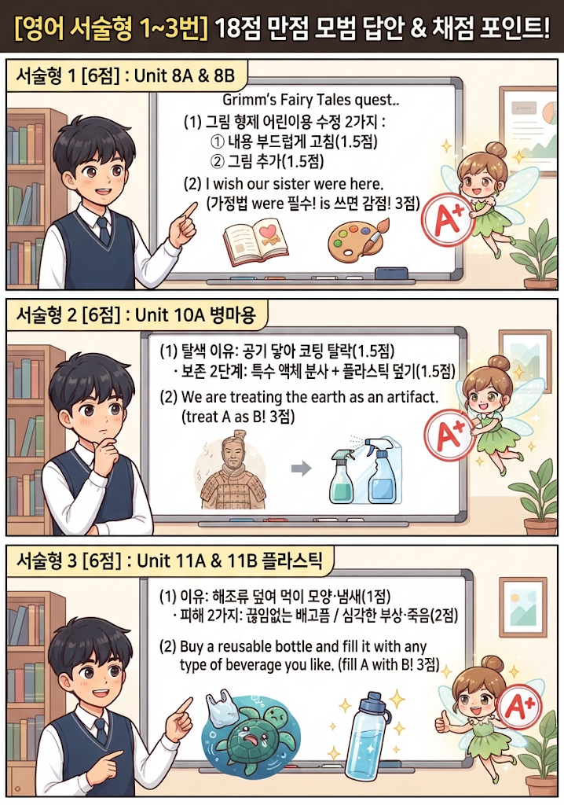

# ✅ 2026학년도 7학년 2학기 2차 지필평가 대비 — 영어(영어A) 예상 문제지 정답 및 해설

> **채점 기준**: 선택형 22문항(82.0점) + 서술형 3문항(18.0점) = **총 100.0점**  
> *(풀이 형식: 문제 + 선지 전체 → 답 → 이유)*

---

## 📊 빠른 정답표 (채점용)

| 번호 | 1 | 2 | 3 | 4 | 5 | 6 | 7 | 8 | 9 | 10 | 11 |
| :---: | :---: | :---: | :---: | :---: | :---: | :---: | :---: | :---: | :---: | :---: | :---: |
| **정답** | ⑤ | ④ | ② | ② | ③ | ④ | ③ | ③ | ③ | ② | ② |

| 번호 | 12 | 13 | 14 | 15 | 16 | 17 | 18 | 19 | 20 | 21 | 22 |
| :---: | :---: | :---: | :---: | :---: | :---: | :---: | :---: | :---: | :---: | :---: | :---: |
| **정답** | ③ | ④ | ① | ⑤ | ③ | ① | ② | ④ | ④ | ④ | ① |

---

## 📖 문항별 상세 풀이

### 1번 [3.5점]
윗글(Unit 8A)의 밑줄 친 ⓐ~ⓔ의 영영 풀이가 잘못된 것은?
① ⓐ folktales: traditional stories or legends told again and again for generations / ② ⓑ published: printed as a book for sale / ③ ⓒ beliefs: ideas a person accepts as being true or real / ④ ⓓ primarily: for the most part; mainly / ⑤ ⓔ moral: an evil character who has magical powers

- **답)** ⑤
- **이유)** `moral`은 이야기 속 **교훈, 메시지(message / lesson)**를 뜻한다. 마법 능력을 가진 사악한 인물은 `evil witch`에 해당한다.

---

### 2번 [3.5점]
윗글(Unit 8A)의 내용과 일치하지 않는 것은?
① 그림 형제는 독일 대학생 시절에 민담에 관심을 갖게 되었다. / ② 그림 형제가 수집한 민담 중 다수는 프랑스·이탈리아·일본 등에서 전해지는 이야기와 비슷했다. / ③ 그림 형제는 1812년에서 1814년 사이에 독일어로 두 권의 책을 출판했다. / ④ 그림 형제는 처음부터 주로 어린이들을 위해 이 이야기들을 썼다. / ⑤ 초기 이야기와 나중에 수정된 이야기 모두 교훈을 담고 있다.

- **답)** ④
- **이유)** 문단 C에 *"the Grimm brothers first wrote them **primarily for adults**"*라고 나와 있으므로, 처음에는 어린이가 아니라 **주로 어른들을 위해** 썼다.

---

### 3번 [4.0점]
According to the passage, what does the underlined word *Many* in paragraph A refer to, and what is the main purpose of the reading?
① folktales — to explain why forests in Germany are dangerous / ② folktales — to give information about the Grimm brothers and their stories / ③ storytellers — to give information about the Grimm brothers and their stories / ④ storytellers — to compare German folktales with Japanese legends / ⑤ books — to explain how to write fairy tales for children

- **답)** ②
- **이유)** 앞 문장의 *"collect **folktales** from storytellers"*를 받아 `Many`는 **folktales(민담들)**를 가리키며, 글 전체의 목적은 **그림 형제와 그들의 이야기에 대한 정보를 제공하는 것**이다.

---

### 4번 [3.5점]
다음 (A), (B), (C)의 괄호 안에서 문맥과 어법상 가장 적절한 말을 골라 바르게 짝지은 것은?
(A) The earthquake (affected / effected) thousands of people. / (B) What (affect / effect) does reading stories to children have on their development? / (C) The (origin / original) story of "Little Red Riding Hood" can be traced back to 10th-century France.
① affected — affect — origin / ② affected — effect — original / ③ affected — effect — origin / ④ effected — affect — original / ⑤ effected — effect — original

- **답)** ②
- **이유)** (A) 주어 뒤 동사 자리이므로 **affected**(영향을 미쳤다), (B) `have an effect on` 구문의 명사 자리이므로 **effect**(영향), (C) 명사 `story`를 꾸미는 형용사(`origin + -al`) 자리이므로 **original**(원래의)이 알맞다.

---

### 5번 [4.0점]
주어진 글 (A)(Unit 8B: 일곱 형제가 숲속 우물에서 물병을 빠뜨리고 귀가를 두려워함 → 화난 아버지가 소리침)에 이어질 내용을 순서에 맞게 배열한 것으로 가장 적절한 것은?
① (B) — (C) — (D) / ② (B) — (D) — (C) / ③ (C) — (B) — (D) / ④ (C) — (D) — (B) / ⑤ (D) — (B) — (C)

- **답)** ③
- **이유)** (A) 아버지의 외침에 이어 **(C)** 아버지가 까마귀가 되라고 외쳐 진짜 변하고 성장한 여동생이 오빠들을 찾아 나섬 → **(B)** 마침내 집을 찾아 손가락으로 문을 열고 들어가 마지막 컵에 반지를 떨어뜨림 → **(D)** 까마귀들이 돌아와 반지를 발견하고 소원을 빌어 인간으로 돌아옴 순서가 자연스럽다.

---

### 6번 [3.5점]
윗글(Unit 8B)의 밑줄 친 (a)~(e) 중에서 가리키는 대상이 나머지 넷과 다른 것은?
① (a) The couple / ② (b) they (had a girl) / ③ (c) they (loved very much) / ④ (d) They (were afraid to go home) / ⑤ (e) her parents

- **답)** ④
- **이유)** (a), (b), (c), (e)는 모두 **부모(부부)**를 가리키지만, ④ (d) `They`만 우물에 물병을 빠뜨려 집에 가기를 두려워한 **일곱 아들들(the seven boys)**을 가리킨다.

---

### 7번 [4.0점]
윗글(Unit 8B)의 내용과 일치하지 않는 것은?
① 일곱 형제는 숲속 우물에서 싸우다가 물병을 우물에 빠뜨렸다. / ② 화가 난 아버지는 아들들이 까마귀로 변해 버리길 바랐다가 곧바로 후회했다. / ③ 여동생은 오빠들을 다시 사람으로 되돌리기 위해 자신의 손가락을 잘랐다. / ④ 여동생은 마지막 컵에 부모님이 주신 반지를 실수로 떨어뜨렸다. / ⑤ 이 이야기가 전하는 교훈은 "말하기 전에 신중하게 생각하라"이다.

- **답)** ③
- **이유)** 여동생이 손가락을 자른 이유는 오빠들을 사람으로 바꾸기 위해서가 아니라, 닭 뼈 열쇠가 없어서 **오빠들 집의 현관문을 열기 위해서(to open the front door)**이다.

---

### 8번 [3.5점]
윗글(Unit 10A)의 밑줄 친 동음이의어(homonyms) ⓐ~ⓔ의 문맥상 풀이가 잘못된 것은?
① ⓐ rule: (n.) a period of control / ② ⓑ set: (n.) a group of similar things / ③ ⓒ light: (adj.) not heavy / ④ ⓓ features: (pl. n.) parts of someone's face / ⑤ ⓔ Once: (conj.) when; as soon as

- **답)** ③
- **이유)** `light brown`에서 `light`는 '가벼운(not heavy)'이 아니라 색깔이 **'연한, 밝은(not dark)'**이라는 뜻이다.

---

### 9번 [4.0점]
What is the main idea of paragraph B? (Unit 10A)
① Visitors to Xi'an's museum can still see the soldiers' original bright colors. / ② The soldiers' paint fell off because the underground tomb was too hot. / ③ The terracotta soldiers were originally colorful, but lost their colors very quickly after being unearthed. / ④ Emperor Qin ordered artists to paint all the soldiers light brown. / ⑤ Boiling an egg helped scientists protect the clay coating under the paint.

- **답)** ③
- **이유)** 문단 B의 핵심은 병마용이 원래는 빨강·파랑 등 화려한 색이었으나, **발굴되어 공기에 닿자마자 아주 빠르게 색을 잃었다**는 내용이다.

---

### 10번 [3.5점]
윗글(Unit 10A)의 빈칸 (A), (B)에 들어갈 말로 가장 적절한 것은?
① (A) therefore — (B) currency / ② (A) however — (B) liquid / ③ (A) however — (B) network / ④ (A) for example — (B) liquid / ⑤ (A) in addition — (B) army

- **답)** ②
- **이유)** (A) 땅속에서는 보호되었으나 발굴되자 코팅이 떨어졌다는 역접 흐름이므로 **however**(그러나), (B) 병사들에게 뿌려서 색을 보존하는 특수 **액체**이므로 **liquid**가 정답이다.

---

### 11번 [4.0점]
윗글(Unit 10A)의 내용과 일치하는 것만을 `<보기>`에서 있는 대로 고른 것은?
`<보기>` ㄱ. 진시황은 만리장성 건설과 새로운 화폐·도량형 도입을 이루었다. / ㄴ. 고고학자들은 최근 무덤 안에서 병사들의 색을 보존하는 고대 액체를 발견했다. / ㄷ. 고고학자들은 병마용 주변의 흙에서도 색소를 찾고 있어 흙을 유물처럼 다룬다. / ㄹ. 박물관 수석 화학자 Rong Bo는 병마용의 원래 색을 복원하는 데 반대한다.
① ㄱ, ㄴ / ② ㄱ, ㄷ / ③ ㄴ, ㄷ / ④ ㄱ, ㄷ, ㄹ / ⑤ ㄴ, ㄷ, ㄹ

- **답)** ②
- **이유)** ㄱ(O), ㄷ(O). ㄴ은 무덤 안에서 발견한 것이 아니라 **중국·독일 연구진이 개발**한 액체이므로 X, ㄹ은 Rong Bo가 원래 색을 다시 입혀 **복원하는 것을 다음 과제**로 삼고 있으므로 X이다.

---

### 12번 [3.5점]
According to the passage (Unit 10B), what is the main purpose of the reading?
① to explain why Egyptian kings competed to build taller tombs / ② to prove that foreign slaves built the pyramids of Giza / ③ to describe who the pyramid builders were and what their lives and work were like / ④ to compare the pyramids of Giza with the Mayan pyramids in Mexico / ⑤ to explain how ancient Egyptians treated arthritis with medicine

- **답)** ③
- **이유)** 이 글의 주된 목적은 **피라미드 건설자들이 누구였으며 그들의 삶과 일이 어떠했는지 설명하는 것**이다.

---

### 13번 [4.0점]
윗글(Unit 10B)의 내용과 일치하지 않는 것은?
① 기자 피라미드는 노예나 외국인이 아니라 평범한 이집트인들이 지었다. / ② 피라미드 건설에는 약 80년이 걸렸고 2만~3만 명이 참여했다. / ③ 노동자들은 서로 다른 역할과 팀을 나누어 어느 팀이 더 빨리 일하는지 경쟁하기도 했다. / ④ 여성 노동자들도 건설에 참여했으며, 대체로 남성 노동자보다 더 오래 살았다. / ⑤ 노동자들은 충분한 음식을 먹었고 아프거나 다치면 의료 혜택을 받았다.

- **답)** ④
- **이유)** 문단 C에 *"Male workers generally lived to age 40–45, but women to only 30–35"*라고 되어 있으므로, **남성 노동자가 여성 노동자보다 더 오래 살았다.**

---

### 14번 [4.0점]
다음은 윗글(Unit 10B)의 개요 요약(Outline)이다. 빈칸 (A), (B)에 들어갈 말과 문단 C의 밑줄 친 *their*가 가리키는 대상을 옳게 짝지은 것은?
• Builders' bones show signs of (A) from carrying heavy things. / • Laborers felt proud and saw building the pyramids as a (B).
① (A) arthritis — (B) national project — their: female workers / ② (A) arthritis — (B) foreign task — their: male workers / ③ (A) misfortune — (B) national project — their: female workers / ④ (A) arthritis — (B) national project — their: archeologists / ⑤ (A) medical care — (B) personal hobby — their: male workers

- **답)** ①
- **이유)** 무거운 짐을 날라 생긴 질환은 **arthritis**(관절염), 노동자들이 자부심을 갖고 여긴 것은 **national project**(국가적 프로젝트)이며, 문단 C의 `their`는 앞 문장의 여성 유골을 받아 **female workers**(여성 노동자들)를 가리킨다.

---

### 15번 [3.5점]
위 인포그래픽 자료와 지문(Unit 11A)을 바탕으로 할 때, 사실과 다른 것은?
① 2015년 전 세계에서 생산된 플라스틱은 총 4억 4,800만 톤이다. / ② 전 세계 플라스틱 생산량 중 거의 40%가 포장재(packaging) 용도이다. / ③ 포장재 플라스틱은 버려지기 전 평균 6개월 미만으로 사용된다. / ④ 건축·건설용 플라스틱은 버려지기 전 평균 35년 동안 사용된다. / ⑤ 2000년 이후 플라스틱 생산량이 급증했으며, 우리는 그중 절반 이상을 재활용한다.

- **답)** ⑤
- **이유)** 문단 B에 *"we recycle **less than one-fifth** of it"*이라고 했으므로, 절반 이상이 아니라 **5분의 1(20%) 미만**만 재활용한다.

---

### 16번 [4.0점]
윗글(Unit 11A)의 내용과 일치하는 것은?
① 코스타리카 바다거북은 코에서 빨대를 빼낸 뒤 결국 부상으로 죽었다. / ② 바다로 들어가는 플라스틱 대부분은 수년 내에 자연스럽게 생분해된다. / ③ 일부 물고기들은 해조류로 덮인 플라스틱을 먹이로 착각해 먹고 지속적인 배고픔을 겪는다. / ④ 문단 B의 밑줄 친 *It*은 코스타리카에서 구조된 바다거북을 가리킨다. / ⑤ 매년 해안 지역에서 바다로 유입되는 플라스틱은 약 700만 킬로그램이다.

- **답)** ③
- **이유)** ① 거북이는 살아남아 바다로 방생됨(X), ② 대부분 결코 생분해되지 않음(X), ④ `It`은 **거북이 구조 영상(the video of the turtle's rescue)**을 가리킴(X), ⑤ 매년 해안에서 유입되는 양은 **약 81억 kg(8.1 billion kg)**이며 700은 피해 해양 생물 종 수이다(X).

---

### 17번 [3.5점]
접두사 `ex-`("out / out of")를 활용한 빈칸 (A), (B)의 알맞은 단어와 문단 C의 굵은 단어 **constant**의 영영풀이를 바르게 짝지은 것은?
(A) ... technologies that can (A) plastic waste from our oceans. / (B) "Ghost nets" can (B) for more than several hundred meters in length.
① (A) extract — (B) extend — constant: happening all the time / ② (A) extract — (B) except — constant: happening once in a while / ③ (A) extend — (B) extract — constant: happening all the time / ④ (A) exit — (B) extend — constant: difficult to understand / ⑤ (A) extract — (B) exit — constant: continuing far into the future

- **답)** ①
- **이유)** (A) 바다에서 쓰레기를 '빼내다' = **extract**, (B) 수백 미터 길이로 '뻗다' = **extend**, `constant` = 끊임없는(**happening all the time**)이다.

---

### 18번 [4.0점]
다음 (가)~(다)에서 글쓴이가 인용구(quote)를 사용한 목적을 `<보기>`에서 골라 바르게 짝지은 것은?
(가) 캘리포니아 해안위원회 Eben Schwartz 발언 / (나) 12세 Molly Peterson의 빨대 중단 사례 / (다) "plastic soup" 표현
`<보기>` a. 뒷받침하는 진술·질문 추가 / b. 주장에 대한 전문가 증거 제시 / c. 흥미롭거나 기억에 남는 어구 강조
① (가)-a, (나)-b, (다)-c / ② (가)-b, (나)-a, (다)-c / ③ (가)-b, (나)-c, (다)-a / ④ (가)-c, (나)-a, (다)-b / ⑤ (가)-c, (나)-b, (다)-a

- **답)** ②
- **이유)** (가) 기관 전문가의 통계 근거 제시는 **b**, (나) 일반 학생의 실천 진술 추가는 **a**, (다) *"plastic soup"*처럼 기억에 남는 비유적 어구 강조는 **c**이다.

---

### 19번 [3.5점]
윗글(Unit 11B)의 밑줄 친 ⓐ~ⓔ의 문맥상 유의어가 잘못 짝지어진 것은?
① ⓐ roughly = approximately / ② ⓑ skip = stop using / ③ ⓒ beverage = drink / ④ ⓓ partially = totally / ⑤ ⓔ cartons = containers

- **답)** ④
- **이유)** `partially`는 '완전히(totally)'가 아니라 **'부분적으로(in part)'**라는 뜻이다. (`completely or partially`에서 `completely`와 대조됨!)

---

### 20번 [4.0점]
윗글(Unit 11B)의 국가·도시별 정책 및 수치에 대한 설명으로 일치하지 않는 것은?
① 미국에서는 매년 전 세계 비닐봉지(1조 개)의 약 10%인 약 1,000억 개가 사용된다. / ② 덴마크는 1993년에 세계 최초로 비닐봉지에 세금을 부과했으며, 평균 덴마크인은 1년에 일회용 봉지를 4개 사용한다. / ③ 시애틀은 2018년에 플라스틱 빨대를 금지한 미국 최초의 주요 도시가 되었다. / ④ 호주의 번다눈과 미국의 샌프란시스코가 생수를 금지하면서, 전 세계의 플라스틱 병 구매량은 거의 사라졌다. / ⑤ 노르웨이는 슈퍼마켓 기계에서 병당 최대 2.5크로네(32센트)를 환불해 주는 방식으로 플라스틱 병의 97%를 재활용한다.

- **답)** ④
- **이유)** 문단 D에 *"Globally, however, people still buy **nearly a million plastic bottles every minute**"*라고 되어 있으므로, 전 세계 사람들은 여전히 매분 거의 100만 개의 플라스틱 병을 사고 있다.

---

### 21번 [4.0점]
글의 흐름으로 보아, `<보기>`의 문장(*Buy bar soap instead of liquid soap in plastic containers.*)이 들어가기에 가장 적절한 곳은?
① ( ① ) / ② ( ② ) / ③ ( ③ ) / ④ ( ④ ) / ⑤ ( ⑤ )

- **답)** ④
- **이유)** `<보기>`는 플라스틱 용기에 담긴 액체 비누 대신 고체 비누를 사라는 내용이므로, **4. Avoid plastic packaging.(플라스틱 포장을 피하라)** 직후인 **( ④ )**에 들어가야 한다.

---

### 22번 [3.0점]
윗글(Unit 11B)이 주로 담고 있는 성격과 문단 E의 밑줄 친 *They*가 가리키는 대상을 바르게 짝지은 것은?
① suggestions (제안) — U.K. leaders (영국 지도자들) / ② suggestions (제안) — supermarkets (슈퍼마켓들) / ③ suggestions (제안) — plastic-free areas (플라스틱 없는 구역들) / ④ reasons (이유) — U.K. leaders (영국 지도자들) / ⑤ predictions (예측) — supermarkets (슈퍼마켓들)

- **답)** ①
- **이유)** 이 글은 플라스틱을 줄이기 위한 5가지 **제안(suggestions)**으로 구성되어 있으며, 문단 E의 `They`는 앞 문장의 주어인 **영국 지도자들(U.K. leaders)**을 가리킨다.

---

## ✍️ 서술형 모범 답안 및 채점 기준

### 서술형 1 [총 6.0점]
- **(1) 모범 답안 [3.0점]**: ① 원래 이야기의 본문을 수정하여 **내용을 부드럽게(덜 무섭게) 고쳤다**. ② **그림을 추가했다**.
  - **채점 포인트**: 내용 부드럽게 수정/원문 변경 (1.5점) + 그림 추가 (1.5점)
- **(2) 모범 답안 [3.0점]**: **`I wish our sister were here.`**
  - **채점 포인트**: `I wish` + 주어(`our sister`) + 가정법 과거 **`were`** + `here` 정확히 작성 시 3.0점 (`is` 사용 시 1.5점 감점, 대소문자·마침표 오류 시 0.5점 감점)

### 서술형 2 [총 6.0점]
- **(1) 모범 답안 [3.0점]**: 발굴된 후 **공기에 닿아 페인트 아래의 코팅이 떨어져 나갔기 때문**에 색을 잃었다. 보존 신기술 2단계는 ① 유물에 **특수 액체를 뿌리고**, ② **플라스틱으로 덮는 것**이다.
  - **채점 포인트**: 공기 접촉으로 코팅 탈락 설명 (1.5점) + 특수 액체 분사 및 플라스틱 덮기 2단계 모두 서술 (1.5점)
- **(2) 모범 답안 [3.0점]**: **`We are treating the earth as an artifact.`**
  - **채점 포인트**: `We are treating` (1.0점) + `the earth as an artifact` (`treat A as B` 어순 정확히 작성 시 2.0점)

### 서술형 3 [총 6.0점]
- **(1) 모범 답안 [3.0점]**: 플라스틱이 **해조류(바다 식물)로 덮여 먹이처럼 보이고 냄새가 나기 때문**에 먹는다. 이로 인한 피해는 ① **끊임없는 배고픔(과 기력 저하)**을 겪고, ② 날카로운 플라스틱 조각을 먹으면 **심각한 부상을 입거나 죽음에 이를 수 있다**.
  - **채점 포인트**: 먹는 이유(해조류로 덮여 먹이처럼 보이고 냄새남) (1.0점) + 피해 2가지(끊임없는 배고픔 / 심각한 부상 또는 죽음) 각 1.0점씩 총 2.0점
- **(2) 모범 답안 [3.0점]**: **`Buy a reusable bottle and fill it with any type of beverage you like.`**
  - **채점 포인트**: `Buy a reusable bottle and` (1.0점) + `fill it with` (`fill A with B` 정확히 작성, 1.0점) + `any type of beverage you like.` (1.0점)

